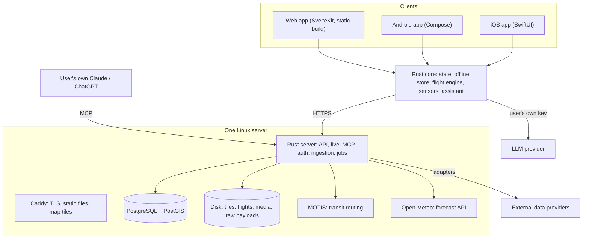

# Architecture

Last revised: 2026-11-21. Facts marked *(to verify)* come from research that could not reach the primary source and must be checked before they are relied on.

## Shape of the system



Three ideas carry the design:

1. **Rust owns everything except pixels and operating-system services.** The same flight engine runs in the phone's recorder, in the browser and on the server.
2. **Nothing outside an adapter knows a provider exists.** External data is normalised into one canonical model before anything else touches it.
3. **One server process, one database, one disk.** Extra services are added only when they are separate upstream projects (transit routing, forecast API).

## Rust workspace

Packages are named `venti-<directory>`, for example `venti-domain`. Built so far: `domain`, `sources`, `sources-dwd`, `sources-geosphere`, `sources-openaip`, `sources-osm`, `sources-ffvl` (the French federation's flying sites, from data.gouv.fr), `sources-openmeteo`, `sources-basemapat` (Austria's orthophoto, and the cut along Austria's border), `sources-ign` (France's orthophotos from IGN, cut along France's border by the same cut), `outline` (a country's outline with its index, and the cut of a map tile along it, which those two share; no I/O and no provider's types), `sources-naturalearth` (Natural Earth's outlines of the countries of Europe, for a take-off's country; an asset, nothing fetched), `sources-suedtirol` (South Tyrol's weather stations), `sources-awc` (the airfields' weather reports, METAR), `sources-meteoswiss` (SwissMetNet), `sources-slf` (the SLF's IMIS stations), `sources-pioupiou` (the pilots' own wind sensors of OpenWindMap), `sources-arso` (Slovenia's automatic stations), `sources-meteotrentino` (Trentino's weather stations), `sources-arpalombardia` (Lombardy's weather stations; built and named by no region pack), `sources-dwd-radar` (DWD's rain radar composite RY), `sources-geosphere-radar` (the first step of GeoSphere Austria's nowcast INCA, as the rain radar's second layer), `hdf5` (a bounded reader for the small part of HDF5 that the two radar products' files use; no I/O and no provider's types), `regions`, `api-types`, `store`, `server`, `flight` (flight files, track summary, track views for drawing, and the live flight computer), `airspace` (the OpenAir reader, airspace queries and airspace warnings; see [airspace.md](airspace.md)), `sensors` (sentence parsers for external varios), `leagues` (what XContest and the DHV-XC take from an app: the days, the signature, the DHV-XC's upload request), `llm` and `tools` (the assistant's provider format and its tools), `mcp` (the protocol of the server's connector), `core` (the logbook on the device, the cockpit session and the assistant), `core-wasm` (the core for the browser), the iOS shell in `apps/ios`, the Android shell in `apps/android` and the web shell in `apps/web`. The rest are planned. `tools/uniffi-bindgen-swift` generates the Swift interface of `core`, and with its second program, `uniffi-bindgen`, the Kotlin interface.

```
crates/
  domain         Canonical types, units, identifiers. No I/O.
  flight         IGC read/write, vario filter, wind estimate, thermal detection,
                 glide geometry, scoring, task logic. No I/O.
  airspace       OpenAir files, airspace queries (what is here, what is near,
                 side view) and the cockpit's airspace warnings. No I/O.
  sensors        Parsers for external instrument protocols. No I/O.
  sources        Adapter traits, manifest types, registry, pipeline.
  sources-*      One crate per provider (sources-dwd, sources-geosphere, ...).
                 docs/adding-a-source.md is the guide to writing one.
  regions        Loads and validates region packs.
  store          Server persistence behind one interface: PostgreSQL with PostGIS,
                 and an in-memory twin for tests and the development mode. Holds
                 what the data sources deliver (stations, observations, airspace),
                 pilots' accounts and flights, the live tracks of flights under
                 way, and pilots' groups with their plans for a flying day.
  client-store   Client offline store (SQLite). Not built: the logbook and its sync
                 with the server live in `core` so far.
  api-types      The wire format of the HTTP API, shared by server and clients. No I/O.
  tools          Assistant tool definitions: one definition, served in-app and over MCP.
  mcp            The Model Context Protocol as a server speaks it over HTTP: reads a
                 request into what is asked, builds the answer. No I/O.
  llm            Provider clients for the in-app assistant.
  core           Client application core: state, events, view models. UniFFI exports.
                 Today it keeps the logbook: flight files in the app's storage and an
                 index beside them, kept in step with the pilot's server
                 (`account.rs`). It also runs the cockpit session, the assistant,
                 the ground from elevation tiles and every request the apps make
                 of a Venti server.
  core-wasm      The core as a WebAssembly module with TypeScript declarations
                 (wasm-bindgen). The web app's only way into Rust.
  terrain3d      Terrain and flight-replay renderer on wgpu.
  server         The server binary: ingestion scheduler, accounts, pilots' flights,
                 live tracks, map regions for download,
                 HTTP API, share pages, development mode, and the one-shot live
                 run that CI uses as its canary.
apps/
  ios/           SwiftUI shell
  android/       Compose shell
  web/           SvelteKit app
regions/         Region packs (configuration, no code)
deploy/          Compose files, Caddyfile, backup scripts
docs/
```

### Dependency rules

- Dependencies point inward. `domain` depends on nothing in the workspace. `flight`, `airspace`, `sensors`, `leagues` and `sources` depend on `domain`. Everything else may depend on those.
- A `sources-*` crate depends only on `domain` and `sources`, and on `hdf5` where its provider's files are HDF5: a reader of a file format that two providers share, which depends on nothing in the workspace and knows no provider (since 2026-11-21; `crates/sources/tests/dependency_rules.rs` holds the rule). Since 2026-11-22 it may also depend on `outline`, the cut of a map tile along a country's outline that two providers of imagery share, which depends on `domain` and `sources` and knows no provider either. No other crate may name a provider-specific type; only `server`, which assembles the registry, depends on the provider crates.
- `api-types` and `store` depend only on `domain`. The wire format must stay usable in a browser and on a phone, and the store must not know how data was fetched.
- `server` may depend on `flight`: what it says about an uploaded flight is worked out by the code the apps run on the device. It may depend on `tools`: its connector offers the tools the app's assistant has, from the one definition. It never depends on a crate made for the apps alone (`core`, `core-wasm`, `llm`, `sensors`).
- `tools` depends on `domain`, `api-types`, `airspace` and `flight`: the last for the thermal estimate its forecast tool gives, which is the flight engine's and so the apps'. `mcp` depends on no other crate of the workspace, and only `server` uses it. Neither is built from anything that can open a connection, here or outside the workspace.
- Nothing a client is built from reaches a server-side crate: `core`, and every crate that depends on it, never depends on `store`, `server`, `sources`, `regions` or a provider crate, not even through another crate.
- `flight`, `airspace`, `sensors` and `leagues` do no I/O and read no clock. Time, positions and bytes are passed in, which makes every algorithm replayable from recorded data.
- UI shells contain no business rules. If a shell needs an `if` about flying, the logic belongs in `core`.

The test `crates/sources/tests/dependency_rules.rs` enforces the first two rules on every CI run by reading the crate dependency graph. It also fails if anything other than `server` depends on a provider crate, if `api-types` or `store` grows a workspace dependency besides `domain`, if a client crate can reach a server-side one or a server-side crate depends on one made for the apps alone, and it holds `core-wasm` to depending on `core` alone. `flight`, `sensors` and `airspace` are held to `domain` alone. For `mcp` and `tools` it reads the lock file as well and fails if either can reach an HTTP client, a socket library or the runtime such code needs.

## Clients

### The bridge

| Target | Mechanism |
|---|---|
| Swift, Kotlin | UniFFI (0.32 at the time of writing) |
| Web | wasm-bindgen (0.2.130 at the time of writing), in the crate `core-wasm` |

The core follows the one-way pattern used by Proton Mail, Bitwarden and the Crux framework: the shell sends events in, the core returns a view model, and the shell performs the side effects the core asks for (network, storage, sensors). We adopt the pattern, not the Crux framework, to keep the dependency surface small.

Bridge rules:

- The interface is coarse. A screen gets one view-model struct, not twenty getters.
- Per-frame and audio paths never cross the bridge. The vario tone is synthesised natively from a value the core updates a few times a second. Instruments are drawn natively from a snapshot struct.
- One error type crosses the bridge.

What the Phase 0 spike showed (2026-11-18, UniFFI 0.32, Xcode 26.6, Swift 6.3):

- The generated Swift interface compiles in Swift 6 language mode without changes. Records are `Sendable`, the core object can be shared across tasks, and Rust errors arrive as a Swift error with a readable message.
- The core is packaged as one XCFramework of static libraries (device, simulator, Mac) inside a local Swift package. The Mac slice lets the bridge tests run with `swift test` in seconds, without a simulator.
- The module map must be generated with the module name the generated Swift imports (`venti_coreFFI`); the generator's default name does not match.
- Not yet exercised: async functions, callbacks from Rust into Swift, and a physical device. UniFFI's own notes say async code does not yet conform to `Sendable`.

What the Android build showed (2026-11-19, UniFFI 0.32, Kotlin 2.4, Android Gradle plugin 9.5):

- The Kotlin interface is generated at build time by a Gradle task, from a build of the core for the build machine, and compiled with the app. Nothing generated is committed. The same library lets the unit tests call the real core on the JVM through JNA, in seconds and without an emulator: the counterpart of the Mac slice above.
- For the phone, `cargo ndk` builds `libventi_core.so` for `arm64-v8a` and `x86_64`, driven by a second Gradle task. Both tasks run again only when something under `crates/` has changed.
- The generated Kotlin did not compile as it came. The core's error carries its text in a field called `message`, and a Kotlin exception already has a property of that name. The generator's own rename setting (`apps/android/uniffi.toml`) calls the field `reason` on the Kotlin side; the core is unchanged. A new kind of error in the core needs a line there, and the build fails until it has one. A UniFFI "flat" error would give Kotlin the text as the exception's message and need no rename; that is a change to the core's interface and has not been made.
- A Rust error's text therefore reaches Kotlin as `reason`, not as the exception's message, which describes the fields. The app reads it through one extension, `pilotMessage`.
- Not yet exercised, as on iOS: async functions and callbacks from Rust into Kotlin. Not exercised at all: a physical device.

There is no first-party generator that covers WASM, so the web has its own binding crate, `core-wasm`. It is thin. The view types are the core's own: built with its `wasm` feature, the core derives their TypeScript declarations from the Rust definitions (with `tsify`), doc comments included. Only the list of calls exists twice, once for UniFFI and once for wasm-bindgen. A failed call throws a JavaScript `Error` whose message is the core's and whose name is the kind of error. BoltFFI would unify the two bindings but is young.

### Storage

The core keeps whole files under short names (`flights/<id>.igc`, `logbook-index.json`) and reaches them through one small interface, `Storage`: list a folder, read a file, write one, remove one. What makes two files the same flight, the index, summaries and totals are built on top of it and are the same code on every platform. There are two implementations:

- `DiskStorage` is a folder the app owns. The phones use it. The files are where they were before the interface existed.
- `StagedStorage` is for a host that can only store things asynchronously, which is every browser, while the core's interface is synchronous. It knows the names of the stored files and holds none of their contents. A read of a file that is not in memory fails and notes the file as wanted; the host fetches it, hands it over and makes the same call again. Writes and removals are staged, and the host applies them to its own store after the call, all together. What the host handed over is dropped once the call has succeeded.

This is the one-way pattern above applied to storage: the core decides what is stored, the shell does the reading and writing. It also keeps a long logbook out of memory. Opening needs the index only, and a flight's file is fetched when that flight is opened. A lost index is rebuilt a few files at a time.

One suite of tests runs against both implementations (`crates/core/src/storage.rs` and `crates/core/src/logbook.rs`). How the web app stores the files is under [Web](#web). The cockpit's recorder is not behind this interface: it appends to a file in the data folder and exists only on the phones.

### iOS (first target)

- SwiftUI, minimum iOS 26, iPhone in portrait for now. The Xcode project is generated from `apps/ios/project.yml` by XcodeGen and is not committed, so every project change is a readable diff. How the app looks and why is in [design.md](design.md).
- The shell holds no flying logic. One `Core` object is created at launch with the app's data folder; screens ask it for a view (`LogbookView`, `FlightView`) and draw it. Storing flights, recognising a flight that is already there, totals, grouping by year, climb rates and the reduced altitude profile are all the core's work.
- UI tests drive the real app on a simulator and keep a screenshot of every screen; the iOS workflow publishes them. This is how an AI session sees its own interface changes.
- Live wind follows the one-way pattern. For each thing a screen wants from the server the core has a pair of plain functions (`crates/core/src/wind.rs`): one says which path to ask for, one reads the answer into a view, with the wire format of `venti-api-types`. The shell does the request in between. The app asks for the stations of somewhat more than the map shows whenever the map comes to rest outside what it already has, and again every minute while the map is on screen. The age of a reading is measured against the server's clock, which the app reads from `/v1/health`, not against the phone's. The server's address is built into the app since 2026-11-21 (`VENTI_SERVER` in `apps/ios/project.yml`, read from the Info.plist in one place): a Debug build asks the Venti on the Mac it was built on, and a Release build cannot be made until Venti has a public address. Before that day the pilot typed an address in the settings. The UI tests run against `venti-server dev` on the same Mac.
- The cockpit's sensors live in `apps/ios/Venti/Fly`: positions from Core Location (best accuracy, airborne activity type, background updates with a `CLBackgroundActivitySession`), pressure from `CMAltimeter`, an external vario over Core Bluetooth, and the vario tone synthesised sample by sample in an `AVAudioSourceNode`. The app declares the location, audio and Bluetooth-central background modes. To verify on a real iPhone, none of it can be exercised on a simulator: that recording survives hours in the background, that the vario connects and reconnects, and that the tone sounds right.
- The vario is chosen in the app, from a list of every Bluetooth LE device nearby. On a device with one of the known serial services the app listens to that service; on any other it listens to everything the device notifies outside the standard Bluetooth services, and the core keeps whatever is a sentence it knows. That is how a vario whose service nobody has documented (the owner's MipBip) can work without a driver. The vario list shows what the connected device offers and the last lines it sent, and can share that as a report, so an unknown device can be worked out from one test.
- The pilot's name, glider and sound setting are kept in the phone's own settings store, not in the core: they are preferences of this device until accounts exist. The names are passed to the core when a recording starts.
- Map: MapLibre Native (7.0), wrapping `MLNMapView` directly. The SwiftUI wrapper is pre-1.0 and incomplete.
- Recorder: Core Location with a `CLBackgroundActivitySession` and `CLServiceSession` started in the foreground. Apple's guidance and a 2026 developer-forum thread both point to missing sessions as the cause of suspension about a minute after backgrounding.
- Barometer: `CMAltimeter`. The update rate is undocumented and reported at about 1 Hz, which is too slow for a responsive vario on its own.
- External vario over Core Bluetooth with the `bluetooth-central` background mode and state restoration. This is the primary vario source for the owner's setup.
- Vario audio through the background audio mode. It is real audible content, which is what App Review requires.
- Live Activity for a running flight. The system ends a Live Activity after eight hours, so long flights need a restart strategy.

### Android

Built 2026-11-19 with the same sections as the iPhone app; `apps/android/README.md` says how to build it, and `apps/android/AGENTS.md` what has not been tried. It has run on an emulator in CI and on no phone.

- Kotlin and Jetpack Compose with Material 3, one module, minimum Android 8 (API 26), built against Android 17 (API 37). The Gradle wrapper pins Gradle and checks its download; library versions and their licences are in `apps/android/gradle/libs.versions.toml`. How the app looks and why is in [design.md](design.md#android).
- The shell holds no flying logic, as on iOS. What it holds for the life of the process (the logbook's model, the flying session, the vario link) belongs to the application object, not to a screen: Android rebuilds screens whenever it likes, and a recording has to carry on through that. Screens draw what these models hold as Compose state.
- No Google Play Services anywhere, so the app can be distributed through F-Droid: positions come from Android's `LocationManager` and its satellite receiver, and the map's own position marker uses MapLibre's built-in engine over the same manager. The UI tests run on an Android image without Google's services, which checks it on every push.
- Map: MapLibre Native Android 13.7, wrapped directly in a Compose `AndroidView`, in its OpenGL ES build. The library's default build draws with Vulkan, which not every phone from Android 8 on has and which the CI emulator would draw in software. To verify: Vulkan on the phones pilots fly with.
- The shared style is prepared as on iOS and handed to the map as text. The label fonts and the demo region ship inside the app as assets and are copied into the app's storage once per installed version: the map engine reads a tile archive in pieces by position, which it can do with a file and not with an asset.
- The cockpit's sensors live in `apps/android/app/src/main/kotlin/fly/venti/app/fly`: positions from `LocationManager` (satellite provider, one a second), pressure from `SensorManager` (twenty readings a second), an external vario over Bluetooth LE with the same rule for which characteristics to listen to as on iOS, and the vario tone synthesised sample by sample into an `AudioTrack`. Each sensor reports on its own thread straight into the core's session.
- Android reports altitude above the WGS 84 ellipsoid, where iOS reports it above sea level, which is what the core asks for. The shell converts: with the system's own converter from Android 14, and before that with the geoid height the satellite receiver states in its NMEA output. Without either, the ellipsoid height is passed on, about 45 to 50 m too high in the Alps.
- Recorder: a foreground service of type `location`, started while the cockpit is on screen, with a notification and a partial wake lock. It does nothing but keep the process alive and awake; the sensors and the session are the process's. If Android ends the process, the core's recording file is adopted at the next launch. Android 17 applies the same visibility rule to background audio *(to verify: that the tone keeps sounding with the screen off)*.
- The pilot's name, glider, sound setting and remembered vario are in the app's `SharedPreferences`. Cloud backup is switched off for the app, because it tells the pilot that flights stay on the phone; a direct transfer to a new phone is allowed from Android 12.
- The app's requests to servers, the assistant's and the wind map's, leave from one place (`Http`), with the platform's `HttpURLConnection`: no cache, no cookies, and no redirect is followed. What to ask and how to read the answer is the core's. When the assistant's model looks up live wind, the core names an address on the pilot's Venti server and the shell fetches it like the map does, without the key or the question; a server that cannot be reached is told to the model, not shown as an error. The assistant's key is encrypted with a key that lives in the Android Keystore and never leaves it, and only the result is written to the app's own storage. In tests the provider is a script and the key a value in memory.
- Live wind is the iPhone's in substance: the server's address is built in (the Gradle property `venti.server`, `BuildConfig.VENTI_SERVER`; a debug build asks the Venti on the machine it was built on, as an emulator reaches it); the server's own clock, read from its health answer, is what ages are measured against; stations are asked for the box in view and a quarter more, once the map rests, and again every minute while the map is on screen and the app in front; they leave the map after fifteen minutes without an answer. How a station is marked (arrow, calm or too old, its heading and its numbers) is the core's, with every station; the app keeps the colours, the sizes and the pictures the map places and turns.
- Requests without encryption: Android's network security configuration can allow them for named hosts or for all, not for "the pilot's own network". It allows all, and `Http` refuses every address that is not HTTPS unless its host is this device, a name without a dot or ending in `.local`, or a private, link-local or unique-local address. The map engine's own requests go to the HTTPS addresses in the style.
- Flight files arrive through the system's document picker, through "Open with" (Android knows no type for IGC files, so the app registers for the types other apps use for them and for names ending in `.igc`) and through "Share". A flight's file leaves through a `FileProvider`. A whole folder is picked in the system's folder picker and read through the document tree it grants, with the platform's own calls and no library: every name ending in `.igc` in it and in the folders inside it, eight levels deep at most, hidden entries left out, oldest name first. Listing a folder and importing run in the app's own scope, away from the screen, so an import carries on when the pilot leaves the logbook; the model counts the files for the screen and reads the list again after every twentieth. The UI test for it shares 22 flights to the app, one of them a named pipe the test fills when it has taken its picture: the count then stands still at a known number on any device.
- UI tests are Compose tests that drive the real app on an emulator and keep a screenshot of every screen in both appearances; the Android workflow publishes them, and the debug build of the app. For the wind map the workflow starts `venti-server dev`, which the emulator reaches at `10.0.2.2`. The unit tests play the server with the answers the server's own tests keep in `crates/server/tests/golden`, so a change to the API that the app cannot read fails here too.
- Map labels: the app ships a font file for every range of Unicode's first 65,536 characters, taken with the demo region from the iOS app's resources; a unit test counts them. An airspace's names have a source apart from its outlines, because a name from a pilot's file can still hold a character from beyond those.
- Airspace is the iPhone's in substance: the core keeps the pilot's OpenAir files, reads them into one index, gives a map the airspaces in view and the session the warnings, worded. The shell draws them on the map tab (not when zoomed out past six degrees of longitude) and around the glider in the cockpit (about 40 km, drawn again every 10 km flown), shows the most urgent warning, passes on "seen" and "does not apply today", and says a new warning aloud with Android's `TextToSpeech`, in British English like the words. To verify: speech on a real phone, with the screen off, and over the vario's tone.
- Airspace from the pilot's server is the iPhone's too ([airspace.md](airspace.md)): the core says when it is due, what to ask and how to keep the answer; `AirspaceModel` sends the request through the app's one place for requests, to the server the wind comes from, when the map has come to rest on a place less than four degrees of latitude high and when a flight has its first position. The request runs in the app's own scope, not the screen's, so an answer is kept when the pilot has moved on. A server that failed is left alone for five minutes. The pilot's choice not to use the server is a preference of the phone, under the iPhone's name. The cockpit's map works out the zoom that shows the airspace of the loudest warning as the iPhone's does, from the map's size in density-independent pixels (`CockpitMap.zoom`, with a unit test). To verify on a phone: a country's whole airspace (a megabyte to read and to write) on a slow phone. A finished flight is checked by the core against the same set (`Core.flightAirspace`); the flight screen asks when it opens and again when the set changes, draws the airspace around the flight under its track, and lists the stretches inside.
- Flying sites are the iPhone's in substance (`apps/android/app/src/main/kotlin/fly/venti/app/sites`): asked of the pilot's server once the map has rested on a part no wider than 0.8 degrees of longitude, for half as much again on every side, used for an hour and not stored; the core says what to ask and reads the answer into what the screens show, words included. They are one source and one symbol layer between the flights and the wind, from zoom 9, with signs the app draws from its own icons at the screen's density. A tap goes to a wind station first where a station and a site lie under the same finger. Keeping a site as a waypoint is the core's `add_waypoint`. The wind measured near a site is the core's `stations_near` over the stations the wind model holds for the map, so a station outside the map and its margin is not listed. The sites of another server, or of none, are dropped at the map's next move. The unit tests play the server with its own recorded answer for `/v1/sites`.
- The forecast of a place is the iPhone's in substance (`apps/android/app/src/main/kotlin/fly/venti/app/forecast`): `WindModel.forecast` asks the pilot's server, for a site, a station or a place pressed on the map (MapLibre's long-click listener), and asks again every five seconds, seven times at most, while the server answers that it is still fetching; the core reads the answer into models, days and hours, with the phone's own offset from UTC for where a day begins. `ForecastRows` lays one day of one model out as rows of cells, as the iPhone's `ForecastTable` does, and words what stands around the table. Which rows a table has and what they are called is therefore written twice, in Swift and in Kotlin; a third shell is the moment to move it into the core. The unit tests read a canned answer in the server's format and the server's own recorded one.
- The account is the iPhone's in substance (`apps/android/app/src/main/kotlin/fly/venti/app/account`): the core hands out each request and reads the answer, `AccountModel` sends it through the app's one place for requests, with the token only where the request asks for it, and runs the sync as the core's loop of steps, every step off the main thread. A sync runs after signing in, when the app comes to the front (at most once a minute), after the number of flights in the logbook has changed by anything but a sync, and when the pilot asks; only one the pilot asked for reports a failure. Sign-in, sync and sharing run in the app's own scope, so leaving a screen cuts none of them short. The session token is sealed under a key in the Android Keystore (`SealedStore`, which the assistant's key uses too, each under a key of its own) and kept in a preferences file that no backup takes and that stays behind when the app's data moves to a new phone; a phone that knows the account and has no token says that it was signed out. This phone's name in the account's list of devices is its maker and model, not the name the pilot gave it. Changing who may see a flight is a `PATCH`, and deleting the account a `DELETE` with a body. Android's `HttpURLConnection` is asked to send both; the UI tests do both on an emulator against the server's development mode, and that is the only check there is, because the class of the same name in desktop Java refuses `PATCH` (tried on Java 21) and the unit tests do not send through it.
- A task is the iPhone's in substance (`apps/android/app/src/main/kotlin/fly/venti/app/task`, and `TaskStrip.kt` beside the cockpit): the core reads, keeps and measures it and makes a route of waypoints; `TaskModel` hands it the text of a file, of the clipboard or of a file another app opens with Venti (told from a flight file by its name, `.xctsk`). When a session starts, `FlySession` gives the core's session the kept task, on the day of the flight, which for a replay is the day it was flown; with every refresh it asks where the flight stands in it and says each of the core's task events aloud once, through the voice that speaks the airspace warnings. The cockpit's map draws the cylinders from the task's outlines, the next one heavier, and the way still to fly, in two sources of their own, and takes the cylinders into the whole-flight view. No QR code is drawn or read: both need a library on Android, and none has been chosen. To verify on a phone: opening a task from a messenger or a mail app, and the voice over the vario's tone.
- Sharing a flight while it is under way is the iPhone's in substance ([Live tracks](#live-tracks)). `FlySession` asks the core once a second whether a request is due; `AccountModel.carry` takes it to the pilot's server with the session token and waits twenty seconds for the answer; the answer, or word that none came, goes back to the core. The session belongs to the app's process, which the recording's foreground service keeps alive with the screen off, so the positions go out wherever the pilot looks, and no screen sends anything. The 26 bytes a link is made of come from `java.security.SecureRandom`. The audience is the setting `VentiLiveAudience`, as on the iPhone, and is taken up when a flight starts; a replay shares nothing. When the pilot ends the flight, the session first lets a request that is on its way be answered, because the core hands out nothing until then, the landing included, and then tells the server of the landing and goes on with positions that still wait from a gap in the network, a batch every quarter of a minute, for a minute and a half at most. That runs in the app's own scope after the service has stopped: Android may end the app before it is done if the pilot leaves it at once, and the track then goes quiet instead of landed. To verify on a phone: that, and what a battery saver does to requests sent with the screen off.
- Who is in the air is the iPhone's in substance (`apps/android/app/src/main/kotlin/fly/venti/app/live`). `LiveModel` asks the pilot's server for the gliders of the part of the map in view once the map rests, a quarter more on every side, and again every fifteen seconds while the map tab is on screen, through the app's own networking, which keeps no answer; a map wider than six degrees asks for nobody. A glider's age is the server's at the moment of its answer plus the time since on the phone's clock, put into words by the core when the screen is drawn: nothing ticks between two answers. While a glider's page is open, a coroutine of that page follows the flight with the core's `LiveFollow`, every ten seconds, and ends with the page. The overview map draws the track with the layers of a flight's line, in a source of its own, and fits it once into the part of the map above the page. To verify on a phone: tapping a glider among wind arrows and site signs.
- The ground is the iPhone's in substance (`apps/android/app/src/main/kotlin/fly/venti/app/terrain/TerrainModel.kt`). The model asks the core which tiles to have around the glider (`Terrain.tilesWanted`), takes each from its folder in the app's files outside the backup where it has it, else from the tile server the map's style names (`MapStyle.Online.TERRAIN_TILES`) with the app's own networking, hands the bytes to the core (`addTile`) and keeps them as `z-x-y.webp`, written beside and moved into place so that a tile cut short is never taken for a whole one. A round ends at the first tile that gets no answer at all: without a network the others would not come either. When the map is drawn from the region that comes with the app, that region's `terrain.pmtiles` is read once (`addArchive`) and nothing is fetched, which is how the unit tests and the UI tests have ground without a network. `FlySession` hands the terrain to the core's session at the start (`useTerrain`) and asks for the ground around the glider with the first position and every ten seconds after; reading, decoding and writing run off the main thread. What the cockpit then says, the height over the ground, a ridge in the way of a glide, a landing with nothing in the way, is the core's. So is the edge of what a straight glide reaches (`FlightSession.glideRange`, asked with the score once a second and drawn by `CockpitMap` as one closed line, `rangeFeatures`), and so is the side view (`FlightSession.airspaceAhead`, asked with each refresh while its sheet is open): `AheadSheet.kt` draws the record it is given, and works out only where the glider's line ends in the picture, as the iPhone's view does.
- A flight of the logbook is replayed from its own file: `LogbookModel.fileText` hands the text the core keeps to `FlySession.startReplay`, at one of three speeds. It is the session a replay of the sample flight uses, so nothing is recorded, and the core refuses to share what is replayed. A replay moves on by the time since the last refresh, and by two seconds of the clock at most (`FlySession.replayStep`): after the app was held for longer it carries on where it was, as on the iPhone.
- The landing within reach is the core's (`FlightSession.landingOption`, `reach`). The session asks once a second with the pilot's waypoints whose kind is landing, and the list of places to fly to asks for the reach of the places it shows with every new position. The shell words a height to ten metres and takes one of three tones from the core's `Reach` (`fly/Reach.kt`); it compares no heights and knows no margin. The amber and the red of everything that warns over a map, the airspace banner included, are now two colours in `Palette`.
- Groups and their plans are the iPhone's in substance (`apps/android/app/src/main/kotlin/fly/venti/app/groups`). `GroupsModel` holds the board the server last gave and nothing else: it asks the core for each request, hands it to `AccountModel.answer`, which sends another part's request to the account's server with the session token and throws where the phone is signed out or no answer came, and lets the core read the answer. The board is asked for from the pilot's own today, which the phone knows and the server does not, when the sheet opens and after every change; what went wrong comes back in the account's words (`GroupsModel.attempt`). The pages are one sheet with a path of its own (`PlansSheet.kt`, `GroupsPages.kt`); what a day is called, how a time is written and what each thing done to a group means are in `PlanWords.kt`, apart from the screens, for the unit tests.
- Everyone's flights are the iPhone's in substance (`apps/android/app/src/main/kotlin/fly/venti/app/community`). `CommunityModel` asks the pilot's server with the core's path, keeps the pages it was given, and asks for the next when the last row of the list is drawn. A flight is opened by fetching its file, which the core prepares as it prepares one of the logbook's (`flightFromFile`, `flightAnalysisFromFile`) for the flight screen's own map and panel; the bytes are held for that screen and written nowhere. A pilot's page (`pilotPagePath`, `pilotPage`) is kept in the model as well, so that it is there when the pilot comes back to it from one of its flights. Every flight a list has shown is remembered by its identifier while the app runs, and the one that is opened is looked up there, whichever list it came from. Where the pilot is, is kept by that identifier alone: when Android has ended the app in between, the lists are gone, and the route leads back. A report is the core's as well (`reportForm`, `reportRequest`, `reportSent`): `ReportSheet` shows the form, and `AccountModel.report` sends the request to the account's server with the session token, from the app's own scope so that it goes on when the form is closed, and hands back the core's line or its refusal. Nothing of a report is kept on the phone. Whether a report can be sent at all, with an account on the server the thing is on, is decided in `ReportWords.obstacle` as the iPhone decides it in its form.
- The cockpit's map is given the glider and its track as one piece of data, so it cannot draw one without the other, and is moved at an even pace to arrive as the next position is due. The thermals the glider has left, and the wind in each band of height, are the core's lists (`CockpitView.thermals`, `windsByHeight`); the shell draws the first as dots with the core's label, in a source of their own, and lists the second. The picture of the thermal being circled in is the core's as well (`CockpitView.lift`), and the shell works out nothing of it: the circle to fly, the places of the last circles and the middle are features of the glider's own source, each marked with what it is (`CockpitMap.liftPicture`), drawn by layers between the thermals left and the glider, the places with a layer for each band of climb, as the trail has, and a size from the core's strength; when the core gives no picture, none of it is in the source. The iPhone has three sources for them. Here the map draws each source in its own time: an emulator's screenshot showed the dots a refresh ahead of their ring and of the glider, and what cannot be drawn apart is one piece of data, as the glider and its track are. The badge's words and the way its arrow points are the core's too. So are the wind's age and the line about a wind that leaves the glider little way (`CockpitView.windAgeS`, `strongWind`): the shell shows an age from 300 seconds on, as the iPhone does, shows the line while the core hands one out, and knows no other threshold. Where to fly for an FAI triangle is the core's too (`FlightSession.faiAreas`, asked with the score): two outlines drawn dashed, unless the pilot's setting leaves them out. The whole-flight view fits the smallest box around the glider, the scored route, those areas, the take-off and the place flown to, and fits again only when something has grown out of it. To verify on a phone: how the map follows at a real flight's one position a second.
- Compose draws a UI test's frames only when the test asks for them. A test that sleeps looks at a screen frozen at the moment it fell asleep, the map included, which made the cockpit's map look as if it could not keep up with a replay. The tests' waits therefore keep asking for frames (`TestDevice.letTheAppRun`). A screenshot is the other way round: the last frame is asked for, the map is waited for until a frame it draws has all it was given (`TestDevice.letTheMapFinish`, two seconds at the most: a long track takes the emulator longer than a line of two points, and the glider then stood beside the line that starts at it), its thread is given four tenths of a second more, and no frame is asked for in between (`TestDevice.keepScreenshot`), so that the map and the numbers around it are of one moment; taken straight after the frame, a picture of a replay at twenty times its speed showed the numbers of one refresh over the map of the one before. A test's look at the screen also waits for the screen to come to rest, and gives up after a minute. The cockpit refreshes five times a second; on the emulator's software renderer a frame of it takes most of a second, more with a sheet open over the map, so it never rested and two cockpit tests failed that way in one run. In a UI test the cockpit therefore refreshes every two seconds (`FlySession.SLOW_REFRESH_MILLISECONDS`); the unit tests run it at its real pace. A replay goes on while a test looks, so what a test wants to see together during a thermal or a glide it looks for at one look (`waitForAll`), and what comes late in a flight it waits eight minutes for (`TestDevice.WHOLE_FLIGHT_SECONDS`): a replay that does not leap takes as long as the emulator needs.

To verify on a real phone, none of it can be exercised on an emulator: that recording survives hours with the screen off and what manufacturers' battery savers do to it, the altitude conversion, the pressure sensor as a vario, everything about Bluetooth, the tone, and "Open with" from real file managers.

### Web

- SvelteKit built to static files and served by Caddy. No Node process on the server.
- MapLibre GL JS 6 for maps. The Rust core runs as WebAssembly for flight analysis and the offline store.
- Pages that must unfurl in chats and be indexed (flights, sites, profiles, events) get their HTML head and a text summary rendered by the Rust server; the web app then takes over. Revisit with a server-rendered SvelteKit build if search indexing proves too thin. Built for flights: see [Share pages](#share-pages). The web app is not linked from them yet.

What exists (2026-11-19; since 2026-11-21 on SvelteKit 2.65, Svelte 5.57, Vite 8.3 and MapLibre GL JS 6.14, the newest the owner's registry mirror has, see the decision log): `apps/web` has the map tab with live wind, flying sites, the forecast for a place and who is in the air, the logbook with its statistics and with everyone's public flights beside it, and the flight screen of the iPhone app, over the same core, the pilot's account (signing in, keeping the logbook in step with the server, sharing a flight with a link), and airspace on both maps, from the server and from the pilot's files, with a flight checked against it. Since 2026-11-20 it also has the flying plans of the pilot's groups, as a section of its own, and draws a flight's altitude profile over the ground it was flown over. It has no cockpit and no assistant, and of the settings only what a browser has use for. Nothing is deployed. `apps/web/README.md` says how to build and run it, and `apps/web/AGENTS.md` how to test it.

- **Static files and nothing else.** Every page is written out at build time as its own `index.html`, with compressed copies beside it. No page needs a rewrite rule or a fallback page, so any static file server serves the app. A flight is therefore named by a query parameter, `/logbook/flight/?id=…`, not by a part of the path. The pages hold the app's frame; flights exist only in the browser and are drawn there.
- **The shell holds no flying logic.** Screens ask the core for a view and draw it, as on the iPhone. What the TypeScript does besides drawing is what the Swift does: formatting numbers, the tables of climb and wind colours, cutting a track into runs of one colour, the pictures for the symbols the core gives the wind stations, fitting a thumbnail into its box, stepping the marker along the track when a flight is played.
- **The core runs in a worker.** The page sends it calls and waits for answers (`apps/web/src/lib/core`: `client.ts` on the page, `worker.ts` in the worker, `protocol.ts` the list of calls). Nothing the core does can hold up the page, which matters for long flights. Measured in Node on the build machine, with the browser tests running beside it: the sample flight of 29 minutes imports in about 90 ms and opens in about 20 ms; a flight of eight hours, 28,800 fixes, takes about 1.3 s to import, 0.2 s to open and 0.9 s to analyse. To verify on a phone.
- **Building the core.** `apps/web/scripts/build-core.sh` compiles `core-wasm`, runs the wasm-bindgen tool in the version `Cargo.lock` names, and then removes what only the phones use. The core is one crate, and its UniFFI interface is compiled into the browser's module too: well over a hundred exported functions that no page calls, each keeping alive what it reaches (the cockpit, the recorder, the assistant, airspace). The script takes those exports out with Binaryen and lets it drop everything they held, and prints what that saved. On 2026-11-19, with the account, the sync and airspace bound for the browser, 2,194 KB became 947 KB (386 KB compressed with gzip). On 2026-11-20, with everything since bound too, the reader of elevation tiles with its WebP decoder and groups and their plans the last of it, 3,923 KB became 1,577 KB (618 KB compressed with gzip); the groups and plans are 88 KB of that. The module grows with the core, the part for the browser more slowly than the whole.
- **The label fonts and the sample flight** are the files in `apps/ios/Venti/Resources`. The repository holds one copy of each and the web build takes them from there.

#### The logbook in the browser

The core's files are kept in IndexedDB: one database, `venti`, with an object store `files` (a file's bytes under the name the core gives it, the same names as on a phone's disk) and an object store `meta` that holds one counter, the store's revision. `session.ts` and `idb-store.ts` in `apps/web/src/lib/core` are the browser's side of the [storage interface](#storage) and know nothing about flights.

| Situation | What happens |
|---|---|
| The page loads | The worker reads the names of the stored files and the revision, and hands the names to the core. The core asks for the index; a flight's file stays in the database until that flight is opened. |
| A flight is imported or deleted | The core stages the changes (the flight's file and the index). The worker writes them in one transaction and only then answers that it worked. |
| The index is missing, damaged or from an older version | The core rebuilds it from the flight files, which the worker fetches eight at a time, so memory stays bounded however long the logbook is. |
| Two tabs | Every write first checks, in the same transaction, that the revision is still the one the tab last saw, then raises it. A tab that is out of date writes nothing: it reads the store again and repeats its change, which then includes the other tab's. After a write the tab tells the others over a `BroadcastChannel`, and they read the store again and redraw. A browser without `BroadcastChannel` loses only the redraw. |
| The disk is full | The transaction fails as a whole. The worker rebuilds the core from what is stored, so the flight is not listed, and the page names the file with the reason. The rest of that import is not attempted. |
| The browser gives the page no storage (some do in private windows) | The logbook is kept in memory for the visit, and its screen says that the flights are gone when the page is closed. |
| The browser removes the site's data | Possible when the device is short of space, and in Safari after seven days without a visit *(to verify: Apple's stated policy for storage written by scripts; not tested)*. After the first import the page asks the browser to keep its data (`navigator.storage.persist()`), which browsers grant by their own rules. The imported files remain the pilot's copy until flights are synchronised with a server. |

A flight file is read as UTF-8, or as Western European text if it is not valid UTF-8, and handed to the core as text. Like on the iPhone, a file with characters outside ASCII is therefore not stored byte for byte. To verify: whether that breaks a recorder's signature check for such files; if it does, `import_flight` has to take bytes.

#### Maps in the browser

- The style is prepared from `map/style.json` as on the iPhone: OpenFreeMap for the base map, Mapterhorn for terrain up to zoom 12, with the terms and the limits given under [Maps and terrain](#maps-and-terrain). The map shows both sources' credits, written out on a wide map and folded into a button on a narrow one.
- Label fonts are served by the app. The build gives each font file a name with a hash of its contents, so the style's `{fontstack}/{range}.pbf` cannot name them; the style gives a `venti-font://` address instead and the page tells MapLibre how to answer it. The shared folder has a file for every range of 256 characters up to 65,535, most of them without glyphs; the build takes all 256 in, the small ones inside the script that names them. A font or a range that is in no file is answered with an empty font and not with an error, so a label loses those characters instead of failing its whole map tile.
- 3D terrain is MapLibre GL JS's own, on the flight screen: the same elevation tiles as the relief shading, added as a second source because MapLibre prepares a source differently for the two uses. The track lies on the ground in this view, not at the height it was flown; a replay at flown height is the `terrain3d` renderer's job.
- The end-to-end tests draw the map from the region bundled for the iPhone's tests, without the network and without a switch in the app: the test browser answers the app's requests to the two tile services from those files (`apps/web/e2e/bundled-map.ts`).

#### Wind in the browser

- **The server is the one the site is served from.** The app asks its own origin for `/v1/…`, beside its own files, as it will when one web server hands out both. There is no address to set, at build time or by the pilot, and no other origin to allow. A site that only hands out the files answers the first question, `/v1/health`, with "not found": the map then has no wind and says nothing about it, which is the iPhone app without a server address. Any other answer that cannot be used is told to the pilot in words: the core's for a server in trouble, "could not be reached" for none at all.
- **The worker sends the requests** (`apps/web/src/lib/core/wind-source.ts`). The core, which says what to ask for and reads the answer, runs there, so an answer never crosses to the page and back as bytes. The worker also keeps how far the server's clock is ahead of the device's, read from `/v1/health` at most once a minute.
- **The page keeps the wind for the part of the map in view** by the rules of the iPhone's `WindModel` (`apps/web/src/lib/wind/watch.ts`): it asks for a quarter more than the map shows, once the map has rested outside what it has, and again every minute while the map is on screen and the browser tab in front. After fifteen minutes without an answer the stations are taken off the map.
- **While developing and in the tests** Vite passes `/v1` on to `cargo run -p venti-server -- dev` on the same machine, and `/f` and `/live`, where the pages of shared flights and of live tracks are, so the app is used the way it will be served: one origin for both.

#### The account in the browser

- **The server is the one the site is served from**, as for the wind. The core remembers the account by that address, and the link to a shared flight is that address with `/f/…`; the web server in front has to pass both `/v1` and `/f` on.
- **The worker sends the requests** (`apps/web/src/lib/core/account-source.ts`). The core hands out a request and reads the answer; the worker sends it in between, without the browser's cache, without cookies, and without following a redirect.
- **The session token is kept in IndexedDB**, in the `meta` object store beside the store's revision: not among the core's files, read by the worker only, and written in the same transaction as the account the core remembers, so the two arrive and leave together. A page has no Keychain. Whatever its code can read, a script on the same origin can read, and with the server's API as it is the token has to be readable to the code that sends it. `apps/web/AGENTS.md` says what was weighed; the decision log has what the server would need for something better.
- **A sync is the core's step machine, one step to a turn.** Each step is a call to the core like any other: the files it turns out to need (the account, a flight's file to send) are fetched and the step is taken again, and what it changed is stored before the next request goes out. Between two steps the page's other calls take their turns, so the app stays usable while flights travel. A sync that is cut off has lost nothing.
- **When a sync runs** is the iPhone's rule (`apps/web/src/lib/account/model.svelte.ts`): after signing in, when the site is opened, when its tab comes back to the front (at most once a minute), after an import or a deletion, and when the pilot asks. Only one asked for by the pilot reports a failure; being offline is no news.
- **Two tabs.** Only one tab of the site syncs at a time (a Web Lock, where the browser has them); the next one waits and finds the work done. A run belongs to the core that began it: when another tab changes the store under it, the run's next step is refused, and a new run starts from what is stored. Signing in or out in one tab is seen by the others through the store, like an import.
- **Who may create an account** is in the server's health answer, and the core hands it out with the rest of that answer (`ServerStatus.registration`: open, by invite, closed, or nothing). The worker reads it with the server's clock, the account's model asks for it when the app starts, and the form for a new account shows the field for an invite code, or no form, by it.
- **Storage that fetches on request** needed three things of the core that a phone's disk never asked for: a sync step that can say "fetch this file and call me again" instead of failing or skipping (`FlightSync::start_when_fetched`, `receive_when_fetched`), a deletion that reads the account before it deletes, and an airspace set that is not built from the files that happen to be in memory.

#### Airspace in the browser

- **The core keeps it and answers for it**, as on the phones: the pilot's OpenAir files and the one answer kept from the server are files in the browser's store, and the core builds one set from them, in the worker. It reads every file once and keeps the set; a map's question is then a look-up. [airspace.md](airspace.md) has the rules.
- **The server's airspace** is fetched by the worker (`apps/web/src/lib/core/airspace-source.ts`) when the core says it is due, around the middle of what a map shows; when is the iPhone's rule (`apps/web/src/lib/airspace/model.svelte.ts`): whenever a map has come to rest somewhere, not while a request is under way, and not for five minutes after one failed. A site without a server is never asked. The pilot can switch it off, which deletes what is kept; that choice is a preference of this browser (`localStorage`), like the phone's.
- **A map asks when it has moved, not for a frame** (`apps/web/src/lib/airspace/view.ts`): once it has come to rest outside the area it has the airspace of, it asks the core for a quarter more than it shows; again when the airspace itself has changed; and not at all below zoom 7, where nothing is drawn. The shapes cross from the worker to the page as plain objects and become one GeoJSON source with five layers, under the flights.
- **A finished flight is checked by the core** against the same set (`Core::flight_airspace`, bound as `flightAirspace`), and the flight's details list what it entered. The flight screen asks when it opens and again whenever the airspace changes, as when the server's arrives a moment after the flight is on screen. Over the browser's storage the question is repeated until the flight's file and every airspace file have been handed over; it is never answered from the airspace that happens to be in memory, which would say "nothing was checked". A test in `core-wasm` and one over IndexedDB (`session.test.ts`) reload the store between bringing the airspace in and checking.
- **What a file left out, and whose the server's airspace is**, is said where the phone says it: at import, on the file's row, and with the provider's credit, licence and notice on the airspace screen. On the maps the credit is a line. The sentences about files speak of the map where the phone's speak of warnings: a browser has no cockpit.

#### Flying sites in the browser

- **Asked for, not kept**, as on the iPhone. The worker sends the request (`apps/web/src/lib/core/sites-source.ts`); the core says what to ask and reads the answer into what the screens show, words included. Nothing is stored among the core's files: the browser's own cache reuses an answer for the hour the server allows.
- **When** is the iPhone's rule with the zoom in place of the map's width (`apps/web/src/lib/sites/watch.ts`): from zoom 9, once the map has rested outside what it has the sites of, for half as much again on every side, and an answer is used for an hour. Zoomed out, the screens are shown no sites; the answer is kept for when the map comes back.
- **A layer of their own.** The sites are one GeoJSON source and one symbol layer, between the flights and the wind, with signs the app draws itself (`symbols.ts`), and their credit is a line of its own on the map. OpenStreetMap's licence is share-alike, and nothing here joins its records to other data.
- **A site without a server** has no signs and no button for them, like the wind.

#### Forecasts in the browser

- **Asked for when looked at, and not kept.** A site's page and a station's page lead to the forecast for their place. The worker sends the request (`apps/web/src/lib/core/forecast-source.ts`); the core says what to ask and reads the answer: every model by itself with its run, its grid cell and its ground, the levels named, each wind with its band and its label. The browser's own cache reuses an answer for the minute the server allows.
- **The days are cut by the browser's clock**: the worker tells the core how far that clock is ahead of UTC, as the phones tell it theirs.
- **The table is laid out in the shell** (`apps/web/src/lib/forecast/table.ts`), as on the iPhone: which days and hours are shown, the order of the rows, a height rounded to the hundred, a dot for an hour without rain, and the sentence that says what the numbers are. It is the iPhone's layout written a second time; what the values are and what the levels are called is the core's.
- **A site without a server** has no forecast and says so in the sheet; the server's own refusals (no forecast service, outside its area, busy) are shown in the core's words with a way to ask again.

#### Who is in the air, in the browser

- **Asked for, not kept**, by the worker (`apps/web/src/lib/core/live-source.ts`). The core says what to ask and reads the answer: `liveMapPath` and `liveMap` for the gliders of a box, and its reader of one track, `LiveFollow`, which lives in the worker for as long as a glider's page is open and is let go of when it closes. `crates/core-wasm` binds the three and `liveAgeInWords`.
- **Past the browser's cache, with the validator named by hand.** The server lets these answers be kept and checked again, and says "not modified" while nothing has changed. A browser's own cache would then hand the app the body it kept, with the server's clock of an earlier moment in it, and every age would start again from that moment at each question. So the worker asks with `cache: 'no-store'` and sends `If-None-Match` itself, with the validator of its last answer to the same address; the browser then hands the `304` over as it is. On a `304` the worker hands the page its last answer again under the same number, and the page keeps the moment that answer first came. A position's age is its age at the server's `time` in the last answer given in full, plus the time since by the browser's clock: what [api.md](api.md#live-tracks) asks of a client. The server is spared the full answer, which the iPhone asks for every time.
- **When** is the iPhone's rule (`apps/web/src/lib/live/watch.ts`): a quarter more than the map shows, once the map has rested outside what was asked for; again every fifteen seconds; nobody on a map wider than six degrees; and an answer that does not come leaves the gliders where they were, with their ages counting on. A followed flight is asked for whole, then every ten seconds for what arrived since, and at once while the server has more. Neither is asked while the browser tab is not in front (`model.svelte.ts`), and both are asked at once when it is again.
- **The words for an age are the core's, second by second.** The page works out each age and has the worker put it in words (`liveAgeInWords`), once a second while a list or a glider's page shows ages. Which words an age gets, and that silence is never called a landing, stays the core's.
- **On the map** the gliders are one GeoJSON source and one symbol layer above everything but the pilot's own position, with pictures the app draws itself (`symbols.ts`: the iPhone's wing and disc). The followed flight is a second source under the sites and the wind, drawn in the climb colours by the layers a logbook flight has on its own screen. Whether a glider has landed or gone quiet, and its label, arrive with it from the core.
- **The link goes to the server's page.** `/live/…` is the server's, which the web server in front passes on like `/v1` and `/f`; the web app has no route under it.
- **A site without a server** has no gliders and no button for them, like the wind.

#### Everyone's flights in the browser

- **Asked for, not kept**, by the worker (`apps/web/src/lib/core/community-source.ts`). The core says what to ask and reads the answers: one page of everyone's public flights (`public_flights_path`, `public_flights`), one pilot's (`pilot_page_path`, `pilot_page`), and one flight by its address (`public_flight_path`, `public_flight`). The browser's own cache keeps an answer and checks it with the server before every reuse, as the server asks.
- **A flight is opened in two steps**: first what the list says about it, which names the pilot and the paths of its file and of its page, then the file, which the core reads by the code that reads the logbook's (`flight_from_file`, `flight_analysis_from_file`). The result crosses to the page as a view and is gone with the page: nothing is written to the browser's store, and the logbook does not know the flight. Because the first step is the server's `GET /v1/flights/{id}`, a flight shared by link only opens the same way for whoever has its address.
- **The page keeps the list for as long as the app is open** (`apps/web/src/lib/community/pages.ts` holds the rules, `model.svelte.ts` the state): what is asked for, the pages fetched so far, and where the next begins. Another order or other days are another list, read from its top. A page that cannot be fetched leaves what is listed and says why.
- **The days are the reader's**: a day chosen in a date field is the span from its first second to the first second of the day after, by the browser's clock, handed to the core as moments. That is the offset the API's document asks a client to write.
- **Three pages, written out like the others**: `/flights/` (before `/logbook/everyone/`), `/pilots/<handle>/` (before `/logbook/everyone/pilot/?handle=…`) and `/logbook/everyone/flight/?id=…`. What is asked of the list is in the first one's query.
- **A site without a server** has no switch in its logbook, and the pages say that there is no server.
- **A place's page is two answers, kept apart** (`/places/<lat>,<lon>/`, before `/logbook/everyone/place/`). The worker first asks for the sites around the place (`site_at_path`, `site_at`: the site named in the address, or the take-off nearest to the place within a kilometre), then for the public flights and the ranking of the square a kilometre and a half to each side of the site, or of the place where there is no site (`area_around` with `FLOWN_FROM_HERE_M`, bound as `flownFromHere`). The site is shown as the map shows it, in a section of its own with its source's credit and notice; the flights and the ranking are the server's answers about the pilots' flights. Nothing of the site goes into a row, a flight or the ranking, and nothing of them into the site: the only thing they share is where on the map they were asked about. The page's title is the site's name, read from the site's answer.

#### Reports in the browser

- **Sent by the worker, from the pilot's account** (`apps/web/src/lib/core/account-source.ts`): the core hands out the request, which needs the session token, and reads the answer into the one line the form shows afterwards. What the core refuses, words missing with "Something else" or more words than a report has room for, never reaches the server.
- **The form is the core's** (`reportForm` in the browser's binding): its six reasons, the line about each, how long the words may be, and the notice that says who reads a report. The page asks for it once. `apps/web/src/lib/community/ReportSheet.svelte` lays it out and holds no rule: that nothing is sent before a reason is chosen is the one thing it enforces by itself, as the iPhone's form does.
- **Three entries, one form**: another pilot's flight (by its address), a pilot's page (by handle) and a live track (by its identifier), each handed to the form as the subject the core's request takes.

#### Flying plans in the browser

- **Sent by the worker, from the pilot's account** (`apps/web/src/lib/core/groups-source.ts`): the core hands out each request about a group or a plan and reads the answer, refusals included, and the worker sends it in between with the session token, as it sends a report. Nothing is kept: no group and no plan is among the core's files or in the browser's storage, and an invite code is held by the page for as long as its sheet is open.
- **The account is read before an answer is.** In an answer about groups the pilot is "you", a plan is "mine", a group "kept by you", and the core tells by the handle of the stored account. Over a browser's storage that file is fetched on request, and the core's readers take "not fetched yet" for "signed out": read as they are, every plan would be somebody else's after a reload. So the binding looks at the account first (`call_as_the_pilot` in `crates/core-wasm`), which makes the call fail for want of the file, and the session fetches it and calls again like for any other file. A test in `core-wasm` and one over IndexedDB (`groups-source.test.ts`) reload the store between signing in and reading the board.
- **Today is the browser's.** The board is asked for from a day on, and that day is the date of the browser's clock where the pilot is (`apps/web/src/lib/groups/days.ts`), worked out on the page and handed to the worker with the question. It is the iPhone's rule. [api.md](api.md#plans-for-a-flying-day) suggests the server's clock read in the device's zone; the two differ only where a device's clock is wrong, and the development mode's clock, which stands still, would make every day the 18th of November.
- **The rules of asking are apart from the state** (`apps/web/src/lib/groups/board.ts` and `model.svelte.ts`, as for everyone's flights): signed out nothing is asked and a board from before is put away; only the newest answer is shown, so that a board asked for before a change does not come back after it; an answer that does not come leaves the board and says why. The board is asked for when one of the four pages opens, after every change, when the pilot signs in or out, and when the tab comes back to the front.
- **Four pages, written out like the others**: `/plans/`, `/plans/plan/?id=…`, `/plans/groups/` and `/plans/groups/group/?id=…`, under a fourth section of the navigation. A plan's page reads the plan from the board, as the iPhone's does, because the server has no address for one plan; a plan that is not on the board, deleted or of a day gone by, is said to be no longer there. A group's page asks for the group with its members.
- **What the screens hold is words and layout.** Who may change or delete a plan, who keeps a group, who is in "in a line", a group's "3 members · kept by you" and every refusal arrive from the core. The page's own sentences are the iPhone's (`apps/web/src/lib/groups/words.ts`), with the questions asked before something is done to a group.
- **A site without a server** has the section and says there that groups and plans are kept by a Venti server; signed out, it says that plans need an account, and nothing is asked.

#### The ground under a flight, in the browser

- **The core reads it, in the worker** (`apps/web/src/lib/core/terrain-source.ts`, and `Terrain` in `crates/core-wasm`, bound like the reader of a live track). When a flight's screen opens, the page hands the worker the flight's bounds and its track; the core says which tiles cover the flight (`tilesCovering`), the worker fetches each and hands it over as it came (`addTile`), and the core answers with the ground at up to 240 moments of the flight (`groundUnder`). The terrain is one of its own for each flight and is freed with the answer: a tile's heights are half a megabyte, and a flight of some tens of kilometres has up to three dozen.
- **From the map's own tile server, and no other host.** The address is the one the map's style has for its relief (`ONLINE.terrainTiles` in `apps/web/src/lib/map/online.ts`), which the content security policy and the header for the workers already allow. The requests are plain ones, as the map makes them, six at a time.
- **Nothing is kept but what the browser's cache keeps.** The tile server lets a tile be kept for a week (`Cache-Control: public, max-age=604800`, seen on 2026-11-20), so a flight opened again, and the map and the ground between them, fetch a tile once. The app stores no tile and no height: the phones keep tiles on the device to have the ground without a network in the air, and a browser has no cockpit.
- **What does not come is left out.** A tile the server does not have leaves the ground under that stretch unknown (the public server answers `404`, seen on 2026-11-20; any answer but `200` is read the same way); so do bytes that are no elevation tile. A request without any answer ends the fetching: without a network the others would not come either. The page then has fewer moments or none, draws no ground where there is a gap, and reads the time in the air at the marker as before.
- **Only the newest flight is worked on.** The page numbers its questions; opening another flight, or leaving the flight's screen, lets go of the one before, and its remaining tiles are not asked for.
- **The whole track crosses to the worker and into the core.** `ground_under` takes the track and chooses the moments itself, so the shell chooses none. For a flight of eight hours, 28,800 positions, fetching apart, that and reading the ground from two tiles took about 50 ms in Node on the build machine (2026-11-20). To verify on a phone.
- **Drawn by the chart** (`apps/web/src/lib/flight/ground.ts`, `AltitudeChart.svelte`): one filled shape for each stretch the ground is known along, between the flight's own shape and its line; the height over the ground at the marker is that of the nearest moment the ground was read at, as on the iPhone.
- **A site without a Venti server** has the ground all the same: the tiles are the map's, not the server's.

#### The content security policy

- **Every page carries one**, written into it by the build as a `meta` element ahead of everything the page loads: SvelteKit's `csp` setting with hashes (`apps/web/vite.config.ts`), over the list in `apps/web/src/lib/app/security-policy.ts`. `apps/web/AGENTS.md` has every entry with the reason it is there. The policy starts from "nothing" and allows the app's own files, the two tile hosts, and `data:` addresses for images and for the label fonts the build keeps inside a script. No inline script but the one that starts the app, by its hash; no inline style but one of SvelteKit's, by its hash; no text made into code.
- **It is what protects the session token** against a script that is not the app's: such a script does not run, and a page can send nothing to a host the app does not use.
- **It does not reach the workers**, and it cannot say who may frame the site. Both need a header from the web server; `apps/web/AGENTS.md` has the two lines. The core's WebAssembly is compiled in its worker, which is why the page's policy needs no `'wasm-unsafe-eval'`.
- **The browser tests fail on anything the browser refuses** under the policy (`refused` in `apps/web/e2e/helpers.ts`), which is how the list was found and how it stays true.

#### How it is tested

Unit tests (Vitest, in Node) call the real WebAssembly core over an IndexedDB implemented in memory: reload, two tabs, a full disk, a lost index, and the page's conversation with the worker. For the wind and the flying sites they read the server's own recorded answers (`crates/server/tests/golden`), so a wire format that drifts fails here too. For groups and plans they play the server from its recorded answers too. For the ground under a flight they hand the core real elevation tiles, cut one by one from the region the iPhone app bundles (`apps/ios/Venti/Resources/MapDemo/terrain.pmtiles`), on the way the app takes them: fetched by address and added as images. End-to-end tests (Playwright, Chromium) use the built site as a pilot would, with the server in its development mode behind it, and keep a screenshot of every screen at a phone's width and a desktop's, in light and dark; the test browser answers the worker's requests for elevation tiles from that same region, as it answers the map's. The `Web` workflow runs both and publishes the screenshots. Not tested: Firefox, Safari, and any real phone.

## The cockpit

How a sensor reading becomes a number on the screen:

```
phone GPS, phone barometer, Bluetooth vario      (shell: owns the sensors)
        │  each sample with the time it was taken
        ▼
core::FlightSession                              (core: one object per flying session)
   ├─ sensors::SentenceReader + parse            bytes from the vario → readings
   ├─ flight::live::FlightComputer               pure; no clock, no I/O
   └─ Recorder                                   appends each fix to a file at once
        │  CockpitView, pulled about five times a second
        ▼
screen and vario tone                            (shell: draws and synthesises)
```

- **No clock in the computer.** Every sample carries its own time and the shell passes "now" when it asks for a view. A recorded flight replayed through the same code therefore shows exactly what the pilot saw; `core::Replay` does that, and it is how the cockpit is tried on the ground and tested.
- **Climb rate** comes from the best source that is still talking: the external instrument's own vario, else a Kalman filter over pressure altitude (the instrument's pressure if it sends any, else the phone's), else the same filter over satellite altitude. A source silent for three seconds is dropped. When the pressure sensor changes, the filter starts again, because two sensors disagree by a constant.
- **Altitude** is pressure altitude plus a slowly followed correction toward satellite altitude: as smooth as the barometer, as true as the satellites.
- **The ground** comes from the map's own elevation tiles, the ones that shade its relief (`flight::terrain`, `core::Terrain`). A tile is a square image on the web map's grid in which a pixel's colour is a height (Terrarium: red × 256 + green + blue / 256 − 32768 metres). The shell fetches tiles as WebP images, or has an archive of them in the PMTiles format, and hands the bytes over; the core decodes them and keeps the heights, a metre apart at the finest. It works with zoom 12, where a pixel of a 512-pixel tile is 13 m wide at the latitude of the Alps, asks for the five by five tiles around the glider, and lets go of those more than four tiles away. Between pixels the height is the mean of the four around. A session that was given terrain (`FlightSession::use_terrain`) knows the height above ground wherever a tile covers the glider, hands the ground to the airspace warnings, so that a limit given above ground is placed exactly and a warning is no longer "possibly", and draws the ground in the side view. Checked on the tiles that come with the iPhone app: they give the Wallberg's summit as 1,717 m (published: 1,722 m), the Tegernsee as 725 m (published: 725 m) and the sample flight's take-off as 1,621 m. **To verify:** the height above ground in the air against a landing and against known ground; what the model does over forest, cables and buildings, which it does not know; and tiles finer than zoom 12, which Mapterhorn has for some countries.
- **Wind** is fitted while circling: ground velocities around a circle lie on a circle whose centre is the wind and whose radius is the airspeed. It needs no compass and no airspeed sensor, and it does not assume the pilot flew a perfect circle over the ground. Only one unbroken stretch of turning is fitted. The glider counts as turning while its velocity over the ground changes by 0.7 m/s each second or more, which is a turn of 4°/s at 10 m/s whatever the wind. The change is taken over four seconds, each velocity against the one four seconds before, and dated to the middle of them: from one second to the next a velocity worked out from a flight file's positions, which are rounded to two metres, changes by more than that with the glider flying straight. So the fit runs two seconds behind the glider, and the stretch counts as a circle when, seen from the fitted centre, its velocities lie in ten of twelve sectors: that is the direction the glider pointed in, which goes around once per circle in any wind. The direction of travel over the ground does neither in a wind near or above the glider's speed. The circle is fitted twice: the second time without the velocities that lie more than 1.5 m/s off the first, or more than twice what they all do on average if that is more. Those are the seconds of rolling in and out, where the glider flies faster than in its circles; the fit made as the glider leaves a thermal is the one that stands for the whole glide after it. From one velocity to the next the glider is taken to have pointed at everything in between, up to a third of a circle, so that a recorder writing a position every four or five seconds, which leaves five or six to a circle, gives a wind too; a fit needs six velocities. A circle is flown one way round: of all the turning from one velocity to the next, seen from the fitted centre, four fifths must be left when left and right are set against each other. Velocities that ring a point in no order, which is what pulling up and pushing over or straight flight through rough air leaves, are no circle however well they fit one. A wind more than twice the speed the glider circled at is refused as well. A fit is refused when the velocities lie further from the circle than 2 m/s or a quarter of its radius, root mean square, and each fit carries a quality (how close they lay, times the share of the circle covered) by which it counts in the mean of its band of height.
- **Circling** uses the rule XCTrack documents (90° of turn within 30 s while not sinking faster than 0.5 m/s). It ends when the turn within 30 s drops under 30°. The turn is measured over the ground and, once a wind is known, through the air with that wind taken off, and the larger counts: in a wind stronger than the glider is fast the track over the ground swings from side to side and never comes around.
- **The thermal's picture** (`live::thermal`) is what a thermal assistant draws. Each place flown through in the last fifty seconds of a climb is moved with the wind to where its air is now, which turns the loops over the ground back into the circles flown. A circle is fitted to those places, and around it the climb as a mean and a lean (least squares, both). The middle of the lift is the circle's middle moved toward the stronger side: a full radius for a lean of 1 m/s, never more. No centre is given for less than three quarters of a circle or for places that lie further from the circle than 0.35 of its radius, which is what a wrong wind leaves. The climb shown at a place is the mean over two seconds either side; the fit takes the readings as they came. To verify in the air: the measure of 1 m/s for a radius, and that a vario's delay and a position's cancel.
- **Recording** cannot lose a track to a crash: each fix is appended to `recordings/<start>.igc` in the data folder as it arrives, and that file is a complete flight file at every moment. Stopping imports it into the logbook and removes it; one found at launch is imported then.
- **The vario tone** is described by the core (pitch, rhythm) and synthesised by the shell.
- **Airspace warnings** come from `airspace::WarningEngine`, which is fed the computer's state once a second and, like the computer, reads no clock. It is built and tested, and since 2026-11-19 the session feeds it (`crates/core/src/airspace.rs`); [airspace.md](airspace.md#feeding-the-engine-from-the-cockpit) says how.
- **The airspace that matters next** is read in the same pass, from the sample the warnings were just worked out for (`WarningEngine::proximity`, since 2026-11-21): one airspace out to 5 km over the ground, with the distance and direction to its outline, the height to its floor or ceiling, and its words, in the view as `airspace_proximity`. It uses the warnings' table and their two measurements, so the two cannot disagree about an airspace; [airspace.md](airspace.md#the-airspace-that-matters-next) has the rule by which one is chosen among several. The shells do not show it yet.
- **The course** is in the view as a number, which turns the glider's arrow, and since 2026-11-21 as words (`course_words`, "285° W"), which the core leaves out below 2 m/s over the ground: the speed under which the side view does not look along the course either.

To verify in the air: the take-off and landing thresholds, the tone table and the filter's settings are first values. None has flown yet.

## Maps and terrain

All map data is self-hosted open data, stored as PMTiles files and served as static files with HTTP range requests. The apps download the same files for offline use; MapLibre Native reads them from local storage.

Until the server exists, the iOS app fetches its tiles from two public services of the same open data, so that the map covers wherever a pilot has flown and not only the demo region:

| Layer | Service | Terms, read on the provider's page 2026-11-18 |
|---|---|---|
| Vector base map | OpenFreeMap, `tiles.openfreemap.org` (unmodified OpenMapTiles schema, the one our style is written for) | Free public instance, "no limits on the number of map views or requests", commercial use allowed, attribution required. [openfreemap.org](https://openfreemap.org/) |
| Terrain | Mapterhorn, `tiles.mapterhorn.com` | A public tile endpoint is documented on [mapterhorn.com/data-access](https://mapterhorn.com/data-access); no usage limit is stated there. To verify with the project before any public release. Attribution required. |

The app asks Mapterhorn for terrain only up to zoom 12, the level it serves for the whole world; finer tiles exist only for some countries and return "not found" elsewhere. Both services see the IP address and the map areas of whoever uses the app. This is a development arrangement, not the product: it ends when our own tile server is up, and it must end before a public release unless both projects agree. Since 2026-11-20 the same terrain tiles are also read for their heights: the 25 tiles around the glider while the cockpit is open, fetched once each and kept on the iPhone and, since the same day, on Android, and the tiles under a flight when its page is opened. That is a few megabytes per place flown at and no more requests than the map itself makes for the same tiles, but it is one more thing that depends on this arrangement, and a cockpit that knows the ground only where it has had a network; downloading a region's terrain ahead of a flight is being built: since 2026-11-20 the core reads a region's elevation archive from its file, tile by tile as the glider moves (`Terrain::open_archive`), and reads the list of regions a server hands out (`crates/core/src/maps.rs`); since the same day the iPhone app downloads a region from the pilot's server and flies with it (`apps/ios/Venti/Maps`), and the Android and the web app do not.

| Layer | Source | Notes |
|---|---|---|
| Elevation | Mapterhorn | Includes Bavarian DGM1 (1 m), Austrian BEV (1 m), swissALTI3D and South Tyrol. Used for hillshade, colour relief, 3D and height-above-ground. |
| Contours | Pre-generated vector tiles from the same elevation data | MapLibre Native has no on-device contour generator, so all platforms use the same pre-built tiles. |
| Vector base map | OpenStreetMap through a custom Planetiler profile | Starts from the OpenMapTiles profile and adds what alpine flying needs: path difficulty (`sac_scale`), material ropeways, power lines, free-flying sites. |
| Style | Our own MapLibre style | One style shared by iOS, Android and web. A high-contrast variant for sunlight in the cockpit. |
| Official maps | basemap.at, Bavarian DTK25 | Switchable raster layers, both CC BY 4.0. |
| Imagery | basemap.at orthophoto, Bavarian DOP20, swisstopo's SWISSIMAGE, South Tyrol's orthophoto of 2023, Sentinel-2 cloudless 2016 elsewhere | For the 3D viewer and the aerial view. The aerial view exists: the apps fetch the mosaic and Bavaria's, Switzerland's and South Tyrol's orthophotos from their providers ([data-sources.md](data-sources.md#the-aerial-views-photographs)). basemap.at's tiles go through the server, which cuts them at Austria's border ([below](#the-aerial-view-through-the-server)); the apps ask it for them through the shared style. |

### What exists so far

- `map/style.json` is the shared style. It names its tiles and fonts with placeholders that each app replaces with local or remote URLs.
- A small demo region (the Tegernsee valley, about 7 MB) is bundled with the iOS app under `apps/ios/Venti/Resources/MapDemo`: a vector base map, terrain tiles and label fonts. `tools/demo-map/build.sh` rebuilds it. It uses the stock OpenMapTiles profile and terrain only to zoom 12; the custom profile, contours and high-resolution terrain are not built yet.
- The iOS app prepares the style for one of two tile sources: the public services above (the default), or that bundled region. The UI tests use the bundled region, so the offline path is drawn and checked on every push. Label fonts always come from inside the app.
- Confirmed on the simulator (2026-11-18): MapLibre Native reads vector and terrain archives through `pmtiles://file://` URLs, decodes the WebP elevation tiles, and loads label fonts from a `file://` glyph URL. No network is involved.
- The Android app prepares the style the same way and takes the same files, from where the iOS app keeps them, into its assets at build time.
- Since 2026-11-20 the iOS app downloads a region from the pilot's Venti server (`apps/ios/Venti/Maps`). The two archives are fetched with range requests into `Application Support/Maps/.incoming/<id>/<version>/`, checked by the core against the size and SHA-256 the server listed, and moved to `Maps/<id>/<version>/` with a `region.json` beside them: the region as the server described it, in the server's own format, so that the app knows what it holds without a server to ask. The folder is left out of the iPhone's backup. A third source of the style, a kept region, points the shared style at those two files, and the terrain model opens the elevation archive for the core to read heights from.
- Since 2026-11-20 the server hands out map regions for download, which is its side of "the apps download the same files" (`crates/server/src/maps.rs`, [api.md](api.md#maps)). Whoever runs it keeps one folder for each region, with the region's archives and a `map.toml` that names them, their SHA-256 and their credits. `GET /v1/maps` lists the regions whose files the server has read and found to have those hashes, and a file is fetched whole or by its range of bytes under an address that holds the region's version. The files are never compressed on the way and no time limit applies to them. The bundled demo region has such a `map.toml`, and the development mode hands it out when it is started with `--maps apps/ios/Venti/Resources`. Since 2026-11-23 `tools/region-map/build.sh` builds the regions listed in `map/regions/`, from valleys to the whole Alps, all cut from one base map and one terrain archive of Geofabrik's extract of the Alps: nine were built on the owner's Mac, from 35 MB (the Bernese Oberland) to 3.1 GB (the Alps), in seven minutes in all; [running-a-server.md](running-a-server.md#map-regions) has the table. [running-a-server.md](running-a-server.md#map-regions) says where regions go and how one is renewed, and [deploy/AGENTS.md](../deploy/AGENTS.md#map-regions) what was tried and what the estimates rest on. Mapterhorn's terms for handing an extract of its tiles on to many pilots are *to verify* before a public release, like its tile service above.

### The aerial view through the server

Austria's orthophoto from basemap.at is white wherever its tiles reach beyond Austria, and a map style can stack rasters but cannot cut one along a line. So its tiles go through the server, which cuts them once and keeps the result (built 2026-11-20, `crates/server/src/imagery.rs`, `crates/sources-basemapat`; [api.md](api.md#map-imagery)):

```
GET /v1/imagery/basemap-at/{z}/{x}/{y}
        │  three plain numbers of a tile, else 404 before anything is touched
        ▼
  where does the tile lie?     beyond the border, outside the service's box
  (Austria's outline, index)   or zooms 0 to 19 ──► 204, the provider not asked
        │
        ▼
  on the disk?  ──► the kept answer
        │  no: one fetch for all who ask at once, at most four at a time,
        ▼      eight seconds, a tile over 1 MB refused
  inside ──► the provider's JPEG     on the edge ──► cut ──► PNG, or JPEG, or 204
        │
        ▼
  kept under imagery_dir/basemap-at/z/x/y.jpeg|png|none; failures not kept (502, 504)
```

- **The cut.** Austria's outline is an asset of the adapter crate: the Federal Office of Metrology and Surveying's administrative boundaries at 1:50 000, CC BY 4.0 like the photographs, joined, reprojected and simplified at 5 m (20,163 points, 437 kB of GeoJSON). Around it lies a band of 50 m on each side. A pixel inside the outline and out of the band is kept, however white; one outside and out of the band is removed, whatever it shows; one in the band is removed if it is white (every channel at least 245) and kept otherwise. A tile is placed against the outline through a grid of 256 cells over the outline's box that knows which cells the band reaches: a tile far from the border is answered from a few cells, in about a microsecond.
- **What was found in the recorded tiles.** At the Achenpass and the Brenner the provider's photograph reaches beyond the border (up to about a kilometre at zoom 12), and its white begins further out; the cut removes that photograph too, and the layer is Austria and nothing else. Over Munich the service answers zoom 10 with an all-white tile and zooms 12 and 14 with a 404, inside its own box. A 404 is "nothing here", and is kept like one.
- **The disk.** One file per answer, under the folder `imagery_dir` names, at `basemap-at/{z}/{x}/{y}.jpeg`, `.png` or `.none` (empty): the path is made of the source's identifier and the three checked numbers and nothing else. Written to a `.part` file and renamed. The folder is kept under `imagery_cache_mb`, 20 GB unless set: when a write takes it over, a sweep reads the whole folder and removes the files written longest ago until it holds a tenth less. The server sweeps once at its start, which also learns what the folder holds. A tile does not expire otherwise. Without `imagery_dir` the server passes no imagery on and every address under `/v1/imagery` is 404.
- **The development mode** answers from six tiles recorded on 2026-11-20 and with 204 for every other, so it keeps its promise of no network. `--online-imagery` lets this one route ask the provider and keep tiles in `venti-dev-imagery` under the system's temporary folder.
- **Measured** in the test build without optimisation, on the session's machine: reading the outline and building its index 63 ms, once; cutting a recorded tile 20 to 50 ms, decoding the JPEG and writing the PNG included; placing a tile against the outline about 1 µs. A cut PNG is 30 to 110 kB where the JPEG was 7 to 17 kB.

The apps ask for these tiles through the shared style since 2026-11-20 (`aerial-austria` in `map/style.json`; the decision log has the placeholder that names the server).

**France goes the same way** (built 2026-11-22, `crates/sources-ign`; no app asks for it yet, and `map/style.json` has no layer of it). IGN's orthophotos (BD ORTHO, the Géoplateforme's layer `ORTHOIMAGERY.ORTHOPHOTOS`, Licence Ouverte) are JPEG and white beyond the edge of the photographs, so they are a second source of the same route, `GET /v1/imagery/ign-ortho/{z}/{x}/{y}`, with the same disk, the same bounds on asking and the same answers. What differs is the adapter's:

- **The address** is the service's WMTS request with the layer, the style, the tile scheme and the format fixed, and the three checked numbers as `TILEMATRIX`, `TILECOL` and `TILEROW`. No key.
- **Zoom 13 to 19 only.** Up to zoom 12 the provider's layer shows the ground beyond France as well (seen over Turin), which is not IGN's aerial photography and whose licence was not found; from zoom 13 a tile beyond France is white or a 404. A coarser tile is answered with 204 and the provider is not asked. The world's mosaic is finer than a pixel of zoom 12, so nothing is lost on the map.
- **The outline** is metropolitan France with Corsica, from IGN's ADMIN EXPRESS COG of 2026 (Licence Ouverte like the photographs): the thirteen regions as the Géoplateforme's WFS gives them, joined by dropping the boundaries two regions share, simplified at 5 m where Switzerland, Italy and Monaco are and at 15 m elsewhere, islets under a hectare dropped (310 rings, 112,398 points, 2.4 MB of GeoJSON; a script in the crate that needs Python and nothing else). The band is 50 m, as Austria's. Llívia, Spain's town inside France, is a hole in it.
- **The sea and Lake Geneva are cut away.** The regions end at the shore, so the photographs end within 50 m of it and the water is the mosaic's. On Mont Blanc the outline is the border as France draws it.
- **What was found in the recorded tiles.** The photographs reach beyond the border by kilometres (a tile five kilometres wide at Veyrier is photograph on both sides), so the cut removes photograph, not white: the layer is France and nothing else. The white that begins further out is one tile of 1,651 bytes, the same over Courmayeur, Geneva and Turin; where a tile holds nothing of the photographs the service answers 404. On the ridge west of Mont Blanc's summit the snow on the border is as white as the provider's white, and the band removes 1,477 pixels of it: a glacier on the border shows the mosaic in a strip of up to 100 m. Austria's rule does the same on its glaciers.
- **Measured** in the test build without optimisation: reading the outline and building its index 0.97 s, once, at the server's start; cutting a recorded tile 34 to 187 ms; placing a tile 27 µs. With optimisation, as a server runs: 48 ms, 0.2 to 1.3 ms and 0.2 µs. A cut PNG is 30 to 144 kB where the JPEG was 10 to 20 kB.

The cut, the outline's index and the tile arithmetic were files of `sources-basemapat` and are a crate of their own since 2026-11-22, `crates/outline` (`venti-outline`: `cut.rs`, `outline.rs`, `mercator.rs`), which both adapters depend on: one rule, written once, with no provider in it. A provider's crate may not depend on another's, and `crates/sources/tests/dependency_rules.rs` holds that; `outline` is allowed to them as `hdf5` is.

**Switzerland and South Tyrol do not go through the server.** Measured on 2026-11-21: swisstopo's SWISSIMAGE, asked for as PNG, and the province of South Tyrol's orthophoto are transparent wherever they have no photograph, so their tiles lie in the style as they come, like Bavaria's, and the apps fetch them from the providers ([data-sources.md](data-sources.md#the-aerial-views-photographs)). Neither ends at its border: the photograph runs on for a kilometre and more before the tiles turn transparent. The style's order settles what shows there: the mosaic, Switzerland, South Tyrol, Austria, Bavaria, the later over the earlier, so that Austria, which the server cuts at the line, is Austria's photograph up to the line. What this costs is the weight of Switzerland's tiles, 160 to 200 kB each as PNG where the same tile as JPEG is 18 to 29 kB; the JPEG is white where the PNG is transparent and would need the cut. Should that weight or swisstopo's fair use say otherwise, Switzerland becomes a third adapter beside `sources-basemapat` and `sources-ign`: its outline from swisstopo's own boundaries, and the cut of `crates/outline`, whose rule is an outline, a band and the provider's white.

### 3D

MapLibre Native has no production 3D terrain. The work exists as a draft pull request with no timeline. MapLibre GL JS on the web does have it.

The 3D viewer is therefore our own renderer: the `terrain3d` crate on wgpu, reading the same elevation and imagery tiles. It draws a quadtree terrain mesh with draped imagery, track ribbons and pilot markers, with a free camera. It embeds in a Metal layer on iOS, a surface view on Android and a canvas on the web (WebGPU, with a WebGL2 fallback because Firefox on Linux and Android still lacks WebGPU by default).

This is the largest single piece of custom engineering in the project. It is confined to replay and route preview; the cockpit and planning maps are 2D with hillshade and contours and do not depend on it. Revisit when MapLibre Native ships terrain pre-releases.

### Live overlays

MapLibre Native slows down with around a thousand symbols that use sort keys and halos. Overlay rules: few symbol layers, no sort keys, feature-state for updates, and a custom layer for objects that move every second (live pilots).

## Server

Everything runs on one Linux server under Docker Compose.

The server is a data platform first (owner decision 14 of [plan.md](plan.md#owner-decisions)): what pilots make is stored as data with its author, its times and its licence, and is read and written through the documented API by programs that are not Venti's apps. [data-platform.md](data-platform.md) has the principles a new endpoint or table is judged by, what the server holds and every way in and out of it as of 2026-11-21, and the pieces that are missing.

| Process | Role |
|---|---|
| Caddy | TLS, static web app, PMTiles, media files |
| `server` (Rust, Axum) | REST API, live tracks, MCP endpoint, authentication, ingestion scheduler, background jobs, map regions for download. One binary; roles can be split later with flags. |
| PostgreSQL + PostGIS | The only database |
| MOTIS | Public-transport routing, self-hosted with open timetable feeds |
| Open-Meteo | Forecast API, self-hosted, syncing open model data |

Deliberate omissions: no Redis (live tracks are rows in PostgreSQL that clients ask for; the job queue is a Postgres table), no WebSocket ([Live tracks](#live-tracks) says why), no object store (blobs live on disk behind a small trait, so an S3-compatible store can replace it), no search engine (Postgres full-text and trigram), no Node runtime, no managed services.

### What the server does today

The server collects station observations, airspace and flying sites and serves them, it answers point forecasts from an Open-Meteo instance of the operator's when it is told where one is ([Forecasts](#forecasts)), it makes a thermal map of the kind of day over its regions from that instance with each run of ICON-D2 ([The thermal map](#the-thermal-map)), it keeps pilots' accounts and flights, it takes the positions of flights under way and shows them to those their pilots let see them ([Live tracks](#live-tracks)), it takes pilots' reports about what is shared and lets whoever runs it take things down ([Reports and taking down](#reports-and-taking-down)), it keeps the groups pilots make and the plans their members post for a flying day ([Groups and plans](#groups-and-plans)), it hands out the map regions that whoever runs it put in a folder, for apps to draw without a network ([Maps and terrain](#what-exists-so-far)), it passes on Austria's and France's orthophotos cut at their borders and keeps their tiles on its disk ([The aerial view through the server](#the-aerial-view-through-the-server)), it collects the rain radar of its regions and keeps the last two hours of it in memory as pictures ([The rain radar](#the-rain-radar)), and it answers a pilot's own assistant over MCP at `/mcp` ([mcp.md](mcp.md)). MOTIS is not built.

`venti-server` is one program with these subcommands:

| Subcommand | What it does |
|---|---|
| `serve` | Runs the server: collects the sources of the configured regions on their schedule, keeps accounts and flights, stores everything in PostgreSQL, serves the API and the share pages, hands out the map regions of its maps folder, removes old data |
| `dev` | Serves the same API over payloads recorded from the providers, a demo account with three flights and three live tracks, two further pilots with three flights each, and two groups with four plans for a flying day between them, from an in-memory store. No network, no database. Its clock stands still at the moment of the recording, so every start gives the same answers. With `--maps FOLDER` it also hands out the map regions of that folder, as `serve` hands out those of its `maps_dir`. Map imagery comes from thirteen recorded tiles, six of Austria and seven of France; with `--online-imagery` that one route asks the providers over the network. For client work and UI tests |
| `ingest <region.toml>` | Runs a region's sources once against the live providers, those of observations, of airspace and of flying sites, and prints a health line for each. A forecast source is asked for the forecast of the middle of the region, if `VENTI_OPEN_METEO_URL` says where it is, and passed over if not. Stores nothing. CI runs it daily as the canary, from the image a server runs |
| `invite` | Makes invite codes for a server that takes accounts by invite, and prints them |
| `reports`, `close-report` | Lists what pilots reported, with who reported it; closes a report with a note. See [Reports and taking down](#reports-and-taking-down) |
| `take-down`, `release` | Makes one flight private against its pilot's setting and keeps it so; lets it go again |
| `remove-live-track` | Removes one live track and retires its identifier |
| `suspend-publishing`, `resume-publishing` | Takes from an account the ability to make a flight or a live track public, without deleting anything; gives it back |
| `group`, `rename-group`, `remove-plan`, `remove-group` | Shows one group as its members see it; gives it another name; removes one of its plans; removes the group with everything in it. To the members each is the keeper's or an author's own doing |
| `site`, `revert-site`, `remove-site` | Shows one site that pilots made with its history; puts it back to an earlier revision, also when it is taken down; takes it down, so that its address answers that it is gone and only whoever runs the server brings it back. See [running-a-server.md](running-a-server.md) |
| `derive` | Reads one flight file and prints what the server works out from it. The server runs this itself, as a child process, for every upload; see [Flights](#flights) |

**Collecting.** Each source has one task that runs it, waits and runs it again; that loop is what guarantees a source never runs twice at once and that a slow source delays no other. A run goes through the pipeline of the `sources` crate (fetch, archive, parse, merge, validate); the validated records and the outcome of the run are then written to the store in one transaction. The wait is measured from the start of one run to the start of the next and is never shorter than the source's cadence, which is what keeps the server inside a provider's hourly request limit. A random delay of up to a tenth of the cadence is added. After a second failed run in a row the wait doubles each time, up to an hour. A restarted server reads the run history and waits out what is left of the cadence. Except where the plan grew: a source whose stored set says where it is whole (airspace, sites, cables) runs at once when that is less than the plan now asks for, provided its latest run was healthy; after a failed one the wait above holds. A run takes the last three hours from each payload, so values that a provider publishes late still arrive and a short database outage heals itself.

**Fetching.** Every request to a provider leaves through one fetcher, which keeps to bounds of its own whatever an adapter or a provider's answer asks: HTTPS only, except to the addresses the server's configuration names with `http://`; no redirect to another host; no answer larger than the source's manifest allows, read in pieces and not taken into memory whole; ten seconds to connect and two minutes for a request. [data-sources.md](data-sources.md#what-the-fetcher-will-not-do) has the details and what a new source declares.

**Collecting airspace** uses the same loop, with one source so far: openAIP, once a day, one file for each of the ten countries the box of the three Alpine regions reaches into (eight, those of the first region's box, until 2026-11-22). What differs is what a run is. It delivers the whole airspace the source has for the server's regions, and that set replaces the one stored before, in the same transaction that writes down the run. It does so only if the run was healthy, which for airspace means that every request worked. A run that could not fetch one country's file changes nothing: half an airspace set is worse than yesterday's whole one, because a pilot is not warned about airspace that is missing. The store holds to that rule itself, whoever calls it. A failed run is tried again a day later, by the rule above that no wait is shorter than the cadence.

Every airspace carries the date of the file it was read from. openAIP's files have no date inside, so the pipeline takes the date its file store puts on each file (the `Last-Modified` of the response), and the time of the run where a provider gives none. On 2026-11-19 a live run dated the Austrian airspace 01:12 UTC and the German 01:57 UTC, which is when openAIP had written the two files.

**Collecting flying sites** is the same loop and the same kind of run: once a day the server asks an Overpass API instance for every place in its regions' box that carries OpenStreetMap's free-flying tags, with its tags and its geometry, in one request, and the set replaces the stored one if the request worked and the instance finished its query. The set is dated by the instance's own word for how old its copy of OpenStreetMap is. Which instance is asked is a setting (`overpass_url`). The server has not yet run this against the main public instance: *to verify* on the first installation.

**Sites that pilots make** (2026-11-21) are no source's set and no run: they are records of the server's own, the first data of the community's that is given to everyone ([data-platform.md](data-platform.md#take-offs-and-landings-made-by-pilots)). A site has an identifier of the server's making (`venti:` and 26 characters) that is never used again, and every change to it is a revision that is kept, with its author, its time, through what it came in and the whole record as it stood (`pilot_sites`, `pilot_site_revisions`, migration `0013`; `crates/store/src/pilot_site.rs`). Undoing is a revision that restores an earlier one; removing is a revision too, and no row is ever deleted. An account that is deleted leaves its sites and their revisions without an author. They go out as a layer of their own, `venti`, beside OpenStreetMap's in `GET /v1/sites`, never in one record with it, under CC0 1.0, which the owner decided and one constant names (`LICENCE` in `crates/server/src/pilot_sites.rs`). One site has an address, its history has one, and a program asks what changed in the layer since it last asked. A signed-in pilot adds and corrects through the API on a server that was told to take sites from pilots (`sites_from_pilots`, off unless set): the terms that tell a pilot what they give do not exist yet. A site can be reported, as it stands or at one revision, by a report that names no second account (migration `0015`; [api.md](api.md#reports)). All of it ran in the tests against the in-memory store on that day. The migration and the queries were compiled and not run against PostgreSQL on that day: *to verify* on the first installation.

**Storing.** Stations carry a PostGIS geography position; a box query runs on a spatial index over its planar view. Observations are one row per station and time, in monthly partitions that are created when their first observation arrives. Writing an observation again merges it: a new measurement replaces the stored one, a missing measurement leaves it alone, and a row that would not change is not rewritten. Old data leaves by dropping whole months. Airspace is one row per airspace: the canonical record as the JSON the API sends, and the box around its outline in four columns with a spatial index over them. A second table has one row per source with the set it holds: when it was fetched, how many airspaces, the oldest file date and the newest change, and where the set is whole (the box its run collected for and the countries it fetched). Airspace is not removed by age; a source's set stays until a healthy run replaces it. Flying sites are kept the same way: one row per site with the canonical record as JSON and its position in two columns under a spatial index, and one row per source with the set it holds. Of forecasts the store keeps two small tables: the run each weather model was at when the server last looked, and what the thermal map judged of each model's cells, one row per model, written each time the map makes a model's part whole ([The thermal map](#the-thermal-map)); the forecasts themselves stay with the forecast service. Accounts, sessions, flights and live tracks are described below. The schema is a numbered list of SQL files compiled into the program and applied at start.

**Serving.** The API is described in [api.md](api.md). Every answer with station data names the source of each record and carries that source's credit line; a station belongs to exactly one source, so data under different licences never shares a record. A station whose source is not in the server's configuration is not served, even if the store still holds it. Airspace goes out in layers, one per source, each with the time the server fetched it, the date of its files and the area in which the set is whole, and the answer carries each source's credit and the notice its terms ask for. A source is a layer in every answer, also where it has nothing: only so can a client tell "no airspace here" from "not held". openAIP's licence is non-commercial with a share-alike condition, so its layer is never mixed with another's: not in a record, not in a list. The measured size of a whole region's airspace, and why one answer carries it, are in [api.md](api.md#get-v1airspacebboxwestsoutheastnorth). Flying sites go out the same way, in layers by source, each with the date its source's data is of. OpenStreetMap's licence is share-alike, so its layer too is never mixed with another's.

**Configuration** is a TOML file, environment variables, or both; a variable wins. `crates/server/config.example.toml` documents every setting. The database URL holds the only secret and is never printed.

How the server is run on a machine is in [running-a-server.md](running-a-server.md).

### Forecasts

Decided and built on 2026-11-19: the canonical series in `domain`, the adapter trait and the run in `sources`, the adapter in `sources-openmeteo`, and the server's part in `crates/server/src/forecast.rs`. It has run against recorded answers and against no instance on a schedule: *to verify* on the first installation.

A point forecast is the one kind of data the server does not collect ahead. The self-hosted Open-Meteo instance beside it already is a store of forecasts that answers for any point at the model's own resolution. So the server asks it when a pilot asks, and keeps the answer for a while:

```
GET /v1/forecast?lat=&lon=
        │  the place, rounded to 0.02°; refused if outside the regions
        ▼
  an answer kept for that place, younger than half an hour?  ── yes ──▶ serve it
        │ no
        ▼
  is it being fetched already?  ── yes ──▶ wait for that answer
        │ no
        ▼
  has the instance been asked as often as it may this hour?  ── yes ──▶ 503, Retry-After
        │ no
        ▼
  sources::run_forecast (the pipeline: plan, fetch, parse, validate)
        │  per model: which run does the instance hold, then the series
        ▼
  keep the answer, serve it
```

- **One path.** A forecast goes through the pipeline and a fetcher of the kind every source uses, so it is budgeted and validated like everything else, and the adapter stays pure.
- **Honest about age.** Every series names its model and the run of the model, holds only the hours that run computed, and the answer says when the server fetched it. An answer is reused for half an hour at most, so what a pilot sees is never more than that behind what the instance holds. An answer that lacks a model is handed on and kept for two minutes.
- **One client cannot take the hour.** What the instance may be asked is one budget for everyone, so a request that makes the server fetch is counted for the address it comes from: 12 places an hour for one address, 48 for an IPv6 /48 network, counted before the fetch like every other attempt. A forecast that is at hand is not counted, nor is a request the budget itself turns away.
- **Bounded load on the instance.** Answers are reused; a place that many ask for at once is fetched once, by a task that finishes also when those who asked give up; two places are fetched at a time; and every request to the instance is counted against the manifest's hourly limit (400), whoever caused it. A tenth of the hour is held back for the server's own look. When the rest is used up, a place that is not at hand gets `503` with `Retry-After`. A request waits eight seconds for a forecast that is being fetched and is then told to ask again.
- **Health on a schedule.** The scheduler has a job for the forecast source like for every other. Every ten minutes the collector asks the forecast service for the forecast of the middle of the source's area, fetched afresh and archived, and writes down whether that worked and which run each model is at. That is the source's entry in `/v1/health`. The forecasts that pilots cause are not archived: there would be a copy of the instance's data on disk within days.
- **No fallback.** A server that was not told where its Open-Meteo instance is has no forecasts and says so, in `/v1/health` and with `501` at the endpoint. No adapter knows an address of its own, and the server never asks Open-Meteo's public service, whose terms are for non-commercial use within daily limits per address.
- **The one request that makes the server ask a provider.** Everything else the API answers from the database. Here a request leads to a fetch, and what it contributes is two numbers, checked and rounded; the address is the adapter's, made from the server's configuration at start. The request handlers still name no fetcher: they hold the forecast service, which lives outside `api/`.

In the development mode the service answers from recorded answers, which exist for five places. A place anywhere in the first region gets the forecast of the nearest of them, and the answer's `point` says which. That mode's forecasts were recorded three days after its wind, so the forecast service has a clock of its own there. They are of the runs of 2026-11-21 06:00 UTC of both models: ICON-D2's hours reach to 06:00 UTC on the 23rd, and ICON-EU's, from one of its main runs, to 12:00 UTC on the 24th.

What a series holds and lacks is in [data-sources.md](data-sources.md#forecasts); what the instance needs is in [running-a-server.md](running-a-server.md#forecasts).

### The thermal map

Built on 2026-11-21, in `crates/server/src/thermals.rs`; the wire format is `venti_api_types::v1::ThermalMapResponse`, the endpoint `GET /v1/thermals` ([api.md](api.md#get-v1thermals)). It ran against an instance for the first time on 2026-11-21, in the owner's stack on the owner's Mac, and the iPhone app drew that map ([deploy/AGENTS.md](../deploy/AGENTS.md#what-has-run-where) has what was seen); on a server of its own it has not run. The three apps draw it.

Since 2026-11-21 the map also keeps, beside each judged hour, what the model has in it of wind, cloud and rain, and serves the hours of each day a layer at a time: `GET /v1/thermals/hours` ([api.md](api.md#get-v1thermalshoursdatelayerheight)), `ThermalHoursResponse`. That part has run in the server's tests and in the development mode, over four recorded cells; against an instance, over a region's grid, it has not, and the apps do not draw it yet. Its sizes below are measured over made-up weather and say so.

The map says, for every cell of a grid over the server's regions, whether each day can be flown by the air alone and what kind of day its thermals make. The server works it out itself, with the rules of the flight engine (`venti_flight::day`) that an app applies to a take-off's forecast, so the map and a take-off's page say the same of the same air; a cell is judged at the height of the model's ground, a take-off at its own. One answer for a region replaces some 1,800 forecasts for one place that every phone would otherwise ask for.

```
the collector's look at the forecast source, every 600 s
        │  sees the runs of ICON-D2 and ICON-EU the instance holds
        ▼
  a run the map was not made from?  ── no ──▶ nothing
        │ yes
        ▼  (in a task of its own; one at a time; ICON-D2 first, then ICON-EU)
  for each request of 80 places of the grid, one after the other:
        has the map used half of the source's hour?  ── yes ──▶ stop; the next look goes on from here
        │ no
        ▼
  sources::run_forecast_places: which run, then the forecast of 80 places (2 requests)
        │  each place's series → venti_flight::day::cell_hours, and of each judged hour
        │  its wind, gusts, cloud and rain and venti_flight::aloft::wind_at_height
        ▼
  per cell: the judged hours with their weather, a newer run's hour replacing an older run's
        │  all requests of the model done
        ▼
  drop hours of days before yesterday; cell_days per cell and model;
  each day from one model; the answer for the days, and each day's hours
```

- **The grid.** A point every 0.1° over the box the forecast source is listed for, on multiples of the step: for the first region 23 rows of 79, 1,817 cells, from 46.3 N 9.4 E to 48.5 N 17.2 E. Each point is asked for as a place; the model answers from its own cell nearest it, one of the twenty or so ICON-D2 cells in each square.
- **Two models, one for each day.** ICON-D2, the source's finest, a run every three hours that reaches 48 hours: today and tomorrow, and the day after only in part. ICON-EU for the days after: a run every three hours that reaches 78 hours from 00, 06, 12 and 18 UTC and 30 from the runs between. The adapter asks it for four days, today by the date in UTC being the first (since 2026-11-21; three before), which hold the day after tomorrow and, from one of those four runs, the day after that as far as the run reaches: to 06, 12 or 18 UTC of it, or to its end. Both are fetched on the same 0.1° points and kept apart, each with its own runs. A day is one model's, never a blend, by the rule a take-off's page uses (`site_outlook` in the core): the finest model's, unless the coarser one has more of the day's judged hours, counted over all cells. The rule is applied per day over the map and not per cell, so that a day names one model and one run (`days[].model`, `days[].run`); the cells of one day lie within some 8° of longitude and their daylight differs by half an hour, so per cell it would choose the same model but on a day a run ends near dusk. The map is served once ICON-D2's part was made; until ICON-EU's is, it has ICON-D2's days alone.
- **Four days, the last mostly not whole.** With ICON-EU's part the map has today, tomorrow, the day after tomorrow and, once a run of ICON-EU of 00, 06, 12 or 18 UTC reaches into its daylight, the day after that. Only the run of 18 UTC has all of that day; from the others it is judged by the hours to 06, 12 or 18 UTC, and where the day's daylight goes on after them its `whole` is `false` and an app says so under it. Between two such runs the map keeps the day from the last one, as it keeps every run's hours (below), where a forecast for a place, which is one run's, loses it. A server that has run for a day also has yesterday, so five days at most. Seen in the development mode and in the unit tests of `thermals.rs`; on an instance the fourth day has not been seen: *to verify* on the owner's installation.
- **The cost.** 23 requests of 80 places and one about the run before each, 46 requests a run of each model. Both models start a run every three hours, so a cycle is 92 requests every three hours, about 31 an hour of the 400 the manifest allows; in the hour both runs arrive, 92 of the map's 200. ICON-D2's answers are 1.1 to 1.6 MB each; ICON-EU's, with four days, were 1.98 MB for the first 80 places on 2026-11-21, which is why the manifest's limit for one answer is 4 MB ([data-sources.md](data-sources.md#several-places-in-one-request-tried-2026-11-21)). They are not archived, as pilots' forecasts are not.
- **Pilots first.** The map's requests are counted against the source's hour like every other. Before each request the map asks whether half of the hour's requests are used up, all of them counted; if so it stops, and the next look, ten minutes later, goes on from the request where it stopped. A pilot's request for a place may use the hour up to the tenth held back for the look, so the map never takes from a pilot more than half the hour, and in an ordinary hour it takes 46 requests once or twice, one model after the other. It takes one of the two turns at fetching that the forecast service has, never both, and makes one request at a time.
- **Merging runs.** A run says nothing of the hours before it began, so a cell keeps the hours of each run it has seen, by their time, and a newer run's hour replaces the same hour of an older run, its verdict and its weather together: the morning of today stays the run's before. Hours of days before yesterday, by the sun at the cell, are dropped when a map is made. A cell the instance had no answer for keeps what it had.
- **The map that is served** is the last one made whole: while a new run is being fetched, the map of the run before goes out. Its `model` and `run` are ICON-D2's newest that any cell holds hours of; each day names its own model and the newest run of it that the day holds hours of. The hours of each day are made in the same moment from the same kept hours and held beside the days (`DayHours`), so that a day and its hours never say different things while a run comes in.
- **The hours, and the model's weather in each.** Until 2026-11-21 a series was judged and dropped; only `RatedHour` stayed. Now each judged hour keeps, in the whole numbers it is served in (`Weather` in `thermals.rs`): the mean wind 10 m above the model's ground in km/h, its direction to ten degrees, the gusts; the wind at six heights above the sea (`MAP_HEIGHTS_M`: 1000, 1500, 2000, 2500, 3000 and 4000 m; the set is ours); the cloud cover in percent; the rain in tenths of a millimetre. The wind at a height is read between the model's levels by the flight engine (`venti_flight::aloft::wind_at_height`, no I/O and no clock): the wind at 10 m, the levels 80, 120 and 180 m above the ground, and the surfaces of 950, 850, 700, 600 and 500 hPa with the heights the model gives for them, without those that lie under the model's ground. Between the level below and the level above the speed is read in a straight line by height and the direction along the shorter way round; under the ground, above the highest level and without a height of the ground (a cell of water) there is no value, and none is made up. **The limits:** the hours are the daylight hours the map judges and no others, from an hour after sunrise to an hour before sunset by the sun at the cell (`venti_flight::day::daylight_hours`), so the night's wind and the day's first and last hour are not kept; a square of 11 by 7.5 km has the values of one of some twenty cells of ICON-D2, so a valley's own wind is not in it; and between the surfaces of 850 and 700 hPa a height is read across some 1,500 m, in which a shear or an inversion's wind is not seen. Finer needs four times the requests for half the step, or DWD's own files with the model's levels ([burnair-parity.md](burnair-parity.md#the-gaps-in-build-order)).
- **Served a layer at a time.** `GET /v1/thermals/hours?date=&layer=&height=` answers one day in one layer: the hours' verdicts and thermals, the wind at the ground with its gusts, the wind at one height, the cloud, or the rain. The answer is cut from the day's kept lists at the request and carries the day's model, run and `whole`, the grid, the ground of the day's model and the source's credit; `ETag`, `Cache-Control`, `501` and `503` are those of the map of the days, and a day the map does not have is `404`. A layer at a time because a day with everything is a quarter to half a megabyte packed ([api.md](api.md#get-v1thermalshoursdatelayerheight) has the table); the map of the days names the heights (`heights_m`), by which a client knows a server that has hours.
- **Written down, and read back at a start.** The map is made in memory. Each time a model's part is made whole, its cells' kept hours are written to the database, one row per source and model (`thermal_map_parts`), as JSON packed with gzip in a form of the map's own. The form is the second since 2026-11-21: an hour has its weather, and a part names the heights its wind is at. A part of the first form, or of other heights, is not read and is made again from the source at the next look, as a part of another grid is; until then the server starts without that model's days. **What a part weighs.** Before the weather, ICON-D2's part of the first region was some 540 kB (measured 2026-11-21 over the real grid of two days of November) and ICON-EU's 333 kB from a run that reaches 30 hours. With the weather it has not been measured on an instance. Over the real grid with made-up weather of a July day (`a_regions_hours_weighed` in `thermals.rs`; smooth fields, and every value drawn by itself) an hour's weather adds 13 to 20 bytes packed to an hour that took 43 to 45 without it, every hour of such a day having thermals; one run's hours were 2.8 to 3.2 MB for ICON-D2 (27 hours a cell) and 4.4 to 5.0 MB for ICON-EU (43 hours a cell). By that, November's 540 kB becomes some 0.9 to 1.0 MB, and a midsummer part with yesterday still in it some 5 MB for ICON-D2 and 8 to 9 MB for ICON-EU, each written once per run, every three hours. *To verify* on the owner's installation. At a start the server reads them back before its first look, drops the days before yesterday and serves the map at once; the first look then asks nothing for a run the map was made from, and a newer run merges in as before. So today keeps the hours before the newest run began across a restart. An hour is kept as it was judged: after a change of the flight engine's rules the hours read back are judged by the old ones, which is a day and a half of hours at most and mostly replaced by the next runs; a part of another grid or another form is not read and is made again from the source. A database that cannot be written costs the written hours, not the map. The development mode has no database and keeps the map in memory only.
- **In memory.** A kept hour is 168 bytes (104 the judged hour, 12 its run, 52 its weather) beside its key in the cell's map, some 190 with it; before the weather it was some 140. A server that has run for a day keeps yesterday, today, tomorrow and part of a day more from ICON-D2 and five days from ICON-EU: in midsummer some 120 hours a cell for both, 218,000 hours and 40 MB for the first region, of which the weather is 11 MB; in late November half of that. The days' hours held ready to be served (`DayHours`) are some 106 bytes a cell and hour in their lists: 2.7 MB for a midsummer day and 13 MB for five. Reckoned from the sizes of the records, not measured on a running server.
- **A cell of water.** Where the model's cell nearest a point of the grid is a lake or the sea, the source has no height of the ground for it ([data-sources.md](data-sources.md#the-values)), and the series comes without one. Such a cell is judged as the flight engine judges any series without a ground: by the wind at the ground, the gusts and the rain, with no wind higher up weighed and no thermals. Its hours keep the wind at the ground, the gusts, the cloud and the rain, and no wind at any height above the sea: without a ground the model's levels cannot be placed. Its `ground_m` is `null` and the apps draw no kind of day there, which over a lake is as it should be. A cell keeps the ground of the series it took last, so a cell that had a height from an earlier run loses it with the first run that has none. In the first region these are ten cells of 1,817.
- **Health.** `/v1/health` says where the map stands, under `thermal_map`: when the map that is served was worked out, and for each model the run its part was last made from whole; before the first map, the models without a run. It is read from the map in memory, not from the store, where the sources' state is. A map that is behind does not make the server `degraded`: the source's own entry says which run the instance holds, and a map some minutes behind it is the ordinary case. The log says when a map is made, from which run and with how many requests, and when it waits and for what.

In the development mode the map is made by the same code from answers recorded for four places in one request, a grid of two by two cells around the Tegernsee, by a forecast service of its own over them. Since 2026-11-21 09:25 UTC those answers are of the same moment and the same runs as the mode's forecasts for a place, both models' of 06:00 UTC that day; they stay a set of their own, with their own answers about the runs under the same addresses. The map has four days: the 21st and the 22nd from ICON-D2, both whole, and the 23rd and the 24th from ICON-EU, whose main run ends at 12:00 UTC on the 24th, so the 23rd is whole and the 24th is not. The unit tests of `thermals.rs` show the same with a made-up service, and that the map keeps those days when a run of ICON-EU between the main ones follows. The hours of the four days are served from the same recorded answers: seven a day, 08:00 to 14:00 UTC, and five on the 24th; the four cells' ground lies between 947 and 1,118 m, so the wind at 1000 m has a value over one of them, which is the example in [api.md](api.md#get-v1thermalshoursdatelayerheight).

### The rain radar

Built on 2026-11-21: the canonical frame in `domain` (`RadarFrame`, `RadarGrid`, the steps of rain), the adapter trait and the run in `sources` (`RadarSource`, `run_radar`), DWD's composite in `sources-dwd-radar`, the server's part in `crates/server/src/radar.rs`, the endpoints `GET /v1/radar` and `GET /v1/radar/{source}/{time}.png` ([api.md](api.md#get-v1radar)), and the core's reading of them (`venti_core::radar`). It has run over the two recorded frames, in the tests and in the development mode. Against DWD's server on a schedule it has not run, and no app draws it: *to verify* on the first installation. A second source came the same day: `sources-geosphere-radar`, the first step of each run of GeoSphere Austria's nowcast INCA, with the reader for both products' files moved into a crate of its own, `hdf5`. It has run over its two recorded frames in the tests, through the adapter, the radar service and the API; against the provider's service it has not run.

```
the scheduler, every 300 s for a radar source
        │
        ▼
  which frames are wanted?      those after the newest one held, and none
        │                       older than two hours
        ▼
  sources::run_radar            the provider's list of frames (1 request),
        │                       then each wanted frame (1 after a run, 24 after a start)
        ▼
  the adapter reads a frame     DWD: an HDF5 file, 1100 by 1200 pixels of 1 km in a
        │                       polar stereographic projection, a rain rate in each
        ▼
  onto the server's grid        squares of the web map over the regions' box, each
        │                       the step of rain of the pixel its middle falls into
        ▼
  a PNG, a byte a pixel         its values the steps, not colours
        │
        ▼
  kept in memory by its time    at most 25 a source; older than two hours dropped
```

- **The grid.** A frame is handed to a map as one picture pinned by its four corners, so it is made in the projection the apps' maps are drawn in: columns an eightieth of a degree of longitude wide, rows as high as a column is wide on the map (`RadarGrid::over`). At 47.5° N that is 0.94 km, as fine as the radar products are and no finer. Over the first region's box it is 624 by 261 cells, 162,864. A larger area gets a coarser grid, the step doubling until no side has more than 2048 pixels, so that a picture stays one a phone's map draws as one texture.
- **Steps, not rates and not colours.** A cell holds one of eight values: no rain, six steps of rain rate (from 0.1, 0.2, 1, 4, 10 and 30 mm/h; `RAIN_STEPS_MM_H` in `domain`, ours, and the same for every radar source), or "not seen". The adapter turns its product's values into them; the rates stay with the provider. The colours are the apps' tokens, so the picture carries none that mean anything: its palette is a plain grey, and an app's core writes the app's colours over it (`radar_frame_image`), which changes two small chunks of the file and none of its pixels. A place the product has no value for is "not seen", never dry: beyond the radars' range, behind a mountain, outside the composite's own grid.
- **One picture, not tiles, and not numbers in JSON.** MapLibre draws a picture pinned by its corners on the three platforms (an `image` source), and a frame of a region is small enough to be one. Tiles would be several requests a frame for a picture of five kilobytes. The compact grid the thermal map's hours use would be 163,000 numbers a frame for the apps to turn into squares: a picture is what a map draws cheaply.
- **How large.** A picture of the first region is 4.5 kB for each of the two recorded frames, a morning of light rain over southern Bavaria (6,600 and 6,900 cells of rain), measured by the server. With the same grid and steps, packed outside the server, the frame of 2026-11-19 12:35 UTC, rain over half of what the radar sees in the region (38,000 cells), was 8.3 kB. Two hours are 25 pictures, 0.1 to 0.2 MB a source, and can never be more than 25 unpacked pictures of 163 kB, 4.1 MB. A summer afternoon of scattered thunderstorms has not been measured: *to verify*.
- **In memory, and nowhere else.** The pictures of the last two hours are all that is kept: not the provider's file, not the cells, nothing on the disk and nothing in the database. A server that starts asks the provider for the two hours again, the list and 24 frames, 1.4 to 10 MB once, and serves them some seconds later. The provider's files are not archived either: a day of them is 15 to 125 MB, the archive keeps fourteen, and DWD itself keeps two days to fetch again. A run holds what it fetched until it has read it: after a start that is 24 files, up to 10 MB; they are read one after the other, and reading one takes some 6 MB for a moment (the file, its 2.6 MB of values unpacked and as numbers, the cells).
- **What a run asks.** The list, 86 kB, and the frames after the newest held: two requests every five minutes while DWD publishes, 0.14 to 0.5 MB, 40 to 150 MB a day, of which the list alone is 25 MB: more than the frames of a dry day, and the first thing to look at should the traffic matter. DWD names no limit for its open-data server and promises no level of service; the manifest holds a run to two requests at a time and the service to 26 a run.
- **Healthy means the provider is publishing.** A run that finds nothing new is healthy: the server asks more often than a frame appears. It is unhealthy when a request failed or when the provider's newest frame, by its own list, is older than three intervals: a quarter of an hour for DWD. Then the source turns `stale` in `/v1/health` like any other, and `radar[].newest_frame_age_s` says by how much. The frames held stay served for their two hours, each with its time, and the apps' core says of a newest frame older than a quarter of an hour that it is not the rain of now.
- **A clock of its own.** The radar service has its own clock, as the forecasts have: in the development mode it stands at 13:19 UTC on 2026-11-21, four minutes after the newer of DWD's two recorded frames and nineteen after the newer of GeoSphere Austria's, and the service there keeps DWD's frames after 13:05 and GeoSphere Austria's after 12:30, which are the two of each the recording holds. The run history is written by the collector's clock, so in that mode the source's `last_success` is of the 18th and its frames of the 21st. The development mode has both of the first region's sources. They were recorded anew on 2026-11-21 between 13:17 and 13:19 UTC, within two minutes of each other, so that one clock is honest for both (`adapters::radar_recorded_at`): DWD's frames of 13:10 and 13:15, GeoSphere Austria's runs of 12:45 and 13:00, each source kept from where its own recording begins, and neither behind by the rule above. An earlier pair of recordings, made an hour apart on the same day, could not be shown by one clock, and that mode had DWD's layer alone until this one replaced them.
- **Layers by source.** `GET /v1/radar` lists the frames in layers, one for each radar source, each with its own credit; two sources are never laid into one picture. The first region has two. DWD's sees Bavaria and the north of Tirol and Vorarlberg and nothing east of Passau or south of the main ridge: 57 % of the first region's box is "not seen" in both recorded frames. GeoSphere Austria's has a value at every point of its grid: all of the box in its recorded frames, and so do the two together (counted by the server's test from the pictures: 69,885, 162,864 and 162,864 of 162,864 cells). Asked for with the region's own box the service left 107 cells in the middle of the grid's last row without a value, south of the rectangle it cut; the adapter asks for the box widened by 0.05°, and the recording is of that request.
- **Two kinds of picture, and their order.** DWD's layer is what radars measured in five minutes, there twenty seconds later. GeoSphere Austria's is an analysis: the rain of a quarter of an hour as INCA puts it together from radars and gauges, there some 22 minutes later, so 22 to 37 minutes old when it is shown (*to verify* with the provider: that the nowcast's first step is the analysis and not already a forecast). The server lists the layers by source and ranks neither. The core gives them in the order to draw them, the first at the bottom: analyses, then measured radar pictures, so that where both see a place the picture that is minutes old lies on top. It says of each layer what it is ("Germany's radars, every 5 minutes", "Austria's analysis of radar and gauges, every 15 minutes"), judges each by its own cadence (too old after three intervals: a quarter of an hour, three quarters), and names the one layer whose pictures draw the veil of "not seen" (`draws_unseen`: the lowest layer that has a picture). It also lays the layers on one line of time (`RadarView::moments`): the stops are the frames of the layer that has frames most often, and at each stop a layer shows its newest frame whose interval had ended by then, unless that frame was then older than three of the layer's intervals; the lowest picture of a stop draws the veil. An app draws what a stop names and holds no rule of its own about which frame belongs to which moment. The layers above it get a clear colour for "not seen", or the veil of DWD's 57 % would hide Austria's rain exactly where no German radar sees. So a place is veiled only where no layer sees it.
- **One reader for both files.** Both products come as HDF5, DWD's as ODIM_H5 and GeoSphere Austria's as netCDF-4, written by different libraries with different defaults. `crates/hdf5` reads both and nothing else: bytes in memory, no I/O, no provider's types, every read bounded, every structure it does not know refused by name. What the second file needed beyond the first: a superblock of version 2; datasets stored contiguously (integers of four and eight bytes, doubles); one chunk packed with shuffle and then deflate (sixteen-bit integers of three dimensions, floats of four bytes); attributes in a fractal heap whose root is an indirect block of direct blocks; and an attribute that is an array of one value, which is how netCDF writes a number. Its tests run on both providers' recorded files.
- **GeoSphere Austria's grid.** EPSG:31287, a conformal conic projection on Bessel's ellipsoid in the datum MGI. The adapter moves a place of the map from WGS84 to MGI by the seven numbers the file itself gives (`TOWGS84`) and projects it. Held against the degrees the file carries for each of its 159,904 points, that is within 0.95 m, a thousandth of a cell; without the datum's shift it is 53 to 116 m off, up to a ninth of a cell, all to one side. Every frame's four corners are checked so, and a frame on another grid is refused.
- **The shared limit.** GeoSphere Austria's dataset service allows an address 5 requests a second and 240 an hour, and the station adapter `geosphere-tawes` asks from the same address. The two manifests divide it: 4 a second and 120 an hour for the stations (which use 12 an hour), 1 and 100 for the radar (8 an hour, 7 after a start). A test of the radar adapter adds the two up.

What DWD's product is, how its file is read and what was verified on whose page is in [data-sources.md](data-sources.md#radar-and-lightning).

### The whole Alps

The owner's wish of 2026-11-22: "At least let's start with the full Alps region." Until then Venti collected in one box, 9.4° to 17.2° E and 46.3° to 48.5° N. The whole Alps are taken here as the box 5.0° to 17.2° E and 43.5° to 48.5° N, 3.55 times the first region's area. What follows was measured on that day with the adapters as they are, each source by itself; the numbers of each provider are in [data-sources.md](data-sources.md#catalogue-the-rest-of-the-alps).

**More packs, not a wider box.** The code is made for a second region pack: a server is given a list of packs, a source that several of them name is one job over one box around them (`plan` in `crates/server/src/plan.rs`), and a source that one pack names keeps that pack's box. A wider box for `alps-de-at` would have been one line and was not done, because what is recorded for the first region is recorded for its box: the answer of OpenStreetMap's sites and the test that keeps its counts, the radar frames laid on its grid, the 1,817 cells the thermal map's tests count, the development mode every app's tests run against, and the map of 3.7 GB an app keeps for flying without a network. A pack also names what differs from region to region: its languages, its stations and their order.

So there are three packs since 2026-11-22, and their boxes tile the whole box, sharing edges and nothing else (the test `the_three_regions_tile_the_whole_alps`):

| Pack | Box | Lists |
|---|---|---|
| `alps-de-at` | 9.4° to 17.2° E, 46.3° to 48.5° N | Everything, as before |
| `alps-west` | 5.0° to 9.4° E, 43.5° to 48.5° N | Stations of DWD, MeteoSwiss, the SLF and Pioupiou, and the airfields' reports; openAIP's airspace (since the same day's evening); OpenStreetMap's sites; the Open Glider Network |
| `alps-south` | 9.4° to 17.2° E, 43.5° to 46.3° N | Stations of South Tyrol, ARSO, the SLF and Pioupiou, and the airfields' reports; openAIP's airspace (since the same day's evening); OpenStreetMap's sites; the Open Glider Network |

A job's area is one box around its packs, not their union: DWD, which the first and the western pack name, is asked for the whole box, and Germany's stations end where Germany does. **A server collects the two new packs only when its `regions` names them**; the image's own setting names the first alone. Since the same day which packs a stack collects is its setting `VENTI_REGIONS` (`deploy/env.example`), and the owner's own local stack names all three. The daily canary runs every pack in `regions/`, each for its own box.

**Kind by kind.**

| Kind | Does the adapter cover the box | Measured on 2026-11-22 | State |
|---|---|---|---|
| Stations | The four that exist cover what their providers have: DWD 30 stations more (the Black Forest, Lake Constance), the airfields' reports 51 more, South Tyrol's one more (Salurn), GeoSphere none. As measured that morning Switzerland, France, Italy outside South Tyrol and Slovenia had no adapter; since the same day Switzerland (MeteoSwiss, the SLF), Slovenia (ARSO) and the pilots' Pioupiou sensors across the Alps are collected, and Lombardy's and Trentino's adapters are built and in no pack ([data-sources.md](data-sources.md#catalogue-the-rest-of-the-alps)) | DWD over the whole box: 80 stations, 156 requests, none failed. The reports: one request, 70 airfields of the 400 an answer holds, 32 kB | **Listed** in the new packs. The gap is adapters: at least 884 anemometers under licences that were read, in the order of [the catalogue](data-sources.md#the-adapters-to-write-next) |
| Airspace | **Yes, since 2026-11-22.** openAIP is fetched by country, and its manifest names the ten that have a file and whose territory the box takes in: France and Bosnia and Herzegovina were added. Liechtenstein, Monaco and San Marino have no file; their airspace is in the files of Switzerland, France and Italy | 2,167 airspaces reach into the box against 518, with 99,502 corners against 50,899; ten files and 12.9 MB a day against eight and 8.8 MB. Under the 5000 airspaces one answer of the API carries. The answer for the whole box is 3.0 MB, 644 kB with gzip; what a phone keeps around Chamonix 780 airspaces and 1.26 MB (285 kB with gzip), around Grenoble 613 and 0.82 MB ([api.md](api.md#get-v1airspacebboxwestsoutheastnorth), "Size") | **Listed** in the new packs: the three name openAIP, so it is one job over the whole box. What the warning table makes of French airspace, which has no rules of its own: [airspace.md](airspace.md#outside-germany-and-austria) |
| Flying sites | Yes: OpenStreetMap is asked by box | One request: 2,174 sites against 502, 1.87 MB of the 4 MB the manifest allows, under a minute of the two the fetcher gives. As the API's records 1.07 MB, 242 kB with gzip; under the 5000 sites of one answer | **Listed** in the new packs |
| Cables | Yes, in tiles | 157,515 ways in the box. Since 2026-11-23 the adapter asks for it in 78 tiles of one degree on a fixed grid of whole degrees, one after another, 30 s apart (`rate_limit.pause_seconds`), within a budget of 120 requests a run; a tile is reckoned at 2–3 MB (some 9 MB where dense) and some 10 s of the instance's work. A line across a tile's edge is kept once, by its way id. Each tile that answers replaces the stored cables inside it, a failed tile keeps what was stored inside it, and a line across a tile's edge goes only with a healthy run; a failed run is tried again 48 h later (`retry_failed_run_after_hours`), doubling up to the week; after a refusal the next tile waits 120 s. On 2026-11-23 an overloaded public instance answered 31 of 78 tiles (502), which the first rule, whole or nothing, threw away | **Listed** in all three packs since 2026-11-23. The whole box was not fetched yet: size, time and PostgreSQL with 157k cables are *to verify* at the first run |
| Forecasts and the thermal map | The forecast service has ICON-EU for the whole box; ICON-D2 answers only north of 43.7° N (measured 2026-11-23 on the owner's instance: at 43.5° almost nowhere, at 43.6° a third of the places, at 43.7° everywhere from 5° to 17.2° E), and one place outside its grid makes the instance refuse a whole request. Since then each model is asked only where it reaches (`ICON_D2_REACH`; its west, north and east edges *to verify*), a day's model is chosen over the cells both cover, and cells outside ICON-D2 are blank on its days | Measured 2026-11-23: 6,273 cells, ICON-D2 asked for 6,027 in 76 requests and ICON-EU for all in 79, 310 requests every three hours with the metadata. Fits by count; does not fit by time: the owner's instance reads each model's part from Open-Meteo's bucket on first use (cache full at 8 GB), and a cold 80-place request took 160 s. Requests to a service beside the server may now take 600 s (`OWN_SERVICE_TIMEOUT`, `ingest/http.rs`; others 120 s) | **Not listed.** Waits for the owner: keep ICON-D2 and ICON-EU on the instance's own disk, or a bigger cache ([owner-todo.md](owner-todo.md)) |
| Rain radar | DWD's composite reaches 150 km around the Feldberg, over the north of Switzerland and the Vosges; GeoSphere Austria's nowcast is Austria's. Nothing sees the French or Italian Alps | DWD's three newest frames laid on the whole box's grid (976 columns, three and a half times the cells): 0.34 s of processor time in an unoptimised build against 0.23 s for the first box. GeoSphere's run could not be measured: it had no frame of the last quarter of an hour | **Not listed.** Cheap for the server; it changes the picture the apps draw, which nobody has looked at |
| The aerial view through the server | Not a matter of the box: only Austria's orthophoto passes through the server, cut at Austria's border, and no pack names an imagery source | | Nothing to do here. Which photographs exist for France and Italy is a question for the catalogue of imagery |
| Live positions | Yes: the network is asked for one box | Two minutes of listening with both boxes at once: 4,986 lines of 368 devices against 2,156 of 194, 4.9 kB a second | **Listed** in the new packs |
| Sites from pilots | A pilot's site is taken inside any pack's box | | With the three packs, the whole box |
| Maps for flying without a network | Not a matter of the packs since 2026-11-23: map regions are files of their own in `map/regions/`, cut from the extract of the Alps, which covers all three boxes' mountains | Measured: the Western Alps 990 MB, the Central Alps 1.27 GB, the Eastern Alps 992 MB, the whole 3.10 GB. Mapterhorn's sources cover France (IGN's RGE ALTI) and Italy's Alpine regions (Aosta, Piedmont, Lombardy, Trentino, South Tyrol, and TINITALY) by its attribution list | Built |

**What a live run of each new pack fetches**, as the canary does once a day and as was run by hand, one source at a time: for `alps-west`, DWD's 30 stations in 55 requests, 27 airfields in one, and 1,480 sites in one query; for `alps-south`, South Tyrol's two requests for the one station Salurn (the values of the 95 stations north of the box are reported as left out, which is the truth about that box), 24 to 30 airfields in one, and 192 sites in one query. A server with all three packs asks each provider once for the whole box: 156 requests to DWD every ten minutes, one for 70 airfields, two for South Tyrol's stations with Salurn among them, one query a day for 2,174 sites, openAIP's ten files once a day (12.9 MB on 2026-11-22, 2,167 airspaces in the box), and one standing connection to the Open Glider Network.

**To build, in this order.**

1. **Done on 2026-11-22: France and Bosnia and Herzegovina in openAIP's adapter**, then `[airspace]` in both new packs. A line each in the manifest, a recorded file each with its golden files, and every place that lists the eight countries: the server's tests and golden answers (`crates/server/tests/airspace.rs`, `golden/airspace*.json`), the examples in [api.md](api.md), and the sentence the web app's test expects of the development mode (`apps/web/e2e/airspace.spec.ts`), which is why it was not done from the server's side alone. With it: what the cockpit's warning table makes of French airspace, which has rules of its own for Germany and Austria only ([airspace.md](airspace.md#outside-germany-and-austria)); and the answer's weight, the first region's being 1,240 kB and 290 kB with gzip, so two to four times that for the whole box, *to verify*. Ten files in a run where one missing file keeps all ten a day older is a reason to keep a set per country, which is not built. Left open by that work: the sentence of the web app's test (`apps/web/e2e/airspace.spec.ts`), which names the countries of the development mode and now has to name ten; and the edge of the box at 5.0° E, which a phone keeping airspace around Grenoble crosses some 56 km west of the town (Lyon and the Rhône valley lie beyond it).
2. **The station adapters**, one a session, in the catalogue's order: Pioupiou, MeteoSwiss and the SLF (all three built and in the packs on 2026-11-22, by the guide [adding-a-source.md](adding-a-source.md), which the next ones follow), Météo-France (after the owner's account), Lombardy, Slovenia, Trentino. Slovenia's is built and in the packs `alps-de-at` and `alps-south`; Lombardy's and Trentino's are built and in no pack, Lombardy's because its values arrive hours late and Trentino's because the server cannot reach its host (the rows of 2026-11-22 in the decision log). Each is listed in the packs its stations stand in. With them the rule for one station from two sources ([data-sources.md](data-sources.md#the-same-station-from-two-sources)) meets pairs it was not measured on, MeteoSwiss's stations on the airfields of Geneva, Zurich, Sion and Lugano first of all.
3. **Forecasts in the new packs**, after one run of the thermal map over the whole box on the owner's instance: how long both models' parts take, what the instance and the server need in memory, what a part weighs in the database. The hourly budget of 400 is Venti's own bound on an instance that is the owner's, so it can be raised if the instance bears it; if it does not, the map gets a step that is coarser away from the mountains, or a map per pack.
4. **Cables in pieces.** Built 2026-11-23 (the row above).
5. **Radar.** `dwd-radar-ry` in `alps-west` is one line, to be done with a look at the layer in the three apps. After it MeteoSwiss's radar composite, which is open data in HDF5 that `crates/hdf5` may read as it is: licence, product and format *to verify*. Météo-France's mosaics need the account of step 2; Italy's were not looked at.
6. **The maps for flying without a network** of the two new packs, and their weight.

**Not verified**, beyond what the table marks: how the apps' maps behave when a server's layers end at different boxes (airspace, cables, radar and thermals in the first region's, sites and stations in the whole box); each layer says where it is whole, which the apps read for airspace and were not checked for here. That OpenStreetMap's sites query stays under the fetcher's two minutes on a busy day: it failed once with `502` in four runs. Whether the airfields of the wider box ever report in metres a second, which the reports' adapter was not written for; none of the 70 did.

### Flights

A pilot's flights live on the phone first. The server is where they are kept safe, reach the pilot's other devices, and can be shared.

**The file is the truth.** An uploaded IGC file is kept byte for byte: a recorder's signature covers every byte, and a league accepts only the file it signed. Everything else the server says about a flight (start, take-off and landing, airtime, distances, the score, an outline for thumbnails, an altitude profile) is worked out from the file by `venti-flight`, the code the apps run, and stored beside it with the version of the analysis that produced it. When that version goes up, the server works every stored flight out again after its next start, in the background, and each flight that changes shows up as changed to its pilot's devices.

**Identity and address.** A flight's identity is the hash of its fixes that the apps' logbooks use; the server computes it itself and never takes a client's word for it. One account holds an identity once, which is what makes an upload repeatable. The flight's address on the server, used in paths and share links, is a second identifier: it is derived from the account and the identity, so the same flight uploaded again gets the same address, and nobody who merely has the file can work out a link to it. Two accounts that upload the same recording hold two flights.

**Analysing a file from a stranger.** The analysis is quick on real flights (a made-up twelve-hour flight takes about half a second) and can be made to take minutes by a file built for it: 20 000 fixes that zigzag across the globe kept one core busy for two and a half minutes (measured 2026-11-19; the simplification of a track is quadratic in the worst case). A thread cannot be stopped from outside. So for every upload the server starts a copy of its own program (`venti-server derive`), hands it the file, and kills it if it is not done within ten seconds. Two run at a time; the rest wait. The server takes in eight files at once, two from any one account, and refuses further ones before reading them, so uploads cannot fill its memory. A file that had to be killed counts fifty times against its account's daily uploads, and one that was not killed counts in proportion to the time its analysis took beyond the first second, which no real flight needs. A file gets 100 seconds to arrive and may not stand still for more than 10, so a place cannot be held by a connection that sends nothing; an upload that ends that way counts for fifty as well. The same weakness exists on the phone, where a crafted file can hang an import; that is for the flight engine to fix.

**How much an account keeps.** 25,000 flights and 4,096 MB of flight files, counted as they were uploaded, unless the configuration says otherwise (`accounts.flights`, `accounts.storage_mb`). The numbers are meant never to be met by a pilot: twenty years of a thousand tandem flights a year are 20,000 files and about a gigabyte, twenty years of 150 four-hour flights a year about two. Whether a flight fits is decided by the store in the transaction that stores it, under the lock on the account's row, so two uploads cannot share the last place. And a file is taken only if it is mostly positions: the flight file reader skips every line it does not know, so a date, one position and megabytes of anything else read as a flight, and the server would keep that byte for byte and hand it out. What is not a position line may be as large as the position lines plus 64 kB. Neither rule stops someone who writes their bytes as lines that read as positions; the room of an account is what bounds that.

**Who sees a flight.** Private, unlisted (anyone with the link) or public (listed on the pilot's page). A new flight is public unless its pilot keeps new flights private (owner decision 21, 2026-11-22): the account's setting `new_flights_public`, on until the pilot switches it off, decides at the upload, and the pilot makes all their flights public or private at once ([decision log](#decision-log), 2026-11-22). To everyone but its pilot a private flight does not exist: the answer is the one for an address that belongs to no flight, in status, headers and body. Followers-only joins the list when follows exist; the wire format already tells clients to expect values they do not know. The pilot chooses, with two exceptions that whoever runs the server can make by hand: a flight that was taken down is private until it is released, and an account whose publishing is suspended shares by link at most ([Reports and taking down](#reports-and-taking-down)); both stand above the setting, so such an upload is private.

**Everyone's public flights.** Since 2026-11-20 one list holds the public flights of all pilots ([api.md](api.md#public-flights)): the newest first, or the best first by the points the server works out for every flight; narrowed, if asked, to the flights that took off in a box of the map and to those that started in a span of time. It is what a page of "flights of today" or "best flights from here" needs, and it is the community's first list: there are no follows yet, so it is not a feed of the pilots one follows.

- **The row is the flight.** A row of the list is the record that a pilot's page lists and that `GET /v1/flights/{id}` answers, and the answer has the shape of the logbook's own list. The apps read it with what they have. It is larger than a row has to be, by the outline for a thumbnail: [api.md](api.md#public-flights) has the sizes.
- **One truth about who sees a flight.** The list reads the one column that says who may see a flight, and three indexes that hold the public flights and no others: by start, by points, and by where they took off. Nothing a request carries can take the condition out of the question. An answer has no count of anything, and the mark from which a next page goes on names the last flight that was listed: a flight that is private or shared by link shows in no page, behind no filter and after no mark. The handler looks at what the store hands it once more before it answers.
- **Which index answers depends on what is asked.** A box around one take-off holds a few flights, which are found by their place and sorted. A box around the Alps holds most, and then the list is walked in its order and what lies elsewhere is left out. PostgreSQL chooses, and it can only choose with the box and the times in hand, so this one question is planned for every request and not kept prepared like the store's others. It also needs the take-off as a column of its own: for a point worked out inside an index PostGIS guesses one row in ten thousand whatever the box.
- **Measured** on 2026-11-20 with PostgreSQL 16 and PostGIS 3.4, on a million made-up flights of 2,000 pilots over ten years, three in four of them public and a tenth of them from one valley: of twenty-two questions (either order; no bound, a day, a week, a month, a year; a box around one take-off, a valley, a quarter of the region, everything and nothing; a page deep in the list), seventeen took under 2 ms and the other five between 2 and 15 ms. The slowest was the best of a box that holds one flight in two hundred: 3,645 flights found by their take-off and sorted. None read the table from end to end. Planning adds about 0.3 ms. The machine was a development container with a warm cache: *to verify* on the server, with real flights.
- **Not built:** a name for the place a flight took off from. The server has flying sites, from OpenStreetMap under a share-alike licence, and a flight is its pilot's own; nothing of the one is put into the other. A client that wants a name asks for the sites near the take-off.

**Public flights as data.** Since 2026-11-21 a public flight can be followed by a program that is not Venti's app ([api.md](api.md#following-ventis-public-flights), piece 5 of [data-platform.md](data-platform.md#public-flights-as-data-what-stands-2026-11-21)).

- **One count for what the public sees.** Beside each account's own change numbers, which tell a pilot's devices what happened to the pilot's flights, there is one count for all accounts (`flight_public_change`, migration `0017`): making a flight public, working a public flight out again and taking a flight from the public each take its next number. The count is one row that every such write locks after its account's row, so the numbers are committed in the order they were taken and "what changed since" never misses one, as for the sites that pilots make. Both stores decide what a change is to the public in one function (`PublicEffect::of`, `crates/store/src/flight.rs`).
- **A flight has the moment it became public, held by the database.** `flights.published_at` and `flights.public_change` are there exactly while the visibility is `public`: two constraints refuse a write that changes the one and forgets the others, which a store's test showed at once when an old insert left them out.
- **A withdrawal is a record of its own that outlives the flight** (`flight_withdrawals`): one row per flight that was public and is not, with nothing of the flight but its address. Five paths write it, in the same transaction as the change: the pilot's choice, a take-down, the suspension of an account's publishing, a deletion, and the deletion of the account, before the flights go with it. A flight that is public again loses its row.
- **Handed out by a hash.** The changes name a withdrawn flight by the SHA-256 of its address. A flight shared by link is read by whoever has its address, and one path makes public flights unlisted without their pilot's doing (the suspension), so a list of the addresses would be a list of links.
- **The list and the changes are the two orders.** `GET /v1/flights/public` gained `pilot` beside the box and the span of time; it has no third order "by change", because that list with its withdrawals is `GET /v1/flights/public/changes`. The pilot's page (`GET /v1/pilots/{handle}`) stays what the apps read.
- **The track is the file, read again.** `GET /v1/flights/{id}/track` parses the stored file for every answer that is not kept (`crates/server/src/flights/track.rs`) and runs no analysis: reading a file is linear in its size, which the upload bounds, where the analysis can be made slow and runs in a process of its own. Nothing is stored for it.
- **One statement of the terms** (`FlightTerms::current` in `crates/api-types/src/v1/flights.rs`), carried by every answer with a flight someone other than its pilot may read. Not decided: it grants reading only.
- **Bounded per address** with the throttle that bounds the forecasts an address makes the server fetch: 600 reads an hour of the list, the changes and tracks together (`Api::count_public_flight_read`).

**Syncing devices.** Every upload, deletion or change to a flight takes the next *change number* of its account, in the same transaction, under a lock on the account's row. A device remembers the largest number it has seen and asks for what came after; because numbers are handed out in the order the changes become visible, it never misses one. A deleted flight leaves only its address and identity behind, so that other devices can be told. Change numbers follow the clock (microseconds, or one more than the last if the clock has not moved), so after a restore from a backup new changes still sort after everything a device saw before. A device whose number lies beyond the account's latest is told to start again and to compare its whole logbook.

**Where the files are.** In PostgreSQL, compressed with gzip, in the row of the flight. Compression saves about two thirds: the half-hour sample flight is 65 kB as a file and 20 kB stored, so a long flight is a few hundred kilobytes. In the database a flight and its file appear and disappear in one transaction, deleting an account is one statement that takes everything with it, and the nightly dump that already exists is the whole backup. On disk they would need a second backup, a way to find files whose row is gone, and care on every delete. The database stays manageable for a long time at these sizes; when the dump becomes too slow or the files too many, they move behind the blob trait the plan names for media.

### Share pages

A public or unlisted flight has a page at `/f/{id}` and a picture at `/f/{id}/preview.png`. The page is for people and for the preview fetchers of chat apps: its head carries Open Graph and Twitter-card lines, its body the flight's numbers, its track and altitude profile as inline drawings, and a link to the flight file. It is one HTML document with its style inside, light and dark, with no script and no request to anywhere else. The picture is drawn by the server in Rust (`tiny-skia`), with the Nunito typeface compiled in for the numbers; no map is under the track, because there is no tile server yet. A picture is drawn once and kept in memory under the flight's address and change number, the last 64 of them: a link posted to a chat is fetched by every member's app, and drawing takes about ten milliseconds of a whole core. Who may see the flight is asked before a kept picture is handed out, every time.

Everything on the page that a pilot or a file supplied is escaped, and the page forbids itself all scripts with a content security policy, so a mistake in the escaping could deface a page but not run code. The addresses in the page come from the configured `public_url`, never from the request.

#### Proposal, not built: a link the pilot can renew

Finding L7 of the security review of 2026-11-19. This is a design for the owner to accept, change or drop. Nothing of it is in the code.

**What is so today.** The link to a flight is `/f/` and the flight's address, and the address is worked out from the account and the flight's identity (above). It is the same value that names the flight in every path of the API. So:

- A link never changes. A pilot who made a flight unlisted, sent the link to a group and later thinks better of it can make the flight private; when they share it again, with anyone, the old link works again for everyone who ever had it.
- A flight that is deleted and uploaded again gets its old address, and its old links with it.
- The key to an unlisted flight is in every path its pilot's own devices ask for, and so in any log of requests. The server names the path when it logs a request that failed; Caddy keeps no log of requests as it is set up.

**The proposal.**

| | |
|---|---|
| A share token | Each flight gets a second value beside its address: 26 characters from 128 random bits, like a session's identifier. It is drawn when the flight first becomes unlisted or public, and kept in a column of its own with a unique index. A private flight that was never shared has none |
| The link | `/f/{token}` and `/f/{token}/preview.png`. The flight's address opens no page |
| What goes with a link | Without a session, a public flight is still read by its address under `/v1/flights/{id}`: it is listed in its pilot's public logbook anyway. An unlisted flight is read without a session only by its token, under `/v1/shared/{token}` and `/v1/shared/{token}/igc`, which are what its page links to |
| For the pilot | The flight as its own pilot reads it gains `share_path`, the text `/f/{token}`, left out while the flight is private. Nobody else is shown it |
| Renewing | `POST /v1/flights/{id}/share-link`, signed in, for one's own flight that is not private: a new token is drawn, the old link answers with the page for "no such flight" from that moment, and the answer is the flight with its new `share_path`. Counted per account, as uploads are, so that it cannot be asked for without end |
| Going private | Discards the token. Sharing the flight again draws a new one: a link lives until the pilot stops sharing or asks for another. *(For the owner to decide: the other choice keeps the token, so that hiding a flight for a while breaks no link)* |
| Flights shared before the change | Their token is set to their address, once, when the column is added, so every link that was handed out keeps working until its pilot renews it |

**Why it is not built.** The apps make the link themselves: the core builds it from the server's address and the flight's `id` (`crates/core/src/account.rs`; `share_path` in the API's types does the same). A server that changed what a link is made of would have every app showing links that open nothing. The change therefore starts in the core and the three apps, which were outside the work that wrote this down.

**What it takes.**

1. Server and store: the column and its index, the token drawn on the first sharing, `share_path` in the pilot's view of a flight, the page and the picture found by token, the two `/v1/shared/` reads, the renewing request, and the store's suite for all of it on both stores.
2. The API's types and the core: `share_path` read from the flight instead of built, and a call for renewing. A record of the core gains a field, which the web app's hand-built test records then need.
3. The apps: "New link" beside "Copy link", with one sentence saying that the old link stops working.
4. In this order, so that nothing breaks on the way: the server first, answering both the old address and the token; the apps next; then the server stops opening pages by address for flights whose token was renewed or drawn after the change. Flights shared before it keep their old link, which is their address, until renewed.

**What it does not change.** Whoever has a link sees what an unlisted flight shows: its numbers, its track and its file. What a share hands out is a separate decision of the owner's.

### Live tracks

Built on 2026-11-19: on the server the storage, the API ([api.md](api.md#live-tracks)), the page a link opens, and the development mode's three demo tracks; in the core what an app needs to send (`core::live`, below) and to read the list of who is in the air; on the iPhone the sending, the public gliders on the map tab with a page for each, and the flight of the glider whose page is open as a line on the map. The Android app sends and shows gliders as the iPhone does; since 2026-11-20 the web app shows the public gliders too, with a page for each and the followed flight as a line ([below](#who-is-in-the-air-in-the-browser)), and sends nothing, having no cockpit. The server runs on no machine.

**The app's side.** A flight is shared only when the pilot switched that on, and from take-off: positions on the ground before it are not collected. `LiveShare` in the core follows "How an app sends" in the API's document. It keeps every position until a request that carried it was answered, sends what has gathered every fifteen seconds, the newest sixty first (which fills a gap at 240 positions a minute, under the account's 300), says a landing and a narrower audience at once with the newest position, waits as long as the server asks (two minutes at most) and twice as long after each request without an answer (a minute at most), drops what the server refuses for good, and stops in words when the identifier takes no more. It reads no clock and sends nothing: the shell asks once a second whether a request is due, carries it with the account's token, and hands back the answer or says that none came. The identifier is made from 26 bytes the shell takes from the system's source of random numbers; the core has none of its own, and it refuses 26 equal bytes. A flight replayed in the cockpit is never shared: the session notes the replay, drops any sharing and refuses to begin one. When the pilot ends the flight the app tells the server "landed" with what still waits, trying for a minute and a half after the cockpit has closed.

**Who is in the air.** `live_map_path` and `live_map` in the core are the usual pair: what to ask for a box, and the answer read into gliders for a map, each with its age by the server's own clock at the moment of the answer; the shell lets its clock run on from there. `live_age_in_words` puts an age into words and never calls a quiet glider landed. The iPhone asks with the cache switched off: the answers may be kept and revalidated, but a kept answer carries the server's time of an earlier moment, and an age worked out from it would start again from nothing.

**Following one flight.** `LiveFollow` in the core is the reader of one track: its `path` asks for the whole track the first time and afterwards for what arrived since the last answer (`since`), and `receive` puts the answers together by the positions' seconds, so that one that arrives late out of a tunnel finds its place and one that comes twice is held once. It starts again when the server says `reset`, and a `404` ends it in words. For the map it hands out at most 4,000 points, every second or third position of a long flight and always the newest.

A signed-in pilot's app sends the positions of one flight in batches; the server keeps them as a live track and hands them to whoever may see it: everyone, for a track its pilot made public, or whoever has the track's identifier, which is its link.

```
POST /v1/live/positions            a batch of 1 to 120 fixes, with the track's identifier,
        │                          who may see it, and whether the glider has landed
        ▼
  counted for the account (300 fixes a minute)
        │
        ▼
  looked at (crate::live::check)   not what the API asks for: refused whole
        │                          a fix from the future or older than 12 h: left out, counted
        ▼
  store.save_live_fixes            one transaction under a lock on the track's row;
        │                          a fix for a second the track has: nothing changes
        ▼
  live_tracks  (one row: who, who may see it, landed, the newest fix, how many)
  live_fixes   (one row a fix: time, where, and its number in the order of arrival)

GET /v1/live?bbox=                 the public tracks with a fix in the last 30 min, from live_tracks alone
GET /v1/live/{id}?since=           one track; the fixes that arrived since, by their numbers
GET /live/{id}                     the same as a page of words for people
```

- **The app makes the identifier**, 130 random bits. A batch sent twice adds nothing, the link exists before the first answer, and nobody can guess it. Whoever has it sees the track, so it is treated as a secret everywhere: it is in no log line and no error message, and the request log leaves it out of the path (`api::log::logged_path`).
- **An identifier is used once.** A track that is deleted, or removed for its age, leaves its identifier behind in `live_retired`, and fixes sent under it are refused for good. A link that was handed out can therefore never come to show another track, and a deleted track cannot come back with fixes that were still on their way. Deleting an identifier nothing has arrived under yet takes it out of use in the same way.
- **Any order.** After a gap in the network an app sends where the glider is now and then what it missed, and a request that was lost is sent again. So nothing depends on the order in which requests arrive: a fix is known by its second; and who may see the track and whether it landed is what the request with the newest fix said, where a request for the same moment can only narrow the one and assert the other. Both stores decide this with one function (`venti_store::live::merge`), whose test tries the same batches in six orders.
- **Followed by arrival, not by time.** Every fix gets its track's next number as it is stored. A viewer asks for the fixes after the last number it saw (`since`) and misses none, also not those that fill a gap behind what it already has. Asking by time alone would never show them.
- **Asking again is cheap.** The validator of an answer about a track is worked out from the track's one row and the request's parameters, before any fix is read. A viewer that asks every few seconds and finds nothing new costs one indexed read and gets a `304`. That is what stands in for a WebSocket: no connection is held open, nothing is kept per viewer, and any number of server processes could answer.
- **The server never says "landed" by itself.** A track has landed when its app said so. A track whose newest fix is older than half an hour is quiet, which the API leaves to the reader to see from the times and the page says in those words; it leaves the list of public tracks and stays readable by its link.
- **Kept for 48 hours** after its newest fix (`retention.live_hours`), then gone: the API stops answering for it at that moment, the maintenance job deletes the rows within the hour, and the nightly dump never held them. A live track is where a person was, and it is not a flight: nothing turns one into a logbook entry.
- **Bounded.** Per account, counted in memory like uploads: 300 fixes a minute, 30 tracks a day. Per track 43,200 fixes, twelve hours at one a second, decided by the store in the transaction that stores them. Per request 120 fixes and 32 kB; per answer 5,000 fixes or 1,000 tracks. Measured on 2026-11-19 with PostgreSQL 16: a fix costs 165 bytes with its two indexes and a full track 7 MB; out of such a track the database reads 5,000 fixes in about three milliseconds, the 1,800 newest for the page in two, and the ten that arrived last in a third of one. Over HTTP a track of twenty minutes at a fix a second is 204 kB, 28 kB with gzip.
- **Apart from what sources deliver.** These positions are the pilots' own, like their flights. Positions from the Open Glider Network or from trackers will arrive through adapters under their own licences ([data-sources.md](data-sources.md#live-tracking)) and will not be stored in these tables or merged into these records.

The page at `/live/{id}` is described in [design.md](design.md#the-page-of-a-live-track). Not built: a map under its line, a track only followers see, and a track shown with a delay. Reporting a track and taking one down are built; see the next section.

### Reports and taking down

Built on 2026-11-20 on the server; the core has the form's reasons, the request and the answer since the same day (`report_form`, `report_request`, `report_sent`), and the iPhone, the Android and the web app send reports with them. Since 2026-11-21 a group and a plan of a group can be reported as well, on the server and in the core (`report_form_for` is the form for any subject); the apps do not offer it yet. No app shows what the operator did before the pilot runs into it. It is what a server needs before people its owner does not know share flights and gliders on it, in its plainest form: pilots report, and a person decides, by hand. [api.md](api.md#reports) has the endpoint, [running-a-server.md](running-a-server.md#reports-and-taking-things-down) the operator's commands.

```
POST /v1/reports                   a signed-in pilot: what (a flight, a pilot's page, a live track,
        │                          a group, a plan of a group), one of six reasons (five for a
        │                          group or a plan), at most 1,000 characters of their own
        ▼
  counted for the account (20 a day), before the report is read
        │
        ▼
  the subject is looked up as the reporter may see it: what the endpoint that
        │                          shows it would not show this reporter is not there to report
        ▼
  reports  (one row: who reported, whose it is, what, why, the words;
            of a group its name, of a plan its place and note, as they stood;
            of a comment its words and its flight, as they stood;
            later: when it was closed, with what note)

venti-server reports               whoever runs the server reads them; nothing else does
venti-server take-down, release, remove-live-track, suspend-publishing, resume-publishing, close-report
venti-server group, rename-group, remove-plan, remove-group
venti-server remove-comment        one comment under a flight (since 2026-11-22)
```

- **Nothing happens by itself.** A report is stored. No number of reports hides a flight and no reason does: the server cannot tell a true report from a false one, and a rule that acts on reports is a tool for whoever wants another pilot gone.
- **Nobody learns from the server who reported them.** The API cannot read a report back, list reports or count them. A test asks everything the reported pilot can ask, before reports and after, and holds the answers equal in status, headers and body. What the operator's command prints does name the reporter; it goes to the terminal and to no log.
- **Reporting finds nothing out.** What is reported is found by the function the endpoint that shows it uses, with the reporter as the viewer. A private flight, an account that shares nothing and an address nobody has answer a report exactly as they answer a reader. A group is found as `GET /v1/groups/{id}` finds it and a plan in what `GET /v1/groups/{id}/plans` lists, so both are there for a member and for nobody else: a report about a group one is not in, or about any plan of it, real or not, is answered as one about an identifier nothing has, in status, in every header and in every byte. Whether a reason fits the subject is said by the kind of subject alone and before anything is looked up.
- **Nothing of a report is in the log.** What is reported stands in the body and not in the path, no line is written for a report, and no error message repeats a part of the request. `crates/server/tests/reports_log.rs` holds the log to that at its most talkative level, as `live_log.rs` does for live tracks, and holds it for a group and a plan too: neither their identifiers nor a word of a name, a place or a note, while they are reported and while the operator's commands look at them, rename and remove them.
- **A report about words keeps the words.** A flight, a page and a live track are named by a report and looked at where they are. A group's name and a plan's place and note are text that is changed or deleted in a moment, by the very person a report is about, so a report about either carries them as they stood when it was made, and the operator's list prints them beside what stands there now. Nothing else of a group or a plan is copied: not who is in the group, and of a plan neither its day, its time to meet, its position nor who was in on it. The copy is the report's: kept exactly as long, removed with it, and in the dump with it. That is the one place where words of a plan outlast the two days a plan is kept and reach a backup, and the price of a report that can still be read when someone gets round to it.
- **A report is about an account, also when it is about a group.** A plan is its author's. A group is nobody's for good, so a report about one is about the member who keeps it at that moment, who is the one that can rename it. The report goes when that account is deleted, as it goes with its reporter's, and the words it kept go with it.
- **Still one truth about who sees a flight.** A flight that is taken down has `private` in the one column every reader asks, and beside it the moment (`taken_down_at`); a constraint in the database holds every writer to "taken down means private". No list, page, picture or index had to learn a rule, and the tests that try to find a private flight cover one that was taken down. A suspension is the same idea: it is carried out when it is ordered (the account's public flights become unlisted, each as a change its pilot's devices hear of, and its public live tracks become `link`), and from then on it is a rule for writes alone: no flight of the account is made public, and a batch of live fixes is stored as `link`. No reader asks whether an account is suspended.
- **Neither can be raced past.** A change of who sees a flight, a take-down and a suspension all take the lock on the account's row. A batch of live fixes reads whether the account is suspended inside the transaction that stores it, behind a lock the suspension needs as well. The stores' shared suite runs a suspension against four publications and three public live batches at once, on both stores: whatever the order, nothing of the account is public afterwards.
- **Deleting and uploading again undoes no take-down.** A deleted flight leaves its address and identity behind for the pilot's other devices. It now leaves "taken down since" behind as well, and a flight that comes back under that address comes back taken down. A file with one fix changed is another flight under another address: that is not stopped, and it is what suspending the account's publishing is for.
- **A suspension narrows live tracks and refuses none.** A batch from a suspended account is stored, and its track is for those with the link. Refusing it would lose the positions of a pilot in the air, and the people who were given the link are the ones who would go and look for that pilot.
- **Removing a live track is the pilot's own deletion, done by someone else.** The track and its fixes go and the identifier is retired. An app that follows the rules then begins a new track under a new identifier: removing takes one link away and keeps no glider off the map. The suspension does that.
- **What the operator does in a group is the keeper's own doing, done by someone else.** `rename-group` gives a group another name, `remove-plan` deletes one plan and `remove-group` the group with everything in it; `group` shows one group as its members see it and changes nothing. To the members each looks exactly like what a keeper or an author can do: the name is another, the plan or the group answers as one that never was. Nobody is told, and nothing in the API says who did it. That is how a removed live track is treated and not how a flight that was taken down is, for a reason: a flight that is taken down stays its pilot's, and the pilot runs into a refusal that has to say what stands in the way; a plan or a group that is gone leaves nothing that could say anything, a record of "removed by the operator" would be a record of who was in a group after the group is gone, and a group tells its members of nothing that happens in it, whoever did it. Nothing of this is kept either: the keeper can name the group back, the author can post the plan again, anyone can make a group again. What stands against a keeper who names it back is removing the group.
- **Kept**: an open report until it is closed, a closed one for 90 days (`retention.report_days`), then removed by the daily job. A report goes with either of its two accounts. Reports are in the nightly dump. A report outlives what it is about: one about a flight that was deleted, a plan whose day is gone or a group that was removed stays, says "deleted" or "gone", and is closed like any other.
- **Bounded.** 20 reports a day for one account, counted in memory before the report is read. One open report per reporter and thing, which the database holds with a unique index, so the same report sent twice at one moment is kept once; a group is one thing whoever keeps it and whatever it is called by then, which a second index holds, because the first one counts the account a report is about. 1,000 characters of text, cleaned of what a terminal acts on when it is stored and again when it is printed; a name, a place and a note were bounded and cleaned when they were written.
- **The operator is whoever can run the program with the database.** There is no operator's account, no role, no page and no endpoint, so there is nothing of the kind to break into from the network. The server says once a day in its log how many reports are open, and nothing else about them. What the commands about a group ask of the store, they ask as nobody (`any_group` and five calls beside it), where every call that a request reaches names the account that asks; a test reads the server's sources and fails if anything but the commands calls one of them (`only_the_operators_commands_ask_the_store_as_nobody`).

Not built: an answer to the reporter, a way for a pilot to object, a message to the pilot whose flight was taken down or to the members of a group in which the operator did something, one pilot hiding another's flights from their own view, anything automatic, a record of what the operator did beyond the note on a closed report and the moment on a flight or an account, and a command that lists what is taken down or suspended (two queries in [running-a-server.md](running-a-server.md#reports-and-taking-things-down) do). For groups, not built: a command that lists every group (a statement in [running-a-server.md](running-a-server.md#groups) does, and why it stayed one is in the decision log), a command that takes a member out of a group, a name the keeper cannot change back, and anything that stops an account from making groups or posting plans, as the suspension stops one from publishing: what happens in a group is seen by its members only, who can leave, and its keeper can remove a member. Whether that is enough is the owner's to say.

### Groups and plans

Built on 2026-11-20, on the server first: the wire format in `venti-api-types`, the storage, the API ([api.md](api.md#groups)) and the development mode's two groups. The core has the requests and the readers since the same day (`crates/core/src/groups.rs`), and the three apps the board and the groups; for the web see [Flying plans in the browser](#flying-plans-in-the-browser). It is the first piece of what the plan calls Community, in its plainest form: a circle of pilots plans a flying day.

```
POST /v1/groups                    a signed-in pilot makes a group and keeps it;
        │                          the answer carries its invite code, this once
        ▼
  groups         (one row: the name, who keeps it, the hash of the invite code)
  group_members  (one row a member: who, since when)

POST /v1/groups/join               the code, in the body; counted for the account (20 a day)
        │                          before it is looked at
        ▼
  the group's row, locked as the row of this code: a code that was replaced
        │                          in the meantime finds no row
        ▼
  room for one more?               in the account (20 groups), in the group (50 members)

POST /v1/groups/{id}/plans         a member: a day, a place in their own words, perhaps
        │                          a position, a time to meet and a note
        ▼
  group_plans        (one row a plan; it hangs on its author's row in group_members)
  group_plan_pilots  (one row for each member who is in; it hangs on the plan and on the member)

GET /v1/groups/{id}/plans?from=&to=    a group's plans, for its members
GET /v1/groups/plans?from=&to=         the plans of all of a pilot's groups: the board
```

- **To anyone else a group does not exist.** A group is in no list but its members' own and cannot be found, by its name or otherwise. Every call of the store that a request reaches about a group names the account that asks, and the store answers an account that is not in the group as it answers for a group that is not there: the two are one value before a handler sees them, so no handler can tell them apart by mistake, and none looks a group up first and asks afterwards who may see it. A test sends every request there is about a group, as a pilot who was never in it, as one who was removed and as one who left, once at the group and once at an identifier nothing has, and holds each pair of answers equal in status, in every header and in every byte (`crates/server/tests/groups.rs`); another does the same for a report about the group and about a plan of it (`crates/server/tests/moderation.rs`). The one exception is whoever runs the server, who is in no group: six calls of the store name no account, only the operator's commands use them, and a test holds the server's sources to that ([Reports and taking down](#reports-and-taking-down)).
- **The invite code is a secret, kept as a hash.** Sixteen characters, 80 random bits, made by the server and shown to the keeper once. The store holds its SHA-256, taken with a prefix of its own, so that the code of a group and the code that creates an account can never stand in for each other. One code lets in as many pilots as the group has room for. It travels in a request's body and never in a path, which is what a log names. Trying codes is counted per account before the code is looked at.
- **A code ends when a member is removed.** Whoever the keeper takes out knew the code and would be back in a moment. The removal therefore ends the code, and nobody comes in until the keeper has made a new one. A member who leaves by themselves ends none. A new code ends the one before it.
- **A group has a keeper, and the keeper is a member, at every moment.** The pilot who makes a group keeps it and can hand the keeping on. When the keeper leaves, or deletes their account, the member who has been in the group longest keeps it; when the last member goes, the group is deleted. The database holds every writer to this: `groups.keeper_id` with the group's own identifier is a foreign key into `group_members`, looked at when a transaction ends, so a step that would leave a group without a keeper who is in it fails as a whole (`crates/store/tests/postgres.rs` tries it past the store).
- **What a pilot put into a group hangs on their place in it.** A plan refers to its author's row in `group_members`, and a pilot's "I am in" to the pilot's row there and to the plan. Leaving, being removed, deleting the account and deleting the group are each the removal of rows that the rest follows; no code has to remember what else to delete. One thing a pilot typed can stay behind: the name of a group, which is the group's and not the pilot's once others are in it.
- **One change to a group at a time.** Whatever changes who is in a group, who keeps it, which code lets a pilot in or how many plans it holds locks the group's row first, so two pilots who race for the last place get it one after the other, and a pilot who comes in while the code is replaced either held the row first, and is in, or finds the code gone. Where an account's own row matters too (how many groups it is in; that it is not being deleted at this moment) it is locked before the group's, never after. A call that counts on a member, as the one it acts for or as the next keeper, holds that member's row against deletion until it is done. The deletion of an account can still meet a hand-over to that account, or the deletion of the account next in line: the database then refuses a step or ends one of two transactions that wait for each other, and the deletion is begun again, up to four times. The stores' shared suite runs these races on both stores (`crates/store/tests/suite/groups.rs`).
- **A plan's day has no time zone.** It is a calendar date as it is at the place, and the time to meet is what a clock there shows; both are kept as they were sent, because the server does not know where the place is. Where the server has to say which days are today, ahead or gone, it goes by the date of its own clock in UTC and leaves a day of room where a pilot's plan would otherwise be lost: a plan is taken for the server's yesterday, which west of Greenwich is not over, and a plan is never removed before its day has ended everywhere. A client names the days it means.
- **Kept for two days after its day** (`retention.plan_days`), then gone: the API stops answering for a plan at that moment, the maintenance job deletes the rows within the hour, and the nightly dump never held them. A plan is where people meant to be. Two days are long enough to look up, that evening and the day after, where the others were going to fly, and for whoever looks for a pilot who did not come home to read where that pilot meant to be. The operator's commands go by the same reckoning: a plan the API no longer shows is no plan to them. One thing of a plan can be kept for longer: its place and its note, if a member reported it, with the report and without its day ([Reports and taking down](#reports-and-taking-down)).
- **The place is the pilot's own words.** A name they type and, if they mark one, a position. The server looks neither up and adds nothing. In particular nothing of the flying sites it collects goes into a plan: those are OpenStreetMap's under a share-alike licence, a plan is its pilot's own, and data of different licence families is never merged into one record.
- **A group shows plans, and nothing else new.** Its members see each other's handle and display name, which a flight they share shows as well. A group opens no flight and no live track to anyone: what each of those shows is decided where it always was.
- **Nothing of a group is in the log.** No line is written for what pilots do in groups, no error message repeats a name, a code or a word of a plan, and the request log leaves out whatever follows `/v1/groups/` in a path: a group's or a plan's identifier, a member's handle, or a code that a client put where none belongs. `crates/server/tests/groups_log.rs` holds the log to that at its most talkative level.
- **Bounded.** An account is in 20 groups, a group has 50 members and holds 100 plans; a name has 60 characters, a place 80, a note 500. Per account and day, counted in memory like the other counts: 10 groups made, 20 invite codes tried, 50 plans posted or changed. Whether there is room is decided by the store in the transaction that takes the place. The answer about all of a pilot's groups carries 200 plans at most and says when it was cut. The reasons are with the numbers in `crates/server/src/groups.rs`.
- **Text is cleaned, not refused.** A name, a place and a note go through the function that cleans the text of a report: control characters go, and what would hide text or turn it round. A name and a place are one line.

A group and a plan can be reported since 2026-11-21, by any member, and whoever runs the server can look at one group, rename it, remove a plan and remove the group; [Reports and taking down](#reports-and-taking-down) has what a report keeps, what the commands do and what the members see of it, which is the change and nothing about who made it. The report's subjects are a closed list in the wire format and the apps' core reads that list to the end, so the two kinds arrived in the wire format, the server and the core in one change; a server from before answers a subject it does not know as a request it cannot read, and the core says that the server may be older than the app. The keeper is still who clears up in a group first.

Not built: a report from the apps, which have the core's side and no button yet; a link that carries the code, a group that others can find or that pilots nearby see, more than one keeper, chat, events, a plan for several groups, and any notice to members that something happened.

### Storage

- **PostgreSQL:** users, flights with their files, live tracks for 48 hours after their newest position, groups and their plans, a plan for two days after its day, sites, airspace, stations, community data. Observations are partitioned by month and kept for thirteen whole months unless configured otherwise. Airspace is kept as the latest whole set of each source.
- **Disk:** media under content-hash paths, PMTiles, and a rolling archive of raw provider payloads for replaying adapter bugs (one folder per source and day, fourteen days unless configured otherwise). Flight files are not on disk; see [Flights](#flights).
- **Backups:** nightly encrypted, incremental backups of the database and blobs to storage in a different location. This is the one recurring cost besides the server and it is not optional. Built so far: `deploy/backup.sh` writes a nightly dump of the database to the same machine and rotates old dumps. Since accounts and flights exist, that dump is what stands between a pilot's flights and a broken disk, and it holds personal data and password hashes. The dump leaves out the rows of live tracks: the server removes a track 48 hours after its flight, and a backup must not keep it for longer. For the same reason it leaves out the plans of groups and who is in on them, which the server removes two days after their day; the groups and their members are in it, and so are the reports, with the place and the note of a plan that was reported. The copy at a different site is not set up; where it goes is the owner's decision.

### External dependencies that cannot be self-hosted

| Dependency | Why | Cost |
|---|---|---|
| Apple Push Notification service, Firebase Cloud Messaging | Push notifications | Free |
| An SMTP relay | Sign-in and notification email; self-hosted mail has poor deliverability | Small, or avoided at first with passkeys and Sign in with Apple |
| GitHub Actions | CI, including macOS runners for iOS builds | Free for public repositories |

### API and offline sync

- Static reference data (sites, airspace, obstacles, station metadata) ships as versioned, immutable **region bundles** that clients download and query locally. The map overlays render from the local bundle, so they work without a connection and need no tile server.
- Live data (observations, positions, forecasts) comes from the API with cache validators. Observations are built: see [api.md](api.md). So are positions, on the server: [Live tracks](#live-tracks). Until region bundles exist, the station list of the API carries the station metadata too, and airspace comes from an endpoint of its own: an app asks for the box of its region once, keeps the answer on the device, and asks again with the validator it was given. That is what a bundle would do for airspace, without the bundle.
- Flights are recorded locally and uploaded later. Upload is repeatable: one account holds a flight, known by the hash of its fixes, once. A device learns what its other devices did from the account's list of changes; see [Flights](#flights). The iPhone app, the web app and the Android app sync this way.

#### The description of the API

A program reads what `/v1` is from an OpenAPI 3.1 document that the server hands out itself, `GET /v1/openapi.json`, and that the repository keeps as [openapi.json](openapi.json) ([api.md](api.md#get-v1openapijson)). It is made by code of ours from two things written by hand, and held to the server by tests.

- **The table of operations** (`operations` in `crates/server/src/api/openapi.rs`): a line of Rust for every method on every path, with who may ask, the query parameters, the body, the statuses of success and the answer. Paths are the constants the router routes, scopes are `Scope`'s own names.
- **The schemas** (`crates/server/src/api/openapi_schemas.json`): one for every record of `venti-api-types` and `venti-domain` that goes over the wire, under the Rust type's name, in a small part of JSON Schema: `type`, `properties`, `required`, `additionalProperties`, `items`, `enum`, `anyOf`, `format` for times and days, and `x-venti-values` for a list of values that may grow. They were first written out by a script that read the Rust types, on 2026-11-21, and are kept by hand from there: the script is not in the repository.
- **No schema is derived from the types at build time.** That would be a derive on every wire type of two crates, one of them `venti-domain`, which everything depends on, and a new dependency whose output for the hand-written serialisers (positions, boxes, airspace limits, identifiers) would have to be overridden by hand anyway.
- **What holds it true** (`crates/server/tests/openapi.rs`). The router writes down the path of every route it gets (`Routes` in `crates/server/src/api/mod.rs`; the framework's router cannot be asked), and a test sends every method to every one of them: each route and each method it answers is described, each described operation reaches a handler, and what the description calls open is answered without a token while everything else is `401`. Every golden answer and request body is checked against the schema of its operation by a validator of the test's own, which fails on a field the schema does not name, on a value outside a listed set, and on a schema that uses a keyword it does not read; every golden file must be named there, and so must every schema that no golden file reaches. The scopes are held to the table in api.md, which another test holds to the server's behaviour, and every request that api.md gives a heading must be described: that is what found the confirmations of a site, three requests that a handler of a wildcard route answers and the router's list cannot show, when they came on the same day. And the served document is compared with the file, which `VENTI_UPDATE_GOLDEN=1` rewrites.
- **What nothing holds:** fields the recorded data never shows (their schema is the script's reading of the type), the fourteen schemas no golden file reaches, query parameters and their bounds, which error code an operation answers, the statuses of success, and that the list of error codes is complete. A path that a handler takes apart itself (`/v1/sites/{*rest}`) is held by its methods, by each described path reaching a handler and by api.md's headings, not by a list of what the handler accepts: a new path under it that has no heading in api.md, no scope and no golden answer would not be missed.


### Authentication and accounts

**Where this is going (the owner, 2026-11-20): a pilot signs in with Apple or with Google, and Venti has no account management of its own.** Uploading a track should not begin with choosing a password, and Venti should not have to keep, limit and recover passwords. Google is built on the server and in the core since 2026-11-21 (the decision log; [api.md](api.md#sign-in-with-google)), on no screen yet, and Apple is not; what is built besides, below, stays until both are, and is then taken out. What it means, as far as it is thought through:

- **The server learns who signed in from the provider's signed statement** and checks it itself, against the provider's public keys. No service stands in between and nothing bills by use. For an account it keeps which identity it belongs to, the provider and the provider's own id for the person, as two further kinds in the credentials table.
- **The handle and the display name stay.** They are what a flight is shared under, and are chosen at the first sign-in. Sessions, the list of devices and deleting an account stay as they are, with signing in again where the password is asked for today.
- **The password goes**, with its rules, the counting of guesses and the forms that ask for it, on the server and in the three apps. Passkeys and the email link are no longer the aim.
- **It needs from the owner** the Apple developer membership and the domain, as passkeys did, and a client registration with Google.
- **To verify before building:** that Apple's review asks for Sign in with Apple wherever Google's is offered (App Review Guideline 4.8, not re-read for this note); how Google's sign-in is done on Android without Google Play Services, which the app does not use so that it can be on F-Droid (in the browser, presumably); that neither provider needs to be asked for an email address, which Venti does not want; and what a pilot does who has neither account, or loses the one they signed in with.

Signing in says who the pilot is; it does not say what a program of another maker may do for them. That is tokens with scopes, which the pilot gives and withdraws, and later an authorization server: pieces 3 and 12 of [data-platform.md](data-platform.md#what-is-missing-in-build-order). Tokens with scopes are built since 2026-11-21 ([below](#tokens-for-other-programs)), and the authorization server since 2026-11-22, on the server, for one purpose: a pilot's own assistant reading the pilot's flights over the connector ([Bring your own AI](#bring-your-own-ai), "The authorization server"). For everything else a pilot still makes a token by hand and gives its secret to the program.

Until then the aim was passkeys, an email link and Sign in with Apple; the OAuth 2.1 authorization server for MCP clients that was wanted beside them is built since 2026-11-22 (PKCE, dynamic registration). None of the three sign-in methods could ship when accounts were built. Passkeys in an iPhone app need an associated domain, which needs a paid Apple developer membership and a domain; Sign in with Apple needs the same membership; email needs a mail relay. The owner has postponed all three.

What is built instead (2026-11-19) is the plainest thing that is still sound:

- **An account is a handle, a display name and a password.** The handle is unique whatever its case, from a narrow alphabet, with names such as `admin` kept back. No email address is stored, and nothing else about the person.
- **A forgotten password cannot be recovered.** There is nothing to recover it with. The apps must say so where a password is chosen. Sessions last 400 days without use, so that a pilot who does not fly all winter is still signed in when spring comes.
- **Passwords** are hashed with Argon2id at the cost OWASP's Password Storage Cheat Sheet gives as a minimum (19 MiB, two passes, one lane; read 2026-11-19). A password is 15 to 128 characters with no other rule, which is what NIST SP 800-63B-4 asks of a password that is the only thing protecting an account, and is brought to one Unicode spelling (NFC) before hashing. Not done: comparing new passwords with a list of leaked ones, which the same document also asks for.
- **Credentials have a table of their own**, with a kind. Today the only kind is the password. A passkey or an Apple identity becomes a further kind, with the columns it needs, beside it.
- **A session is a random token** of 256 bits, sent as `Authorization: Bearer`. The server keeps its SHA-256 hash, one row per signed-in device with the name the device gave itself and when it was last used. Devices can be signed out one by one. Changing the password signs out every other device. No cookie names an account or a session (the one cookie the server sets is the consent page's value against forged answers, below), and there are no signed tokens that would stay valid after being revoked.
- **Who may register** is a setting: `invite` (the default), `open` or `closed`. An invite code creates one account and may expire; `venti-server invite` makes them.
- **Guessing is slow.** Wrong passwords are counted per handle (10 an hour) and per client address (30 an hour), attempts to register per address (10 an hour), uploads per account (1000 a day). The counters are in the server's memory. A handle that has used up its attempts cannot be signed in to until the hour is over, not even with the right password; devices that are signed in are not affected. Signing in takes the same time and gives the same answer for a wrong password and for a handle nobody has.
- **A signed-in device answers for its own guesses.** Changing the password and deleting the account ask for the password beside the token. Wrong ones are counted for the session (10 an hour), not for the handle, so a handle that strangers have closed to signing in is still open to the pilot who is signed in to it.
- **An attempt is counted before it costs anything.** A sign-in takes its place among the wrong passwords of its handle and of its address before the password is hashed, in one step for both, and gives the place back when the password is right. Four passwords are hashed at a time and 32 more may wait; a request that finds the queue full is told at once that the server is busy, and is not counted.
- **The client's address** is the address of the connection, or, when the connection comes from a reverse proxy the configuration names, the address that proxy reports. In the Compose deployment that proxy is Caddy, at a fixed address. An IPv6 client is counted as its /64 network, and a second time, with four times the limit, as its /48: whoever rents a server usually holds a /48, which is 65,536 networks of the first size.
- **The counting is bounded and does not fail shut.** Each count is a table of at most 100,000 keys (11 MB when full, measured). A key that finds its table full is counted together with all others in that position, under a hundred times its own limit; it is not refused for being new, and it is not let through uncounted.
- **Deleting an account** needs the password, not just a token, and removes the account, its sessions, its flights and their files, its live tracks, and its place in every group with what it put there, in one transaction. A group it kept passes to the member who has been in it longest, or goes with it if there is no other ([Groups and plans](#groups-and-plans)). What remains is in the nightly dumps until they rotate out.
- **An account that shares nothing cannot be found.** A pilot's public page exists once the pilot has made a flight public; before that, asking for it gives the answer for a handle nobody has. A handle and a display name stand on every flight the pilot shares, public or unlisted.

#### Tokens for other programs

Built on 2026-11-21, piece 3 of [data-platform.md](data-platform.md#what-is-missing-in-build-order); [api.md](api.md#tokens-for-other-programs) has it for whoever builds such a program.

- **Two kinds of credential, one header.** A session is the app's own sign-in and may do everything the pilot may. A token is made by a signed-in pilot for one program they name, with scopes they pick and an end if they want one. It is 256 random bits behind the prefix `venti_pat_`, and the server keeps its SHA-256 hash, hashed apart from a session's so that neither can stand in for the other (`AccessSecret` in `crates/server/src/accounts/secret.rs`; the table `access_tokens`, `0014`).
- **One place checks** (`crates/server/src/api/auth.rs`). No handler can take the caller as a bare argument. It takes `May<WriteFlights>`, which lets a session through and a token with that scope; or `Viewing<ReadFlights>`, which lets anybody through and counts a token as the owner of what is its account's own only with the scope; or `OwnSession`, which lets no token through. The scope is a type in the handler's signature, so a handler that names none does not compile. A test walks every such request with a token that has every scope but the one it needs (`crates/server/tests/tokens.rs`), and holds the table in api.md to the same list.
- **Ten scopes**, named for what they open: `account:read`, `flights:read`, `flights:write`, `live:write`, `sites:write`, `groups:read`, `groups:write`, `reports:write`, and since the kept take-offs are on the account `kept-sites:read` and `kept-sites:write`. The store keeps them as words and gives them no meaning; a word the server does not know opens nothing, so a new scope needs no migration.
- **What stays with the session:** the sessions themselves, the password, deleting the account, and making, listing and withdrawing tokens. A token cannot widen itself.
- **Making a token asks for the password**, as changing the password and deleting the account do: a session picked up from an unlocked phone cannot be turned into a credential that outlives signing the phone out. So a new password need not withdraw the tokens, and does not; neither does signing out everywhere. With the sign-in through Apple or Google this becomes signing in again, as for the other two.
- **Withdrawn, ended and unknown are one answer**, `401`, the same as a session that was signed out. A good token without the scope is `403` `insufficient_scope` with the scope named in the error; a good token on what is for the session is `403` `session_required`.
- **An account holds 20 tokens**, and none makes room for another: a program whose token went that way would stop with nobody having decided so. A token whose end has come is listed, and counted, until it is withdrawn.
- **Of a token's use the server keeps the day**, in UTC, and no address: enough for a pilot to see which tokens are in use, at one write a day.
- **A token shares every bound of its account** (uploads, live tracks, groups and plans, sites, reports: all keyed by the account's identifier in `crates/server/src/accounts/throttle.rs` and the `Limits` of each kind). Bounds per token are piece 11.
- **Origin.** A revision of a pilot-made site written through a token says `token`, and the store keeps the name the token had then (`via_token`, `0014`), which the operator's `site` command prints. The public history says `token` and not which. No other record keeps its origin yet: flights, live tracks, groups, plans and reports have no such column.
- **Not built:** screens in the apps and the core's calls for them; a command for whoever runs the server to list or withdraw an account's tokens; removing ended tokens by itself; a token withdrawing itself. The authorization server that hands a token out without the pilot copying a secret (piece 12) is built since 2026-11-22 for reading flights over the connector, and for nothing else: [The authorization server](#bring-your-own-ai).

Not built: passkeys, Sign in with Apple, email, password recovery, and changing a handle or a display name. What whoever runs a server can do about an account is in [Reports and taking down](#reports-and-taking-down): suspend its publishing, which deletes nothing. There is no command that deletes an account or signs it out.

### Sizing

The owner has no server yet and wants the system to carry many users. The recommendation is one machine that is large enough for development now and for a public launch, so nothing has to be migrated in between.

| Resource | Recommendation | Reason |
|---|---|---|
| CPU | 16 modern cores | Map builds, flight analysis and video transcoding. The API itself needs little. |
| Memory | 128 GB, error-correcting | Transit router (estimated 16 to 32 GB), forecast service (8 to 16 GB), database cache, map builds. 64 GB is the working minimum. |
| Fast storage | Two 2 TB NVMe drives, mirrored | Database, routing data, forecast data, map and terrain tiles |
| Bulk storage | None at first | Add mirrored hard disks or network storage when 3D imagery and user video arrive |
| Network | 1 Gbit/s without a traffic cap, in an EU data centre | Offline map downloads are the heaviest traffic |
| Backup | About 5 TB at a different site | See Storage above |

A Hetzner AX102 matches this (16 cores, 128 GB, two 1.92 TB NVMe drives). Its price could not be confirmed from this session: listings ranged from about 100 to 260 euros a month before VAT. Check the provider's configurator, and its auction of used servers, before ordering.

What this is expected to carry, as estimates that have not been measured:

- **API and live tracking:** tens of thousands of daily users and several thousand pilots in the air at once. Each pilot sends one small batch every 10 to 15 seconds. Measured on 2026-11-19: a fix costs 165 bytes in PostgreSQL, so five thousand pilots who each fly three hours at a fix a second are 9 GB a day, kept for two days. Not measured: the server under that many writers and their viewers.
- **First limit, bandwidth:** 1 Gbit/s moves at most about 10 TB a day. At 3 to 5 GB per offline region, that is roughly two thousand new installs a day. The remedy is a second machine or a content delivery network for the tile files only.
- **Second limit, disk:** user video. Clip length and resolution are capped from the start.
- **Single point of failure:** if the machine dies, restoring from backup takes hours. The cockpit is unaffected because it works offline. Before a public launch, add a second machine as a warm standby with database replication.

Growing beyond one machine does not need a redesign. The server binary's roles (API, live, ingestion, jobs) can run as separate processes on separate machines, PostgreSQL can replicate, and tiles are static files that any web server or CDN can serve.

The transit router's real memory use and the size of the terrain tiles for the Alps are measured in Phase 0 before these numbers are trusted.

### Deployment

What exists: the `deploy/` folder holds a Compose file (Caddy, the server, PostgreSQL with PostGIS), a Caddyfile, the server's Dockerfile, a backup script and a runbook for first install, update, backup and restore. The server builds its own image from a checkout of the repository. CI builds the same image on every push and starts it, so a broken Dockerfile is found early, but publishes it nowhere: publishing images is the owner's decision. The stack has run on a development machine only; the project has no server yet.

Recommended once the owner has a server: CI publishes container images to GitHub's registry, and a timer on the server pulls tagged releases and restarts the affected services. The owner runs one bootstrap script once. No credential that can reach the server is stored in GitHub, and a self-hosted CI runner on a public repository is ruled out because forks could run code on the server.

How an AI session inspects the running server when something breaks is still open. What exists for a person on the machine: `/v1/health`, the server's log with one line per collection run, the run history in the database, and the `ingest` subcommand to run a source by hand; see the runbook.

## Bring your own AI

The project pays for no inference. What the research found:

| Route | Allowed | Who pays | Notes |
|---|---|---|---|
| Sign in with a Claude subscription inside our app | **No** | | Anthropic's terms forbid third parties offering claude.ai login or routing requests through subscription credentials. |
| Our server as an MCP connector in the user's Claude | Yes | The user's Claude plan | Works on every plan including Free (one custom connector). A connector added on the web appears in the mobile apps. Use in voice mode with custom connectors is unproven and must be tested. |
| Our server as a custom MCP server in ChatGPT | Partly | The user's ChatGPT plan | Full custom MCP is documented for Business and Enterprise on the web; consumer plans realistically need a directory listing *(to verify)*. |
| User's own Anthropic API key in our app | Yes | The key owner | Anthropic states developers should use API-key authentication. The key stays in the device keychain and calls go from the device to Anthropic. |
| User's own OpenAI API key in our app | Grey | The key owner | Common practice, no explicit approval found. On-device storage only. |
| OpenRouter account connect (OAuth with PKCE) | Yes | The user's OpenRouter account | Best "connect" experience; needs no app registration. |
| Sign in with ChatGPT for open-source apps | Yes, in preview | The user's ChatGPT plan | Announced autumn 2026. Preview limits include no audio input and a loopback redirect, so the fit for a mobile app is unverified *(to verify)*. |

So the owner's wish is met in two ways:

1. **Connector.** The `tools` crate defines each tool once. The server exposes them over MCP at `/mcp` (Streamable HTTP). A pilot adds the connector to their own assistant and asks there. This costs the project nothing. Built on 2026-11-19 for the tools that read public data, without sign-in: see [mcp.md](mcp.md).
2. **In-app assistant.** The same tools run inside the app against the same API. The tool loop runs on the device in the Rust core, calling the provider directly with the user's credential. The server never sees a key. Providers sit behind one `LlmProvider` trait: Anthropic (Messages API over plain HTTPS, as there is no official Rust SDK), OpenAI, OpenRouter. Speech recognition and speech output use the phone's own engines.

What is built (2026-11-19): the in-app route for Anthropic, answering from the logbook on the device and, when the pilot has set a Venti server, from its live wind stations.

- `crates/llm` knows a provider's wire format and does no I/O: it builds the request and reads the reply. Anthropic's Messages API is the first, written against API version `2026-10-21` from the documentation; a reply's content is returned to the provider unchanged, so parts this code does not model (the model's reasoning) survive a tool loop. Its fixtures are written from the documented format, not recorded. To verify with a real key: one full conversation.
- `crates/tools` defines each tool once: `logbook_statistics`, `list_flights`, `get_flight`, and the two wind tools `wind_stations` (the stations around a place, nearest first, with wind and gusts in km/h, direction, and the age of each reading) and `station_history` (one station hour by hour). All only read. Results carry units in their field names and say where they come from; a reading older than an hour is marked `too_old`, on the same line the map draws.
- The wind tools read from a Venti server and are answered in two steps, so the crate does no I/O: one function says which path to ask the server for, one turns the server's answer (the types of `venti-api-types`) into the tool's result. The server's MCP connector builds the same answer types from its database and uses the same second step.
- `core::Assistant` runs the conversation as steps: the shell gets a request to send, sends it, and hands back the answer; the core runs the tools between. For a wind tool the step is an address on the pilot's server to fetch with a plain `GET`: the key, the question and the conversation never go to a Venti server, which sees an area of the map and nothing else. The wind tools are always offered to the model, since the server's address is built into the app. A server that cannot be reached is told to the model as the tool's result, and the conversation goes on. The key is passed in with each step and stored nowhere in the core. A failure of the provider puts the conversation back to where it was before the question.
- The iOS app keeps the key in the Keychain (this device only), sends requests with an ephemeral URL session, and says on the screen where the key is entered what leaves the phone: the question and whatever the tools looked up, to Anthropic, billed to the pilot's account.
- Since 2026-11-19 the core also runs the assistant at services that speak the chat completions format, such as OpenAI and OpenRouter (`crates/llm/src/chat_completions.rs`); the iPhone app offers that choice, and since 2026-11-21 the Android app; the web has no assistant. Not built: streaming replies, voice, anything proactive.

**The connector (2026-11-19).** `/mcp` on the server offers `wind_stations`, `station_history` and a third tool, `airspace_at`: the airspace over a place and near it, with what the cockpit's warning table makes of each one, and with the caveats in the result itself. It answers four revisions of the protocol at the one address, one JSON object per request, with no stream and no session. Its public tools are open to everyone and know nobody. Until 2026-11-22 no token was looked at; since then three more tools read one pilot's own logbook for a token the authorization server gave out (below), and nothing a pilot keeps private is in any public tool's answer, with a token or without. Requests are bounded in size, in time and in number per address, and a tool call cannot make the server fetch anything. [mcp.md](mcp.md) has the rest: how a pilot adds it, what the server learns, and which client programs it was tested with. Claude and ChatGPT themselves have not called it yet, because the project has no server on the internet. Since 2026-11-21 it also offers seven tools of the community's data (the sites of every layer, a site's history, what public flights say about it, the candidates, the public flights), which read through the same code as the API's requests they mirror.

The app's own assistant offers the airspace tool too, since 2026-11-19: `venti-tools` has it (`airspace::AIRSPACE_TOOLS`, `request`, `result`), and the core offers it and fetches its path in the same two steps as the wind tools (`crates/core/src/assistant.rs`).

**The authorization server (2026-11-22).** A pilot's logbook over the connector means an assistant acting for one account, and MCP's way to that is OAuth 2.1. The owner's word on it (owner decision 16, 2026-11-22): "All the data should be available through an MCP server and through an API publicly, except flights that users keep private." So every public tool stays open without a token at the same address, and a flight its pilot keeps private or shares by link is read by the pilot, or by an assistant the pilot agreed to on Venti's own page, with a token limited to what was agreed, which the pilot withdraws. [api.md](api.md#connecting-an-assistant-to-a-pilots-logbook) has it for whoever builds a client, step by step; here is how it is built and why. **Nothing is deployed and no assistant has connected: *to verify* with Claude and ChatGPT over HTTPS.**

Read on 2026-11-22, each on its own page: the protocol's authorization chapter in the current revision's successor draft (modelcontextprotocol.io, `specification/draft/basic/authorization` with its pages on discovery, registration and security; the current revision is 2026-07-28), draft-ietf-oauth-v2-1-13, RFC 9728, RFC 8414, RFC 8707, RFC 7636, RFC 7591 and RFC 7009. They were read through a tool that answers questions about a page, so a quotation here is that tool's reading: *to verify* against the text wherever a client behaves otherwise. Not read: RFC 9207 itself (what is built of it is as the protocol's chapter describes it), RFC 8252, RFC 6750, and draft-ietf-oauth-client-id-metadata-document.

What is built, in the six steps this section listed before it was, and a seventh that closed the gap they left:

1. *The server as a resource.* A call of a logbook tool without a token is answered `401` with `WWW-Authenticate: Bearer resource_metadata="…", scope="flights:read"`; the document it names is at `/.well-known/oauth-protected-resource/mcp` and at the root (RFC 9728), made from the server's public address. A token is taken only if the authorization server gave it out for the connector's address (the `resource` of RFC 8707, kept with the token), its access token has not ended and it has the scope. A token that is not good is answered `401` with `error="invalid_token"` on every request, also for a public tool, as the chapter requires ("Invalid or expired tokens MUST receive an HTTP 401 response"): so a session of the apps or a token made by hand, sent to the connector, is refused where until now it was not looked at. No token is passed on to anything (`crates/server/src/api/mcp.rs`, `connector_caller`).
2. *The authorization server* is this server (`crates/server/src/api/oauth.rs`; the rules that need no store in `crates/server/src/accounts/oauth.rs`): its description at `/.well-known/oauth-authorization-server` (RFC 8414), the authorization code flow with PKCE (`S256` only; a request without a challenge gets nothing), `resource` required on the page and at the exchange and equal to the connector's address, `state` carried back, `iss` in every answer that goes back to a program (RFC 9207). A code lasts two minutes, is stored as a hash and is exchanged once; a second exchange by whoever also has the verifier withdraws what the first gave, and an attempt without the verifier changes nothing, so that a code alone can neither be used nor used up. A server reached over plain HTTP from another machine offers none of it.
3. *The page on which the pilot agrees* (`GET` and `POST /oauth/authorize`) is served by the server as the share pages are: the same style, no script, nothing loaded, a content security policy that allows the one style by its hash, no frame (`X-Frame-Options: DENY`, `frame-ancestors 'none'`), `no-store`. The pilot signs in there with handle and password each time, through the same function and the same counters as `POST /v1/sessions`, so that it is a second place a password is typed and not a second number of guesses. It names the program by the name the program gave itself, marked as the program's own claim, the address the pilot is sent back to, and what may be read. **The form is taken only from the page itself:** a random value in the form and in a cookie (`__Host-venti-consent`, `HttpOnly`, `SameSite=Strict`, a quarter of an hour), compared on arrival, and an `Origin` header that is the server's own where a browser sends one. It is the first cookie this server sets; it names nobody and signs nobody in. **Nobody is redirected without the pilot's own click:** every program registers itself, so no redirect address is one the server trusts; a request that cannot be agreed to is explained on a page, with at most a link back, and the browser is redirected only as the answer to "agree" or "refuse". The request log writes the path and never the query, and no line of the log holds a code, a token, a verifier, a `state` or a program's name (`crates/server/tests/oauth_log.rs`).
4. *Knowing the client: registration without a fetch.* Dynamic client registration (RFC 7591) at `POST /oauth/register`, for public clients only: a program gets an identifier and no secret. A redirect address is `https://` with a host name, or `http://` to `127.0.0.1`, `[::1]` or `localhost`; it is compared character for character, except that for an address of the device itself the port may differ, as OAuth 2.1 asks. No scheme of an app's own. Bounded: 10 registrations an hour for an address, 50,000 programs in all, a name of 60 characters, five addresses of 400 bytes; when the table is full the program that registered longest ago among those no pilot ever agreed to makes room, and a program without an agreement that was not used for 30 days is removed by the maintenance. The numbers are estimates and the owner's to set.
5. *Tokens.* An agreement is one row of `access_tokens` (migration `0024`), so it is in the pilot's list with the program's name and is withdrawn there like any token; it counts among the account's 20, and agreeing again with the same program replaces it. Its secrets change while it lives: an access token of one hour (`venti_oat_`) and a refresh token (`venti_ort_`) that is replaced at every use. A refresh token used a second time withdraws the whole agreement, since one of its two users is not the program. Unused for 180 days, the agreement ends. Codes, access tokens and refresh tokens are 256 random bits, stored as SHA-256 hashes, each kind hashed apart from the others and from sessions and hand-made tokens, so that none can stand in for another (`OauthSecret` in `crates/server/src/accounts/secret.rs`). **Reading only:** the one scope given out is `flights:read`; a request for any scope that writes is refused at registration, on the page and at a refresh. The token's budget of requests is the one a token has at the API, counted at the connector for the agreement. `POST /oauth/revoke` (RFC 7009) lets a program give an agreement up.
6. *The tools.* `logbook_statistics`, `list_flights` and `get_flight`, the app's assistant's three, through the `Host` trait of `venti-tools`, answered for the token's account by the methods that answer `GET /v1/flights` and `GET /v1/flights/{id}` (`crates/server/src/api/logbook.rs`). No argument names an account. Their answers, and every answer to a request with a token, carry `Cache-Control: no-store`. The list of tools is the same for every caller, so it stays shareable; listing asks nobody to sign in.

7. *Agreeing where the pilot is signed in already (2026-11-22, the same day).* The page of step 3 signs a pilot in with handle and password, and an account that signs in with Google has none; Google is the only sign-in the owner starts with. The web app runs at the server's own address and holds the pilot's session, however the pilot signed in, so the pilot agrees there. The authorization endpoint keeps all its checks and, when they pass, **keeps the request** (migration `0025`, `oauth_requests`): the program, the address to go back to, the scopes, the connector's address, the challenge and the program's `state`, under the SHA-256 hash of an identifier of 256 random bits (`venti_oar_`, hashed apart from codes and tokens), for a quarter of an hour, at most 20,000 at once. The page gets a plain link, "Continue in Venti", to the web app's `/connect/?request=<identifier>`; the server still redirects nobody before the pilot acts, and the link carries nothing the program sent. The form stays for whoever has a password. **Two calls of `/v1`** are for the web app (`crates/server/src/api/agreement.rs`): `GET /v1/oauth/requests/{id}` hands whoever holds the identifier what the pilot must see (the program's name as its own claim, the host to go back to, what may be read in the server's words, the end), and `POST /v1/oauth/requests/{id}` answers it, agree or refuse, **with a session and with nothing else** (`OwnSession`, the rule that makes a token by hand): a token a program holds, of whatever scopes, can never give itself or another program access, and a token the authorization server gave out is no token at `/v1` at all. Its answer is the address the web app sends the browser to, made of what the server kept and of nothing the web app sends: the registered address with the code and `state`, or with the refusal. **A request is answered once**, by one statement that marks it (`answer_authorization_request`); after that both calls say "answered already" until its end and hand out nothing of it. What stands against agreeing and can be set right (the account's tokens are full; its publishing is suspended) is said before the request is used up. The request log leaves the identifier out of the path, as it does a live track's. The core has the two requests, the readers and every word of the page (`crates/core/src/agreement.rs`), bound for the web in `venti-core-wasm`. So the server needs no redirect to Google, no secret of Google's and no second place where a password is typed. **Not built: the web app's page**, and nothing of this was tried in a browser.

What a token of this kind is not: a token for the API. It is written and hashed another way, and `auth.rs` refuses one a second time by what it is bound to. Nor is a hand-made token or a session a token at the connector.

Not built, and what each would need:

- **Client-identifier metadata documents**, the protocol's preferred way to know a client since the draft after 2026-07-28, which also marks dynamic registration as deprecated and kept "for backwards compatibility": the client's identifier is an HTTPS address and the authorization server fetches it. That is this server fetching an address somebody else names, which it does nowhere today, so the owner asked for registration without a fetch first. Building it means: HTTPS only; the name resolved once and every address it resolves to refused unless public (no loopback, private, link-local or the server's own network), with the connection made to the address that was checked; no redirects followed; a body of a few kilobytes and a time limit of a few seconds; the document's `client_id` equal to the address it was fetched from, and its redirect addresses held to the same rules as a registration's; answers kept for a bounded time and a bounded number of them; a budget of fetches per asking address; and all of it in the server crate, outside `venti-mcp` and `venti-tools`, which are held to opening no connection. The metadata says `client_id_metadata_document_supported: false` until then. *To verify:* whether Claude and ChatGPT still register dynamically when that is all a server offers.
- **Google on the server's own page.** Not needed any more: an account without a password agrees in the web app, with the session it has (step 7). What it would have taken stays written down for whoever wants the page to stand alone: a redirect address registered with Google for this server; a nonce in the ID token, which the server's check of an ID token does not read today, bound to the browser; the request for agreement kept across the round trip, which step 7 now does; and either a client secret with a call from the server to Google's token endpoint, or Google posting the ID token back as a form (*to verify* that Google offers that for an ID token alone), which arrives from another site and so without the page's `SameSite=Strict` cookie.
- **The web app's page `/connect/`.** It reads `request` from its address, shows the core's page for it, sends a pilot who is not signed in through the app's own sign-in and back, and navigates to the address the answer names. Until it is there the link on the server's page leads to the web app's "not found", and an account without a password still cannot agree.
- **A suspended account on the server's own page.** An account whose publishing is suspended is refused when it agrees in the web app. The form on the server's page, which was left as it is, does not look: *to decide* whether it should.
- **Scopes beyond `flights:read`**, and with them adding a site through the connector or another maker's app signing a pilot in to write: the flow carries any scope, the page's words and the list in `accounts/oauth.rs` do not.
- **Screens.** No app shows the agreements apart from other tokens ("Connected apps"); the existing list has them, with `client` set.
- **Pages of other origins calling the token endpoint from a browser.** The endpoints answer the origins the API answers. A client that runs in a browser on another origin (the MCP Inspector) was not tried: *to verify*.
- **A deployment.** `deploy/Caddyfile` hands `/mcp` and `/.well-known/oauth-*` to the server and not yet `/oauth/*`: without that line the page and the token endpoint are the web app's "not found". `/connect/` is the web app's and needs no line; the two calls of step 7 are under `/v1`, which the server has already. Its comment that the connector asks nobody to sign in is of before.

Only the in-app assistant can speak first. An MCP connector can only answer. Proactive in-flight alerts therefore need the in-app route, and anything safety-relevant is deterministic code that works with no assistant at all.

Tool design rules: tools return numbers with their source and timestamp; calculations (glide range, airspace conflicts, itineraries) are done by the flight engine, never by the model; every tool declares whether it is read-only.

## Transit

Google's transit data is good, but its terms rule out the API for this project. The Routes API may not be used with a non-Google map; under the terms that apply to customers billed in the EEA, route steps may not be shown with any map at all; and passing raw results to a language model is not licensed. A plain "open in Google Maps" link is free, needs no key and is allowed.

- **Primary:** self-hosted MOTIS with the open timetable feeds that the community project Transitous uses (Germany-wide DELFI, the Austrian transport associations, Switzerland, South Tyrol and Trentino), plus OpenStreetMap for the walking legs. Results can be drawn on our map and given to the assistant.
- **Bootstrap:** the public Transitous API, which is the same software. It is free for open-source, non-commercial projects, asks for coordination above 720 routing requests a day and for automated use, and requires a link to its sources page.
- **Hand-off:** "open in Google Maps" and "open in Apple Maps" buttons as a cross-check for the pilot.

Realtime coverage is uneven: Germany has it, Tirol and Salzburg do not *(to verify)*. Small alpine bus lines should be tested against known routes before the feature is trusted.

## Quality rules

- **Replay tests.** The flight engine is tested by feeding it recorded flights and sensor logs and comparing against stored results. The cockpit can be run on the ground from a recorded flight.
- **Adapter contract tests.** See [data-sources.md](data-sources.md#testing).
- **One store suite, two stores.** The behaviour of the store is written once (`crates/store/tests/suite`) and run against the in-memory store everywhere and against a real PostgreSQL with PostGIS in CI. For airspace that includes what must not happen: a failed run, an older run or a set with a stranger's record in it replacing what is stored. Locally the PostgreSQL run needs `VENTI_TEST_DATABASE_URL` and is skipped without it; CI refuses to skip it.
- **API tests through the real router.** They run against what the development mode serves and compare the answers with golden files, which are also the examples in [api.md](api.md); a test fails when the document and the files differ.
- **Tests that play the attacker.** Accounts, flights, live tracks and groups are tested for what must not happen. For live tracks: a track shared by link in a list, a position or a track's identifier in the log or in an error message, a deleted track that comes back with fixes that were still on their way, another account sending under a track's identifier, and markup from a display name on the page of a track (`crates/server/tests/live.rs`, `live_log.rs`). For the list of everyone's public flights: a flight that is private or shared by link in any page, behind any filter, in either order or after any mark from which a list goes on, also a mark taken from that flight while it was public; and a server whose flights are all hidden answering differently, in any header or byte, from a server without flights (`crates/server/tests/feed.rs`, and for both stores `crates/store/tests/suite/flights.rs`). For reports and taking down: learning from a report's answer that a private flight, a quiet account or a group one is not in exists, or that such a group has a plan; any answer to the reported pilot, or to the keeper and the members of a reported group, that changes when a report arrives; anything of a report in the log, a group's name and a plan's words included; a pilot sharing again a flight that was taken down (by asking, or by deleting it and uploading the file again); an account publishing while its publishing is being suspended; a second open report about one group because its keeper changed; and a request handler reaching one of the store's calls that ask about a group as nobody (`crates/server/tests/moderation.rs`, `reports_log.rs`, and for both stores `crates/store/tests/suite/moderation.rs` and `groups.rs`). For groups and plans: any request about a group answered differently, in status, in a header or in a byte, to a pilot who is not in it than for a group that does not exist, be it a pilot who never was in it, one who was removed or one who left; a code that still lets a pilot in after it was replaced or after a member was removed; two pilots taking a group's last place; a pilot coming in under a code at the moment it is replaced and ending up neither in nor out; a member doing what only the keeper or a plan's author may; and an invite code, an identifier, a name or a word of a plan in the log (`crates/server/tests/groups.rs`, `groups_log.rs`, and for both stores `crates/store/tests/suite/groups.rs`). For accounts and flights: telling a wrong password from an unknown handle by the answer or by the time it takes, telling a private flight from no flight, guessing without limit, finding a password or a token in the log, markup from a display name or a flight file reaching a share page, and a flight file that takes minutes to analyse. They live beside the other API tests in `crates/server/tests`.
- **Scheduler tests on virtual time.** The schedule is tested with a clock that the test moves; nothing sleeps.
- **CI gates:** formatting, lints with warnings as errors, tests, the dependency-graph test, a check of dependencies' licences and of the advisory database (`deny.toml`, which also bans OpenSSL and native-tls: TLS is rustls, and names the three "unmaintained" notices it tolerates, with the date to look again), and a build and start of the server image, confined as the Compose file confines it. All of them run on every push.
- **Decisions are written down.** A change to anything in the decision log below updates the log in the same commit.

## Decision log

| Date | Decision | Reason | Revisit when |
|---|---|---|---|
| 2026-11-18 | Native UI per platform over a shared Rust core; no cross-platform UI toolkit | Owner decision; performance and feel | Not open |
| 2026-11-18 | UniFFI for Swift/Kotlin, wasm-bindgen for web | Most widely deployed; used by Mozilla, Bitwarden, Element. Confirmed by the Phase 0 bridge spike. | Async or callback interfaces hit Swift 6 problems, or BoltFFI matures |
| 2026-11-18 | The iOS project is generated by XcodeGen; the core ships to the app as a local Swift package around an XCFramework | AI sessions cannot open Xcode, so the project must be editable as text and buildable from the command line | Not expected |
| 2026-11-18 | MapLibre Native and MapLibre GL JS for 2D maps | Open, one style on all platforms, local PMTiles, hillshade and colour relief built in | Not expected |
| 2026-11-18 | Own wgpu renderer for 3D | MapLibre Native has no 3D terrain; no web views allowed | MapLibre Native terrain pre-releases appear |
| 2026-11-18 | Pre-generated contour tiles on all platforms | No native contour generator | A native equivalent appears |
| 2026-11-18 | One server, PostgreSQL + PostGIS, disk storage, Docker Compose | Owner decision; cost | Load that one server cannot carry |
| 2026-11-18 | Static web build, no Node on the server | Fewer processes to run | Search indexing proves too thin |
| 2026-11-18 | Self-hosted MOTIS for transit; Google by link only | Google's terms forbid the API with our map and with an assistant | Not expected |
| 2026-11-18 | Self-hosted Open-Meteo for forecasts first, own model pipeline later | It already handles DWD's new native-grid feed; no usage limits when self-hosted | Soaring fields it lacks (boundary-layer height, model levels) are needed |
| 2026-11-18 | Users bring their own AI; MCP connector plus in-app assistant on user credentials | Owner decision; Claude subscription login in third-party apps is prohibited | Provider policies change |
| 2026-11-18 | Name: Venti | Owner decision. It is a common word (Italian for "winds" and "twenty", a coffee size, a game character), so plain searches for "Venti" will not find the app; the domain and "Venti paragliding" will. | Not open |
| 2026-11-18 | Licence: AGPL-3.0-or-later | Owner decision. Keeps forks open and allows reuse of GPL flight software such as XCSoar. The owner, as sole copyright holder, can publish in app stores. Before the first outside contribution is merged, a contributor agreement must let the owner keep doing so. | First outside contribution |
| 2026-11-18 | All work is committed straight to `main`; no branches, no pull requests | Owner decision; one person works on the project | Not open |
| Recommended | Pull-based deployment from GitHub's container registry. Until the owner decides, the server builds its image from a checkout and CI publishes nothing. | No server credential in GitHub | Owner orders the server |
| 2026-11-18 | iOS 26 is the minimum | The current system design (floating glass panels, the new tab bar) exists only from iOS 26. Supporting iOS 18 would mean a second, untested version of every such surface. iOS 26 runs on iPhone 11 and later. | Pilots with older iPhones ask for it |
| 2026-11-18 | Until the tile server exists, the iOS app fetches base map tiles from OpenFreeMap and terrain from Mapterhorn's public endpoint | A logbook has to show flights wherever they were flown, and the bundled demo region covers one valley. Both are the same open data we will host. | The server is up; in any case before a public release |
| 2026-11-18 | The logbook lives in the core: flight files kept as received plus a rebuildable index | All three apps get the same import, duplicate detection and totals. Keeping the original file keeps the recorder's signature for later upload to leagues. | Sync with the server is built (`client-store`) |
| 2026-11-18 | A flight's identity is a hash of its fixes, not of its file | The same recording downloaded from two places differs in headers but is one flight | Two recorders on one flight need to be recognised as one flight |
| 2026-11-19 | A flight's identity is worked out by one function in `venti-flight` (`identity`), which the core and the server both call; a test pins its value for the sample flight | The server must give an uploaded file the identity the phone gave it, and must work it out itself rather than believe the client. Positions enter the hash as the numbers the file reader produced, so a change to the reader would silently give every flight a new identity: the test is what notices. | The reader has to change how it turns a line into a position; then identities need a version |
| 2026-11-19 | The core reaches its files through a storage interface with two implementations: a folder on disk, and a staged one for hosts that can only store asynchronously | A browser has no synchronous storage that fits a logbook, and the core's interface stays synchronous for UniFFI. With the seam at whole files, a flight's identity, the index, summaries and totals stay one piece of code. | `client-store` (SQLite) replaces the logbook's files, or the core gets an asynchronous interface |
| 2026-11-19 | In a browser the core holds the names of the stored files and the index, never every flight file | A logbook of a thousand flights is several hundred megabytes of text, more than a phone's browser should hold | Not expected |
| 2026-11-19 | The web binding is its own crate, `core-wasm`; TypeScript types are generated from the core's Rust types with tsify, behind the core's `wasm` feature | A second, hand-written copy of every view type would drift. A separate crate keeps wasm-bindgen out of the phones' builds. | UniFFI or BoltFFI can generate the web binding |
| 2026-11-19 | The UniFFI derives stay on in the WebAssembly build, and the web's build script removes their exports from the finished module | The core compiles for `wasm32-unknown-unknown` with them. Switching them off would put a second attribute on every type in the core and break only the web build when one is forgotten. Left in, they keep every phone-only part of the core in the browser's module; taking the exports out afterwards leaves well under half of it (1,856 KB became 645 KB on 2026-11-19) and asks nothing of whoever writes the core. | UniFFI can leave its scaffolding out for a target |
| 2026-11-19 | The browser keeps the core's files in IndexedDB, under the names they have on a phone's disk | It holds megabytes, survives a reload, is shared by all tabs, writes several files in one transaction, works in a worker, and exists in every browser. The origin private file system still makes a page wait to open a file, and has no transactions over several files. | `client-store` (SQLite) arrives and needs a file system |
| 2026-11-19 | Tabs are kept apart by a revision counter checked inside every write, and told of changes over a `BroadcastChannel` | Two tabs each hold an index in memory; without the check the second writer would silently drop the first one's flight from it. The counter needs nothing but IndexedDB's own transactions. | Not expected |
| 2026-11-19 | In the browser the core runs in a worker, and the page talks to it in messages | Importing or analysing a long flight takes the core about a second, during which a page that ran it itself would not scroll or answer a tap. The iPhone app moves the same calls off its main thread. | Not expected |
| 2026-11-19 | The web app is built with the wasm-bindgen tool directly, not wasm-pack | One tool whose version `Cargo.lock` already fixes, and one build script that says everything it does | Not expected |
| 2026-11-19 | Every page of the web app is written out at build time; a flight is named by a query parameter | Static files that any server serves without rewrite rules or a fallback page, which is the owner's hosting decision taken literally | The server renders flight pages for sharing |
| 2026-11-19 | The web shell, like the iOS shell, holds the table of climb colours and cuts the track into coloured runs itself | It is what the iPhone app does today, and one way in two shells is easier to follow than two. It is a rule about flying in a shell all the same. | A third shell is written: then the core should hand out the band of each point |
| 2026-11-19 | The sample flight and the label fonts stay where the iPhone app keeps them, and the web build takes them from there | One copy of each in the repository | Shared files get a folder of their own |
| 2026-11-19 | 3D terrain on the web's flight screen uses MapLibre GL JS's terrain | It is there, it needs no code of ours, and it uses the tiles the map already fetches | The `terrain3d` renderer exists; then the web shows flights at the height they were flown |
| 2026-11-19 | The web's end-to-end tests answer the app's tile requests from the bundled region instead of switching the app to it | The tests see the app as it ships, and the app has no test mode to keep working | The app can use stored regions itself |
| 2026-11-19 | The web app asks the origin it is served from for the server's API, and takes "not found" for the health check to mean that the site has no server | One web server will hand out the app and the API, so the address needs no setting, no build variable and no permission for another origin. A site that only hands out the files then simply has a map without wind, like the iPhone app without an address | The app is hosted apart from the API; then the address is given when the app is built |
| 2026-11-19 | In the browser the worker sends the requests to the server | The core that names the path and reads the answer runs in the worker, and the page stays free while a long station list is read | Not expected |
| 2026-11-19 | npm packages are held to a licence allowlist in CI, like crates | The app is distributed; what it is built from must allow that. One exception: lightningcss (MPL-2.0), Vite's own CSS minifier, which runs at build time and is not in the built site. | Not expected |
| 2026-11-19 | The flight computer takes time from its samples and reads no clock | A recorded flight replays to exactly what the pilot saw, which makes the cockpit testable on the ground and in CI | Not expected |
| 2026-11-19 | Climb rate from a two-state Kalman filter over altitude, with the external instrument's own vario preferred | Works at any sample rate and for any source; an instrument's vario already fuses sensors we cannot see | Accelerometer fusion is added for pilots without an external vario |
| 2026-11-19 | Wind by fitting a circle to ground velocities | XCTrack's own tracker lists its perfect-circle wind estimate as weak; this needs only GPS and tolerates uneven circles | A compass or airspeed sensor is available |
| 2026-11-19 | The wind estimate judges turning by how fast the ground velocity changes, and a full circle by the directions seen from the fitted centre, not by the direction of travel over the ground | In a wind of 9.5 m/s against a glider flying 10 the track sweeps through its upwind half between two positions, and in 12 m/s it never points upwind: the old rule found no wind exactly when the wind mattered most. Both cases are tests now | Not expected |
| 2026-11-19 | Methods are learnt from open-source programs and published texts, which are named; closed programs are not decompiled. For wind and thermals XCSoar was read (GPL-2.0-or-later, `src/Computer/Wind/CirclingWind.cpp` and `src/Computer/ThermalLocator.cpp`, github.com/XCSoar/XCSoar, read 2026-11-19): it fits a cosine to the ground speed around a circle, as Cumulus did, and takes a thermal's centre as the lift-weighted mean of past positions moved with the wind. No code was taken; ours fits the velocity circle and, for the thermal, the circle flown and the lean of the climb around it | The owner suggested decompiling XCTrack. It is closed, EU law allows decompiling only to make programs work together, and an AGPL project must be able to show where its methods come from. A lift-weighted mean leans toward the glider when the circles are not whole (a fifth of a radius for a circle and a half); the fit does not | XCTrack's authors give permission, or publish the method |
| 2026-11-19 | The middle of the lift is the fitted circle's middle moved toward the stronger side by one radius per 1 m/s of lean, at most one radius | In a thermal weakening evenly from its core the true distance is the lean times the width squared over twice the strength and the radius: from half a radius per m/s in a narrow strong thermal to three in a wide weak one. One is between, and a pilot moves a circle by no more at a time | Flights show another measure |
| 2026-11-19 | The dots of the thermal's picture are sized against a fixed measure (1 m/s above or below the picture's mean), not from its weakest to its strongest | Stretched from weakest to strongest, an even thermal showed the vario's noise at full size: 0.9 m/s of spread in the sample flight, whose recorder writes whole metres | Not expected |
| 2026-11-19 | A recording is a flight file appended fix by fix in the data folder | A crash, a kill by the system or a dead battery costs at most the last seconds | Not expected |
| 2026-11-19 | The cockpit session is its own core object beside the logbook, and the shell imports a finished recording | Keeps the cockpit out of the logbook's storage while that is being reworked for the web | The storage interface has settled; then stopping can import in one call |
| 2026-11-19 | Everything shown about a flight describes the flown part of its recording: take-off to landing, found by the cockpit's own rules. The file is kept whole. | A recorder left on at the car park would otherwise inflate airtime and distance, and the app's own recorder runs from "Start flight", not from take-off | Recordings with several flights turn out to be common; then they are split |
| 2026-11-19 | Flight analysis judges circling with a window centred on each moment, unlike the cockpit's backward-looking rule | With the whole track available a thermal can be dated to when circling began, not to when it could be recognised | Not expected |
| 2026-11-19 | Flights are scored by the World XContest's published rules (free flight, free and FAI triangle, the 20% and 5% closing limits), searched on the track's corners: at most 400 for free flight with dynamic programming, at most 240 for triangles by trying every three | Exact search over every fix is far too slow, and the best turnpoints lie on corners. The points are labelled as ours: to verify against XContest's own result for the same flights, including which Earth model it measures on. | A flight scores differently on XContest |
| 2026-11-19 | Airspace is its own crate, `airspace`, depending on `domain` only, and not a part of `flight` | The server must read and check airspace without the flight engine, and a client must have it without the source framework | Not expected |
| 2026-11-19 | An airspace's edges are straight lines in longitude and latitude; distances are measured on the FAI sphere | It is the GeoJSON standard's definition and what a map draws; no source in use says otherwise | A source defines edges as great circles or rhumb lines (the DFS data sets do) |
| 2026-11-19 | Circles and arcs are turned into polygons that are never smaller than the true shape and at most 10 m larger | A pilot the polygon reports as outside must be outside | Not expected |
| 2026-11-19 | What is unknown about height is taken toward the pilot: a limit above ground without the ground elevation, and a flight level without a pressure altitude (standard atmosphere, widened for 980 to 1040 hPa and 7 % of temperature), make the answer "inside, uncertain" | A wrong "clear" is the worst answer. The phone's barometer makes the flight-level case exact | A terrain lookup exists; then pass it in everywhere |
| 2026-11-19 | Limits above mean sea level are compared with the cockpit's altitude, not with a barometric altitude at the local pressure setting | The app has no QNH. XCTrack uses one | A QNH is available, from the pilot or from nearby airfield reports |
| 2026-11-19 | Every airspace counts as active, and glider sectors, Austrian TRAs and HX airspace never open the airspace around them by themselves | There is no feed of activations. The pilot opens an airspace by hand, for a time | An activation source is built |
| 2026-11-19 | Airspace warnings use XCTrack's margins (100 m and 500 m of height, four times that over the ground) as two boxes, with a prediction of our own from the path of the last 20 s | The benchmark's values, read in its manual; a box is never later than its blended distance. The course of one second is useless in a thermal | The first flights with it |
| 2026-11-19 | Which airspaces warn is a table of data, read top down, with "avoid" for whatever fits no rule | It is a question about air law, which must be reviewable in one place, with its sources, by someone who does not read code | A pilot profile exists (radio, transponder, country) |
| 2026-11-19 | The OpenAir reader replaces a limit it cannot read by the widest one and skips, with a report, an airspace whose shape it cannot read | Larger than published is safe; half a shape is not; silence is worst | Not expected |
| 2026-11-19 | An airspace run delivers the whole set and is fit to replace the last one only if every request worked; records that fail validation are removed and reported and do not make it unfit | A run that missed one country's file would replace a complete set by one with a country missing, and a pilot is not warned about airspace that is missing. One bad record must not freeze the set | The server stores airspace per country; then one country can be replaced without the other |
| 2026-11-19 | openAIP is read from its public export files as GeoJSON, not from its API and not as OpenAir | The files need no key, so the owner has nothing to sign up for. GeoJSON carries more than OpenAir (hours, activation flags, a second floor, an identifier) and unrounded corners | openAIP moves or closes the export store, or the OpenAir export gains what it lacks |
| 2026-11-19 | openAIP's licence is declared as non-commercial and share-alike | CC BY-NC 4.0 has no share-alike term, but openAIP's own terms of use add one. The stricter reading keeps it apart from every other licence family | openAIP says in writing which holds |
| 2026-11-19 | A region pack's airspace sources are checked against the registry like its observation sources, always. (Earlier that day the check was skipped by a build without airspace adapters, so that a server which collected observations only kept starting.) | The server registers the openAIP adapter now. A region whose airspace cannot be collected must stop the server at start, not leave pilots with a map that silently has none | Not expected |
| 2026-11-19 | The server keeps the airspace of each source as one whole set, and only a healthy run replaces it; the store refuses anything else itself | Half a set is worse than yesterday's whole one. With the rule in the store, in both implementations and in the suite, no caller can get it wrong | Sets are kept per country; then one country can be replaced without the other |
| 2026-11-19 | An airspace is stored as the JSON of its canonical record, with the box around its outline in four columns under a spatial index. The outline itself is not a PostGIS geometry | The API hands out the record as it is and asks only "what touches this box", which the boxes answer exactly. Thirty columns and their mapping would be written for no question anybody asks | A query needs the outline itself: what lies over a point, what a line crosses |
| 2026-11-19 | The server's crates read JSON numbers exactly (`serde_json` with `float_roundtrip`, set in `sources` and `store`) | A record must come back from the database as it went in, or the two stores differ. It also showed that the adapters had been reading the last digit of a long coordinate wrong: GeoSphere publishes a station at 11.384166666666665 and the server had it at ...664. The apps' builds are not changed by this | Parsing shows up in the server's load |
| 2026-11-19 | Airspace is served by an endpoint of its own, `GET /v1/airspace?bbox=`, in layers by source, as the canonical record | The apps need airspace now and region bundles do not exist. Layers make it impossible to lose which source, licence and date a record has; the record is the one the apps already read from OpenAir files | Region bundles exist |
| 2026-11-19 | One answer carries the whole box: no pages, no compact geometry | Measured: Germany and Austria whole are 1,018 airspaces and 59,043 corners, 1.7 MB plain and 369 kB with gzip; the first region is 187 kB. A phone fetches that once a day at most and usually gets a 304. A compact geometry would save some of it and cost a second form of the record | The whole Alps make it several megabytes compressed |
| 2026-11-19 | Every layer of an airspace answer says where the server's set is whole (`covers`: the box the run collected for; `countries`: the countries fetched), the run hands both to the store with the set, and a source is a layer in every answer, also with no airspace in the box asked for | The server keeps only what reaches into its regions. Without this a cockpit north of the box would find nothing and call the air free. The area belongs to the set and not to the configuration: a set collected for a smaller area before a restart must not claim the larger one. A box cannot follow a border, so the countries are named beside it and the gap is written into the field's documentation | Every country a region's box touches is fetched; then `covers` needs no caveat. Or the set carries real outlines of what it covers |
| 2026-11-19 | openAIP is fetched for every country the first region's box reaches into: Germany, Austria, Switzerland, Italy, Slovenia, Croatia, Hungary and Slovakia. The list is the adapter's manifest | A layer says it is whole inside a box, and the cockpit says it is checking there. With two countries fetched that was untrue over South Tyrol, Graubünden, Slovenia and the rest of the box, and a box cannot follow a border. It is one source under one licence, already verified, without a key: eight requests and 8.8 MB a day. Measured again, the first region is 506 airspaces, 1.2 MB plain and 291 kB with gzip, and one answer still carries it | A second region: its countries join the list, and a server that collects only one region then fetches files it does not need; the list becomes the region's. Or one missing file keeps eight countries a day older too often; then sets are kept per country |
| 2026-11-19 | A box with more than 5000 airspaces is refused, where the station list is cut and flagged | A client that overlooks a flag would fly with part of the airspace and believe it whole. An error cannot be overlooked | Not expected |
| 2026-11-19 | Airspace answers may be cached for an hour | The data changes once a day, and every answer says when it was fetched. An hour is how long a replaced set may linger in a cache | Not expected |
| 2026-11-19 | An airspace file is dated by its server's `Last-Modified`, and by the time of the run where there is none; the fetcher hands the pipeline that date with the body | openAIP's files carry no date inside. Without it the only date was the server's own fetch, which says nothing when a provider keeps handing out an old file | A source's files carry their date inside: its adapter then sets it, and that wins |
| 2026-11-19 | The connector is the endpoint `/mcp` of the API's own server, open to everyone without sign-in, and offers only tools that read what anyone may read through the API: wind stations and airspace | It costs the project nothing and needs nothing the server does not have. Sign-in for assistants is OAuth, which is a server of its own to build, and without it the only honest connector is one that knows nobody: it looks at no token, so it can make no promise about a pilot's data that it would have to keep | The OAuth step is built; the logbook's tools then need it, and the connector's statement about what it learns changes |
| 2026-11-19 | The protocol is a crate of its own, `mcp`, with no I/O and no dependency in the workspace: it reads one HTTP request into what is asked and builds the answer. The server's handler counts requests and runs tools. No SDK is used | The owner asked for the protocol apart from the socket. What the endpoint offers is five methods and one JSON object per answer; an SDK would bring a runtime, sessions and streams that would then have to be kept shut. Tested against the specification's examples and schema it needs no server to run. Whether the official Rust SDK speaks the newest revision was not checked | The connector needs streams, resources or OAuth, and an SDK has become the smaller thing to maintain |
| 2026-11-19 | One endpoint answers four revisions of MCP, 2026-07-28 and the three before it, by what each request says of itself; a request that names none is taken for 2025-03-26 | Claude, ChatGPT and the SDKs in use speak different revisions at the same time, and a pilot has one address to type. The revisions before 2026-07-28 say themselves that a request without the header is 2025-03-26. The newest needs no `initialize`, so the two families cannot be confused | A revision is no longer spoken by any client that reaches the server |
| 2026-11-19 | The connector answers every request with one JSON object. It opens no stream and keeps no session; `GET` and `DELETE` get `405` | Every tool is a quick read of the database. Without sessions any number of server processes can answer, nothing is kept per client, and there is no connection to hold open for an attacker | A tool takes long enough to report progress, or the server has something to tell a client unasked |
| 2026-11-19 | Where the newest revision names no HTTP status for an error (an unknown tool, a cursor never given out), the connector answers `400` | The request was a bad one, and the revision gives `400` to its other errors of that kind. *To verify* against other servers | The specification names a status, or other servers agree on another |
| 2026-11-19 | A page in a browser may call the connector only from the server's public address and from the origins allowed to call the API. The development mode, whose API any page may read, takes local pages only | The protocol requires a server to check `Origin`, so that a page on one site cannot use a visitor's browser to reach a server on their machine or network. Assistants do not call from a browser and name no origin | A browser-based client on another origin is wanted: its origin joins `VENTI_CORS_ORIGINS` |
| 2026-11-19 | A request to the connector is at most 64 kB, is answered within 10 seconds, and an address may send 120 a minute; a batch holds at most 16 calls and each counts. The counters are in memory, like those for sign-in | The endpoint is open to the internet without sign-in. An assistant's provider sends many people's questions from few addresses, so the bound per address is far above what one person asks and far below a burden: every request is one read of the database. A refusal has the shape of the protocol's errors, with the HTTP status as its code | The log shows a provider's address refused, or several server processes share the load: the bound then needs a place they share |
| 2026-11-19 | `tools` is shared by the server and the apps and no longer a crate for the apps alone. The server reads a call's arguments with the tool's own code, builds the answer with the function behind the API's endpoint, and turns it into text with the tool's own function | One definition of a tool is the point of the crate. With the same three steps on both sides a pilot reads the same text from the app's assistant and from Claude, and a test compares the two byte for byte | Not expected |
| 2026-11-19 | A tool call can never make the server fetch anything. `mcp` and `tools` are held, by the test of the dependency rules, to having nothing they are built from that can open a connection, and the server's request handlers never name the fetcher. Since forecasts there is one request that leads to a fetch, `GET /v1/forecast`, which is no tool: it goes through the forecast service outside `api/`, to the address in the server's configuration, with two checked numbers from the request and nothing else | An open endpoint that fetched on request would be a way to make the server call addresses of an attacker's choosing, inside its own network too. Made impossible by construction, it needs no filter that could be got around | The OAuth step: reading a client's metadata document is such a fetch, and must be built as one |
| 2026-11-19 | The airspace tool says in every result that it is advice from uncertified data, that nothing is known about what is active today, and whether each source's data reaches the place asked about; what an airspace means for a paraglider comes from the cockpit's warning table | A model passes on what is in front of it and forgets what was in a description. An empty list reads as free air unless the result says in so many words that it is not. The verdict must be the app's, or the assistant and the cockpit would disagree about the same airspace | Activations are known; the result then says what is active |
| 2026-11-19 | The airspace tool passes a source's text on (an airspace's name, its remarks) as one line of bounded length without characters that do not show, and says in every result and in its description that this text is the source's and never an instruction | Found by the security review of 2026-11-19: names and up to 240 characters of remarks from openAIP, which its community edits, went into the tool result as they were, where a pilot's assistant reads them like everything else. A sentence in the result cannot make a model ignore an order hidden in a name; it is where the model reads it, and the bound limits what such an order can be. The names of weather stations come from two national weather services: they are cut to a line of 80 characters like every other text (the row below) and carry no such sentence | Done the same day for the flying sites, whose names OpenStreetMap has and anyone edits. A tool hands on further text someone outside wrote (a site's description, a pilot's comment): it goes through the same function and is named in the result's sentence |
| 2026-11-19 | The tools bound everything in a result that this project did not write, also what a server says of itself. A credit, a licence, a notice, a model's, a source's and a station's name are each one line of bounded length. The code of an error reaches the model only if it is one of the API's own. A flying site's address is passed on only if it is a plain `https` address of at most 120 characters, and the result says it is for the pilot to look at and not for the model to open. No result grows with the server's answer: six models, fifteen hours of each, ten heights an hour, eight spans of wind direction a site, eight sets of data, eight credits | Found when the two tools the app's assistant got that day (`forecast_at`, `sites_near`) were reviewed as the others had been. The app's assistant talks to whatever server its pilot entered, so a server's own words are to be trusted as little as a map's: a model's name may hold only lower-case letters, digits and hyphens, which is enough to write a sentence, and an error's code went into the sentence the model is told as it came. An address from a map anyone edits is the one thing in a result that a model with a browser might open. And a result is paid for by the token: an answer of megabytes became a result of megabytes | A real server's answer comes near one of the bounds (two weather models are served today, with the wind at seven heights). A result says so where it leaves out a model or hours |
| 2026-11-19 | A source the server asks once a day or less often is stale after two and a quarter of its intervals (54 hours), not three | A failed daily run is retried a day later, so every miss costs a day. One miss is tolerated, as for the fast sources; the second is reported. The quarter covers the scheduler's random delay, so a source is not called stale for the hours before its second try | The scheduler retries slow sources sooner; then the rule can follow |
| 2026-11-19 | The server collects a source for one kind of data; a region that lists one source for observations and for airspace is refused | The run history and the health report are kept per source | A provider is collected for two kinds: key the history by source and kind |
| 2026-11-19 | The assistant's provider code builds requests and reads replies without doing I/O; the core steps the conversation and the shell sends the bytes | The same pattern as the data-source adapters: testable from fixed replies, and the pilot's key touches one header and nothing else | Streaming replies need a different shape |
| 2026-11-19 | The assistant defaults to Anthropic's most capable current model and lets the pilot choose a cheaper one | The pilot pays per token on their own account; the choice is theirs | Not expected |
| 2026-11-19 | The Android app is one Gradle module in Kotlin and Compose with Material 3; Gradle builds the Rust core and generates its Kotlin interface | One command from a fresh clone, as on iOS, and nothing generated in the repository. One module, because there is one app and the bridge has no code of ours to keep apart. | A second Android target (a watch, a widget) needs the core |
| 2026-11-19 | The core's error field `message` is renamed to `reason` for Kotlin in the binding's settings | The generated exception would declare `message` twice and not compile, and the core's interface was not this work's to change | The core's error becomes a flat UniFFI error, or UniFFI handles the clash |
| 2026-11-19 | Android: no Google Play Services; positions from `LocationManager` | The app must be installable from F-Droid, and a flight computer should not depend on a service a phone may not have | Not expected |
| 2026-11-19 | Android: MapLibre's OpenGL ES build, not its default Vulkan build | OpenGL ES 3 is on every phone the app supports and on the CI emulator; Vulkan is not on every phone from Android 8 on | Vulkan is verified on the phones pilots use, or MapLibre drops OpenGL |
| 2026-11-19 | Android 8 (API 26) is the minimum | Notification channels, foreground services and the Bluetooth LE calls the cockpit uses are all there from that version, so there is one code path. Old phones are common as flight instruments, which argues against going higher. | Pilots with older phones ask for it, or a library drops API 26 |
| 2026-11-19 | Android: the flying session and its sensors belong to the process; the foreground service only keeps the process alive | Android rebuilds the screen on any configuration change, and a session tied to a screen would restart with it. A service that owned the sensors would need a second way for the screen to reach them. | Recording is found to stop on real phones; then the service may have to own the sensors |
| 2026-11-19 | Android converts the satellite altitude to height above sea level in the shell: the system's converter from Android 14, the receiver's NMEA geoid height before | The core asks for altitude above sea level and iOS supplies it; Android supplies height above the ellipsoid, 45 to 50 m more in the Alps. It is the same kind of work as iOS turning kilopascals into hectopascals, but more of it. | The core gets a geoid model and takes ellipsoid heights |
| 2026-11-19 | The Android shell, like the other two, holds the table of climb colours and cuts the track into coloured runs itself | The core's interface was not this work's to change. This is the third shell the web's entry above names as the moment to move it. | The core hands out the band of each point |
| 2026-11-19 | Android keeps its own small navigation state and draws its two charts itself, without a navigation or a chart library | Four tabs, a stack under one of them and two charts are less code than the configuration of a library, and every library is one more licence and one more thing to update | Deep links, or a third kind of chart |
| 2026-11-19 | The Android build reads the sample flight, the label fonts and the demo map region from the iOS app's resources folder | One copy of each in the repository, and the iOS and web builds were using those paths while this was written | Shared files get a folder of their own |
| 2026-11-19 | Android keeps the assistant's key encrypted under a key in the Android Keystore; the encrypted text is in the app's private storage | Android has a keystore for encryption keys and none for secrets as such. The key that can decrypt never leaves the keystore, which on most phones is separate hardware. | Android gets a store for secrets, or accounts replace the pasted key |
| 2026-11-19 | Android: nothing of the app goes to a cloud backup | The app tells the pilot that flights stay on the phone | Accounts and sync exist |
| 2026-11-19 | Android allows requests without encryption in its network security configuration and draws the line in the app's own code: HTTPS anywhere, plain HTTP only to this device, a name without a dot or ending in `.local`, or a private address | A pilot's server at home has no certificate and no name known in advance, and Android's configuration knows host names, not address ranges. One function decides, and every request of the app's own passes it. A name can lie about where it leads; an address written in numbers cannot. | Android can allow the local network as such, or the project's server is online and home servers stop mattering |
| 2026-11-19 | Android sends all its own requests with `HttpURLConnection`, without an HTTP cache and without following redirects | The wind map asks at most once a minute for an area and the assistant's answers must not be stored, so a cache has nothing to do; a redirect could lead from the home network to an unencrypted request elsewhere. No HTTP library of the app's own to keep up to date. | The app fetches things worth caching itself, such as forecasts |
| 2026-11-19 | Android's wind tests read the server's recorded answers from `crates/server/tests/golden` | They are what the real server sends, kept current by the server's own tests, so the app is tested against the API as it is and not as it was copied | The server's tests stop keeping them, or the API gets a published schema to test against |
| 2026-11-19 | Android says an airspace warning aloud with the phone's own speech engine, and with nothing if it has none | A warning must not depend on a service the project runs or on a library that ships voices; every Android with Google's apps has an engine, and a phone without one still shows the banner. No vibration: it would need one more permission for something a pilot in gloves does not feel. | Pilots fly phones without a speech engine, or miss a warning they would have felt |
| 2026-11-19 | The Android UI tests run on the emulator's `swangle_indirect` renderer | The usual software renderer, `swiftshader_indirect`, draws none of MapLibre's symbol layers and no dashed lines, so its screenshots showed maps without names, wind arrows or routes. The other draws them as the iPhone simulator does. It sometimes cuts off part of the status bar, which is the emulator's own drawing. | The emulator's default renderer draws the map's symbols, or GitHub's machines get a graphics processor |
| 2026-11-19 | On Android an airspace's names have a map source apart from its outlines | MapLibre Native draws nothing of a source's tile while one label in it waits for a glyph file that does not exist: with fonts for two ranges only, the long dash between an airspace's limits kept the pilot's airspace off both maps while the warnings worked. The fonts now cover every range of the first 65,536 characters; a name from a file can hold one from beyond, and an outline must not depend on its name. The tests ask the map what it has drawn. | The map engine answers a missing glyph range, or draws a tile whose glyphs are incomplete |
| 2026-11-19 | Android's UI tests fly beside a made-up zone the sample flight never leaves again once it is near (within two kilometres from the eighth minute to the landing), and a unit test replays the flight through the core to keep it so | With the zone the iPhone's tests use, the flight is out of warning range for eighty seconds in the middle. Replayed twenty times faster on an emulator that takes seconds over a step, a test that opened the warnings in those four seconds found none and failed. The iPhone's tests use the old zone and have the same gap; on a fast simulator they have not met it | The sample flight changes (the unit test then says so), or the cockpit can be replayed at a pace a test sets |
| 2026-11-19 | Android shows a needed glide of a hundred or more as "99+" | The core's value has no upper end when the glider is level with the place it flies to: on the emulator the instrument read 1,396,016.2 a moment after take-off. The iPhone shows the number as it comes. | The core leaves the value out, or bounds it, when the height above the place is too small to mean anything |
| 2026-11-19 | Android's cockpit map takes glider and track as one source | One source cannot show a glider apart from its track, whatever the map's own pace. The screenshots that first seemed to show them apart were the tests' doing: they slept, and a sleeping Compose test freezes the screen. | A phone shows the glider's mark lagging behind the middle of the map |
| 2026-11-19 | The Android workflow publishes a debug build of the app, signed with the build machine's throwaway key | The owner can install it without a signing key existing anywhere. Nothing is published to a store. | A release is wanted; then a key, kept outside the repository |
| 2026-11-18 | The interface is checked by UI tests that publish screenshots | AI sessions cannot run Xcode or a simulator; without this nobody sees a change before the owner does | A session can drive a Mac directly |
| 2026-11-18 | Adapters are pure: they plan requests and parse responses, and the pipeline does all I/O | Adapters are testable from recorded payloads alone, and none can skip archiving, request budgets or validation | Not expected |
| 2026-11-18 | Validation removes an implausible value rather than the whole observation | One faulty sensor should not cost a good wind reading | Not expected |
| 2026-11-19 | A point forecast is fetched when it is asked for, through the pipeline and its fetcher, and kept for half an hour; nothing is collected ahead for sites or a grid. See [Forecasts](#forecasts) | The Open-Meteo instance beside the server already is a store of forecasts that answers for any point at the model's own resolution. A copy in PostgreSQL as fine as ICON-D2 is 43,000 points for the first region, fetched and archived every three hours to answer the few places pilots ask about; a coarser one answers for a mountain with the valley's values. Asked on demand, the load on the instance follows what pilots ask and is bounded by reuse and an hourly budget | Forecast layers for the map need fields over a whole region: those are collected, as a kind of their own |
| 2026-11-19 | A forecast series is one model's. ICON-D2 and ICON-EU are asked for separately and never blended, and the source's "seamless" blends are not used | A pilot must be able to tell values on a 2 km grid from values on a 7 km grid, and each model has its own run and its own reach. A blend does not say where one model ends | Not expected |
| 2026-11-19 | A series says which run of its model the source held, and nothing is delivered for a model whose run cannot be read | The age of a forecast is the age of its run. A number without it would be shown as current for ever | Not expected |
| 2026-11-19 | A series holds only the hours its named run computed: the hours after the run began, as far as a run of its kind reaches. The hours an instance answers from older runs are left out | An Open-Meteo instance keeps the newest value per hour and answers three days whatever the run. Asked on 2026-11-19, it answered 72 hours of ICON-EU from a run that reaches 30. A value whose run is not known cannot be dated. The cost is a gap: the day after tomorrow has ICON-EU's hours only after the runs of 00, 06, 12 and 18 UTC ([data-sources.md](data-sources.md#what-a-series-holds)) | The run of every hour is known: the single-runs API on the instance, or the server's own record of the runs it saw arrive |
| 2026-11-19 | Forecast values are the model's own for the nearest cell: no shift to the height of the place, no surface of pressure a model does not compute, no hour filled from its neighbours | Open-Meteo's defaults pick a cell at a similar height and correct temperatures to the place, which reads well and hides which air the numbers describe. A pilot is shown the cell and the height of the model's ground and judges | A correction that is shown as one, beside the model's value |
| 2026-11-19 | The Open-Meteo adapter has no default address, and its fixtures were recorded from an instance started for the purpose, not from Open-Meteo's public API | The public API is for non-commercial use within daily limits per address, and the address of the machine that recorded was over its limit through no doing of ours. An instance of one's own is what production uses, and trying it showed what it needs (`API_SYNC_APIKEYS`, or there is no run to read) | Not expected |
| 2026-11-19 | The server's regular look at a forecast source is done by the forecast service, on the scheduler's cadence, and a tenth of the source's hourly requests is held back for it | One place counts every request to the instance, and a busy hour of forecasts for pilots cannot make a healthy source look dead in `/v1/health` | Not expected |
| 2026-11-19 | Forecasts that pilots cause are not archived; the server's own look every ten minutes is | The archive exists to see what a provider sent when a parser fails. The look gives that, 144 times a day. Archiving every forecast would copy the instance's data to disk | A fault that only shows for certain places |
| 2026-11-19 | A request for a forecast that makes the server ask its forecast service is counted for the client's address: 12 such places an hour for one address, 48 for one IPv6 /48 network; then `429`. Forecasts that are at hand are not counted | The only bound on `/v1/forecast` was the 400 requests an hour the server may make to the operator's instance, shared by everyone: one client asking for cell after cell used it up for all, for up to an hour. A count of fetches per address, like the server's other limits, and not a share of the budget that moves with it: 12 places are an eighth of what an hour allows, more than a pilot looks up before a flight (neighbouring take-offs share a cell of two kilometres), and a number that can be said in the API document. It bounds one client and not a crowd: eight addresses that each use their twelve take the hour all the same, which only a larger budget or a forecast store of the server's own would change | The apps ask for more places than a pilot opens (a map of forecasts): then forecasts are collected ahead, as fields, and this bound is not what limits them |
| 2026-11-19 | A forecast that lacks a model is served, and kept for two minutes instead of thirty | One model failing must not take the other from a pilot, and the missing one should be back as soon as the instance has it | Not expected |
| 2026-11-19 | The development mode answers a forecast for any place of the first region with the recording of the nearest of five places, and says in `point` which place that is. Its forecast service has its own clock, a day after the wind's | App screens are built and tested against that mode at wind stations and sites all over the region, and recordings for every place would be megabytes. The answer does not pretend: it names the place it is for. A forecast cannot be served as fetched before its model ran, and the wind must not age by a day | The recordings are made again together with the observations |
| 2026-11-19 | Flying sites come from OpenStreetMap through an Overpass API instance: one query a day for a region's box, to an instance the server's configuration names | The answer for the first region is 165 kB, against 1.5 GB a day for regional extracts and a reader for their format. One query a day is far inside what the public instances ask of regular users, and the operator of the main one asks that its address not be built into applications | The public instances refuse the server, or the regions grow beyond what one query answers: then an instance of our own |
| 2026-11-19 | A site's wind directions are read only where they can be read for certain: a point written with an `O`, a range under the deprecated key, and a range that spans more than half the compass when read clockwise are left out, and with them the whole value | `O` is east in German and west in Italian and French, all spoken in the first region, and a fifth of the ranges are written the wrong way round. A take-off shown as working in a wind it does not work in is worse than one shown without directions. 34 of 149 tagged values are lost to this in the first region | OpenStreetMap's data is cleaned up, by us or by others |
| 2026-11-19 | A place that carries the free-flying tags and names no use is kept as a site without a use; a school, club or shop that names none is left out; no use is guessed from a name | A fifth of the first region's places say nothing about their use, and many are landing fields by their name. They are worth showing, and "Landeplatz" in a name is not data | Not expected |
| 2026-11-19 | A site set, like an airspace set, is replaced whole and only by a run in which every request worked. An Overpass answer that carries a remark is a failed request | A set with a hole in it would show as "no sites here". An instance that runs out of time answers with what it found so far, a remark and a success status | Not expected |
| 2026-11-19 | The fetcher asks HTTPS addresses only, follows a redirect only within one scheme, host and port, reads a body in pieces up to a size the source's manifest gives (`max_response_kb`, 32 MB if it gives none), and allows ten seconds to connect. Plain HTTP is accepted for the addresses the server's configuration names and for no other. An adapter bounds what it unpacks itself: DWD's takes 1 MB out of an archive | Found by the security review of 2026-11-19: bodies were read whole into memory, redirects were followed to any host and to plain HTTP, and DWD's archive was unpacked without a bound. A provider, or whoever answers in its place, could take the server's memory or point it at an address inside its own network. Same host only, and not "no redirects", so that a provider's own move from one path to another keeps working. The bound travels to the fetcher as a second method of the fetch trait with a default, so that fetchers which answer from recorded payloads need not change and meet the same refusal | A provider serves its data through a redirect to another host: its adapter then names both hosts, and the fetcher gets a list of hosts per source |
| 2026-11-19 | `ingest` is a subcommand of the server, not a crate | One place holds the HTTP fetcher, the archive and the registry; the canary runs the code the server runs | Not expected |
| 2026-11-19 | The store is one interface with two implementations, PostgreSQL and in memory, held to one behavioural suite | The development mode and every API test run without a database, and cannot drift from what PostgreSQL does | A third store is wanted |
| 2026-11-19 | `tokio-postgres` with a `deadpool` pool and hand-written SQL; migrations are numbered SQL files compiled in and applied at start, all pending ones in one transaction | Few dependencies, no macros, no build-time database; a failed upgrade leaves the schema as it was. The connection is not encrypted because the database is on the same host. | The database moves to another machine (add TLS), or a migration needs a statement that cannot run in a transaction |
| 2026-11-19 | Observations are partitioned by month; a partition is created when its first observation arrives, and retention is counted in whole months (thirteen by default) | Dropping a partition removes a month at almost no cost, where deleting rows by time would scan the table. Creating on arrival cannot be forgotten the way a scheduled job can. | A source with far finer resolution than ten minutes makes a month too large |
| 2026-11-19 | A station's position is a `geography` column; box queries use a spatial index over its planar (`geometry`) view | A map viewport is a box in longitude and latitude, whose edges are not straight on the globe: the geography index would miss stations near them. Geography stays the column type for distance queries, which get their own index when the first one is written. | Queries by distance arrive |
| 2026-11-19 | Storing an observation again merges it field by field, and unchanged rows are not rewritten | Providers publish wind and temperature at different times, and one failed request must not erase what an earlier run stored. Each run delivers hours of data again; rewriting it would only make garbage. | Not expected |
| 2026-11-19 | One task per source; waits run from start to start and are never shorter than the cadence; backoff doubles from the second failure up to an hour; a restart honours the run history | The pipeline's per-run request budget assumes one run per cadence interval, so this is what keeps the hourly limits, also while a provider fails or the server restarts in a loop | A provider needs runs aligned to its publication times |
| 2026-11-19 | A source listed by several regions is collected once, over one box around all of them | A provider's limits apply to the source, not to a region | Regions far apart make the box wasteful; then a run takes a list of areas |
| 2026-11-19 | The API is versioned in the path (`/v1`); within a version answers only gain fields; an unknown value is left out, never `null` | Old apps keep working against a newer server, and stay installed for years | A breaking change is needed: add `/v2` beside `/v1` |
| 2026-11-19 | Every station belongs to one source and names it; every answer carries the credit of each source in it; stations of a source that is not configured are not served | The licences require credit, and data under different licences must not be merged. Without a manifest there is no licence to serve under. | The resolve stage links stations across sources: links, never merged records |
| 2026-11-19 | Data answers may be cached for 60 seconds and carry a weak `ETag`; the server compresses with gzip only | Data changes every ten minutes and is the same for everyone, so most repeated requests end as a bodiless 304. Weak, because compression changes the bytes and not the meaning. | Measurements show another codec is worth its dependency |
| 2026-11-19 | `/v1/health` answers 200 while the database is reachable and reports staleness in its body; a source is stale after three cadence intervals without a healthy run | A monitor needs "the server works" and "the data is fresh" as two separate facts | Not expected |
| 2026-11-19 | The station list is capped at 5000 stations with a `truncated` flag; an observation window is at most seven days | No request can ask for everything at once | The map needs clustering or tiles for station data |
| 2026-11-19 | The development mode runs the real adapters over the fixtures compiled into the provider crates, with the clock stopped at the recording | Client work needs neither network nor database and gets the same answers every time; the tests' recorded payloads have one definition | A client needs data that moves; then a replay mode |
| 2026-11-19 | Configuration is a TOML file plus `VENTI_*` variables, and the command line is parsed by hand | Compose sets variables, a developer keeps a file; three subcommands with a handful of options do not need a library | The command line grows |
| 2026-11-19 | Sign-in is a handle and a password for now; no email address is stored; a forgotten password cannot be recovered | Owner decision. Passkeys and Sign in with Apple need a paid Apple membership and a domain, email needs a mail relay; the owner has postponed all three | The domain and the Apple membership exist: add passkeys as a second kind of credential, then a way back into an account |
| 2026-11-19 | Passwords: Argon2id at OWASP's minimum cost (m=19456, t=2, p=1), 15 to 128 characters and no other rule, NFC before hashing; no list of leaked passwords | OWASP Password Storage and Authentication Cheat Sheets and NIST SP 800-63B-4, read 2026-11-19. A blocklist needs a list with a licence or an outside service | Hashing shows up in the server's load (raise the cost when it does not); a blocklist the project may ship is found |
| 2026-11-19 | A session is an opaque random token kept as a hash, one row per device, revocable one by one; no JWT, no cookies | Owner decision. A stolen database cannot be used to sign in, a lost phone can be signed out, and nothing the browser sends by itself acts for an account | Not expected |
| 2026-11-19 | A session that is not used for 400 days expires | With no way to recover a password, a pilot who does not fly all winter must not find themselves signed out in spring. Without any limit, tokens of long-forgotten devices would work for ever | Password recovery exists: shorten it |
| 2026-11-19 | `/v1/health` says who may create an account: `registration` is `open`, `invite` or `closed` | The web app could not tell and always showed the field for an invite code. Health is where a server says what it offers (forecasts are there too), every app reads it before anything else, and it holds nothing that `POST /v1/accounts` would not tell on the first try | Not expected |
| 2026-11-19 | `deploy/env.example` starts with `VENTI_REGISTRATION=closed`, because it starts with the plain HTTP address `:80`; and a server whose public address is plain HTTP to another machine while it takes accounts says so in its log at start, in capitals | A first try without a domain must not become a server that takes passwords in the clear because nobody changed a default. The server's own default, when the setting is empty, stays `invite` as decided | The stack cannot be started without a domain at all |
| 2026-11-19 | The development mode listens on an address other machines can reach only with a second word, `--open-to-the-network` | Its demo account's password and token are in the API document, anyone may add accounts, and no attempt is counted. `dev --listen 0.0.0.0:8080` on a machine with a public address was one mistyped line away from an open server. A container and a phone on the developer's own network need such an address and say so | Not expected |
| 2026-11-19 | CI checks dependencies against the advisory database, and `deny.toml` names three notices it tolerates: `ttf-parser`, `basic-toml` and `chrono` are each "unmaintained", none with a vulnerability (read on rustsec.org, 2026-11-19) | A vulnerability in a dependency should stop a push the day it is published. None of the three is easy to replace: chrono is in every crate and in the wire format, basic-toml comes with UniFFI's generator at build time, ttf-parser reads the one typeface compiled into the server. Each entry silences one notice by its number, so a real advisory against the same crate still fails | 2027-02-19, or a public launch: look at all three again. For the owner: whether to move from chrono to jiff or time |
| 2026-11-19 | Registration is by invite unless configured `open` or `closed`; invite codes are single-use, may expire, are kept as hashes and made by `venti-server invite` | Owner decision: a closed beta first. A server that was just set up should not take accounts from whoever finds it | The beta opens |
| 2026-11-19 | A flight's identity is the hash of its fixes, computed by the server; its address in paths and links is a second identifier, derived from the account and the identity | The identity is the owner's decision and what makes an upload repeatable. As the only identifier it would let whoever holds a flight's file work out the link to it, and would force a choice when two accounts upload the same recording: refuse the second (anyone could claim a flight before its pilot does) or reveal the first. With an address per account neither arises | Not expected |
| 2026-11-19 | The uploaded file is kept byte for byte, compressed, in PostgreSQL; everything else is derived from it and carries the version of the analysis | Owner decision for the file. In the database a flight and its file live and die in one transaction and the existing dump is the whole backup; see [Flights](#flights) | The nightly dump takes too long, or flight files exceed some tens of gigabytes: move them behind the blob trait |
| 2026-11-19 | Flights are private by default; unlisted and public are the other two settings; a private flight answers exactly like no flight | Owner decision. Any difference, even in a header, would tell a stranger that a flight exists | Follows arrive: add followers-only |
| 2026-11-19 | An account is deleted by its owner at once, with the password and not just a token, and takes its sessions and flights with it; a deleted flight leaves its address and identity so that other devices can be told | Owner decision. The copies in the nightly dumps go when the dumps rotate out, after fourteen days by default; that is said in the API document and the runbook | A legal reason to answer faster than the dumps rotate |
| 2026-11-19 | Attempts are counted in the server's memory: wrong passwords per handle and per address, registrations per address, uploads per account; a handle over its limit is closed to everyone until the hour is over | Owner decision: no paid service. Counting per handle is what stops guessing from many addresses; that it lets a stranger keep a pilot from signing in on a new device for an hour is the price, and devices that are signed in do not notice | The API runs as more than one process: move the counters into the database |
| 2026-11-19 | A password check takes its place among the wrong passwords before the password is hashed, under one lock for handle and address, and gives it back when the password is right or could not be checked. At most 32 requests wait for one of the four turns at hashing; the next is answered "busy" at once | Found by the security review of 2026-11-19: the limit was asked before the hash and counted after it, so 1000 wrong passwords sent together for one handle got 760 real checks where 10 are allowed, and kept the four turns busy while others waited five seconds for a `503`. The cost: more than ten sign-ins to one account in the same instant can be refused although all are right | The counters move into the database; the same order has to hold there |
| 2026-11-19 | An IPv6 client is counted under its /64 network and, with four times the limit, under its /48 | Found by the security review of 2026-11-19: counted by /64 alone, the holder of one /48 was 65,536 clients, each with a full set of attempts and a place in the table. A /48 is what a rented server or a company is commonly given, a /56 a home. Several real people can share a /48 (a mobile network), so its limit is higher than one client's and not the same | A provider is seen to put many unrelated pilots into one /48 and the limit bites; or abuse comes from wider than a /48: add a third level |
| 2026-11-19 | A table of attempts holds 100,000 keys. A key that finds it full is counted in one count shared by all keys without a place, which allows a hundred times the key's own limit; keys with a place are not affected, and the log says once per window that the table is full | Found by the same review: the table held 50,000 keys and refused every key it had no room for, so 50,000 addresses, sent in 13 seconds, locked out everyone the server had not seen, from sign-in, from new accounts and from the connector. Letting such keys through uncounted would switch the limits off for whoever fills the table. The shared count is between the two: filling the table buys a hundred clients' worth of attempts per window, and new visitors are served until that too is used up. The size is what an attacker has to bring, not what the server needs: 100,000 addresses in a window, 11 MB per full table (measured) | Several server processes: the counts move into the database, with the same rule. Or the log shows the tables full in ordinary use |
| 2026-11-19 | The Compose file publishes ports 80 and 443 on IPv4 only, and the runbook says to publish no `AAAA` record | Found by the security review of 2026-11-19, by reading: the services' network is IPv4-only, and Docker's documentation (read 2026-11-19) says a port published without a host address is mapped from the host's IPv6 addresses to the container's IPv4 address by its userland proxy. Every IPv6 visitor would reach Caddy from one private address and count as one client. Not serving IPv6 loses nobody: an IPv6-only network reaches IPv4 through its provider | IPv6 is set up as the runbook describes and its check has shown a phone's real IPv6 address |
| 2026-11-19 | The server watches where its requests come from and says in `/v1/health` (`client_addresses`) and once an hour in its log when a large share comes from one private address; at start it logs whose `X-Forwarded-For` it believes | A setup that hides the visitors' addresses makes every limit per address a limit for everyone, and nothing in a single request shows it. The health answer is public and tells a stranger that the limits are shared; anyone can find that out with thirty wrong passwords, and whoever runs the server needs to see it more | The answer should not be public: move it to the log alone, or to an endpoint for the operator |
| 2026-11-19 | Where a signed-in request has to name the password (changing it, deleting the account), wrong passwords are counted for the session, ten an hour, and neither for the handle nor for the address | Found by the security review of 2026-11-19: these requests shared the handle's count with signing in, so ten wrong passwords for a handle, sent by anyone from anywhere, kept the pilot from changing the password or deleting the account for an hour, with the right password and a valid token. Whoever holds a stolen token has one session and so ten guesses an hour. **Left as decided, for the owner:** signing in to a handle is still closed for an hour by ten wrong passwords from anywhere, and a stranger who sends ten every hour keeps it closed for as long as they like. Devices that are signed in do not notice; a pilot with a new phone cannot get in. The ways out all cost something else: a lock per handle and address lets many addresses guess; a delay instead of a lock needs the same counting; a second factor or email needs what the project does not have yet | Passkeys or email exist: then a locked handle has another way in, and the lock can be made to tell the pilot |
| 2026-11-19 | A client's address is taken from `X-Forwarded-For` only when the connection comes from a proxy named in the configuration; in the Compose deployment Caddy has a fixed address for that | Anyone can send that header. Caddy ignores one that arrives from outside and writes its own (its documentation, read 2026-11-19) | Another proxy or a CDN is put in front |
| 2026-11-19 | An uploaded flight file is analysed in a child process of the server's own program, which is killed after ten seconds; a file is at most 4 MB and 100 000 fixes, an account uploads at most 1000 files a day and two at a time | A file built for it keeps the analysis busy for minutes, and a thread cannot be stopped. Measured: 20 000 zigzagging fixes, 144 seconds. 4 MB is twice the longest real flight at one fix a second | The flight engine's simplification gets a bound of its own; then a thread is enough |
| 2026-11-19 | An account keeps at most 25,000 flights and 4,096 MB of flight files, counted as uploaded; both numbers are settings. The store decides whether a flight fits, in the transaction that stores it. A full account's upload is answered `403` with `account_full` | Found by the security review of 2026-11-19: with 1000 uploads a day of 4 MB each and no total, one account could fill the disk. The numbers lie above what twenty years of the heaviest flying come to (a thousand tandems a year: 20,000 files, 1 GB; 150 four-hour flights a year: 2 GB), so no pilot meets them and they still end. `403` and a code of its own, because the apps take `413` and `422` to mean "this file will never be accepted" and stop sending it, which is wrong for a file that fits once room is made | Pilots keep other things than flight files (photos, video): those get a room of their own |
| 2026-11-19 | An uploaded file is refused unless it is mostly position lines: what is not may be as large as what is, plus 64 kB. The rule is the server's, not the flight file reader's | Found by the same review: a date, one position and 4 MB of random bytes were accepted, kept byte for byte and, once the flight was unlisted, handed to anyone with the link. The reader skips lines it does not know, rightly, for a logbook on the pilot's own device; a server that hands files out to others is a different matter. Position lines that carry extra bytes, or bytes written to look like positions, pass: nothing in the format can tell, and the room of an account bounds it | A real recorder's files are refused; the log line of the refusal names the reason |
| 2026-11-19 | A flight file has 100 seconds to arrive and may stand still for 10; an upload that fails either counts for fifty of its account's uploads of the day. The time an analysis takes beyond its first second counts in proportion, up to those fifty, whether or not it had to be killed | Found by the security review of 2026-11-19: four accounts that sent nine bytes each on two connections and then nothing held all eight places for the two minutes an upload was given, and a fifth pilot was refused for as long. And only a killed analysis cost anything, so a file built to take nine of the ten seconds was free. A file that keeps arriving a byte at a time is not standing still; it gets the 100 seconds and is then counted, so one account can keep a place busy for about half an hour a day in all, and no longer | Pilots on slow connections are refused: then a file may resume where it broke off |
| 2026-11-19 | Changes to an account's flights are numbered under a lock on the account's row, and the numbers follow the clock | A device that asks for "everything after n" must never miss a change, which needs numbers in the order changes become visible; following the clock keeps that true across a restore from a backup | Not expected |
| 2026-11-19 | The page of a shared flight is one HTML document rendered by the server, with no script and a content security policy that allows none; its preview picture is drawn in Rust with `tiny-skia` and the Nunito typeface (SIL OFL 1.1), without a map | It has to work in a chat app's preview fetcher and without the web app. No map because there is no tile server | The tile server exists: draw the track on a map. The web app exists at the same address: link it from the page |
| 2026-11-19 | A preview picture is drawn once per flight and change number and kept in memory, the 64 asked for last and at most 8 MB of them | Found by the security review of 2026-11-19: the picture was drawn for every request that did not already hold it, about 10 ms of a core each, at an address anyone may ask as often as they like. Keyed by the change number, because what the picture shows changes only with it; bounded, so that asking for many flights' pictures takes no memory. Two requests that arrive in the same instant may both draw | Pictures get a map under the track and become expensive: then they are stored with the flight |
| 2026-11-19 | An answer to a request with a session token is `no-store` and has no `ETag`; an answer about a shared flight to anyone else may be kept and must be checked before every reuse (`no-cache`) | A fingerprint of private data does not belong in a cache or a log. A flight made private must be gone at once, not when a cache gets round to it | Measurements show the checks cost too much; then a short `max-age` for public flights |
| 2026-11-19 | A request whose body is JSON is refused with `415` unless it says `Content-Type: application/json` | Found by the security review of 2026-11-19: the server read any body as JSON. A browser sends a body typed `text/plain` to any site without asking first, so a hostile page could make its visitors' browsers try passwords or invite codes here, from their addresses and against their limits; for `application/json` the browser asks first and the server's answer about origins stops it. The apps send the type already (the core sets it on every JSON request) | Not expected |
| 2026-11-19 | Proposed, not built: a random share token for each flight, which its pilot can renew, in place of the flight's address in the link ("Proposal, not built" under Share pages has the design) | Finding L7 of the security review: a link is worked out from the account and the flight and so never changes; a flight made private and shared again, or deleted and uploaded again, answers every link it ever had, and the key to an unlisted flight is in every path its pilot's devices ask for and so in any log of requests. Not built because the apps make the link themselves from the flight's `id`, so the change starts in the core and the apps | The owner accepts, changes or drops the proposal. With it: whether going private discards the link or keeps it |
| 2026-11-19 | Text that has not the form of an identifier is the identifier of nothing, and the database is not asked about it: the API checks a session's identifier as it checks a flight's address, and the store answers "no such session" for text PostgreSQL would refuse | Found by the same review: `DELETE /v1/sessions/%00` reached PostgreSQL, which takes no zero byte in text, and the answer was `500` | Not expected |
| 2026-11-19 | The request log names a request's method and path, and nothing else of it | Headers carry tokens and bodies carry passwords; a query string should carry neither, but a client that puts one there by mistake must not find it in the log | Not expected |
| 2026-11-19 | No log line is written once per request that a stranger can send for nothing. A refusal for too many requests is one line per address and window; a failure that repeats with every request (database away, server busy, time ran out) is one line at once and then one every ten seconds with a count. A wrong password stays a line each: each one cost the sender a password hash. Docker rotates every service's log (five files of 10 MB) | Found by the security review of 2026-11-19: one address that kept asking the connector after being refused wrote about a megabyte of warnings a second, and Docker kept all of it. The rotation bounds what the rule misses | A line per request is wanted for an investigation: raise the log level for that time |
| 2026-11-19 | The development mode starts with one demo account, three flights and a session token that is written down in the API document; it takes any registration and has no limits on attempts | The apps' tests need an account without creating one, and its clock stands still, so a limit's window would never close | Not expected |
| 2026-11-19 | In the Compose deployment every service drops all capabilities and gets back by name what it needs (Caddy one, the database five, the server none), cannot gain privileges, has a read-only root, and a limit on memory and on processes. The server signs in to the database as a role that owns the database and is no superuser; the superuser has no password and is reached from inside the database's container only; PostGIS is put into the database when it is created | Found by the security review of 2026-11-19: the containers ran with Docker's defaults and the server was the database's superuser, who may read and write files on the database's machine and run programs there. None of the three needs what was taken away. Tried the same day on a development machine with the server's debug build, backup and restore included; the built image under these settings is started by CI | A service needs a power it lacks: give it that one by name, with the reason beside it |
| 2026-11-19 | Caddy sends `Content-Security-Policy: frame-ancestors 'none'; base-uri 'none'` and `X-Frame-Options: DENY` with the web app's files, and with its script files a list for the workers: scripts and WebAssembly from the site, connections to the site and to the map's two tile hosts | Found by the security review of 2026-11-19: the pages had no policy and could be framed by any site. What a page may load, its build now writes into it (the row of the same day about the `meta` element). A policy inside a page cannot forbid framing and does not reach a worker, which is held to the policy that arrives with its own script; the core's worker is the one that reads the session token. The list goes with every script file and not with two named ones, because the build puts the core's worker under `workers/` and the map engine's under `assets/`, and a browser reads the list only where a script starts a worker. Tried through Caddy 2.10 in Chromium: every screen drew, and with the tile hosts taken out the map engine's worker fetched no tile | The map's tiles come from another host: the list changes with it, and CI holds the Caddyfile and `apps/web/src/lib/map/online.ts` together. Or the core does not start under the list in Safari or Firefox *(to verify: neither was tried)* |
| 2026-11-19 | Caddy answers an address of the web app with that page's own file, and with the map's page only where there is none | Every page is built as a folder with an `index.html` in it. The Caddyfile's `try_files {path} /index.html` does not take a folder for a file, so every address but `/` got the map's page: whoever opened or reloaded `/logbook/` saw the map under the logbook's address. Found when the built site was first opened through Caddy; the browser tests serve it with Vite. CI now asks Caddy for a page in a folder | The web app gets a page of its own for an address that is none |
| 2026-11-19 | Caddy in front for TLS and static files; database dumps with rotation on the same machine | Automatic certificates and range requests with a dozen lines of configuration. Off-site backup needs storage the owner has not chosen. | The owner chooses backup storage |
| 2026-11-19 | The core talks to the server through pairs of plain functions, one that names the path and one that reads the answer; the shells send the request | The core does no I/O, and three shells get the same reading of the wire format, of ages and of errors | A call needs more than one round trip, as sign-in will; then a small step machine like the assistant's |
| 2026-11-19 | A reading older than 60 minutes is shown as old: a grey dot without numbers | An old number on a map reads as the wind now. The German stations are regularly 45 minutes behind, so the line cannot be tighter | Providers get faster or slower |
| 2026-11-19 | Wind strength on the map is one hue in four steps, not green to red | Colour that says "fine" or "too much" is a verdict the app cannot give from one number; see [design.md](design.md#wind) | Sites with allowed directions and limits exist; then flyability gets its own colours |
| 2026-11-19 | The apps have no server address built in; the pilot sets one | The project runs no server yet, and a self-hosted server is part of the idea | The project's own server is online; it becomes the default |
| 2026-11-19 | Station names a provider publishes in capitals throughout are set in ordinary case by the core | A list of shouted names is hard to read, and all shells should show the same name | A provider's capitals carry meaning |
| 2026-11-19 | The assistant gets live wind through the pilot's Venti server, by an address the core names and the shell fetches; the model gives a place as coordinates from its own knowledge | No place search exists yet, and a model knows where the Zugspitze is. The server learns an area and nothing about the pilot | Sites exist in the app; then places are looked up, not recalled |
| 2026-11-19 | The pilot's waypoints are stored as one SeeYou CUP file, written by the flight engine | It is the format every flying program reads, so the pilot's data is never locked in, and the reader is tested by reading what the writer wrote | Waypoints need fields the format has no place for |
| 2026-11-19 | The arrival height is predicted from a trim speed and a glide ratio the pilot sets (38 km/h and 8 until then) and the wind last measured, in air assumed neither rising nor sinking | Two numbers a pilot knows about their wing; a polar curve and speed-to-fly need more than pilots can tell the app. The screen says when no wind is known | Flown and found too optimistic or too cautious; a measured polar becomes available |
| 2026-11-19 | Without a chosen place the cockpit navigates back to the take-off | It is where the car is, and XCTrack's first navigation mode | Sites with landings exist; then the nearest landing may be the better default |
| 2026-11-19 | Until the server serves airspace, the pilot brings it in as OpenAir files, which the core keeps as they came | It is the format pilots already have and XCTrack imports; the app is useful for airspace before any server exists; a kept original can be read again when the reader improves | The server's region bundles exist; files then remain for what a bundle lacks |
| 2026-11-19 | The wording of an airspace warning is made in the core | Three shells must say the same thing about the same airspace, and the words carry the safety rules ("possibly clear") | Localisation: the core then returns the parts and each shell its language |
| 2026-11-19 | Airspace warnings are spoken on the iPhone, vario muted or not | The pilot looks outside; the mute button says it mutes the vario | Pilots want it quiet; then a setting of its own |
| 2026-11-19 | The apps keep the logbook in step with the server through a loop of steps in the core (`FlightSync`): send what was deleted here, read the server's changes, fetch what is missing here, send what is missing there. Every finished step is saved | The core does no I/O; a sync cut off by a tunnel or a closed app loses nothing; three shells get the same behaviour | Flights become too many to walk through; then the server's change list carries more |
| 2026-11-19 | The session token is the shell's to keep (Keychain, Keystore) and is handed to no file of the core; the core stores which account this is and what it knows of the server's side | A file in the app's folder is in backups and is readable to anything that reads the folder | Not expected |
| 2026-11-19 | On Android the session token is encrypted with an AES-256-GCM key that the app makes in the Android Keystore and that never leaves it; what is written down is the result, in a preferences file of the app's own that is in no cloud backup and is left out of a transfer to a new phone. No library is added for it | Android has a store for keys, not for secrets, so a secret is kept by encrypting it with a key that cannot be taken out. The platform does that in forty lines (`SealedStore`), with nothing that bills, nothing that phones home and nothing to keep up to date; the assistant's key was already kept this way and now shares the code, under a key of its own, so that signing out removes one secret and leaves the other. The sealed token is not moved to a new phone because the key does not move: the new phone signs in for itself, and the old session can be signed out from the server. To verify on real phones: that the key survives a system update, and which phones keep it in separate hardware | Android offers a store for secrets, or sign-in no longer leaves a token to keep (passkeys) |
| 2026-11-19 | A flight deleted on one device is deleted on the server and on the pilot's other devices; a flight that was only ever on one device is never removed by a sync | Deleting must mean deleting, and a sync must never cost a pilot a flight the server has not had | Pilots lose flights to a mistaken deletion; then a bin on the server |
| 2026-11-19 | The flight file reader keeps only fixes whose time moves forward; the others are left out and counted. A jump back by most of a day is midnight only if the next fix stays on the far side | Everything that works with a track counts on time going forward, and a recorder that writes a second twice or a time from nowhere must not crash an import or turn a flight into one of 24 hours. The cost: a recorder that loses its clock mid-flight loses the fixes after it | Pilots bring files that lose real flying this way; then such fixes are re-timed instead |
| 2026-11-19 | The track simplification gives up on a track that needs more than 64 looks per point and thins it to 2000 points first | Found by the server workstream: a file that zigzags at every fix took minutes, on a phone as on the server. A flown track needs under 20 looks per point and is simplified exactly as before | Not expected |
| 2026-11-19 | How a wind station is marked is the core's decision: the band its speed falls in, calm below 0.5 m/s or without a direction, nothing for an old reading, and the label "12/25". The shells keep only the colours and the pictures | Found by the web workstream: the iPhone, Android and web apps each had a copy of these rules, which is three places for them to drift apart. A pilot who looks at the phone and then at the browser must see the same wind |
| 2026-11-19 | The app keeps one answer of the server's airspace on the device: the box of 2° of latitude and 3° of longitude to each side of the pilot, asked for again after a day, near its edge, or for another server. The records of each source are a file of their own beside an index, written under new names with the index last | Safety-relevant behaviour works offline, so the airspace has to be on the device before the flight, not fetched in it. One box around the pilot is a megabyte and covers a day's flight; regions to download by name belong to the offline maps and can replace this then. A write that fails half-way must leave what was kept whole, and sources under different licences are never one bundle |
| 2026-11-19 | Kept airspace speaks for a place only where the server says its layer is complete (`covers`) and inside the box that was asked for; a server that does not say covers nothing. The pilot's own files keep the hundred-kilometre rule | The server holds airspace only for its regions and the kept box ends somewhere. An empty sky beyond either edge is "no data", and the cockpit must say so instead of staying quiet |
| 2026-11-19 | The apps carry a label-font file for every range of characters: real glyphs for Latin, Greek, Cyrillic, punctuation and common symbols (1.2 MB), and a file without glyphs for each other range | The map engine on the phones never gets an answer for a range that has no file, and the tile the label belongs to stays unfinished. An airspace labelled "GND – 9000 ft" was not drawn at all because of the dash, and any place or waypoint name could do the same. With a file for every range a label in a script the app has no glyphs for is left out and nothing waits |
| 2026-11-19 | In the browser the session token is kept in IndexedDB, beside the core's files and not among them, written in one transaction with the account, and read only by the worker that sends the requests | A browser gives a page no place for a secret. With bearer tokens the token must be readable to the page's own code, and so to any script on the origin; the site loads no script from elsewhere. IndexedDB is not sent anywhere by the browser itself, lasts across visits as a sync that runs by itself needs, is shared by the tabs, and is the one store the worker can read; `localStorage` is as exposed and out of the worker's reach, and a token held for the tab's life only would sign the pilot out on every visit. What a stolen token can do is bounded: deleting the account and changing the password need the password | The server offers a session in a cookie scripts cannot read. It would have to: set it on signing in (`HttpOnly`, `Secure`, `SameSite=Strict`, path `/v1`) and leave the token out of the answer; take the cookie wherever it takes the header; refuse a request that changes something unless it comes from the site itself (`Origin` or `Sec-Fetch-Site`), since a cookie is sent without being asked; clear it on signing out and on deleting the account; and treat answers to it as it treats answers to a token (`no-store`). That reverses the decision above that the server sets no cookies, which is the owner's. A content security policy for the site would narrow the risk in the meantime |
| 2026-11-19 | A sync can wait for storage that hands over a file only after being asked: the steps have a second form that fails with "fetch this first" and is made again (`start_when_fetched`, `receive_when_fetched`), and an answer is taken in once however often it is handed over. Deleting a flight reads the account first, and the airspace set is not built while a file is still to be fetched | Found by the web workstream. Over the browser's storage the phones' calls would have ended a sync with a storage error, skipped every flight to send because its file was not in memory, forgotten to tell the server of a deletion, and drawn a map without the airspace of a file not yet fetched. The phones' calls and their behaviour on disk are unchanged | The core gets an asynchronous interface |
| 2026-11-19 | What a sync did is put in words by the core: "3 sent, 1 fetched" (`sync_summary_in_words`) | The web shows it on the account screen; a phone that does so later says the same | Localisation |
| 2026-11-19 | The web app has a Settings section, as the iPhone has, for the account and whatever else belongs to the pilot rather than to a flight | One more entry in the navigation, where the pilot looks for it on the phone | Not expected |
| 2026-11-19 | The web draws airspace on both of its maps and warns about none of it. On the map of a past flight it draws the airspace of today, and says so | A browser is not a cockpit, and the warning engine is fed by a flying session. Drawn under a flight, airspace answers "where was I flying"; the app keeps no airspace of the past, and a screen that drew today's without saying so would mislead | The server keeps airspace by date, or the web gets a planning mode that needs warnings |
| 2026-11-19 | Kept airspace, like the pilot's files, is waited for by storage that fetches on request: what is kept is not called "nothing" before the index was looked at, and the set is not built without a layer that is still to be fetched | Found by the web workstream, as with the files and the sync above. The phones' behaviour on disk is unchanged | The core gets an asynchronous interface |
| 2026-11-19 | On the web a dropped file is an airspace file on the airspace screen and a flight file everywhere else | Neither kind has a type a browser knows, and both are text. Where the pilot drops it is the one thing that says which was meant | A file says what it is before it is read: then any screen takes both |
| 2026-11-19 | The FAI triangle areas in the cockpit stand on the longest straight line the flight has covered so far, taken as one side of the triangle | A pilot flying a triangle wants to know where the next corner must lie. The longest line flown is defined at every moment, never shrinks, and is the first side of the triangle once the pilot has turned. Which line XCTrack takes is not in its documentation; to verify in the air, and to reconsider if pilots expect the scored triangle's sides instead |
| 2026-11-19 | Flying sites are asked of the server for the part of the map in view, like the wind, and not kept on the device; a pilot keeps the ones that matter as waypoints | Sites are for planning, with a network. What the cockpit needs in the air, a place to navigate to, is a waypoint, which is already on the device. Keeping every site offline belongs with the offline maps |
| 2026-11-19 | A task follows the FAI Sporting Code, Section 7F (2024): the first turnpoint is the launch and distances start at its centre; a cylinder is reached by crossing its edge in either direction; a goal line has the half circle behind it; the start is the last crossing of the start cylinder before the next turnpoint | These are the rules a pilot's task is scored by, read in the FAI's own document on 2026-11-19. XCTrack's task format says the same about direction: readers must ignore it | CIVL changes the rules |
| 2026-11-19 | A turnpoint counts as reached only by a fix on the far side of the edge itself, without scoring's band of tolerance, and a crossing is a start only if both of its fixes are at or after the gate | Section 7F gives the tolerance so that a pilot can rely on the instrument: the instrument must then be the strict one. A "started" shown one second early costs a pilot the task | Pilots report starts the scorers accepted and the app did not show |
| 2026-11-19 | Task distances are measured on the WGS84 ellipsoid with Vincenty's formulae, or on the FAI sphere when the task asks for it | Section 7F measures every distance on the ellipsoid; the two differ by 60 m on a cylinder of 20 km in the Alps. The formulae are checked against the surveyors' example from Flinders Peak to Buninyong to the millimetre | Not expected |
| 2026-11-19 | The shortest way through a task is found as in annex A of Section 7F, moving one point after the other, each on a flat map centred on its own cylinder | The annex prescribes the method and leaves the map to the implementer. A length found here can differ from a scoring program's by metres: to verify against a scored task | A task's length differs from the organiser's by more than the rounding |
| 2026-11-19 | Tasks are read and written in XCTrack's XCTSK format, in all its forms: the file, the compact form of a QR code, and that form compressed | It is the one open format, and XCTrack, Flyskyhy and Naviter's instruments exchange tasks in it. What the published page leaves open was settled against the output of XCTrack's own task tool for a made-up task, kept beside the tests | Not expected |
| 2026-11-19 | On the web, flying sites are asked for and drawn by the map's zoom (from 9), not by its width in degrees as on the iPhone | A phone's map has one width, so 0.8 degrees stands for a zoom there. A browser's window can be a phone's or three times that, and the layer itself appears by zoom | The rule moves into the core, for all three shells |
| 2026-11-19 | The web's button for the list of flying sites is there whenever the site has a server, also while the map is too far out for signs; the iPhone shows its button only once there are sites | On the web the list is the one way to the sites for the keyboard and a screen reader, and the one place that says why there are none: zoom in, the server could not answer, the source knows none here, or the server does not hold this part | Pilots find a button that often opens an empty list a nuisance |
| 2026-11-19 | The web shows how old the flying sites' data is ("As of ..."), under the list and on a site's page | The server's API asks a client to show it, and the core hands it out (`SitesMap.as_of_unix_s`). The iPhone does not show it yet | Not expected |
| 2026-11-19 | A wind counts as from a direction a site works in when it lies within the site's spans or within 11.25° of their ends, and the app says only that: "a direction the site works in" or not | Sites are described by the sixteen points of the compass, and a site said to work in west works in what a pilot calls west wind, which is that point's whole sector. Whether a site can be flown also takes the wind's strength, its gusts, the pilot and the day, which a direction does not know | Sites get limits of their own from a source that states them |
| 2026-11-19 | The in-app assistant can look up forecasts and flying sites on the pilot's server; the server's connector offers neither yet | In the app the request is the pilot's own, like opening the forecast screen. A connector's tool call must not make the server fetch, and a forecast is fetched when it is asked for; the sites could be offered from the database and are simply not built there | The connector gets a way to answer forecasts from what the server already holds |
| 2026-11-19 | The web app's pages carry a content security policy in a `meta` element, written by SvelteKit's `csp` setting, and the web server adds what a page cannot say | A security review found none while the session token is readable to the page's scripts. In the page, because the app is static files any server may hand out. By SvelteKit's setting and not by hand in `app.html`, because each page starts the app with an inline script whose text changes with every build, and the setting works out its hash. `frame-ancestors`, and a policy for the workers, can only come as headers | The web server sends the whole policy as a header: then the `meta` element is a second copy to keep in step, or to drop |
| 2026-11-19 | The policy allows one inline style by its hash, read at build time from the SvelteKit that is installed, and not inline styles as such | The one inline style in the app's pages is SvelteKit's, on the element that announces a new page to a screen reader. With `'unsafe-inline'` for style attributes, markup that got into a page could cover the screen with a false one | SvelteKit stops writing the attribute, or offers a setting for it |
| 2026-11-19 | The page's policy has no `'wasm-unsafe-eval'` and no `blob:` | Nothing was refused without them in Chromium: the core's WebAssembly is compiled in its worker, which a policy in a page does not reach, and the map engine's worker is a file of the app. The owner asked for a list found by what the browser refuses, not by what an app of this kind usually needs | Safari or Firefox refuse something: both are to verify, and the browser tests run in Chromium only |
| 2026-11-19 | The web's browser tests fail on anything the browser refuses under the policy | It is how the list was found, and the only way a change that needs a new entry shows itself before a pilot's browser does | Not expected |
| 2026-11-19 | The assistant can run at any service that speaks the chat completions format OpenAI defined, beside Anthropic: the pilot gives the service's address, its name for a model and a key. The format is written against OpenAI's own published description; the reply's length is limited with `max_completion_tokens` | The project pays for no inference and pilots bring their own: that should not mean one company's account. The format is the one most services and the servers for local models speak, so one more provider covers many. It has been tested against scripted replies only; services that say they follow the format differ in details, to verify one by one | A service a pilot uses needs something the format does not have |
| 2026-11-19 | A pilot's key for such a service is sent over an encrypted connection only; without encryption only this device and addresses of a private network can be reached | The key goes out with every question, to an address the pilot typed. A model run at home is reached without encryption and never leaves the pilot's network | Not expected |
| 2026-11-19 | On the web the forecast is reached from a site's and a station's page, and not by a long press on the map as on the phones | A long press is a finger's gesture: a mouse has none and the keyboard neither, and a way in that only some pilots have would hide the forecast from the others | The map gets a way to choose any place that a mouse, a finger and the keyboard share: then the forecast for that place |
| 2026-11-19 | The web lays the forecast's table out itself (`forecast/table.ts`), as the iPhone and Android shells do | It is what the other two shells do today, and the core's interface was not this work's to change. It is the same layout rules a third time: which hours are columns, the order of the rows, the rounding | The core hands out the rows of the table; three copies are the moment to move them |
| 2026-11-19 | Live tracks are asked for over plain HTTP, every few seconds, with cache validators; there is no WebSocket and no stream. The validator of a track is worked out from the track's one row before any fix is read | Asked of this work by the lead session: one server, plain HTTP. A viewer that finds nothing new costs one indexed read and a `304`; no connection is held open for anyone, nothing is kept per viewer, and several server processes could answer. A position that is five seconds late is early enough for someone watching a paraglider | Thousands watch one track and their asking becomes the load; or the cockpit needs other gliders' positions within a second |
| 2026-11-19 | The identifier of a live track is made by the app, 26 characters and 130 random bits, and is the track's address and its key: whoever has it sees the track | A batch sent again after a lost answer must add nothing twice, so the app has to name the track; and the pilot can hand the link on before the first answer has come back. A flight's address is derived by the server instead, which keeps a link unguessable whatever a client does; here that would cost the app its link until the server answered, and its way to delete a track whose first answer never came | Links must not depend on how well an app draws random numbers: then the address is derived from the account and the app's identifier, as a flight's is |
| 2026-11-19 | An identifier is used once. A track that is deleted or removed leaves its identifier in a table of its own, and fixes under it are refused from then on, from anyone. Deleting an identifier nothing has arrived under takes it out of use too, and counts as one of the account's tracks of the day | A link that was handed out must never come to show another track: without this, whoever had an old link could begin a track of their own under it once the old one was removed. And a deleted track must not come back with fixes that were still on their way, also when the deletion overtakes the track's first batch. The rows hold an identifier and an account and nothing of a flight; they go with the account, so the identifiers of a deleted account are free again | The table grows large: then rows older than some years go. Or addresses are derived (the row above), and nobody but the account can reach an address at all |
| 2026-11-19 | Who may see a live track and whether it landed is what the request with the newest fix says. A request whose newest fix the track already has can only narrow who sees it and only say that it landed; a request of older fixes changes neither | Requests arrive in any order after a gap, and a lost one is sent again later. A batch that was on its way for a minute must not open a track again that its pilot has closed since, and two requests for the same moment must give the same track in either order. One function decides it for both stores | Not expected |
| 2026-11-19 | A live track's fixes are numbered in the order in which they arrive, and a viewer asks for what came after a number (`since`). Asking by time (`after`) exists beside it, for drawing only the last minutes | Fixes that fill a gap lie before, in time, what a viewer already has: asked "what is newer than my newest", the server would never hand them out. The number costs a second index: 165 bytes a fix where one index would leave about 130 (measured on 2026-11-19: 101 bytes a row, 32 an index) | Storage of live fixes matters; then the gap-fillers get a cheaper way |
| 2026-11-19 | A fix that the server does not take for its time, more than 2 minutes ahead of its clock or more than 12 hours old, is left out and counted in the answer, and the rest of the request is kept. Only a request without a single usable fix is an error (`422`). A request that is not what the API asks for is refused whole | After a long gap a batch holds fixes from both sides of the twelve hours, and an app should not have to know where the line is. A phone whose clock is wrong is told so, with the server's time. Unordered fixes, too many, or a value no glider has are faults in the program that sent them, to be found while it is written | Phones in the field are seen to be minutes off: then the two minutes grow |
| 2026-11-19 | A live track holds one fix a second; times are cut to whole seconds, and the first fix received for a second stays | It is what makes a batch repeatable without a number of its own: a fix is known by its track and its second. A flight file has one fix a second too, and a watcher needs no more | The cockpit shares positions for flying together and needs them finer |
| 2026-11-19 | The server never decides that a glider has landed. `landed` is the app's word. A track whose newest fix is older than 30 minutes is quiet: it leaves the list of public tracks, stays readable by its identifier, and the page says "last heard of" and that this does not say what happened | Whoever watches a link is often the person who would raise the alarm. Silence is nearly always a valley without a network or an empty battery; called a landing it would reassure wrongly, called an accident it would frighten wrongly. Thirty minutes is long enough to cross a valley without a network and short enough that a map does not show gliders where none are | Watchers or pilots find thirty minutes wrong in practice |
| 2026-11-19 | A live track is removed 48 hours after its newest fix (`retention.live_hours`). From that moment the API answers as for a track that never was; the maintenance job deletes the rows once an hour; the nightly dump leaves the rows of live tracks out | Suggested by the lead session, and kept: long enough to look at where someone landed that evening and the day after, and to look for a pilot who did not come home; short enough that the server holds nobody's movements of last week. A position is personal data, so "removed" has to mean the database and the backups, not only the API. The cost: after a restore from a backup, tracks that were under way begin anew, and the identifiers of tracks that were live when the dump was taken are free | The owner wants another time, or a search-and-rescue use that needs longer |
| 2026-11-19 | One account sends at most 300 live fixes a minute and begins at most 30 live tracks a day, counted in memory; a track holds 43,200 fixes, decided by the store; a request carries 120 fixes and 32 kB; an answer 5,000 fixes or 1,000 tracks | One fix a second is 60 a minute; five times that lets an app send ten minutes of waiting fixes in two and a half. 43,200 is twelve hours at one a second. Together they bound what an account can store (71 MB a day, 100 MB with every minute one request over, measured at 165 bytes a fix) and how many gliders it can put on everyone's map. 30 tracks a day is an estimate of more than anyone flies | An honest pilot meets one of them; or the counters move into the database with the others |
| 2026-11-19 | Every account may make its tracks public, also on a server that takes accounts from anyone. **Left as built, for the owner** | The owner's plan names "who is in the air" as part of Today. With registration by invite the people who can put a glider on the map are the people the owner invited. With open registration one account can show 30 made-up gliders, and nothing exists to report a track or to take one down. (Since 2026-11-20 a track can be reported and removed, and an account's publishing suspended, by hand: see the rows of that day) | Before registration is opened: a setting that confines public tracks, or moderation tools, or both. The tools exist since 2026-11-20; whether they are enough is the owner's |
| 2026-11-19 | The page of a live track is words in one HTML document with no script. It asks the browser to load it again every 15 seconds (60 once the track has landed or is quiet), with a link that stops that; it is `no-store` and `noindex` also for a public track; and what a chat app reads from it names the pilot and nothing that goes stale, with no picture | It has to work for whoever gets the link, on any phone, without the app. A page without a script cannot fetch a position, and a page that reloads by itself disturbs some readers, who need a way to stop it. A chat keeps a preview for good, so a position or "in the air" in it would be wrong within a minute. A map that updates needs a script and tiles, which is the web app's work | The web app shows live tracks: the page then links to it, or is replaced by it for browsers that run scripts |
| 2026-11-19 | The request log leaves a live track's identifier out of the path, and the answer for a path the API does not have repeats the path the same way. No position and no identifier is in any log line or error message of the server; a test at the most talkative log level holds it to that. The Caddyfile asks for no access log | For a track shared by link the identifier is all it takes to see where a person is, and a log is read by more people, and kept for longer, than a track. Flights' addresses are still logged with their paths at the debug level, as decided earlier for the request log; an unlisted flight's address is a key of the same kind | The same is wanted for flights; or an access log is switched on in Caddy, which then has to leave these paths out |
| 2026-11-19 | The development mode starts with three live tracks of the demo account, made from the sample flight and dated against its standing clock: two public (in the air, landed) and one by link. It takes fixes of any time and treats no track as too old | The apps' tests need gliders to draw without sending any, and a list that is the same on every start. Its clock stands still while an app under test sends the times of its own clock or of a replayed flight, which a real server would refuse | The mode gets a clock that runs |
| 2026-11-19 | The positions pilots send are stored as the pilots' own data, in tables of their own, and are not canonical records of a data source | They belong to an account and go when it goes, like flights. Positions from the Open Glider Network or from trackers will come through adapters under their own licences, and data of different licence families is never merged into one record | A map shows both: then as two layers, each with its credit |
| 2026-11-19 | An app whose server says the account is full sends nothing for an hour, and ends each sync in that hour with the same words | The answer comes after the whole file was sent, and the apps sync whenever they come to the front: without the pause a full account would send megabytes many times a day for a refusal. An hour, not longer, because room may have been made from another device; a deletion from this one ends the pause at once | Not expected |
| 2026-11-19 | A server's error code is shown to the pilot only if it has the shape of one: lowercase words joined by underscores, forty characters at most | The server's address is whatever the pilot typed. Its codes are shown for bug reports; a sentence in their place would be a stranger's words in the app's voice | Not expected |
| 2026-11-19 | The core hands out who may register on a server (`ServerStatus.registration`), and takes a server that does not say and a rule it does not know for the same thing: no answer | The server says it in its health answer since the same day, so that an app can show the field for an invite code only where one is asked for, and no form where none is taken. An older server may ask for a code, so "no answer" keeps the field on the form: nobody is turned away by a field that was hidden | The phones read it too; a server names a rule that needs a field of its own |
| 2026-11-19 | Live tracking is off until the pilot chooses an audience, and the choice is kept for the next flights and shown on the Fly tab before every start | The server's rule is that nothing is shared unless the pilot switched it on for the flight. A pilot who wants every flight shared should not have to remember it at each take-off; one who does not must see at a glance that nothing goes out | Pilots forget that it is on |
| 2026-11-19 | Nothing of a shared flight is collected before take-off, and the first position goes out the moment take-off is noticed | Where a pilot walks about on a launch is nobody's business, and the people who were sent a link want to see a glider as soon as there is one | Not expected |
| 2026-11-19 | Choosing "Nobody" for a flight in the air deletes its track on the server, after asking | There is no way to hide a track from someone who has its link except to delete it (the identifier is the key), and a track that only stops would show its last position for two days | The server learns to close a track |
| 2026-11-19 | The core takes the random bytes for a live track's identifier from the shell | The core is built for iOS, Android and WebAssembly; a random source of its own would need a different back end and build setting on each. Each platform has one call for it | Not expected |
| 2026-11-19 | The iPhone asks for who is in the air without a cache and without `If-None-Match` | A revalidated answer comes back from the system's cache with the `time` of the first one, and ages counted from it are wrong by as long as nothing changed. The list of one part of the map is a few hundred bytes every fifteen seconds | The list grows large enough for a 304 to matter: then the app keeps the validator itself |
| 2026-11-19 | The wind estimate takes the change of velocity over four seconds, not from one position to the next | Found the same day by replaying the sample flight from its file: with positions rounded to two metres every second of a glide looked like turning, the glide was fitted together with the last circle, and the wind shown fell from 11 km/h to 3 after each thermal. The unit tests had fed exact velocities. A replay from a file is a test now, and so is a glide with a metre per second of noise | A receiver's own speed and course prove clean enough for a shorter time |
| 2026-11-20 | The web writes a time of day in the region's own short form (`timeStyle: 'short'`): "00:05" and "09:30" on a 24-hour clock, "9:30 AM" on a 12-hour one | It asked for the hour as a number and wrote "0:05" and "9:30" on a 24-hour clock, which neither phone does (the iPhone asks its system for the short time, Android writes `HH:mm`), which reads like an airtime, and which made a browser test pass or fail by the hour it ran at. The formatter was wrong, not the test's pattern; a unit test now names five past midnight | A region is found whose short time is not what its pilots expect |
| 2026-11-19 | The cockpit says when the wind last measured leaves less than 10 km/h of way into it at the glider's trim speed, and shows a wind's age from five minutes on | A pilot who cannot get forward against the wind should learn it from the instrument and not from the ground going the wrong way; XCTrack marks being blown back. The measure is the trim speed the pilot set (38 km/h unless changed), not the glider's top speed, so the line comes early. A wind older than twenty minutes is not warned from. To verify in the air | Pilots find it too early or too late |
| 2026-11-19 | The cockpit names the landing the glider would arrive highest above, among the pilot's own landing waypoints, and calls a place within reach when the glide is expected to end 100 m or more above it | Landing options are safety-relevant and must work offline: the pilot's waypoints are on the device, and the prediction is the one already made for the place navigated to. The highest arrival, not the nearest place, because into the wind the nearest can be out of reach. 100 m is room for a circuit and for a wrong prediction; it is a first value, to verify in the air. The ground between glider and landing is not looked at, which the screen says: without elevation data on the device there is nothing to look at it with | Elevation data is on the device: then the glide is checked against the ground |
| 2026-11-20 | Everyone's public flights are one list, `GET /v1/flights/public`, open to all without a token. A row of it is the flight as a pilot's page lists it, and the answer has the shape of the logbook's list | The apps read the record already, a row of the list and the flight's own page cannot come to disagree, and there is one way a flight is written. The price is size: the outline for a thumbnail is most of a row | Lists are slow on a phone in the mountains; then a short row, or the outline on request |
| 2026-11-20 | The list is narrowed by where a flight took off (`bbox`) and by when it started (`from` included, `to` excluded), and ordered by start or by points (`sort=score`). It has no total and no numbered pages | Each is one question the database answers from an index, and the two stores answer alike. A total would count for every request what one page does not need, and would be one more thing to keep from telling of hidden flights. A day is two moments because the server knows no time zone; the client writes its own offset | Pilots want to filter by distance, by kind of route or by glider: each needs its own index and its own tests |
| 2026-11-20 | Flights are ranked by the server's own points, across all kinds of route, and a flight too short to score is left out of that order | It is the one number the server has for every flight, worked out by the rules the logbook uses. It is not a league's result, and the API says so | The owner wants rankings by kind of route, by glider class or by a league's rules |
| 2026-11-20 | A flight's take-off is also kept as a point in a column the database fills in itself, and the index for boxes is on that column; a site's position is an expression inside its index | For an expression PostGIS estimates one row in ten thousand whatever the box. With that estimate a box around every flight was answered by reading and sorting all of them (seen with PostGIS 3.4.3). For a column it has the real numbers. Sites are always found by their box, so the estimate does not matter there | Not expected |
| 2026-11-20 | The question for a page of public flights is planned for every request and not kept prepared | Which of three indexes answers best depends on the box and the times asked for. A plan kept for later is made without them. Planning costs about 0.3 ms | PostgreSQL's kept plans take the values into account |
| 2026-11-20 | The server puts no place name on a flight. A list row has the take-off's coordinates | The only names the server has are OpenStreetMap's flying sites, under a share-alike licence, and data of different licence families is not merged into one record. A client looks the sites near a take-off up itself | The project has names of its own, or the owner decides that a site's name beside a flight is no merging |
| 2026-11-20 | The development mode has two further pilots with made-up names, `mara` and `jonas`, with three flights each; five flights of the mode are public. Every one is the sample flight on another day and at another time of day, some cut short | The clients' lists need flights of several pilots, and the sample flight is the only flight file the project may ship. So all of them take off from one place, and a box holds all or none | The project has a second made-up flight from somewhere else |
| 2026-11-20 | The iPhone's cockpit turns the screen to full brightness while it is open, unless the pilot switches that off | A phone at its indoor brightness cannot be read in the air, and a pilot with gloves on does not reach for the control centre. It costs battery, which is why it can be switched off | Flights show that the battery does not last |
| 2026-11-20 | Another pilot's public flight is shown in the app from its file, fetched when it is opened and not kept, by the same code that shows the pilot's own | One way of showing a flight. The server's page of a flight is for people without the app; in the app the pilot expects the map, the profile and the thermals they know. Nothing of another pilot's is written to the device, so there is nothing to delete when that pilot takes the flight back | Flights are compared side by side, which needs them kept for a while |
| 2026-11-20 | The web asks for who is in the air and for a followed flight past the browser's cache, names the validator of its last answer by hand, and on "not modified" keeps that answer and the moment it came | The answers may be kept and revalidated, but a kept answer carries the server's clock of an earlier moment, and an age worked out from it would start again at every question: the reason the iPhone asks without a cache. A browser's cache hides a revalidation from the page, so the worker does it itself. Ages then count on from the last answer given in full, as the API asks, and the server answers most questions with a `304`. Checked in Chromium by a browser test: a position goes on ageing through a "not modified" | A browser is found that does not hand a `304` to a request that names `If-None-Match` itself (to verify in Safari and Firefox); then `no-store` without the validator, as the iPhone does |
| 2026-11-20 | How old a position is, is put in words by the core once a second, in the worker, for as long as a screen shows ages | The words and their limits ("Now" under twenty seconds, never "landed" for a glider that went quiet) are the core's rule. The core runs in the worker, so the page asks it, a few dozen short strings a second at most. The other ways were a second copy of the rule in TypeScript or the core's module on the page as well, which the page's content security policy does not allow | It shows up in a profile of the page |
| 2026-11-20 | On the web a map wider than six degrees asks for no gliders, as on the iPhone, although a browser's window can be any width | The rule bounds what one question asks of the server, which is the same for every screen. On a monitor wider than about 1,500 points the map of the northern Alps the app starts with is wider than six degrees: no gliders are shown until the pilot zooms in one step or the logbook's flights have moved the map, and the list says why. Flying sites go by zoom instead, because their rule is about what can be told apart on screen | Pilots with large monitors miss the gliders at the start; then the start view, not the rule, is what to change |
| 2026-11-20 | The web app follows a flight only from its map, and links to the server's page of a track; it has no page of its own for one track | The server's page is what a link opens, for people without the app, and `/live/` is the server's address. A second page for the same link would be two answers to one address. What it costs: a track shared by link only cannot be watched on a map, in the web app or anywhere else | The server's page gets its map, or the web app a route the server's page links to |
| 2026-11-20 | On Android the thermal's picture, its ring, dots and middle, is part of the one source the glider and its track are in. The iPhone keeps three sources for it | The map engine applies a change to each source in its own time. In an emulator's screenshot the dots and the middle were a refresh ahead of the ring, the track and the glider: at twenty times the speed and a refresh every two seconds that is a hundred metres. One piece of data cannot be drawn apart, which is why the glider and its track were made one source before | The source grows too heavy to replace five times a second, or the engine can change several sources in one step |
| 2026-11-20 | The core reads one public flight by its address (`public_flight_path`, `public_flight`), and says of one that is not there for the asker that it is no longer public | The web gives each flight an address of its own, which can be opened without the list, as from a link; the page then has to learn whose flight it is and where its file is. Text that is no address is refused before it is put into a path. The server does not tell a private flight from none, and the words say no more than that. The same reader words the refusal of a flight's file. The phones can use the pair for a link that opens the app | A flight's page needs more than a row of the list has |
| 2026-11-20 | The web lists everyone's flights without a map, with the days in date fields and further pages behind a button | A list with the days and the order is what the page is for; a map beside it, with the part in view as a filter, is a second screen's worth of work and waits. The core's reader takes an area already, and the browser's binding leaves it out until a page uses it. A button for the next page is what a keyboard and a browser test can both hold to | The list is long enough that pilots look for flights by place |
| 2026-11-20 | The in-app assistant can look up the flights other pilots shared with everyone that took off near a place (`public_flights_near`), on the pilot's server, by day and by score; the server's connector does not offer it | It reads the same public list the app shows, through the pilot's own app, so nothing reaches a model that the pilot could not see. A pilot's name and a glider's are other people's text: they are cut to forty characters on one line and the result says, where the model reads it, that they are no instruction. The model is told that the list is one server's and no league, and that flights flown say nothing about whether a day can be flown | The owner decides what the connector may hand to an assistant that is not the app's |
| 2026-11-20 | A report is stored and nothing else happens. Whoever runs the server reads the reports and acts with subcommands of `venti-server`; there is no page and no endpoint for it, and no operator's account | The server cannot tell a true report from a false one, and a rule that hides what was reported often enough is a tool against a pilot. A person decides. Without an operator's account there is nothing of the kind to break into from the network: the operator is whoever can run the program with the database | More reports arrive than a person reads, or someone is to handle them who should have no shell on the server |
| 2026-11-20 | A report gives one of six reasons: `offensive`, `impersonation`, `privacy`, `not_a_flight`, `spam`, `other`. There is none for how someone flew, such as airspace. **Built this way for the owner to decide** | The brief asked for a short fixed list. These are the things a flight, a name or a live track can be that should not be shown. A report is about what is shown, not a complaint about flying: the server judges no airspace infringement, and a league has its own way | The owner writes rules for pilots, which name what is not allowed; then the list follows them |
| 2026-11-20 | A report may carry up to 1,000 characters of the reporter's own, and must with the reason `other`. The text is cleaned, not refused: line breaks stay, other control characters and characters that hide or turn text go | A reason alone often does not say what is wrong, and "other" alone says nothing. A report must not be lost over a stray character, and the operator reads the text in a terminal, which acts on control characters; it is cleaned again when printed | Not expected |
| 2026-11-20 | What can be reported is what the reporter can see: found by the function the endpoint that shows it uses, with the reporter as viewer. A pilot may report what is their own | So reporting is no way to learn that a private flight or a quiet account exists: the answers are the same in every byte. A report about one's own flight is one more to read and harms nobody | Not expected |
| 2026-11-20 | An account has one open report about one thing. A second is answered `200` with `created: false` and changes nothing; once the first is closed the thing can be reported again | The operator reads each thing once per reporter, whatever a client or an impatient pilot sends. The database holds it with a unique index, so two at one moment are kept once | Reporters need to add to a report |
| 2026-11-20 | An account may send 20 reports a day, counted before the report is read: stored, known already, refused or about nothing, each counts | A report is something a person has to read, and looking a subject up must be no cheap way to try addresses. Twenty is an estimate of more than a pilot who means it sends in a day | Real pilots meet the limit, or one account floods the operator within it |
| 2026-11-20 | The server tells nobody who reported, and tells the reported pilot nothing at all: the API cannot read a report back, list reports or count them. The operator does see the reporter's handle. Nothing of a report is in the log. **Built this way for the owner to decide** | The brief asked that a report never reveals the reporter to the reported pilot. The operator needs the handle to see one account reporting again and again, and to ask back by other means. The log is kept and read more widely than the reports | The owner wants reports the operator cannot attribute either; that costs the limit per account its meaning |
| 2026-11-20 | An open report is kept until it is closed, a closed one for 90 days (`retention.report_days`), and a report goes when either of its accounts is deleted. Reports are in the nightly dumps. **Built this way for the owner to decide** | Long enough to see that the same thing or the same account comes up again; not for ever, because a report names two people and one's word about the other. Deleting an account deletes what the server knows of the person, in either role. Leaving reports out of the dump, as live tracks are, would lose the open ones in a restore | The owner sets another time, or decides that a report must outlive the reporter's account |
| 2026-11-20 | A flight that was taken down is `private` in the one column that says who sees a flight, with the moment beside it (`taken_down_at`); a constraint holds the two together. Its pilot is told that and since when, and not why. **Built this way for the owner to decide** | One truth about who sees a flight: no reader had to learn a rule, and every test that hunts for a private flight covers this. The pilot must be able to see that it was the operator and not a fault. The server holds no reason to tell: the operator's note is on the report, in the operator's words, and may name the reporter | The owner wants the pilot to be told why; then a take-down carries a text written for the pilot |
| 2026-11-20 | A take-down outlasts deleting the flight and uploading its file again. A file with a changed fix is another flight and is not stopped | A flight's address comes from its account and its fixes, and a deleted flight already leaves its address behind; it now leaves "taken down" there too. Recognising an altered copy would be guessing | Pilots get round take-downs with altered files more often than suspending them answers |
| 2026-11-20 | Suspending an account's publishing makes its public flights unlisted, not private, and its public live tracks `link`; afterwards the account can make nothing public. It is carried out once and is then a rule for writes only. Lifting it makes nothing public again. **Built this way for the owner to decide** | The brief asks for the ability to publish to be taken, not for content to be removed: what was handed out as a link keeps working, and a single flight can be taken down beside it. No reader asks whether an account is suspended. What became unlisted stays so on lifting, because the server does not remember what it changed and the pilot can publish again | The owner wants a suspension to hide everything, also from those with a link |
| 2026-11-20 | Live fixes from an account whose publishing is suspended are stored, and their track is for those with the link, whatever the request asks. No batch is refused | Refusing would lose the positions of a pilot in the air, and the people with the link are the ones who would go and look for that pilot. The answer says what the track is | Not expected |
| 2026-11-20 | Removing a live track is the pilot's own deletion done by the operator: the fixes go, the identifier is retired, the app gets `410`. It does not stop the app from beginning a new track | An identifier is used once already, so the link can never show another track. A separate "blocked" state for a track would need the app to know one, and what keeps a glider off the map is the suspension | An app goes on under new identifiers so readily that removing is pointless |
| 2026-11-20 | No command deletes a flight or an account, and none closes a report as a side effect. The software has no rules of conduct. **For the owner: what is allowed on a server, and who decides** | Deleting cannot be undone and the brief asks for none of it; a pilot's flights are the pilot's. What is acceptable is not a property of the code | The owner writes rules for pilots, or a legal duty to delete arises |
| 2026-11-20 | The server says once a day in its log how many reports are open, and tells the operator nothing in any other way | The server knows no address of its operator, and sends mail nowhere. A line a day is found by whoever reads the log, and names nothing | The server gets a way to notify its operator |
| 2026-11-20 | The wind estimate asks which way round the velocities went, counts what lies between two of them, and refuses a wind more than twice the airspeed | Found by running it, for the first time, over flights that were really flown: four sailplane logs from XCSoar's test data, used on this machine and not kept in the repository. Twice it gave 127 and 129 km/h, from a cloud of velocities around fast straight flight that fitted a circle of 20 km/h; and from the two logs written every four seconds it gave one wind in ten hours, because ten of twelve sectors needed a velocity each. With the rules changed the absurd winds are gone and one of the two four-second logs gives 23 winds that agree between thermals (the other circles faster than the estimator lets a paraglider fly). A sailplane circles at 90 to 110 km/h, above what the estimator accepts for a paraglider, so most of their circles are still refused, as intended; with that limit lifted for the trial all four gave winds that agreed from thermal to thermal. **To verify:** no recorded paraglider flight was at hand; the owner's own flights are the test that counts | A recorded paraglider flight shows a rule too strict or too loose |
| 2026-11-20 | The height of the ground is read in the core from the map's elevation tiles, at zoom 12, from WebP images the shell fetches or from a PMTiles archive read whole | One source and one piece of code for hillshade, height above ground, airspace above ground and the side view, on every platform, also without a network once the tiles are there. Decoding in the core (the `image-webp` crate, MIT or Apache-2.0, pure Rust) keeps the shells free of it and gives the browser the same answer as the phones. Zoom 12 is what Mapterhorn serves for the whole world; 25 tiles of it are about 3.5 MB to fetch and 13 MB of heights in memory | A phone shows that the tiles take too long or too much memory, or the heights prove too coarse on steep ground |
| 2026-11-20 | An airspace limit above ground is drawn in the side view as one block that begins over the lowest ground under the stretch and ends over the highest | The limit follows the ground; a block is what the picture can show. Larger than the airspace, never smaller: the picture errs toward showing airspace where there is none | The side view draws limits that follow the ground |
| 2026-11-20 | With terrain, a place the straight glide would reach is out of reach when that line meets the ground before it, and the landing named in the cockpit is one with nothing in the way | Until now the reach of a landing did not look at the ground between, and said so. A landing behind a ridge shown with height to spare is the kind of answer that gets believed. The line is held against the ground every hundred metres, from the first hundred to five hundred before the place, where it comes down to the place by design and a waypoint's height and the model's differ by a few metres. The arrival height is still handed out, as what a straight glide would give; the shells show that the ground is in the way in its place. **To verify in the air:** the five hundred metres, and whether a line that clears a ridge by a metre should count as clear | Flying shows a margin is needed over the ridge, or the last stretch is too long or too short |
| 2026-11-20 | A group is found by nobody. A pilot comes in with an invite code that the keeper hands out; there is no search, no list of groups and no group that pilots nearby see. **Built this way for the owner to decide** | The plainest and the most private of the choices. The plan's features name a board "visible to the group or to pilots nearby"; a group that strangers can see is a second kind of group with its own questions (who may come in, what a stranger is shown), and nothing built now stands in its way | The owner wants groups that can be found, or a board for pilots nearby |
| 2026-11-20 | To an account that is not in it, a group answers as a group that does not exist, on every endpoint, in status, headers and body. The store takes the asking account with every call about a group and has one answer for "no such group" and "not yours to see" | A difference, even in a header, would tell a stranger that a group exists, and which identifier it has. With one value at the store's edge no handler can get it wrong, and the rule is the store suite's on both stores | Not expected |
| 2026-11-20 | A group's invite code is sixteen characters, 80 random bits, made by the server, good for as many pilots as the group has room for, shown to the keeper once and kept as a hash under a prefix of its own. It is sent in a request's body. There is no invite link. **Built this way for the owner to decide** | Made and kept as the codes that create accounts are, so that a database that was copied lets nobody into a group. In the body, because a path is what a log names. A link would be a page for people without the app, with the code in its address; the code can go behind a `#`, which no server sees, and that is the web app's to build. The cost: a keeper who lost the code makes a new one, which ends the old one for whoever had not used it yet | The apps want a link: then one whose code is in the fragment. Or keepers lose codes often: then the code is kept readable for the keeper, in the database too |
| 2026-11-20 | A new invite code ends the one before it. Removing a member ends the code as well, and nobody comes in until the keeper has made a new one; a member who leaves by themselves ends none | Whoever is removed knew the code, and a removal that the removed pilot undoes in a moment is none. Ending it by itself is the safe default, and the keeper notices at the next invitation. Someone who left can come back, which is theirs to decide | Keepers find a group closed without knowing why: then the answer to a removal says so, or carries the new code |
| 2026-11-20 | A group has one keeper, who can rename it, make a new code, remove a member, hand the keeping on, delete the group and delete any plan in it. The keeper cannot change another member's plan and is told nothing the other members are not told, the code apart. **Built this way for the owner to decide** | One role is the least that lets a group look after itself, and it is what stands in for moderation while a group cannot be reported. Deleting is clearing up; changing someone's words would be speaking for them | Groups want several keepers, or members who may invite |
| 2026-11-20 | When the keeper leaves or deletes their account, the member who has been in the group longest keeps it, and by account identifier among those who came in in the same second. When the last member goes, the group is deleted. The group's name stays as it is. **Built this way for the owner to decide** | Deleting an account cannot wait for a hand-over, so there has to be a rule that needs nobody's answer; the same rule for leaving is one rule fewer. The other choice, that a group goes with its keeper, takes the plans of everyone in it away because one person left. A group without members would be an open door for whoever holds an old code. The name was typed by the keeper who went and is the one thing of theirs that stays: it names the group, and the next keeper can change it | The owner wants a group to go with the account that made it, or a deleted keeper's name for the group to be cleared |
| 2026-11-20 | What a pilot put into a group goes when the pilot is no longer in it: the plans they posted, with who was in, and their "I am in" on the plans of others. That holds for leaving, for being removed and for a deleted account, and the database does it: plans and words on plans are foreign keys into the row that makes a pilot a member | A pilot who has left can no longer see, change or delete what they posted, so it must not stay. Done by the database it holds for every writer, an operator's statement included, and no code can forget a table. The cost: a plan that others were in on disappears for them too when its author leaves | Groups want a plan to outlast its author: then a plan belongs to the group, and its author's name goes instead |
| 2026-11-20 | A group shows its members each other's handle and display name, and plans. It opens nothing else: no flight and no live track is seen by anyone because of a group. **Built this way for the owner to decide** | The plainest. Who sees a flight or a live track is decided in one place each, and "the members of my groups" would be a new audience for both, with its own tests of what must not leak | Follows or friends-only live tracking are built: a group is then a natural audience to add |
| 2026-11-20 | A plan belongs to one group. A pilot who wants to tell two groups posts it twice. **Built this way for the owner to decide** | One plan for several groups would show the members of each who of the other is in, or would need a list of who is in per group; both are more than a board of a flying day needs | Pilots post the same plan to several groups as a matter of course |
| 2026-11-20 | A plan's day is a calendar date and its time to meet a time of day, both as they are at the place and without a time zone. The server's "today" is the date of its clock in UTC: it takes a plan for the day before that date and for up to a year after it, and a list that names no first day begins at that date | The server does not know where a place is, and a flying day is a day on the calendar of the people who fly it; a moment in UTC would turn "Saturday at nine" into something each client has to convert back. The day's allowance is for pilots west of Greenwich, whose day is not over when the server's is. A client says which days it means | The project has places with a time zone of their own (sites as records): then a plan at a site can know its zone |
| 2026-11-20 | A plan is kept for two days after its day (`retention.plan_days`), by the server's date. From then on the API answers as if it had never been; the maintenance job deletes the rows once an hour; the nightly dump leaves the rows of plans out. **Built this way for the owner to decide** | A plan says where people meant to be. Two days are long enough to look at it that evening and the day after, and for those who look for a pilot who did not come home; they are the 48 hours a live track is kept. "Removed" has to mean the backups too, as for live tracks. The cost: after a restore the plans for the days ahead are gone and have to be posted again; the groups are there | The owner wants another number, or wants plans to survive a restore more than to leave the backups |
| 2026-11-20 | A plan's place is a name the pilot types and, if marked, a position. The server looks neither up, and nothing of the flying sites it serves is put into a plan, by the server or by a client | The sites are OpenStreetMap's under a share-alike licence, a plan is its pilot's own, and data of different licence families is not merged into one record. It is the question the place name of a public flight raised, answered the same way | The owner decides that a site's name beside a plan is no merging, or the project has names of its own |
| 2026-11-20 | An account is in at most 20 groups, a group has at most 50 members and 100 plans at a time; a name has 60 characters, a place 80, a note 500. An account makes 10 groups, tries 20 invite codes and posts or changes 50 plans a day at most, counted in memory. The store decides whether there is room, in the transaction that takes the place. **Built this way for the owner to decide** | All of them estimates of more than a circle of pilots needs, set so that every answer about a group can be whole: its members and its plans are listed without pages. Twenty tries a day against a code of 80 bits find nothing. The reasons stand with the numbers in `crates/server/src/groups.rs` | A club wants in with hundreds of members: that needs pages, roles and more than one keeper, not a larger number. Or the counters move into the database with the others |
| 2026-11-20 | A name, a place and a note are cleaned and not refused for a character, by the function that cleans the text of a report, which both now share (`venti_api_types::v1::text`). A name and a place are made one line | Other members read them, on screens of their own; a plan must not be lost over a stray character. One function, so that what counts as harmful is decided once | Not expected |
| 2026-11-20 | A plan is changed by sending it whole (`PUT`), not in parts | The API leaves a value out when there is none and never writes `null`. In a change sent in parts, "left out" would have to mean both "as it was" and "no longer there"; sent whole, it means what it means everywhere else | Plans grow large enough that sending them whole is a burden |
| 2026-11-20 | Whatever changes a group locks the group's row; an account's own row is locked before it where it matters; that a group's keeper is one of its members is a foreign key the database looks at when a transaction ends; and the deletion of an account that another call got in the way of is begun again, four times at most | Two joins must not share the last place, and a join must not slip in under a code while it is replaced. An account can be deleted at the moment it is handed a group, or the one next in line can be: the constraint turns what would be a group without a keeper into a failed transaction, and beginning again finds things as the other call left them. Tried on PostgreSQL 16 by the stores' suite, which races these on purpose | The API runs as several processes: nothing changes, the locks are the database's |
| 2026-11-20 | The request log leaves out of a path whatever follows `/v1/groups/`, as it does for live tracks: a group's and a plan's identifier and a member's handle. No line is written for what pilots do in a group | An identifier of a group gives nobody access, unlike a live track's. But a group is nobody's business but its members', a log is read by more people and kept for longer than a group, and a client's mistake can put an invite code into a path | A line per request is wanted for an investigation: the identifiers then have to be asked of the database |
| 2026-11-20 | A group and a plan cannot be reported, and whoever runs the server has no command about a group. **Open, for the owner and the next session** | Extending the report's subjects was looked at and is not a change to the server alone: the wire format's list of subjects is closed, the apps' core matches it to the end, and this work was not to touch the core. A report also wants something the operator can do, and no command removes a plan or renames a group. Until both exist the keeper clears up in a group, every member can leave, and the operator's guide has statements for the database | Before groups are open to people the owner does not know: two kinds of subject in the wire format and the core in one change, the operator's commands, and the tests that a report tells nothing about a group to who is not in it |
| 2026-11-20 | The development mode has two groups with made-up names and fixed invite codes: one that the demo account keeps with `mara` and `jonas` in it and plans for 18, 19 and 20 November, and one that `mara` keeps and the demo account is not in. It counts nothing an account does with groups and takes a plan for any day from its yesterday on | The clients' screens need a group to show and one to come into, and a test needs a code it can know. The second group is what "no group of yours" looks like, and becomes one of the demo account's with its code. The clock stands still, so a count would never start again and "a year ahead" would end on a real date | The mode gets a clock that runs |
| 2026-11-20 | The glide range is a straight glide in each of 72 directions, ending where it comes down to 100 m over the ground | It is what can be said for certain from a place, a height, a glide and a wind, and it is cheap: 72 lines of at most 200 heights, every two seconds. XCSoar also works out what is reached by turning around obstacles; that needs a search over the terrain, and a line that includes "if you go around" promises more than a pilot low over a ridge should be promised | Pilots ask for the reach around ridges, or the ring proves too cautious to be of use |
| 2026-11-20 | A downloaded region's elevation archive is opened from its file and read piece by piece: the first directory is held, further directories (sixteen at a time) and tiles are read when a tile is asked for. The archive that comes with the app may still be handed over whole, as bytes | A region's archive is hundreds of megabytes; the cockpit needs twenty-five tiles of it. Reading through the PMTiles directories is a few hundred lines beside the reader that was there, and adds no dependency | A phone shows the lookups to be too slow, or a format version the reader does not know appears |
| 2026-11-20 | The core, not the shell, reads the server's list of map regions, leaves out what the app cannot draw (no base map, no elevation, a name that could lead out of the region's folder), works out each file's path itself instead of taking it from the answer, checks a download's size and SHA-256, and says which kept region covers a place | What may be drawn and whether a download is whole are rules, the same on every platform; a shell that trusted a path from an answer would fetch from wherever a server said | |
| 2026-11-20 | The cockpit draws its map from a kept region wherever the glider is inside one, also when there is a network. The map tab and a flight's map draw from the network while there is one, and from a kept region when there is none | In the air the network comes and goes; a map that changed its source with it would change under the pilot's eyes, and a map that is the same on the ground as in the air can be checked before take-off. For looking around, the network reaches everywhere and a region does not | Pilots want one rule for all maps, or a setting |
| 2026-11-20 | A map view is made anew when what it is drawn from changes, instead of being handed a new style | Every layer the app adds is added when a style has loaded, and each map remembers what it has drawn; a fresh view starts all of that clean. It happens when a glider crosses a region's edge or the network goes, not in ordinary use | The change is seen as a flicker that matters, or loses something a pilot needs |
| 2026-11-20 | A region's files are fetched by the app's own requests for a range of bytes, appended to a part file, while the app is open; not by the system's background transfers | The part file is the whole state: a download goes on after a lost connection, a stop or a restart of the app, and the version in a file's path makes sure the rest belongs to the same file. It is tested without a device. A background transfer would carry on with the app closed, which matters for hundreds of megabytes: to add once a real region and an iPhone are there | A real region proves too large to fetch with the app open |
| 2026-11-20 | On the web the flying plans are a fourth section of the navigation, "Plans", with pages of their own, not a round button on the map as on the iPhone. **Built this way for the owner to decide** | The web's map buttons act on the map or list what is on it, and a board of plans does neither; the navigation has three sections and room for one more; pages have addresses, as everyone's flights have; and a section is there when the pilot is signed out, to say what plans need. Only the way in differs: the screens and their words are the iPhone's | The owner wants the board opened from the map on the web too: the pages stay and the section becomes a button. Or feed and events are built, and the section is theirs as well |
| 2026-11-20 | The board of plans is asked for from the date of the device's own clock where the pilot is, on the web as on the iPhone, not from the server's clock read in the device's zone | A plan's day is a date on the pilot's calendar, and the device is what knows it. The two dates differ only where a device's clock is wrong. The development mode's clock stands still, so by the server's clock every test and every try-out would live on 18 November 2026 | A device with a wrong date shows the wrong day's board: then take the server's clock, as the wind's ages do |
| 2026-11-20 | The browser's binding reads the stored account before it reads an answer about groups, so that the call fails for want of the file where the browser has not fetched it yet | The core's readers ask who the pilot is and take any failure for "nobody", which on a phone means signed out. Over the browser's storage it also means "not fetched yet", and a board read that way calls no plan the pilot's own. Looking first costs one read and keeps the core's interface as the phones have it | The core's readers return the storage's error instead of "nobody": then the binding calls them as they are |
| 2026-11-20 | On the web the ground under a flight is read in the core's worker from tiles it fetches itself, from the map's tile server, with nothing kept but the browser's cache. `Terrain::add_archive` is not bound for the browser | The heights have to be where the core is, and a worker can fetch. The tile server lets a tile be cached for a week, which is all the keeping a logbook's chart needs: a browser has no cockpit that must know the ground without a network. An archive is how the phones' tests get ground; binding it would put a PMTiles reader into every browser for the tests' sake, so the web's tests serve single tiles cut from the same archive instead | The web gets a cockpit or an offline mode: then tiles are kept in the browser's storage, as the phones keep them on the device |
| 2026-11-20 | Two flights are compared in the core (`crates/core/src/compare.rs`): whether they are laid over each other by the clock (in the air together for a minute or more) or each from its first fix, the moment they were nearest, and the lines of numbers, worded and with which of the two is ahead. The shell looks up where the second glider is at a marked moment in its own copy of the track | How two flights lie to each other and which number is ahead are rules, the same on every platform; a lookup in a track on every move of a finger would carry thousands of points across the bridge each time | Numbers need wording per language, or a comparison of more than two flights is wanted |
| 2026-11-20 | The server hands out map regions for download itself, under `/v1/maps`: a list, and each file under an address of its own. Caddy passes the requests on. Tiles that a map reads piece by piece over the network stay Caddy's, under `/tiles` | The list states each file's hash, and the server is the one program that has read the files and can vouch for it. The development mode hands a region out by the same code, so the apps' tests download from it without Caddy. The files stay plain files under addresses that never change, so Caddy, a second machine or a content delivery network can take them over without a change to the API, which [Sizing](#sizing) names as the first thing to move | Downloads become the machine's main load |
| 2026-11-20 | A file of a map region has the region's version in its address, `/v1/maps/{region}/{version}/{name}`. A renewed region has a new version and new addresses, and the old ones answer `404`. A server hands out one version of a region at a time | What an address names then never changes. A download that broke off goes on by its range in the same file, an answer may be kept for good, and no client joins the beginning of one edition to the end of another. The price: a download of the old version that is under way when a region is renewed starts again | Regions are renewed so often that pilots lose downloads: then two versions side by side, or a way to fetch what changed |
| 2026-11-20 | The server reads every file of a region once when it starts, and lists the region only if each file has the SHA-256 its `map.toml` states. It reads beside everything else, and until it is done the region is not listed. A file that is found changed later, by its size or the time it was written, takes its region off the list until the next start | A client checks its download against the hash the server lists. A wrong hash in the list would make every download fail at its end, after gigabytes over a mobile network, and the server can find that out once, before anyone downloads. Reading gigabytes takes a while and must not hold up the start of the API. The demo region's 7 MB took a tenth of a second in a debug build; a real region is *to verify* | Reading the regions at every start takes too long: then the hashes are kept from one start to the next, by size and time of writing |
| 2026-11-20 | A file of a map region is never compressed on its way out, and no time limit applies to it: its route lies outside the layer that compresses the API's answers and has no deadline. A download ends when the server is told to stop | A phone asks for gzip with every request, and the compression takes any answer of the type `application/octet-stream`: such an answer has no `Content-Length` and no ranges, so a download shows no progress and cannot go on where it broke off. The archives are compressed inside. Kept apart by route and not by a rule about types, because a flight file has the same type and is rightly compressed. A download takes many minutes, so no deadline may end it; and it must not keep the server from stopping. Measured on 2026-11-20 with a file of 200 MB and a slow client: a server whose downloads did not end at a stop was still there after 15 seconds, one whose downloads do was gone in half a second, and the download went on by range after the next start | Not expected |
| 2026-11-20 | Map regions are folders with a `map.toml`, in one folder that the configuration names (`maps_dir`). The server reads it at its start and keeps nothing about maps in the database. A region that breaks a rule is left out with a line in the log, and the server runs. `map.toml` names each file's role, its hash and its credits, and a file without a credit is refused | The files are built outside the server and are too large for anything but a file system. A description beside them, written by the tool that built them, travels with them from the machine that built them and can be read by a person. Nothing a request names is made into a path: a request is looked up among the regions that were read, and the file that is opened is the one that was checked. The credits stand per file because the files hold data under different licences and are never merged | The owner wants a region renewed without a restart, or the server runs on more than one machine |
| 2026-11-20 | The development mode hands out the map regions of a folder it is given (`--maps`) and has read them before it listens. The region the apps bundle has a `map.toml` and is such a folder's one region. The mode's other data is compiled in; this is not | The apps' UI tests need a region to download, and the bundled one is the only map data the repository holds. Read before the first request is answered, so that a test that asks at once finds the region. Seven megabytes of map in the server's program, for something most starts do not use, would be the other way | Not expected |
| 2026-11-20 | A range of a map file is one range of bytes. A request for several ranges at once, or in another unit, gets the whole file with `200`; a range that begins after the file gets `416` with a code of its own, `range_not_satisfiable`. Range handling is the server's own code, some sixty lines, and no library's | One range is what a download that goes on needs, and what a reader of a PMTiles archive asks for. HTTP lets a server answer a header it does not understand with the whole. tower-http's file service would have brought the ranges, and with them a guess at a file's type, validators of its own making and further crates; the file's hash is the validator the list already states, and the errors keep the API's one shape | A client needs several ranges in one request |
| 2026-11-20 | In flight the cockpit shows the wind the server's stations measured on the ground, and warns of a strong wind at the place the pilot means to land. The core chooses the stations, decides which one speaks for the landing (within 3 km and 250 m of its height) and what is strong (against the glider's trim speed); the shell asks the server every two minutes and says the warning aloud once | The wind in the valley is what a pilot high above cannot feel and most needs before coming down. The rule is plain arithmetic on what stations measured, with nothing predicted, and it works without an assistant; it needs a network, and without one it says nothing rather than something old | Pilots find the warning wrong for their valleys, or stations that close are too rare to be worth the badge |
| 2026-11-20 | A route drawn on the map is scored by walking its legs in steps of 250 m and giving that line to the same search that scores a flown flight (`crates/core/src/route_plan.rs`) | One set of rules and one piece of code for what a flight scored and what a plan would score; start and finish are found on the legs as the league's optimiser finds them on a track, so a route that comes back near its start is a triangle without the pilot declaring one | The planner needs what the search cannot say, such as where a turnpoint would have to lie for an FAI triangle |
| 2026-11-20 | Numbers are written the English way on every platform, whatever region the device is set to: each app's `Format` names the locale for numbers and nothing formats a number past it. Dates and times of day still follow the region | The core words its own numbers with a point ("10.0 km NE") and has no locale. An app that wrote its numbers by the region showed "2,5 km" beside the core's words on a device set to Germany; the unit tests on the owner's Mac, whose simulator is set so, found it | When the app is translated: the core's words and the apps' numbers change together |
| 2026-11-20 | The server ranks its pilots by the sum of the points of each pilot's best three public flights (`GET /v1/ranking`, `Store::ranking`). It is asked in the words of the list of public flights, a box and a span of time, and a season is a span the client names: the core offers the calendar year by UTC and all years. The database numbers each pilot's flights and keeps the pilots with the largest sums; the sum that is handed out is made from the flights that count, in one order, by the same code for the database and the in-memory store | A ranking is what makes a list of flights a contest, and the web app is where a visitor looks for one. Asking it like the list keeps one meaning of "which flights": what is private or shared by link counts for nobody by the same condition. The server knows no time zone and no calendar, as for a day. Summed in one place, the two stores cannot differ in the last digit | **The owner decides the rule**: how many flights count (`RANKING_COUNTED`), what a season is, classes of gliders. A server with more than a hundred ranked pilots needs pages, which a ranking by sums does not have yet |
| 2026-11-20 | A flight goes to a league from the pilot's own device, never through a Venti server. For XContest the app hands the pilot the file and opens XContest's claim page; for the DHV-XC it sends the request of the interface the DHV-XC publishes for apps, with the pilot's user name and upload password. `crates/leagues` knows what the leagues take; the core words what the pilot is told first: until when the leagues take the flight, and whether the file is signed | The owner wants pilots to be able to use Venti while they still post to XContest. XContest publishes no interface for apps and no terms, so nothing is built against it; a link and the pilot's own upload need nobody's permission. The DHV-XC prints its interface in its rules. Sent from the device, the upload password is seen by the league alone, and a server that held it would be one more place to lose it | XContest gives the project a key and terms: then its upload is a second request beside the DHV-XC's. The web app cannot send to the DHV-XC from a browser unless the DHV-XC allows other sites to call it (*to verify*); it would need the pilot's server in between, which this decision rules out |
| 2026-11-20 | The owner's design language, "Valley", lives in `design/` as it was handed over: the document, the tokens for every platform, the components' reference in CSS, the fonts with their licence, the icons, the logo, the app icons and the art. The root `AGENTS.md` makes it the rule for everything a user sees, and an app takes its files from there at build time and keeps no copy | One place for the look, as there is one core for the rules: a colour changed in the pack changes in three apps. Sessions read the root `AGENTS.md` first, so that is where the pack is named. Fira Sans is under the SIL Open Font License 1.1, whose text stays beside the fonts | The pack's Swift and Kotlin token files fail to compile or miss a token: then the owner's word decides, not a session's edit |
| 2026-11-20 | The web has a page for a place pilots fly from: the site there and, asked for apart, the public flights that took off within 1.5 km of it and the ranking of their pilots. The site is OpenStreetMap's record shown with its credit in a section of its own; the flights are found by where they took off, not by the site, and carry nothing of it. A flight leads there by where it took off, without the flight's page asking for any site. **The site's name as the page's title, above the list of flights, is built this way for the owner to decide** | A visitor coming from XContest looks for what was flown from a take-off, and its records. The decision log's rule is that a client looks the sites near a take-off up itself and that nothing of the one is put into the other: the page is two answers side by side, each with its own source, and no record of either holds the other's data. Leaving the name out of the title as well would be the narrowest reading; the owner's question about a site's name beside a flight (plan, Public flights, point 2) covers this | The owner decides that a site's name beside a flight is merging; then the title becomes "Flown from here" and the name stays in the site's section |
| 2026-11-20 | On Android a locked cockpit takes the system's back button as well: it does nothing until the lock is held open. TalkBack opens the lock with a double tap | A back gesture from the edge of the screen is a touch like any other, and in the cockpit it asks whether to finish the flight, which is what the lock is there to keep from a glove or rain. A screen reader changes what a touch does, and its user has chosen that; the iPhone gives VoiceOver the same action | Built |
| 2026-11-20 | Venti is one central platform that the owner runs; it is not made to be hosted by clubs or pilots. The address of a server that the phones ask for in their settings, and the words "your Venti server" and "this site's Venti server" in the apps and in these documents, are from before this was said: sessions had read "self-hosted" as "anyone hosts" | The owner's word, on 2026-11-20. One community is the point of the product, and a licence and a brand are chosen to keep it one | The platform has an address: it is built into the apps, the setting stays for developers, and the words are changed in the apps and here. The licence of the code is the owner's to choose with this in mind (AGPL-3.0-or-later today) |
| 2026-11-20 | The Android app takes the design pack at build time: a Gradle task (`designPack`) syncs `design/tokens/VentiTheme.kt`, writes the tokens it lacks as Kotlin from `tokens.json`, turns the pack's SVG icons into vector drawables, and takes the fonts, the launcher and the notification icons into generated resources. General icons are Lucide, converted once into vector drawables in the app | The pack is the owner's and is not edited; a copy in the app would drift from it. `VentiTheme.kt` has no type, sizes or map colours, which `tokens.json` has. Android draws no SVG, and the pack's icons are a handful of strokes that convert by rule; Lucide is not in the pack, so its icons are kept like the Material Symbols before them | Built |
| 2026-11-20 | The web app takes the design pack from `design/` at build time: `src/app.css` imports its tokens (and with them Fira Sans) and maps the app's own names onto them; the colours drawn on the map are read from `tokens.json`; the flying icons are read as files; the favicons and the manifest are written into the site by a plugin of the build. Nothing of the pack is copied into `apps/web` | One copy of the owner's pack, as the sample flight and the map style have one; a change to a token reaches the web with its next build. Mapping the app's names onto the tokens converted every screen in one step and keeps components free of values. The page's policy gained `font-src 'self'` and `manifest-src 'self'`; no font host is asked | The pack is published as a package of its own, or the web needs a token the pack does not have (then the owner is asked, as the pack says) |
| 2026-11-20 | On Android the cockpit asks for the wind on the ground every two minutes of the phone's own clock, also in a replay, and the voice says a strong wind at the landing after what it is saying about airspace (`Announcer.sayAfter`, the speech engine's queue) | A replay twenty times faster would otherwise ask Venti every six seconds; the stations report every five to ten minutes. An airspace warning is more urgent than the wind at the landing and is not cut off by it | Built |
| 2026-11-20 | On Android a map region is downloaded with the platform's own HTTP connection, piece by piece into the region's file and on from its last byte, while the app runs; regions are kept in the app's folder that no backup takes. Whether there is a network is what Android's default network callback says | The same as the iPhone's, with what Android has: no library is needed to write a file as it arrives, and a region can be downloaded again. A download that carries on with the app closed would need a foreground service of its own, which is open as on the iPhone | Built |
| 2026-11-20 | The web app hands a flight to XContest as the iPhone does (the file and the claim page, with the core's words on the deadline and the signature, `league_handover` bound for the browser) and does not send to the DHV-XC | The decision log has a flight go to a league from the pilot's device and never through a server; a page would have to call the DHV-XC from another origin, which works only if the DHV-XC allows it (not verified), and would ask for the upload password in a browser, where nothing like a keychain keeps it | The DHV-XC is found to allow requests from other origins and the owner wants the upload on the web |
| 2026-11-20 | A visitor is shown what is flown on Venti at the head of everyone's flights and under an empty logbook (the best of the day, or the newest, and the top three of the year's ranking), not in a section of its own and not on the map | The navigation's four sections share a phone's width, and a fifth would need the owner; the map is the first screen and its controls act on the map. The two places are where someone without flights looks for flights, and both answers are ones the app already asks for | The owner wants a front page of its own, or the map to show the day's flights |
| 2026-11-20 | A flight records itself, and the rule is the core's: `FlightSession::record_from_takeoff` waits on the ground with the last 30 s of positions and writes nothing; at the take-off the file begins with them; 120 s after the glider came to rest the view says the session is over (`CockpitView.over`), and after two hours of waiting without a take-off it says so too. The shell ends the session on that word as if the pilot had; `start_recording` still records from now | Asked for by the owner: "the app starts tracking automatically once it detects that you are starting flying", as XCTrack does. In the core because it is a rule about the flight, the same on every platform, and testable without a phone. Two minutes: long enough to be sure of the landing, over before the pilot has packed and driven off, which would otherwise be a second "flight" | A flight in the air shows what the times should be; a glider parked in a strong wind for two minutes is taken for landed |
| 2026-11-20 | The take-off's height rule measures against the height of half a minute before (`takeoff_height_s`), not against where the session began | A cockpit that waits for the take-off is carried about the hill: 25 m from the first position was a take-off for a pilot who walked up from the car park. A walker gains a third of a metre a second, a glider that has left the ground a metre or more | A real take-off in a strong headwind is missed or a walk is taken for one |
| 2026-11-20 | The iPhone's cockpit is the design language's flight screen: the flight theme always, the climb as the one very large reading with the pack's scale, four large readings, three pages turned by "Next page", and "Hold to end" in place of a button that asks. The switch "Cockpit for bright sun" is removed | The owner's design language decides how the cockpit looks (`design/DESIGN.md`, flight mode: one `instrument-xl`, at most four `instrument-l`, at most two buttons, ending is press and hold). What needed more buttons (mute, lock, live tracking) and the line that says where to fly moved to pages of their own | Android follows; pilots ask for layouts of their own |
| 2026-11-20 | On the iPhone heights are written without a mark between the thousands ("2410 m") and a loss with the true minus sign, U+2212 | The design language writes them so (`design/reference/screens/`, `design/DESIGN.md`: "Vario always has a sign"), and a comma in a height reads as a decimal to half of Europe | Android and the web still group heights; the app is translated |
| 2026-11-20 | On the web two flights are compared in the core's worker from their files' text (`compareFlightFiles` reads both and calls `compare_flights`), and the flight laid beside is named in the page's address | A flight view crossing from the page back to the worker would carry its whole track twice; the worker has the pilot's files and fetches a public one as it does to open it. In the address, a comparison survives a reload and can be handed on, as every other question of the web's pages | Comparing proves slow for long flights; then the worker keeps the views of the open flight |
| 2026-11-20 | The flight computer stops reporting what it worked out from positions once the latest is older than five seconds (`POSITION_STALE_S`): speed, course, glide, the average climb, and the altitude and climb where they come from the satellites. Where the glider last was and whether it flies stay known | The design language: "Never keep showing an old value as live". Found when a simulated flight stood still and the cockpit went on showing a sink of 0.9 m/s beside "No GPS" | A recording with a position every ten seconds is replayed and its numbers flicker |
| 2026-11-20 | On Android a flight that the core says is over (`CockpitView.over`) is ended from the session's own refresh, which runs on the app's main loop while the recording service keeps the process alive, so that it ends with the screen off too; the recording goes to the logbook through the app's session, and the screen shows it when it next draws. The cockpit's back button does nothing | A flight that ends by itself must not wait for the screen to be looked at, and the refresh is what reads the core's view in any case. With "Hold to end" the only way out, a back gesture from the edge of the screen must not end a flight either | Built |
| 2026-11-20 | The app says whether a take-off's day is for flying, as the design language's Today screen does: flyable, marginal or not flyable for each daylight hour, with the reason in words, and the day in a line. The rule is the core's (`core::today`) and its limits are written in [design.md](design.md#flyable-marginal-not-flyable): rain, the wind at 10 m and its gusts, a wind from where the take-off does not work, the wind higher up, the cloud base, CAPE. It reads the finest model and blends nothing | The owner's design language asks for the verdict ("Status is always icon + word + colour: Flyable, Marginal, Not flyable", "Good from noon"), and the project waited with it until sites had the directions they work in. In the core, deterministic, because it is advice about safety: the same on every platform, testable, and never a language model's. No thermal forecast: the models the server reads give none | Pilots say the limits are wrong for them; the owner sets them; a thermal forecast is licensed |
| 2026-11-20 | The iPhone opens on a Today tab, and its tabs are Today, Map, Fly and Logbook; the assistant and the settings are pages of the Today tab, opened from its corner | The design language's reference screens draw Today as the first tab and have no tab for the settings or the assistant. As pages of a tab's stack, and not sheets, they keep the tab bar and their place | The owner names the tabs (the pack calls them placeholders). Since the same day a fifth tab, League, holds everyone's flights and the ranking, which were a switch in the Logbook |
| 2026-11-20 | The web has Today as a fifth section, first in the navigation, at `/today/`; the map stays at the root. The worker lists the take-offs around a place and asks for each one's forecast (`today-source.ts`, `siteOutlook` bound for the browser), asking again while Venti answers that it is still fetching | Today is what the design pack and the iPhone open on, and a section is how the web shows a page of its own; moving the map off the root would break every address and test that leads to it. The core's verdicts are reused whole; the shell only picks the six take-offs, as the iPhone's model does | The owner wants the web to open on Today: then the root becomes Today and the map moves to `/map/` |
| 2026-11-20 | A take-off by height is 25 m gained or lost steadily: each third of the half minute moved the same way by 5 m or more. On the ground a step between two positions of more than 500 m and faster than 100 m/s makes the flight computer forget what it had learnt. The iPhone's cockpit takes only positions that are good to 100 m and no older than ten seconds | The first run of the self-recording test on the workflow's simulator "took off" standing still: the receiver's first word was another place and height than its second. A phone's first fixes settle the same way, by tens of metres in seconds, and a position from the phone network can lie a kilometre off | A real take-off is missed; Android filters its positions the same way |
| 2026-11-20 | A flight that records itself and lasted less than 30 s from take-off to coming to rest is thrown away, and the session waits for the take-off again (`SHORTEST_FLIGHT_S`). Not after "Record now" | Ground handling, a run with the wing up, and whatever else the sensors take for a take-off must not put a flight into the logbook two minutes later and close the cockpit before the pilot has launched | A training hill's flights are shorter than that |
| 2026-11-20 | Android's cockpit takes only fixes of now from the location manager: accuracy known and no worse than 100 m, no older than ten seconds by the clock that counts since boot (`Positions.isUsable`), as the iPhone's `LocationProvider.isUsable` | A receiver that has just woken hands on a remembered or rough position first, and a jump from there to the first real fix looked like a take-off. The core's rules for the take-off and the hop (e82429a) take the rest. The clock since boot does not move when the phone's time is set | Built |
| 2026-11-20 | The shared base map (`map/style.json`) is drawn in the design language's map colours for the light theme and in no other colour; where the pack has no token for a thing (rock, built-up land, paths, railways, borders) it takes the contour colours, thinned. A test in the web app compares the style's colours with `design/tokens/tokens.json`. | The map was the one large surface of every app that was not in the design language, and all three apps draw from this file. One style keeps what is drawn on the map (wind, airspace, tracks) at one value; a dark style is a second file and a second set of checked colours, and waits. |
| 2026-11-20 | Android opens on Today, with the iPhone's tabs Today, Map, Fly and Logbook; the assistant and the settings are pages of the Today tab. Today asks for the take-offs around the middle of the first region until the pilot taps "Use my position", even when the app may already use the position for flying, and remembers that tap | The same product on both phones. A permission given for the cockpit is not a wish to have Today follow the pilot; and it keeps the UI tests, whose emulator has positions of earlier tests, on a known place | The pilot asks for Today to follow them without a tap |
| 2026-11-20 | Android has the iPhone's five tabs: League takes everyone's flights and the ranking, which Android lacked and now has from the core's `ranking_seasons`, `ranking_path` and `ranking`; the Logbook is the pilot's own flights | The same product on both phones, and the design language's fifth tab | The owner names the tabs |
| 2026-11-20 | The iPhone's Map tab follows the pack's map screen: chips along the top switch the layers (wind, airspace, sites, pilots) and are remembered; the buttons over the map are the pack's round ones; sites are the pack's pins; a site's sheet has its name with the forecast's status, the site in a line, "Plan route" and "Start flight". Everything the iPhone draws on a map (lines, dots, signs, words, wind, gliders) takes a token of the light theme. | The reference screen is the owner's, and the map was where the iPhone still looked like the app before the design language. "Start flight" on a site's page only brings the Fly tab forward and opens the cockpit there: there is one way to start a flight, reached from two places. |
| 2026-11-20 | The iPhone tells the pilot that it may not use the position only when the pilot or the iPhone has refused it. While the system's question is still open, positions fail as "denied" too; that is no answer and is not said (`LocationProvider.isRefused`). | On a new iPhone the first cockpit raised "Venti is not allowed to use your position" over the system's own question, and where the cockpit was opened from another tab the alert kept it from opening at all. Found on the simulator; to verify on a device. |
| 2026-11-20 | The core names the days of a take-off's outlook by the place's calendar (`OutlookDay.name`: "Today", "Tomorrow", "Fri") and lists only today and the days after that the model has daylight hours for; today stays when its hours are gone. The apps show the name and do not count. | The apps called the first day of a forecast "Today" and the second "Tomorrow" whatever day they were. A forecast that begins tomorrow, or an old one, was then read as today's: on a screen that says whether a day can be flown that is the wrong day's answer. Found on the development server, whose clock stands two days before its forecast's daylight. |
| 2026-11-20 | Android's map tab has the pack's chips for its layers, kept in the phone's settings, and its pins for flying sites, drawn by the app as pictures for the map; a site's sheet leads to the route map beginning at the site and to "Start flight", which brings the Fly tab forward and asks Android for the position before the cockpit opens | As on the iPhone. The cockpit opens only once Android has answered, so nothing of the app's own stands over the system's question and a refusal is said by the cockpit as on the Fly tab | The pack draws its pins as files of its own |
| 2026-11-20 | On the web the map's chips hide a layer by the map engine's visibility, and the browser keeps the choice in `localStorage`; a site's sheet asks Venti for the site's forecast through the worker that reads Today's (`siteOutlook` over `site_outlook`) | Hiding keeps what was fetched, so a layer switched on again is there at once, and the answers stay as the server's rules make them. The choice is the pilot's convenience in one browser, which is what `localStorage` is for here; nothing must survive or travel. One reader of a site's forecast for Today and the map | The choice should follow the pilot across devices: then it belongs to the account |
| 2026-11-20 | Sign-in is to be with Apple or with Google, and Venti is to have no account management of its own: no password to choose, forget or recover. The owner's direction; not built. The handle stays as the name a flight is shared under. Passkeys and the email link leave the aim. See [Authentication and accounts](#authentication-and-accounts) for what it means and what is to verify first. | The owner: "you should just be able to sign in with Google or Apple. We don't need to implement an account management feature to upload tracks." A pilot has one of the two accounts already; a password of 15 characters that cannot be recovered is a wall in front of the first upload, and keeping passwords is work and risk that buys the project nothing. |
| 2026-11-20 | The forecast stays on ICON-D2, read on its own grid, with ICON-EU only after its 48 hours: the owner's word, and already what is built. MeteoSwiss's ICON-CH1-EPS (1 km over the Alps, open data) is noted as a possible second model and not taken up. | The owner: "build the entire weather forecast on the ICON-D2 model … the best model from what I know in the Alps", the one Burnair uses (looked up, from secondary sources; see [data-sources.md](data-sources.md#forecasts)). One model keeps one set of limits for flyability honest; a second is a decision, not a default. |
| 2026-11-20 | The map gets an aerial view on every platform: to do, by the owner's word ("very important"). Imagery is a layer under what Venti draws, from the providers the catalogue names, each used only after its terms were read on its own page. | A pilot looks for the meadow to land on, the clearing to take off from and the cable across the valley in a photograph, not in a drawn map. |
| 2026-11-20 | A landing can be taken back. The flight computer calls a glider landed after 20 s slow and at one height, as before; if it flies again by the rule for a take-off within 120 s (`landing_confirm_s`), it had not landed, and the flight goes on from its one take-off. After 120 s the landing stands. The cockpit saves a flight 120 s after its landing, so a flight is never saved while the landing could still be taken back. | Found in the owner's own flights: soaring a ridge or a dune, the glider stood in the wind at one height for 20 to 70 s, or touched down and went on, and the analysis ended the flight there (a flight of 54 minutes was shown as 16). In the air the cockpit would have said "Landed" and saved the flight two minutes later. |
| 2026-11-20 | The flight of a recording is its longest flown flight, not its first; a recording that ends with the glider at rest for 3 s or more ends with a landing; and a stretch whose faster tenth is faster than 80 km/h over the ground was driven, not flown. Splitting a recording into several flights is still not built. | The owner's 45 recordings, all written by XCTrack, read through `cargo run -p venti-flight --example flight_report`: 38 were said to "end in the air" because XCTrack stops the file some ten seconds after the glider stops, sooner than the cockpit's rule sees a landing; one began with a hop and seven minutes on the ground, and its hour of flying was not shown at all. After the change 43 have their landing and every one its flight. The limit for a drive is a guess: to verify with recordings that hold one. |
| 2026-11-20 | The map has two views, the drawn ground and the aerial view, and `map/style.json` says which of its layers belong to one of them only (`venti:view` in a layer's metadata: `drawn` or `aerial`). The file stands in the drawn view; an app shows the layers of the chosen view and hides the other's | Three apps have to show the same thing, and a list of layer names in each app would drift. The aerial view is more than a raster under the map: the drawn roads go, thin roads and a casing for cable cars come, and that is a matter of the style, not of an app |
| 2026-11-20 | The aerial view's photographs are fetched by the apps from the providers' own tile services (EOX for the world at 10 m, the Bavarian survey office for Bavaria at 20 cm), not through Venti, and only once a pilot switches the view on. Their addresses are in the shared style, the same for every app; the web's content security policy names the two hosts | The same arrangement as the base map until Venti has a tile server of its own: no server of ours is in the way of a pilot seeing a landing field. Both services allow it in their own words (the catalogue has them). It ends, as the base map's does, when our tile server is up |
| 2026-11-20 | Austria's orthophoto (basemap.at) is not in the aerial view yet, although its licence allows it | Measured on 2026-11-20: its tiles are JPEG and white wherever they reach beyond Austria. A map style can stack rasters but cannot cut one along a border, so the layer would paint white over Bavaria, South Tyrol and the Engadin. It needs one step that cuts each border tile, and that step is to be built once, in Rust, where all three apps get its result; where it runs (the server as a small caching tile service, or the core) is the next decision |
| 2026-11-20 | The aerial view is one preference for every map of an app, kept on the device (the browser on the web), and off until asked for | A pilot who wants photographs wants them on the flight's page and on the map tab alike; and nobody's first look at Venti should wait for photographs or send their map area to two more providers unasked |
| 2026-11-20 | Austria's orthophoto is cut at the border once, in Rust, on the Venti server, which passes it on as a small caching tile service at `GET /v1/imagery/{source}/{z}/{x}/{y}`: the provider's JPEG for a tile inside, a PNG with transparency for a tile on the border, 204 for one outside. The rules about the provider (its address, box, zooms, the outline and the cut) are an adapter crate's, `sources-basemapat`, behind a new kind, `Imagery`, and its trait `ImagerySource`; the server fetches, keeps and answers | The owner's decision. The apps then get one clean layer: photograph inside Austria, nothing outside, the same on every platform. Done in the core, every phone would decode and cut every tile. A kind of its own because tiles are not records and are not collected: nothing in the registry, the scheduler or the region packs knows them | The apps' layer asks for it (the next step); a second provider needs a cut; the server's disk or traffic says otherwise |
| 2026-11-20 | Austria's outline is the BEV's administrative boundaries at 1:50 000 (release of 2022-10-01, CC BY 4.0), joined, reprojected and simplified at 5 m, kept in the adapter crate as the GeoJSON it was made as (437 kB) with the script that made it; the manifest names it in a new section, `[[asset]]`, with its own source and licence, and a manifest whose asset is of another licence family than the source is refused | Same licence family as the photographs, from an official source: OpenStreetMap's borders are share-alike and are never merged with these. GeoJSON as it is: under half a megabyte, readable in a diff, made again by one script, and read once in 63 ms; a binary form would save 300 kB and add a step. The licence was read from the data.gv.at catalogue, not from the BEV; the BEV's own credit wording is *to verify* | The BEV publishes a newer release, or its own credit |
| 2026-11-20 | The cut keeps a band of 50 m on each side of the outline: inside it the provider's white (every channel at least 245) is removed and everything else kept; outside the outline grown by 50 m everything is removed; inside the outline shrunk by 50 m nothing is | The outline is drawn for 1:50 000 and may be 10 to 25 m off; a band wider than that never lets the provider's white through and never cuts a glacier inside Austria. 245 and not 255 because the JPEG rings next to the white | A tile shows white or a cut that is off by more than the band; then the outline is looked at, not the band widened silently |
| 2026-11-20 | JPEG is decoded with `zune-jpeg` (MIT, Apache-2.0 or Zlib) and the PNG written with `png`, which was in the lock file already | Pure Rust, allowed licences, fast, and the decoder the `image` crate moved to; `jpeg-decoder` is no longer developed. `tiny-skia` writes PNG too but premultiplies, and the cut needs neither its drawing nor its weight | A provider's tile is decoded wrongly, or the owner's crate mirror lacks the version |
| 2026-11-20 | Tiles of imagery are kept on the server's disk as one file per answer under `imagery_dir/{source}/{z}/{x}/{y}.{jpeg,png,none}`, the cut tile rather than the provider's, under a cap (`imagery_cache_mb`, 20 GB unless set) kept by a sweep that removes the files written longest ago until the folder is a tenth under; no expiry otherwise, and nothing in the database | A tile is asked of the provider once, a path is made of checked numbers only, a person can look at what is kept, and the sweep needs no index. The provider's orthophoto changes once in years; 20 GB is hundreds of thousands of tiles and a percent of the planned disk | The disk fills faster than pilots look, or the photographs are renewed and old tiles must go |
| 2026-11-20 | `venti-server dev` answers map imagery from six tiles recorded from basemap.at and with 204 for every other tile; only `--online-imagery` lets that route use the network, with a cache folder under the system's temporary folder | The development mode promises no network and no database, and the browser and UI tests rely on it. The recorded tiles are enough to draw Innsbruck, the Achenpass and the Brenner in a test; a developer who wants all of Austria says so | The apps' tests need more tiles |
| 2026-11-20 | The shared style names what an app asks of Venti itself with a placeholder, `__VENTI_SERVER__`, at the head of the address (first use: Austria's photographs, `aerial-austria`). An app puts its server's address there; an app that has none takes that source and its layer out of the style. On the web the server is the page's own origin | The base map's and the terrain's addresses differ per app and per place they are drawn from, so each app fills them in by name. This one is the same path on every app and differs only in whose server it is; a placeholder says that in the style itself, and the rule "no server, no layer" keeps a map from asking nobody for tiles |
| 2026-11-20 | The cockpit's first page shares its lower part between a drawn close-up of the lift and the map (the owner: "the thermal assistant should be beside the map"). The close-up is a canvas, not a second map, and draws only what the core's cockpit view already holds | The owner flies with exactly this arrangement and reads the circle and the country around it at one look. A canvas needs no tiles, so it is there without a network and costs no second map engine; and since the core already works out the circles, their drift and where the lift is stronger, both apps draw the same picture from the same numbers |
| 2026-11-21 | The web app is part of the deployment as an image of its own (`deploy/web.Dockerfile`): it is built from the checkout, WebAssembly core included, and a service that runs once at each start copies the site into the volume Caddy serves. The setting for a folder of hand-built files (`VENTI_WEB_DIR`) is gone, and `deploy/setup.sh` does a first install in one command | The owner: the deployment is to be "fully containerized … so that I can just plop it on a server and it's ready to go". Before, the server came up with an empty front page until someone built the web app elsewhere with Node and the Rust WebAssembly tools and copied it over. Caddy stays the stock image with the Caddyfile beside it, so what CI checks about it still holds; the one-shot service is confined like the others and has no network |
| 2026-11-21 | The thermal map of thermal.kk7.ch is in the shared style as a layer a chip switches (`venti:layer: thermals`), fetched by the apps straight from its author's server, and its tile address ends in a second placeholder, `__APP_DOMAIN__`. An app with no domain to put there leaves the source and its layer out. The web names the host its page is served from; the phones name one constant, which is empty | The author asks every request to say whose app is asking (`?src=` with the app's domain, and his server refuses a value without a dot), and Venti has no domain yet. Rather than send a made-up name, nothing is sent: the layer is built, tested with a stand-in domain, and appears the day a domain is named, on the web by itself wherever the site is served from one. His other terms shape the rest: on demand only and never for a kept map region, not through Venti's server, his credit while it shows |
| 2026-11-21 | Venti makes a thermal forecast of its own, in the core, from ICON-D2's public fields: how high thermals reach by the parcel method, the cloud base from the model's convective cloud or the dew point, the strength by the convective velocity scale from the heat the ground gives to the air (`venti_flight::convection`), and from them the kind of day by fixed limits (`core::today`) | The owner asked for what Burnair's thermal forecast gives, a day rated from big to not flyable. Burnair's method (Regtherm, licensed, and an algorithm of its own) is not open, and a forecast service that sells thermal data would be a paid dependency. The inputs are already fetched but for one, the sensible heat flux, which Open-Meteo has for ICON. The estimate is deterministic, runs on the device and needs nothing but the forecast the server hands on; the server stays a carrier of the model's figures and judges nothing. Its weaknesses are written in [design.md](design.md#thermals); DWD's raw model levels and mixing height would make it better and are a later step |
| 2026-11-21 | The rules that judge a day by a forecast live in the flight engine (`venti_flight::day`): what the air has against an hour, what an hour's thermals count as, and the kind of day the hours make, with every limit. The core keeps what a take-off adds, the directions it works in and the words | The server is to rate a map of cells with the rules a take-off's page uses, and the server cannot use the app's core. One set of rules in the crate both are built from keeps the map and the page from ever saying different things of the same air. The flight engine is pure, which these rules are: they read a forecast's hours and no clock | The rules need something only a device or only the server has |
| 2026-11-21 | The assistant's tools may depend on the flight engine (`venti-tools` on `venti-flight`), beside the domain, the wire types and the airspace table | The forecast tool gives the thermal estimate, and it has to be the one the apps show: one calculation, in the pure crate that already holds it, not a second one in the tools. The flight engine does no I/O and reads no clock, so it runs wherever the tools do, on a phone or on the server. The rule test (`crates/sources/tests/dependency_rules.rs`) lists it |
| 2026-11-21 | The server rates the cells of a grid over its regions itself, with every run of ICON-D2, by the flight engine's rules (`venti_flight::day`), and serves the result as one answer, `GET /v1/thermals`. The grid is fetched as point forecasts of 80 places a request through the pipeline, counted against the source's hour, never more than half of it, and the map is kept in memory. This revises the row above that has the server "judge nothing": for a place it still hands on the model's figures, and for the map it judges, with the same rules as an app | A map of the kind of day needs the rating of every cell; done on the phone that is some 1,800 forecasts for one place per phone and per run, which no hourly budget carries and no phone should fetch. Done once on the server it is 46 requests a run for everyone, and an answer of 126 kB (10 kB packed) for the first region. The rules are the flight engine's, which is pure, so there is one rating and not two. Asked as points and not collected as fields, since the instance answers many points in one request and the map needs only the sample of one cell in a square of 0.1° | The map is to reach beyond ICON-D2's two days (ICON-EU), a grid finer than 0.1°, or a restart's lost morning matters: then the judged hours are written down |
| 2026-11-21 | A flight's habits (`venti_flight::habits`: which way each thermal was circled, how it ended, height gained, glides) are counted once, on import, and kept with the flight in the logbook's index as counts and sums, under a version of their own (`HABITS_VERSION`). An index written before has none and still opens: a flight's figures are then worked out from its file the first time the tendencies are asked for, and stored. The tendencies over the logbook are added up from the index each time | The tendencies cover every flight, and analysing every file on each asking would read the whole logbook, which a browser fetches a few files at a time. Counts and sums add up across flights without averaging averages. Bumping the index's version, as when the score was added, would have rebuilt every logbook on opening; a version for the figures alone re-counts them on asking instead, when their rules change | The figures need the track again (the pilots beside them, the ground, airspace), or the index grows too large to hold in memory |
| 2026-11-21 | The thermal map reads the days after ICON-D2's from ICON-EU, with the rule of a take-off's page: a day is one model's, the finest's unless the coarser has more of its hours. The rule is applied per day over the whole map, and each day of `GET /v1/thermals` names its model and run | A pilot plans the weekend from the map, and ICON-D2 ends after 48 hours. One model per day keeps a day from being a blend that no model computed, and lets the day say what it is read from. Per day and not per cell, so that the day can name one model: per cell it differs only on a day a run of ICON-D2 ends near dusk. ICON-EU's grid costs 46 more requests a run, every three hours, inside the half of the hour the map may use | The days of ICON-EU become several (the adapter asking for four days), or a model is added between the two |
| 2026-11-21 | The thermal map's judged hours are written to the database (`thermal_map_parts`, one row per source and model, packed JSON the store does not read) each time a model's part is made whole, and read back at a start | After a restart the map lacked the hours of today before the newest run began, so today looked worse than it was until the next day, and the first look fetched the whole grid again. The store holds only what the server alone knows; the rows replace themselves, so nothing grows. Kept as judged and not as the model's values, which would be ten times the size | The rules of the flight engine change often enough that a day and a half of hours judged by the old ones matters: then the model's values are kept instead |
| 2026-11-21 | The Open-Meteo adapter reads a height of the ground of exactly 0 m as no height. The series of such a cell is delivered with its values and without `cell_elevation_m`, and the thermal map's cell keeps the ground of the series it took last, none included | Open-Meteo keeps no height for a cell the model counts as water and answers 0 for it, for the sea and for a lake alike. The first map made from an instance put ten lake cells at the level of the sea, Lake Constance among them, and estimated their thermals from there. The mark is the provider's, so reading it is the adapter's; nothing outside it learns of a special number. A cell of land at exactly 0 m is read the same way, which costs its thermals and nothing else | A take-off's nearest cell turns out to be water, or a region at the sea is added: then the adapter asks for the nearest cell of land, or the height comes from the map's own elevation data |
| 2026-11-21 | `/v1/health` says where the thermal map stands (`thermal_map`: the source, when the served map was worked out, and per model the run its part was made from), read from the map in memory. It does not count towards `status` | On the first installation the map waited a look for each model and nothing but the log said so; whoever runs a server needs to see whether `/v1/thermals` answers 503 because the map is not made yet, and which run a map is from, without reading the log. Not part of `status`, because a map a run behind is ordinary for some minutes every three hours, and monitoring that reads `status` would flap | An operator wants an alarm on a map that stopped following the runs: then a rule like the sources' `stale`, with a patience of its own |
| 2026-11-21 | The cockpit's standing reading of the nearest airspace (`CockpitView::airspace_proximity`) is the warnings' own check without their margin. It counts the airspaces the warning table does not call free, out to 5 km over the ground and at any height, measures each with the warnings' two functions, and takes the first in this order: not set aside by the pilot before set aside; to avoid before deserving attention; then the smaller "warning distance", which is the distance over the ground counted a quarter or the height between, whichever is larger. It has no memory, stays while a warning is up and then carries that warning's level. The course is given in words as well (`course_words`), left out below 2 m/s | The reading and the band are on one screen and must never contradict each other. With one table and one pair of measurements they cannot differ about an airspace, and the warning distance is the measure whose steps the margins are (500 m of it is "near", 100 m "very near"), so the reading is always about an airspace at least as near to a warning as any other. Rejected: the nearest over the ground alone, which lets a zone 1 km off and 2000 m higher hide the floor 150 m overhead; following the order of the warnings, which changes with what the pilot has acknowledged and with what an engine remembers, and needs a second rule when none is up; airspace to avoid only, which leaves the reading empty while the band says "inside" of a drop zone; one order for both kinds, where a nature reserve the glider crosses for an hour hides the control zone 3 km on; a limit in height, after which no reading would not mean "none within 5 km"; leaving out what the pilot set aside, which empties the reading inside an airspace. Both rules live in the core so that two phones cannot differ ([airspace.md](airspace.md#the-airspace-that-matters-next)) | It has flown: whether the reading needs to hold its airspace for some seconds, whether to avoid before to be careful in is what a pilot expects, and what XCTrack's widget does with several airspaces, which its manual does not say. Or a pilot is given a setting for the 5 km |
| 2026-11-21 | Switzerland's photographs in the aerial view are swisstopo's SWISSIMAGE from the layer `ch.swisstopo.swissimage-product` at `current`, as PNG, fetched by the apps from swisstopo's tile service (`aerial-switzerland` in the shared style, shown from zoom 11, asked to zoom 19), not through Venti | Measured on 2026-11-21: this layer's PNG tiles are transparent wherever SWISSIMAGE has no photograph, so they lie in the style as Bavaria's do and no server of ours stands between a pilot and a landing field. swisstopo's terms allow use, passing on and commercial use with "©swisstopo", and call a web application of 20,000 users a day fair use. Not the same layer as JPEG, which is white outside. Not the service's other layer of these photographs (`ch.swisstopo.swissimage`, JPEG, a seventh to a ninth of the bytes): beyond the border it goes on as satellite images of others (SPOT 5, Airbus Defence and Space), which swisstopo's terms are not known to cover and no style can cut away | A PNG tile is 160 to 200 kB: pilots' mobile data or swisstopo's fair use says it is too much, and the JPEG goes through the server and is cut along swisstopo's own boundaries as Austria's is; or swisstopo says the other layer's satellite images may be shown; or swisstopo answers what an app's map has to send as its name and contact |
| 2026-11-21 | South Tyrol's photographs are the province's Orthofoto 2023, fetched by the apps from the province's tile service (`aerial-south-tyrol` in the shared style, shown from zoom 11, asked to zoom 19), not through Venti. Its licence is taken as CC BY 4.0, and its credit is our wording until the province names one: "© Autonome Provinz Bozen - Südtirol, Orthofoto 2023, CC BY 4.0" | Measured on 2026-11-21: a tile is a JPEG where it is all photograph and a transparent PNG elsewhere, so the layer ends by itself, and the service answers a web page of any origin. The data set's own record in the province's catalogue says CC BY 4.0 and names the tile service as how it is given out; the province's open data portal shows CC0 in its licence field beside the same sentence, and the stricter is the safe one to keep. The province says of its services that they are free and prescribes no credit anywhere that was found | The province names a credit, a limit or a condition for apps; a newer orthophoto is published (the address names the year); the service fails pilots, and the tiles go through the server instead |
| 2026-11-21 | Where the photographs of two countries meet, the order of the layers in the shared style decides, the later over the earlier: the world's mosaic, Switzerland, South Tyrol, Austria, Bavaria | Switzerland's and South Tyrol's photographs reach beyond their borders by a kilometre and more (all of a tile at Martina that is more than half Austria; nearly all of one at the Reschen pass that is nine tenths Austria) and are transparent only further out. Austria's are cut at its border by the server, so laid over both they make Austria its own photograph up to the line. Where a neighbour has no layer of its own, or an app has no Venti server to ask for Austria's, the margin shows over the mosaic, and it is a photograph, not white. Between Switzerland and South Tyrol, in the Val Müstair, either order would do: both are photographs at 10 to 25 cm. Bavaria stays on top as it was | A seam shows that should not, or a neighbour's margin proves older or worse than what it covers |
| 2026-11-21 | The short credit line a phone shows on the aerial view names the makers of the photographs in view, not every maker in the style: each layer of photographs carries its maker's name in the shared style (`venti:credit`), and an app lists those whose source's bounds meet the part of the map on screen at a zoom the layer is shown at | With five makers the line no longer fits a phone, and least of all the cockpit, where it wrapped with three. A map in Switzerland shows nobody's photographs but swisstopo's and the world's mosaic. The names are the style's, so that no app writes a provider's name into its code, and the rule needs nothing but the style and the map's box. Bounds are boxes, so a maker can be named a little beyond its photographs and never left out where they are. Each provider's full wording stays one tap away for every provider, as before; whether one tap away meets Bavaria's "bei jeder Bildschirmdarstellung" is still to ask ([data-sources.md](data-sources.md#the-aerial-views-photographs)) | A provider asks for its name on every screen whatever is in view, or outlines replace the boxes |
| 2026-11-21 | The web app's npm packages and the workspace's WebAssembly crates are held to the newest versions the owner's registry mirror has: SvelteKit 2.65 for 3.4, adapter-static 3 for 4, MapLibre GL JS 6.14 for 6.19, Vite 8.3.5, Svelte 5.57, svelte-check 4.5; `wasm-bindgen` 0.2.129 with `js-sys` 0.3.106, pinned exactly because the tool that binds the core must be of the same version. The lock files keep the public registries' addresses | The owner: "If npm has [an] older version, use the older version." The Mac is where the work is built and tested, and its mirror lags the public registries by weeks and lacks some majors altogether; before, the web app could not be installed there at all. Going back to SvelteKit 2 cost a `tsconfig`, one path in `vite.config.ts` and five calls of `goto`; nothing the app uses was lost. CI and the deployment's image install the same pins from the public registries | The mirror has the newer versions: then move forward in one step, the tool and the crates together |
| 2026-11-21 | The Open-Meteo adapter asks each model for as many days as its longest run reaches into hour by hour, today by the date in UTC being the first: three for ICON-D2 and four for ICON-EU (`days` of a model in `crates/sources-openmeteo/src/lib.rs`, in place of one number of three for both). With it the limit for one answer went from 2 MB to 4 MB, and the recorded answers were replaced by a set of one moment in which ICON-EU is at a run of 06 UTC | ICON-EU's runs of 00, 06, 12 and 18 UTC reach 78 hours, into the third day after today. Asked for three days, the adapter never fetched those hours, so the thermal map and a take-off's days ended with the day after tomorrow, and a pilot plans a weekend further ahead than that. A number per model and not four for both, since no run of ICON-D2 reaches a fourth day. ICON-EU's answer for 80 places grew to 1.98 MB, 5 % under the old limit. This is the case the row above on the map's days named for a revisit: the rule of one model per day held as it was, with two days of ICON-EU | A model is added whose runs reach further hour by hour; Open-Meteo keeps ICON-EU's hours after the 78th hour by hour; or the last day, which is whole only after the run of 18 UTC, turns out to mislead more than it helps |
| 2026-11-21 | A take-off's day that the model's run ends in with daylight left says where its hours end. A good stretch that lasts to the run's last hour is named by that hour, "Good until 14:00" with "The forecast ends at 14:00" beside it, and not as lasting all day; and the day's note says that the hours after are not judged. They are words of the core (`site_outlook`); its record of a day has no new field | With four days asked of ICON-EU, the last day of a take-off's forecast is mostly a part of a day: after a run of 06 UTC, its morning. "Good all day" from a morning's hours says more than the model does. The thermal map marks such a day (`whole`) because a square shows no hours; a take-off's page lists them, so the words are enough, and the three apps show them without a change | Pilots take the last day for a whole one all the same: then a part of a day is not listed, or is drawn apart from the others |
| 2026-11-21 | What the wind stations say about the air is worked out in the core, by fixed rules, from the stations a shell already holds for the wind map (`venti_core::station_air`). A cloud base over a station: 125 m above it for every degree between temperature and dew point, the rule and the constant of the thermal estimate (`venti_flight::convection`), the dew point by the Magnus formula over water (17.62 and 243.12 °C, the World Meteorological Organization's figures; *to verify* against WMO-No. 8), to the nearest 50 m; only with the station's height, for a reading the wind map does not show as old (an hour), and with the sun up at the station. The temperature step: to the nearest station that stands at least 500 m higher or lower within 15 km over the ground, both read within the hour and within 20 minutes of each other, in °C for every 100 m up to a tenth, with one of four words chosen from the figure as shown: warmer above (an inversion), hardly cooler above (as warm, or cooler by less than 0.4), cooler above as in air at rest (0.4 to under 0.8), much cooler above, air that turns over (0.8 and more). A station's past days are offered 365 days back and asked for a day at a time, midnight to midnight by the clock's offset the shell names | The stations send temperature and humidity, and nothing used them. In the core and not on the server, because a shell has the map's stations already and a pair needs no request; one rule for a cloud base in the project, so that the station's page and the thermal estimate cannot disagree about the same air. 500 m, because over less height the sensors' error and the ground under each station outweigh the step; 15 km, because farther apart two stations stand in different air; 20 minutes, two of the stations' ten-minute readings. The standard atmosphere cools by 0.65 °C in 100 m and rising dry air by 0.98: 0.4 lies below air at rest and below air rising in cloud, 0.8 near air that is stirred through. A year, because a server keeps thirteen whole months by default, which always holds 365 days; a server set to keep less answers an older day with nothing, and the day says so. Every one of these limits is ours and *to verify* against days that were flown, and the words are the owner's to decide. Neither reading says whether one can fly, and each says so with it. Rejected: a cloud base at night, when nothing rises; the step over less than 500 m; a pressure difference for foehn, which needs pressure reduced to one level | The owner sets other limits or words; stations at take-offs arrive and pairs stand closer; the servers' pressure is found to be reduced to one level; a server says how long it keeps observations, and the day picker follows it |
| 2026-11-21 | A report's subject gains a group, named by its identifier, and a plan, named by its identifier together with its group's (`{"plan": {"group": …, "id": …}}`). The list of subjects stays closed, with no member for "a kind this version does not know": a server that is sent one answers `invalid_request` and stores nothing. With the rows below this closes the row of 2026-11-20 that left reporting a group open | A plan is named with its group in every path, and found through its group in the store, where whether the asker is a member is the first thing decided; a plan found by its identifier alone would be looked up before anyone asked who may see it, which no call about a group does. A subject only ever travels from a client to the server, so nothing has to read an unknown one gracefully: an older server that refuses the request tells the truth, and the core turns that answer into "the server may be older than the app". A list with an "unknown" member would let a server store a report it cannot show its operator | A subject has to travel from the server to a client |
| 2026-11-21 | Any member reports a group's name or a plan of the group; the keeper has no say in it and is not told. The subject is found as a member finds it (`Api::group_as_member` and `Api::plan_as_member`, which are what shows a group and its plans), and everyone else is answered as for an identifier nothing has. A report about a group or a plan gives five of the six reasons: `not_a_flight` is refused, by the kind of subject alone. **Built this way for the owner to decide** | The name and the plans are what every member reads, so every member can say that they should not be there; a keeper who had to agree could not be reported. Who is not in a group must learn nothing of it, as on every other endpoint, and reports are held to that by the same kind of test. A reason about a flight, offered for words, is noise for the reporter and for whoever reads the report; refusing it before anything is looked up keeps the refusal from saying anything about the group | The owner wants only the keeper, or everyone but the keeper, to report; or reasons of their own for groups |
| 2026-11-21 | A report about a group keeps the group's name, and one about a plan its place and its note, as they stood when the report was made (`reports.reported_name`, `reported_place`, `reported_note`). Nothing else is copied: no member, no day, no time to meet, no position, nobody who was in. The copy is kept as long as the report, removed with it, and is in the nightly dump with it. **Built this way for the owner to decide** | A name and a plan are changed or deleted in a moment, by the very person a report is about, and a plan goes by itself two days after its day: a report that only pointed at them would often point at nothing by the time it is read. The words are what a report about words is about. The day, the time and who was in say where people meant to be, which is what a plan's two days protect, and the operator reads those from the plan while it is there. The cost is said where it falls: the place and the note of a plan that was reported outlast the plan, until the report is closed and 90 days more, and they reach the backups | The owner wants nothing of a plan kept past its day: then the copy goes with the plan, and a report is read in time or says nothing. Or wants more kept, the day above all |
| 2026-11-21 | The account a report about a group is about is the member who keeps the group when it is reported; a plan's is its author. The report goes with that account as with its reporter's. One open report per reporter and group holds whoever keeps the group, by a second unique index (`reports_open_once_group_idx`) | A report names two accounts and is erased with either, so that a deleted account leaves nothing that says who was reported for what. A group has no account of its own, and the keeper is who can change its name. The first index counts the account a report is about, and a group that changes hands would have been a new thing to report each time. The cost: a report about a group is gone when the keeper of then deletes their account, though the group lives on under the next keeper with its name; it can be reported again, and nobody tells the reporter that it has to be | Reports about groups are lost this way: then such a report hangs on the group and on no account |
| 2026-11-21 | Whoever runs the server has four commands about groups: `group` shows one group as its members see it, with the number of pilots in on each plan and not their names; `rename-group` gives it another name; `remove-plan` deletes one plan; `remove-group` the group with everything in it. They took the place of the statements for the database in the operator's guide, all but one: no command lists every group. None takes a member out of a group, none keeps a name from being changed back, and none stops an account from making groups or posting plans. **Built this way for the owner to decide** | A report that can be read and not acted on is half a tool; these are the acts the guide's statements were for, as commands that say what they did and what they did not. A list of every group's name and keeper is every circle of pilots on the server at one glance, and whoever acts on a report has the identifier from the report; the statement stays in the guide for an operator who must. Taking a member out is the keeper's, with rules of its own (the code ends, the keeping passes on). Against repetition there is nothing like the suspension of publishing, because what happens in a group reaches its members only, who can leave | Groups are misused again and again by the same accounts: then a suspension for groups, or a name its keeper cannot change back. Or the owner wants the list |
| 2026-11-21 | What the operator does in a group looks to its members exactly like its keeper's or an author's own doing: another name, a plan or a group that answers as one that never was. Nobody is told, and no answer of the API says who did it. **Built this way for the owner to decide** | It is how a removed live track is treated, and not how a flight that was taken down is, for a reason: that flight stays its pilot's, and the pilot runs into a refusal that has to say what stands in the way. A plan or a group that is gone leaves nothing behind that could carry a word; a record of it would keep who was in a group after the group is gone; and a group gives its members no notice of anything that happens in it, whoever did it. The cost: a keeper who finds the group renamed does not know by whom and may suspect a member or a break-in, and an author whose plan is gone will think of the keeper. The operator's guide says so, and asks the operator to tell them some other way | Groups get notices of what happens in them: then one for what the operator did, which says that and not who reported |
| 2026-11-21 | Six calls of the store about groups name no account that asks (`any_group`, `plans_of_any_group`, `any_plan`, `rename_any_group`, `remove_plan`, `remove_group`). They are for the operator's commands, and a test that reads the server's sources fails when any other file calls one of them, or one of the five older calls of the kind (`only_the_operators_commands_ask_the_store_as_nobody`). The commands count a plan as gone from the moment the API does | Whoever runs the server is in no group, so "every call names the account that asks" cannot hold for the commands. Named apart and held by a test, the exception cannot reach a request handler unnoticed, which is what the rule was for | The server gets an operator's page or endpoint: then the operator is an account with a role, and these calls take it |
| 2026-11-21 | The core hands out a report's form by the kind of subject (`report_form_for`): the reasons a report about it can give, each with a line written for it, and a notice that says what whoever runs the server is given to read. `report_form()` stays, as the form for a flight, a page and a live track, until the three apps ask with the subject | The reason about a flight has no place in a form about a name, and "the pilot you report is not told" is not what a member who reports a group has to hear. A shell that left a reason out or wrote a notice of its own would hold a rule. A second function and not a new parameter, so that the apps build as they are until their screens follow: the one thing that does not is a place where an app goes through every kind of subject | The apps ask with the subject everywhere: then `report_form()` goes |
| 2026-11-21 | The thermal map keeps, with every judged hour, the model's wind 10 m above its ground with gusts, the wind at six heights above the sea, the cloud cover and the rain, in whole numbers (km/h, tens of degrees, percent, tenths of a millimetre), merges them run by run as the verdicts are merged, and writes them down with the part, whose form is now the second. The hours are the daylight hours the map judges and no others | The largest gap to Burnair, a forecast on the map hour by hour, needed no new fetching: the map already asks for every hour of 1,817 places with every run and dropped all but the verdict ([burnair-parity.md](burnair-parity.md#the-gaps-in-build-order), steps 2 and 3). Whole numbers because a map shows no more and a region's hours in floats are several times the size in memory, in the store and on the way to a phone. Daylight only because that is what the map keeps and judges: the night's hours would double what is kept in summer and more than treble it in winter, for layers pilots look at for the day | A part's size or the map's memory is a burden on the owner's server (*to verify* there: [The thermal map](#the-thermal-map) has the reckoning). A pilot asks for the evening's or the night's wind on the map |
| 2026-11-21 | The hours of a day are served a layer at a time, `GET /v1/thermals/hours?date=&layer=&height=`: the hours' verdicts and thermals, the wind at the ground with its gusts, the wind at one height, the cloud, the rain. Lists in the grid's order, hour by hour, under the head the map of the days has; `heights_m` in the map of the days says that a server has hours | Measured over the first region's grid with made-up weather of a July day: every layer of a day in one answer is 2.6 MB plain and 280 to 480 kB with gzip; a layer is 12 to 86 kB, the wind at one height 26 to 57 kB ([api.md](api.md#get-v1thermalshoursdatelayerheight)). A pilot looks at one layer at a time, and the answer for it should come over a mountain's mobile network in a second or two. Directions in tens of degrees would save a twentieth more and make the answer harder to read; they stay degrees | The sizes are measured on an instance and differ much. An app wants a whole day for use without a network: then an answer of all layers, packed once when the map is made |
| 2026-11-21 | The wind at a height above the sea is read between the model's levels by the flight engine (`venti_flight::aloft`): the speed in a straight line by height between the level below and the level above, the direction along the shorter way round the compass; nothing under the model's ground, nothing above its highest level, and a surface of pressure that lies under the ground is no level. The heights are 1000, 1500, 2000, 2500, 3000 and 4000 m | A pilot asks for the wind at 2000 m, the model has it at 850 and 700 hPa. Read this way the speed is never below both levels', which a straight line for the wind's east and north parts is where the two levels blow against each other: the reading errs towards more wind. Where it cannot be read it says so and why (the ground lies higher), which in the Alps is most squares at 1000 m. The heights are where paragliders fly here, 500 m apart, and one above; the set is ours, and the owner's to change | The owner wants other heights, which costs a part's remaking and nothing else. Soundings or flown tracks show the reading wrong between 850 and 700 hPa, some 1,500 m apart: then DWD's own files with the model's levels, the large adapter of the catalogue |
| 2026-11-21 | The core hands an hour of a layer to a shell as two GeoJSON texts, the squares and the arrows, from an object that holds the day's answer (`ThermalMapHours`), and the words for the one square a pilot tapped by a call that names the square. A square's days side by side are read from the answer of the map of the days, which the shell keeps (`thermal_map_strip`) | An hour of the first region as records with words, as the map of the days hands its squares out, is 1,817 records with four strings each, made again at every step along the line of hours; as bare lists of numbers it is a few kilobytes, and three shells would each build a map's shapes from them. GeoJSON is what every shell's map takes as it is: 312 kB for the squares and 291 kB for the arrows of an hour in which every square is drawn, one text each. The object, because reading a megabyte of answer again at every hour would cost more than drawing it | Dragging along the hours is not smooth on a phone (*to verify* on the three platforms): then one text for the day with a property per hour, and the map's style picks the hour |
| 2026-11-21 | Cloud and rain on the map stand in with tokens the design language has, as the kinds of day did: a cloudy square (half the sky or more) in the grey of the `vario` scale, its fourth step, and an overcast one (nine tenths or more) as the veil in `text-muted` of a day that is not flyable; rain in the three teal steps of `vario`, the palest for 0.2 to 1 mm in the hour, the next for 1 to 4, the deepest for 4 and more. The wind and the gusts take the wind scale's second, fourth, sixth and seventh step for the four bands, as the phones draw a station's arrow. The core names each (`ThermalMapKey`), so no shell chooses a colour | The pack has scales for thermals and for wind and none for cloud or rain, and a layer that needs a colour the pack lacks waits for the owner or stands in with what there is. Grey for cloud and teal for water are what the scales offer that reads so; purple for cloud would read as wind to a pilot who has just looked at the wind. The limits (50 and 90 %; 0.2, 1 and 4 mm) are ours: 0.2 mm is where the flight engine ends an hour | The owner gives cloud and rain colours of their own, and their limits. Teal squares of light rain are taken for the drawn map's lakes, which are nearly that colour (*to verify* on the screenshots) |
| 2026-11-21 | South Tyrol's weather stations are a source of observations, `suedtirol-meteo`, in the first region's pack: two requests a run for all of them. Which stations of the province's list measure weather is told by the ending of their code (`MS`, `SF`, `WS`). Of a station's four names the German one is kept | CC0 on the province's own page, and the first stations south of the main ridge, 34 of them above 2000 m. The list holds 133 gauges of water beside the 97 weather stations, and the service names no field that tells them apart; a weather station of another ending would show in every run's report as values without a station | The province documents its codes; Venti is offered in Italian |
| 2026-11-21 | A pressure reduced to sea level is not stored: South Tyrol's `LD.RED` and the altimeter setting of an airfield's report are left out | An observation's pressure is the pressure at the station's own height. A value of another meaning in the same field would be believed | The foehn reading is built: it compares reduced pressures and needs a field for them, which 59 stations of South Tyrol and every airfield would fill at once |
| 2026-11-21 | The airfields' weather reports (METAR) are a source of observations like any other, `awc-metar`, taken from the Aviation Weather Center of the United States, last in the first region's priority and collected every ten minutes. Knots become metres per second to a hundredth; a variable wind and a calm have no direction; the dew point is not turned into a humidity | Public domain by the provider's own disclaimer, one request for a region, and airfields where no weather service is collected. Last, because a weather service's own station on the same airfield measures more, and more often. Every ten minutes, because airfields report at different minutes and the apps grey a reading after an hour | A region has airfields that report in metres per second; the owner finds that the rights of the weather services that write the reports matter; a station from two sources becomes one |
| 2026-11-21 | The development mode's clock stays where it is, 19:05 UTC on 2026-11-18. A source of observations that joins later brings a sample for that moment, made from what its service gives for it afterwards (a time series; an answer asked for with a date), called a sample in the notice beside it and held against the recorded answers by a test. Its whole recorded answers are kept as well, for the adapter's own tests | An observation dated after the clock is refused as one from the future, and the clock is what the tests and the screenshots of three apps are written against. A sample of what was measured that same evening also shows one weather on both sides of the Alps | Every source of observations is recorded again in one go and the clock moves with them, which changes every app's tests |
| 2026-11-21 | Not built: the FANET weather stations that the Open Glider Network carries. A source that is a connection which stays open gets a kind of its own (`LiveSource`, designed); `ObservationSource` is not bent to hold one | That an adapter does no I/O is what lets every source be tested from recorded answers and holds every request to the fetcher's bounds. The network's rule against passing on data older than 24 hours also asks for a constraint that the store and the API apply to one source, which does not exist | Live positions of other networks are built: they need the same kind and the same rule |
| 2026-11-21 | Where two sources have a station at the same place, the server hands out one of the two when it answers for the stations of an area. The same place: stations of different sources no farther apart than 2.75 km and no more than 50 m apart in height. Handed out: the one whose source comes first in the region's `priority`, unless it has no wind speed of the last hour and the other has. Both are still collected and stored; the one left out answers by its identifier; nothing is copied from one to the other and nothing is linked in the store. **Built this way for the owner to decide** the distance, the height, the hour, and whether one record is made of two later | Ten airfields were on the map twice from the day their reports were collected. The bounds are from what was measured that day: the ten pairs are 40 m to 2.45 km and 0 to 9 m apart, and the nearest two stations of two sources that are two places are 3.03 km apart. Handing out one of two keeps the decision of 2026-11-19 that a station belongs to one source, changes no record on the wire and nothing in an app, and merges nothing, so licence families do not come into it. A silent station must not keep back a wind that is measured beside it | A source of stations at take-offs is added: the bounds are from airfields. A pairing has to be corrected by hand. A reading wants values of both stations of a place |
| 2026-11-21 | The filter of flying sites is fixed rules in the core, with every word about it (`venti_core::sites_filter_choices`, `filter_sites`): by use (all, take-offs, landings), by a wind, and by height. A take-off fits a wind by the rule a take-off's forecast is judged with (`wind_fits`: within a span its source names, or half a compass point to either side), for one of sixteen directions or for the wind now, which a shell reads from a forecast or a station and hands over in degrees with what it is. Wind and height are asked of take-offs only, and under "Landings" not at all. A take-off whose source does not say what is asked is neither a fit nor left out: it comes back apart (`unsaid`), with words for the difference | One rule for "fits", so that the filter and Today cannot say different things about the same wind. Sixteen directions, because a take-off tagged NNW alone would fit neither N nor NW of eight. Shown apart and not hidden, because in the first region 63 % of the take-offs give no wind directions and 80 % no height (93 and 51 of 252): hidden, any filter would take most take-offs off the map; counted as fits, they would say what nobody said. Take-offs only, because a landing has no direction it works in (two of the 142 name any, and one of the two is a take-off as well). The sites go to the core and come back as records, as the stations do for `stations_near`: some 500 for the whole first region, when the filter or the map's part changes, never per frame | A source that gives directions and heights for most take-offs (the DHV's list, or ParaglidingEarth): then "apart" is a small rest. The owner wants "the wind now" at each take-off and not one direction for the map: then from the forecast map's wind at the ground, square by square (`ThermalMapHours`). The owner decides the heights offered (1000, 1500, 2000 m) |
| 2026-11-21 | The pilot's own sites are kept by the core in its storage, as its other files are: one file for each source under `sites-kept/` (`sites-kept/osm-free-flying.json`), with the source's credit, the canonical records as the server sent them, and for each the date the source's data was of (`Core::keep_site`, `forget_site`, `kept_sites`). Nothing of it goes to the server, and it does not follow the pilot to another device. Any site can be kept; a kept site is not a waypoint | Through `Storage`, so that the phones and the browser keep them by the same code and a browser's store is asked for the file before "none kept" is said. A file for each source, because the API says that a client that stores sites keeps the layers apart as the server does, and the licences ask for the credit wherever a site is shown, which for a kept site is also without a network. The canonical record and not the words made from it, so that a later version of the app reads from a kept site what it reads from a new one. On the device only, because which take-offs a pilot flies from is the pilot's own, and the account's sync carries flights and nothing else so far. Not a waypoint, because a waypoint has no wind directions and no source, and is kept in a file other flying programs read | The owner wants the list on every device: then it goes with the account, as the flights do, and the server learns it. A kept site outside Today's 30 km is never looked up again, and one its source has removed stays kept without a word: then Today asks for the far ones too, one small request for each |
| 2026-11-21 | Which take-offs Today lists, and in which order, is decided in the core (`today_area`, `Core::today_takeoffs`, `today_order`), not in the three apps: the six nearest of the pilot's own take-offs first, however far away, then the take-offs within 30 km that are not marked as discouraged, those with a name first, then the nearest, six at most. On a day: the pilot's own first, each group by the day (a flyable day by its thermals, then marginal, not flyable, no forecast), the nearer first among equals; the take-off that looks best is the best of all, and of two alike the pilot's own. Today refreshes the kept sites its answer holds. The apps' own copies of the old rule stay until they call these, and go then | The rule stood three times, in Swift, Kotlin and TypeScript, and "the pilot's own first" would have been a fourth change to each; a shell holds no rule. The answer for the 30 km is handed over as the core read it (`SitesMap`), so that the credit and the date go with a refreshed site. Six of the pilot's own, because each take-off is a forecast the server is asked for and may have to fetch: twelve at most where there were six. The best of all and not the first of the list, because the head of the screen says how the day is, and a pilot whose own take-offs are in cloud should read that the next valley is not. **Built this way for the owner to decide**: six and six, and what "best" is | The server's requests to the forecast's provider run short with twelve forecasts for a pilot (*to verify* against the request budget on an instance): then fewer, or the forecasts of several take-offs in one request, as the thermal map asks |
| 2026-11-21 | The site record gains nothing from OpenStreetMap in this step, and no outline: the adapter, the API and their golden files are unchanged | No adapter change without a recording that shows the data. The recorded answer of 2026-11-19 holds, of an element's tags, only those the adapter reads (89 other keys were removed when it was recorded, and a website, a description, a fee, opening hours and the guests' rules are not in it), and for an area the centre the adapter asks for, not its outline. What cannot be counted cannot be shown to be on enough sites to be worth a line of a site's page, and a field read from tags no recording holds would be tested against nothing but made-up elements | The coordinator records the answer again with those keys kept, and with `out tags geom` for the outlines ([data-sources.md](data-sources.md#flying-sites) has both, and the question about `operator` for the owner): then the counts decide which lines a site's page gets |
| 2026-11-21 | The server's address is built into the phone apps at build time and is no setting; nothing in an app overrides it but a UI test's own argument. A debug build's address is the developer's own Venti on the machine it was built on (`http://10.0.2.2:8088` from an Android emulator, `http://127.0.0.1:8088` from an iPhone simulator); a release build has none and does not build | The owner, on seeing Android's Today ask for an address: "The server should be baked into the app, it should not be an optional setting." There is one Venti and the apps belong to it; an address field invites a second one and makes a first start fail. The web app already asked the server it came from | When Venti has a public address: it becomes the release value in `apps/android/app/build.gradle.kts` and `apps/ios/project.yml`, one line each |
| 2026-11-21 | The site record gains what OpenStreetMap has often enough for a line of a site's page, and an outline. `venti_domain::Site` has `website` (an `http` or `https` address), `description`, `fee`, `guest_guidelines`, `no_flight_time` and `outline`, each left out where the source does not say; the adapter asks for `out tags geom` in place of `out tags center` and puts an area at the middle of the box around it, reckoned as Overpass reckons its centre. An outline is one closed ring of 4 to 64 points (`SiteOutline`), written `[longitude, latitude]` as an airspace's rings are; a ring with more points is drawn with fewer by its adapter, and the run's report says so. The texts are shown as written and never reckoned with: no code says from `no_flight_time` or `fee` what holds today. `operator`, `phone` and `email` are not read and not kept in the recording. The store's schema is unchanged, since a site is stored as its record; a site a pilot kept with an earlier version is read as before and gains the new fields when it is next seen in an answer. This replaces the row above | The recording of 2026-11-21 shows the data: of 502 sites 107 name a web page, 43 have a description, 34 say whether guests have rules to read, 18 whether a fee is asked, 8 name a time without flying, and 205 are closed ways, among them 82 of the 142 landings. `operator` is on 97 and names a person on at least one, so it stays out. The wiki's page on Overpass QL allows one of `geom`, `bb` and `center`, so the outlines cost the centres; reckoning the centre in the adapter kept every one of the 502 sites where it was, to the last digit, which was compared against the recording of 2026-11-19. 64 points, because half the outlines have 6 or fewer and two have more (67 and 203), and because the bound is in the type a client reads: an outline is for drawing a field, not for measuring one ([data-sources.md](data-sources.md#flying-sites)) | The owner decides about `operator`, or about showing descriptions; mappers move from `free_flying:no-flight-time` to `opening_hours`; a site turns up that is a relation; a source draws fields that 64 points do not do justice |
| 2026-11-21 | The rain radar of Germany is DWD's composite RY (`weather/radar/radolan/ry/` on its open-data server): a rain rate on a 1 km grid every five minutes, one HDF5 file of 50 to 435 kB a frame, there some twenty seconds after the five minutes it is of. Its licence was read on DWD's own page that day, CC BY 4.0, and the credit is DWD's wording for data that is changed: "Datenbasis: Deutscher Wetterdienst, Rasterdaten bildlich wiedergegeben" | Of the composites in that folder tree it is the one that is rain now and nothing else. RV is the same analysis with a two-hour nowcast in 25 files, 3 to 12.6 MB every five minutes for a forecast nobody draws yet; HX and WN are reflectivity in dBZ, which is not rain until a relation is applied that DWD applies better; YW is RY adjusted to rain gauges, and was not looked at. The old RADOLAN binary format the catalogue's row was written against is no longer served for RY | A nowcast is wanted on the map (then RV, a second adapter); or YW proves to be as fast as RY and nearer the truth |
| 2026-11-21 | A radar frame reaches the apps as one PNG of a byte a pixel whose values are steps of rain, on a grid of the web map over the server's regions (624 by 261 pixels of 1/80° for the first), listed by `GET /v1/radar` in layers by source and fetched by its path. Not tiles, not the numbers as JSON, and no colours: the palette in the file is grey and an app's core writes the app's own over it | The apps draw with MapLibre, which pins a picture by its four corners on the three platforms; a frame of a region is 4 to 9 kB so, where tiles would be several requests and a grid in JSON 163,000 numbers for an app to turn into squares, every five minutes and for every frame of a strip. Steps and not colours because colours are the design language's tokens and differ by theme, and a server that knew them would be a second place they live in. The steps themselves (0.1, 0.2, 1, 4, 10, 30 mm/h) are fixed in `domain`, the same for every source, with the forecast map's three bounds among them. **Built this way for the owner to decide**: the bounds, and the colours, for which the core names a stand-in | An app cannot recolour a palette cheaply (then the core hands back pixels); or the regions grow past what one picture of 2048 pixels holds at a useful step (then tiles) |
| 2026-11-21 | The radar's frames are kept in the server's memory, two hours and at most 25 a source, and nowhere else: not on the disk, not in the database, and the provider's files are not archived. This is against [burnair-parity.md](burnair-parity.md#the-gaps-in-build-order), which planned "frames kept on disk" before their size was known | Two hours of pictures are 0.1 to 0.2 MB. Keeping them across a restart would need a folder with its own setting and sweep, or a table, to save one fetch of 25 files from a provider that keeps two days of them. The archive would take 15 to 125 MB a day for fourteen days and replay nothing DWD does not hand out again within its two days | A provider that keeps no history joins; or a restart's 25 requests are ever refused |
| 2026-11-21 | DWD's HDF5 files are read by a reader of the adapter's own (`crates/sources-dwd-radar/src/hdf5.rs`, some 700 lines with its tests) that knows the few structures those files use and refuses every other by name. No HDF5 library | The company mirror has one pure-Rust reader, `hdf5-reader` 0.12.1 (MIT or Apache-2.0): 30,000 lines, 57 of them with `unsafe` in them, and with it `memmap2`, `libc`, `ndarray`, `lru` and `parking_lot`, to read one array of 1100 by 1200 and thirty attributes from bytes a provider sends. The workspace forbids `unsafe` in its own code, and the server would carry all of that for a file whose layout was read byte by byte in an afternoon. The cost is on the other side: when DWD's library writes the file differently one day (a newer superblock, attributes kept another way), the adapter refuses the frames and says which structure it met, the canary fails, and the reader grows by that structure | A second provider's HDF5 or NetCDF needs structures this one does not have (GeoSphere's grids may): then weigh the library again, for both |
| 2026-11-21 | The rain radar's second source is the first step of each run of GeoSphere Austria's nowcast INCA (`rr` of `nowcast-v1-15min-1km`, lead time 0, CC BY 4.0), as a layer of its own, `geosphere-inca-rr`. The two files are read by one reader in a crate of its own, `crates/hdf5`, which replaces the one inside DWD's adapter. The core gives the layers in the order to draw them, the analysis at the bottom and the measured radar picture on top, and one layer draws the veil of "not seen" | GeoSphere Austria publishes no radar composite as open data (looked for on its Data Hub on 2026-11-21). INCA's first step is the nearest thing: rain put together from the Austrian radars and gauges, with a value over all of the first region, where DWD's radars see 43 %. *To verify* with the provider: that this step is the analysis and not already a forecast; the documents and the core's note say so wherever they describe it, and the later steps, which are a forecast, are not taken. One reader, because the second file is HDF5 too and needed five structures more, not another format: two readers would be two places to get a bound wrong, and no HDF5 library is taken for the reasons of the row above. The order, because where both see a place the radar's picture is one to six minutes old and the analysis 22 to 37; and the veil once, because DWD's "not seen" is 57 % of the box and would lie over Austria's rain. The development mode keeps to DWD's source until both are recorded at one moment: the recordings are an hour apart | A layer of RainViewer's tiles for Austria (free for small community use, limits tightened in 2026, and somebody else's colours). INCA's later steps as a rain forecast on the same layer (a forecast is not what fell; it belongs with the forecasts). Merging the two into one picture (two licences' data in one record, and no way to say which pixel is whose). A second reader inside the second adapter. The clock of the development mode at 12:40 with DWD's layer an hour old and the server "degraded" (it would change what three apps build against today; the owner may still choose it) |
| 2026-11-21 | The rain radar's layers share one line of time, and the core makes it (`RadarView::moments`, `first_moment`): the stops are the frames of the layer with the shortest cadence that has frames; at a stop each layer shows its newest frame whose interval had ended by then, and none if that frame was then older than three of the layer's own intervals (the constant by which a layer is `stale`); the stop's line is the topmost picture's, with a sentence for a picture under it that is of another moment; the lowest picture of a stop draws the veil. The development mode serves both layers from one recording of both sources, made within two minutes (13:17 to 13:19 UTC), with its radar clock at 13:19; the filter that kept GeoSphere Austria's layer out of that mode and the second golden answer of the server's tests are gone | Two sources publish at different moments, five minutes and seconds old against a quarter of an hour and 20 to 37 minutes old, and three apps would each have guessed which frame goes with which. The rule for "too old under a moment" is the one for "too old to be now", so there is one number. The recordings an hour apart could not be shown by one clock; one recording of both can, and it also records the widened request the adapter makes, which had never been sent: all 162,864 cells of the region's map now have a value | Stops at every moment any layer has a frame (a strip of uneven steps, and the analysis' moment shown with a radar picture older than it). Holding the last frame of a layer that stopped under every later moment (old rain under new). Keeping the older recordings beside the new for the tests alone (a second set of files and a second clock for what one shows) |
| 2026-11-21 | The wind around a take-off is read from the server's thermal map, not asked for. `GET /v1/forecast` carries `nearby`: for each daylight hour the map keeps, from the first hour of the answer's series on, the strongest mean wind and the strongest gust among the map's cells whose centres lie within 30 km of the place (`ThermalMap::around`, `venti_flight::nearby::NEARBY_KM`), each with the cell's centre, its wind's direction and the model's ground there. It is left out where there is no map | The map already holds, for every cell of 0.1° and every judged hour, the model's wind at 10 m with gusts. Reading the some 34 cells near a place costs no request and nothing kept: for each answer one distance to every cell of the map and a few hundred comparisons (not timed); asking for fifty places with each take-off's forecast would cost two requests of the hour's 400 for every place opened, where a place costs four today, and the same cells again for a take-off 5 km on. The price is the map's coarseness: one of some twenty cells of ICON-D2 in a square, daylight hours only | The map is made finer, or DWD's own files are read: then the neighbourhood is the model's own cells, as Burnair's 3 by 3 and 7 by 7 |
| 2026-11-21 | A much stronger wind near by informs and judges nothing. The rule is the flight engine's (`venti_flight::nearby::much_stronger`): gusts of 40 km/h or a mean wind of 30 km/h near by, the figures from which an hour at a place is not flyable, and at least 15 km/h more than the model has at the place in that hour. The core says it in a line with the hour and with the day (`OutlookHour.nearby`, `OutlookDay.nearby`) and leaves every verdict and headline as it was. The answer of the API holds the magnitudes and no rule | It can never make a day look better, and whether it should make one look worse is a choice about safety that the owner has not made. A ridge's cell has more wind than a valley's on any day, so a rule that turned flyable into marginal on this alone would cry wolf in the mountains until it was measured; a line that names the place, the distance and the ground's height lets the pilot tell a ridge from a foehn. The limits are ours and to verify | The owner decides that it counts: then it is one more `Against` in `venti_flight::day::against`, marginal at most, which needs the neighbourhood handed to the judging of an hour in the core and of a cell on the server, and the map's golden files made again. Or the line is seen to speak on most days over a real region |
| 2026-11-21 | The layering of the air over a place is a pure function of the flight engine over a series' temperatures (`venti_flight::layering::layers`): between two levels a fall of less than 0.5 °C per 100 m is a stable layer, a rise an inversion; the levels read are 2 m above the model's ground and then each at least 150 m above the last. The core gives each hour's layers in words (`OutlookHour.layers`) with a note that says how coarse it is (`SiteOutlook.layers_note`). Nothing is fetched for it and the API is unchanged | The temperatures are in every series already. With three levels within 180 m of the ground and surfaces some 1,500 m apart only the mean between two levels is known, so the function says what the data can carry and the note says the rest: a thin inversion is a slower fall of the whole stretch, or nothing. The step of 150 m keeps a tenth of a degree, which is how the temperatures come, from deciding a layer. The limits are ours and to verify against soundings | The model's own levels are read (DWD's files, the large adapter of the parity plan's step 3): then a true sounding, and the limits are looked at again |
| 2026-11-21 | The server is a data platform first. What pilots make is stored as records with author, times, origin and licence, not as a screen's state; whatever is open is asked for through the documented API by any program, by identifier, place, time and pilot, in pages and by what changed since; what a pilot may write, a program of another maker writes for them with a token the pilot gave; the community's own data stays apart from the data of others' sources, as a source with a licence of its own. A new endpoint or table is judged by the twelve principles of [data-platform.md](data-platform.md#principles) | Owner decision 14 (2026-11-21): the server is to become the central hub of paragliding's community data, "very open", for people to "put their data in there and query it". The review of that day found the server built for its own apps: one all-powerful session token got with the password, sites as whole sets of a source with no author or history, public flights that cannot be followed, no description a program can read | Not open as a direction. The licence of pilot-made sites was decided the same day (the next row). Who may correct one, what an account's deletion leaves and the terms for the reuse of public flights are the owner's to decide: [data-platform.md](data-platform.md#for-the-owner) |
| 2026-11-21 | What pilots give to Venti as flying sites is given under CC0 1.0 Universal: the record, its description among it, and every revision. The owner, asked under which licence pilots give their take-offs to Venti: "CC0, public domain". The code names the licence in one place (`LICENCE` in `crates/server/src/pilot_sites.rs`: its name, the address of its text and the credit "Venti contributors"), and every answer with such a record carries it in `attributions` | Owner decision. Of the three that [data-platform.md](data-platform.md#the-licence-cc0-10-decided-by-the-owner) laid out (CC0 1.0, CC BY 4.0, ODbL 1.0) it is the one that lets the community's data go anywhere, OpenStreetMap included, and that leaves no question about a site's name beside a flight or in a plan. Its deed was read on 2026-11-21 (<https://creativecommons.org/publicdomain/zero/1.0/>): the giver waives their rights under copyright law worldwide as far as the law allows, anyone may copy, change and distribute the work, commercially too, and the rights of others in it are untouched. Its legal code was not read: *to verify* before the terms for contributors are written | Not open. Photos, when they come, are a choice of their own |
| 2026-11-21 | Sites that pilots make are a layer of their own, `venti`, in tables of their own (`pilot_sites`, `pilot_site_revisions`, migration `0013`), beside OpenStreetMap's layer and never in one record with it. Every change is a revision that keeps the whole record with its author, its time and through what it came in; undoing is a revision that restores an earlier one; no row is ever deleted. Venti keeps no correction to a site of OpenStreetMap's | A source's sites are a whole set that each run replaces, with no author and no history (`0005`): a record a pilot made cannot live there, and under another licence it may not. A site outlives its first author and is corrected by others, so nothing may be overwritten, and an undo that anyone can make is the first line against a bad change. Whole records and not differences: a record is a few hundred bytes, and a revision can then be read and restored without the ones before it | Revisions of one site come to thousands, or a site's record grows by photos or long texts |
| 2026-11-21 | Every site has an address, `GET /v1/sites/{id}`, and the answer says what the address promises (`lasting`). For a site of the layer `venti` it is for good: the identifier is the server's own, `venti:` and 26 characters, never used for another site, and when the site is removed the address answers `410` `site_gone`. For a site of OpenStreetMap's it is the source's identifier and the record of the set the server holds now: when a run no longer delivers it, the address answers `404` `site_not_found` | Principle 9 of [data-platform.md](data-platform.md#principles) asks that an identifier stays and that what is gone says so. The server can promise that for its own records and not for a source's: an element of OpenStreetMap can be deleted, merged or redrawn under another identifier, and the server holds no memory of a set before the latest. Giving such a site no address at all would leave a program nothing to ask but the box; giving it one without the word `lasting` would promise what cannot be kept | The server keeps what a source's set no longer has, so that it can say "gone" for those too |
| 2026-11-21 | A site that a pilot removes and a site that whoever runs the server takes down are two states with one answer at the site's address (`410` `site_gone`). A pilot's removal is a revision: the history stays readable, and any signed-in pilot brings the site back by restoring a revision. The operator's `remove-site` also closes the history, and only `revert-site` brings the site back. A single revision cannot be hidden | If only the operator could undo a removal, one pilot could empty the layer faster than it can be put back; if a take-down left the history open, the text it was taken down for would stay readable one request further on. The record is kept in both cases, because an identifier is never used again and a mirror has to be told that the site is gone | Somebody needs one revision's text gone from a site that should stand; or pilots remove and restore each other's sites in turns |
| 2026-11-21 | A server takes sites from pilots only when its configuration says so: `sites_from_pilots` (`VENTI_SITES_FROM_PILOTS`), off unless set, on in the development mode. With it off, every write answers `403` `sites_closed`; the layer is read all the same | A site is given under CC0 1.0 for good and stays when its pilot's account goes, without the pilot's name. A pilot has to be told that before giving the first one, and the terms for contributors that say it are not written ([data-platform.md](data-platform.md#what-the-terms-for-contributors-must-say)). Until then only the owner's own stack should take sites. Who may write on a server that takes them is one function (`may_write`, `crates/server/src/pilot_sites.rs`): any signed-in pilot whose publishing is not suspended, as the review recommended; the owner's to change | The terms exist and an account records which version its pilot agreed to: then the setting can default to on, or go |
| 2026-11-21 | Venti's own flying sites are two layers. `venti` holds the partners' sites and is written only by an account whoever runs the server named as trusted with that (`accounts.edits_sites_since`, migration `0018`; `venti-server grant-sites`, `withdraw-sites`, `site-partners`), and by a token of such an account with `sites:write`. `venti-pilots` is the crowdsourced layer: any signed-in pilot adds to it where `sites_from_pilots` is on, and it is in an answer of `GET /v1/sites` only when `layers` names it. Which layer a site is of follows from who added it and is the beginning of its identifier. A pilot is refused at a partner's site with `403` `sites_for_partners`; a partner corrects sites of both layers. `GET /v1/account` says `edits_sites` to a partner. It replaces the rule of the same day that any signed-in pilot writes any site of `venti` (`may_write`). The setting stays and now means the crowdsourced layer and confirmations only; the partners' layer needs none | The owner, 2026-11-21, first: "pilots shouldn't be able to add the [take-offs] from the app. … the [take-offs] usually are … really official, and they don't change so much. But … the backend, and … the website, so not the app, should support adding new ones for … trusted partners and so on." Then: "maybe don't take it all out, but let it be kind of like a crowdsourced feature, which is less official. It's not maybe displayed by default, but is something like crowdsourced, where someone can say, yes, I started here and it was good." One fact on the account and no system of roles: there is one thing to allow | Open: how a partner is chosen and what a partner agrees to; moving a crowdsourced site into the partners' layer ("adopt") is not built; sites written to `venti` by pilots before this stay there, as partners' sites, until whoever runs the server takes them down |
| 2026-11-21 | A pilot confirms a site of either layer: "I took off here and it was good" (`PUT`/`DELETE /v1/sites/{id}/confirmation`, `GET /v1/sites/{id}/confirmations`; table `site_confirmations`, migration `0018`). One for an account and a site, with a day (today or up to 90 days back), an optional line, and optionally one of the pilot's own flights, of which the server keeps only that it took off within 500 m. A site's `standing.confirmed` says how many pilots and the newest day. A confirmation is no revision: the site takes a new change number, so "what changed since" hands it out again. It goes with its account. Under `sites:write` for a token; closed with `sites_from_pilots` | The owner's words above. A confirmation is the pilot's word and not a record given under CC0, so it is deleted with the account where a site stays. The flight's address is not kept or shown: it is the key to the flight's page | To verify with the owner: 90 days, 500 m, 50 a day; under what terms a mirror may keep a pilot's name and note; a confirmation that goes with its account gives the site no new change number yet; confirmations cannot be reported by themselves |
| 2026-11-21 | No two standing sites of the layer `venti` are nearer to each other than 20 m. A site that would be is refused with `409` `site_too_close`, and the answer names the one that stands there. The distance is measured by one function for both stores (`nearest_within`, `crates/store/src/pilot_site.rs`). Sites of other layers do not count | Two pilots who add the same take-off should end up correcting one record, not owning two. A phone's position is good to some metres, and two take-offs of one hill face different winds and lie further apart than that; 20 m is an estimate between the two and was not measured against real sites. OpenStreetMap's sites are left out because both layers are handed out where both have a place, and refusing a pilot's site for standing near one would make the community's layer depend on another licence's data | Real sites are found nearer to each other than 20 m; or pairs of the same take-off are found further apart |
| 2026-11-21 | The layer `venti` has one count of changes for all its sites. Every write takes the next number in the transaction that writes, after locking the one row that holds the count (`pilot_site_change`, `0013`), and `GET /v1/sites/changes` lists each site whose latest revision took a number after the cursor, once, as it stands now or as gone | A program that mirrors the layer needs an order in which nothing appears behind its cursor later. A database sequence hands out numbers before their transactions end, so a lower number can become visible after a higher one was read; a row that every writer locks makes the numbers appear in their order. It also makes every write of the layer wait for the one before, which lets the check of the 20 m be made without two writers taking the same place. Writes to the layer are a few a minute at most (an estimate) | Writes to the layer come so often that waiting for one another shows; then the count goes per region, or readers are held back to the oldest open transaction |
| 2026-11-21 | A pilot gives another program a token of its own kind: named by the pilot, limited to scopes, with an end if wanted, withdrawn at any time, kept as a hash, recognisable by its prefix `venti_pat_`. A session may do everything; a token what its scopes say, and never what concerns the credentials themselves (sessions, password, tokens, deleting the account) | Owner decision 14 and principle 8 of [data-platform.md](data-platform.md#principles): until now another maker's app could act for a pilot only with the pilot's password, and then without limit. It is the part of OAuth that needs no consent page, and its scopes are what OAuth will hand out | The authorization server is built (piece 12): the same scopes, handed out by consent |
| 2026-11-21 | What a handler asks of the caller is a type in its signature (`May<Scope>`, `Viewing<Scope>`, `OwnSession`), read in one module; there is no way to take the caller without naming one | Every endpoint added before scopes existed had to be sorted afterwards. A forgotten check must be a compile error, not a finding of a review | A request needs two scopes at once, which one type per handler cannot say |
| 2026-11-21 | Eight scopes cut along the handlers' groups, reads apart from writes where both exist: `account:read`, `flights:read`, `flights:write`, `live:write`, `sites:write`, `groups:read`, `groups:write`, `reports:write`. `groups:write` takes in the keeper's acts (renaming and deleting a group, a new invite code, handing over, removing a member) | Few enough to choose from on one screen. Principle 8 asks that what a pilot may write a program may write with their leave, which speaks against keeping the keeper's acts back | The owner decides that a token must not delete a group or hand it over; a pilot asks for a token that sees one group only |
| 2026-11-21 | Making a token asks for the password beside the session; changing the password and signing out everywhere leave tokens alone | Without it a session picked up for a minute becomes a credential that survives signing out. With it, tokens can only have been made by someone who knew the password, so a new password need not break every program the pilot set up | The password goes (sign-in with Apple or Google): then signing in again takes its place |
| 2026-11-21 | A site's public history says that a revision came through a token and not which; the store keeps the token's name with the revision for whoever runs the server | Principle 2 asks for the origin. A token's name is the pilot's private word for a program of theirs, and a history is read by everyone and given under CC0 | Programs get an identity of their own (an OAuth client's registered name), which is public by its nature |
| 2026-11-21 | A token for a program is refused with `403` and the missing scope where it lacks one, and with `401`, as an unknown session, where it is withdrawn, ended or unknown. A token of the flight's own account that lacks `flights:read` is told `403` for a private flight, not `404` | The maker of a program has to be able to tell "ask the pilot for more" from "ask the pilot for a new one". The `404` would send them looking for a mistake that is not there, and tells the account's own delegate nothing it could not ask the pilot | Not expected |
| 2026-11-21 | What a flying site may say is checked by the record itself: `Site::check` and the limits as constants of `Site` in `venti-domain`, and what a site from a pilot has to be beyond that in `SiteDraft::record` in `venti-api-types`. The sources' pipeline (`check_site`), the server's handler and the apps' core all call these; the core only puts each fault into words. The licence's name is a constant of the wire types for the same reason | The core has to say before sending what the server would refuse, in the server's own terms, and may not depend on `venti-sources` (the dependency rules). Two copies of the numbers would drift, and a pilot would fill in a form that the server then refuses. `venti-domain` is below both and does no I/O; a check of a record is a rule about the record | A limit has to differ by source or by server: then it is a parameter of the check and no constant |
| 2026-11-21 | A report about a site that pilots made names one account, its reporter's, and one revision of the site; it copies nothing of the site. `reports.about_account_id` may be empty for the kind `site` and for no other, held by the database (`0015`). One open report per reporter and site. The reasons are a list of the site's own: `wrong_or_dangerous` and `not_a_site`, then those about a text; not `impersonation`, not `not_a_flight`. A site that a pilot removed can be reported; one that was taken down cannot. A source's site is not reported here | A site is nobody's: any pilot corrects it and it outlives the account that added it, so a report that named its author would go with that account and would blame one pilot for a record many wrote. A group's name is copied into a report because it can be overwritten; a site's revisions are never overwritten, so the number is enough and no pilot's text gets a second home. The server answers `site_too_close` with the other site in `error.site`, and says in `GET /v1/health` (`sites_from_pilots`) whether it takes sites, so that an app names the site in the way and does not offer a form that will be refused | Reports about sites are used to argue about who is right, which the history is for; or the operator needs the reported words after a take-down that removed them from view |
| 2026-11-21 | The sites a pilot keeps as their own are on the account, private, in tables of their own (`kept_sites`, `kept_site_changes`, `0016`): a copy of each site's record as it was when kept, with its source and its credit, in step across devices by a change number per account as flights are. They go with the account. The core keeps one way of keeping and forgetting: the device's files, which a sync (`Core::kept_sites_sync`) carries to the account and back | Principle 10 of [data-platform.md](data-platform.md#principles): on the server unless it is the pilot's private matter, and then theirs to move there. The record is copied and not looked up, because a pilot keeps a site its source has since dropped, and the list has to show without the source's set. Deleting with the account is right for a private list of other sources' records, where it is wrong for a contribution | The owner wants the list to be the device's alone again; a licence rule forbids a pilot's private copy of a source's record on the server |
| 2026-11-21 | Of two records of one kept site the one kept later stays, and the server decides it (`kept_from` in `crates/store/src/kept_site.rs`). The core reads no clock: a site kept while signed in is noted with the time of the sync that sends it, and what a device held before signing in has no note and replaces nothing. Signing in joins the two lists; keeping wins over forgetting; signing out leaves the device its copy | One rule in one place, the same for both stores and for any program. A union loses nothing: the worst case is a site that comes back and is forgotten again with one tap | A pilot reports that a forgotten site keeps coming back; the core is given a clock |
| 2026-11-21 | Ten scopes: `kept-sites:read` and `kept-sites:write` beside the eight | A program that plans a pilot's day wants their take-offs and nothing else of the account | The owner finds the list too private for any program |
| 2026-11-21 | What the public sees of flights has one count of changes across all accounts, in one locked row (`flight_public_change`), beside each account's own count, which stays as it was | A program that keeps a copy of public flights has to ask "what changed since" of everyone's flights, and a number per account cannot be asked that way. The pattern is the one of the sites pilots make (`pilot_site_change`): numbers committed in the order they were taken. The account's count is what the apps' logbooks follow and is not touched | Publishing becomes so frequent that one row is a queue |
| 2026-11-21 | `published_at` is since when a flight is public without a break: it is cleared when the flight is withdrawn, and a flight made public again has the moment of the second time. Flights that were public before migration `0017` have their `uploaded_at` | The terms a flight is read under are those of the day its pilot made it public, and the proposal for those terms turns on that day. The table never kept when a visibility changed; `uploaded_at` is the earliest a flight can have been public and the only moment the row has | The owner decides the terms and they need the first time a flight was ever public |
| 2026-11-21 | A flight that stops being public leaves a row in `flight_withdrawals` that outlives the flight and its account; nothing removes it but the flight becoming public again. A flight that goes with its account is withdrawn without a time and without the account | Without it nobody who copied a public flight can learn that it was withdrawn: the works-against point 3 of [data-platform.md](data-platform.md#what-in-todays-server-works-against-it). The row holds an address and nothing else of the flight. `Store::delete_account` is not told when it is called, and its signature belongs to a piece built at the same time | The table's size is felt, or a rule says how long a withdrawal must be told |
| 2026-11-21 | The changes name a withdrawn flight by the SHA-256 of its address, not by the address | An unlisted flight is read by whoever has its address, and public flights become unlisted by their pilot's choice and by a suspension. The addresses of withdrawn flights would be links to them, given to anyone who asks. Whoever kept the flight has the address and compares hashes | The owner decides that a flight which was public may be named for good |
| 2026-11-21 | The changes of one pilot answer `pilot_not_found` once that pilot has no public flight, as the pilot's page does, and the document tells a program to remove everything of that pilot then | An account that shares nothing stays invisible: answering with a list of withdrawals would say that the handle exists and that its pilot once published. The one answer also covers a deleted account | Handles become permanent, or a pilot gets a lasting public identifier |
| 2026-11-21 | A flight's track as data is a GeoJSON Feature with a LineString of longitude, latitude and satellite altitude, and the times and pressure altitudes as lists in `properties` beside it; every fix of the recording, at most 50,000 positions, thinned evenly beyond that | A position in GeoJSON holds three numbers and no time, and the common readers ignore a fourth. Lists of the line's length are what converters from GPX already write. 50,000 is more than thirteen hours at a fix a second, so a real flight comes whole, and the bound holds for the largest file an upload takes (100,000 fixes) | A reader needs the flown part only, or the lists as a standard asks for them |
| 2026-11-21 | The terms a flight is read under are one statement in one place (`FlightTerms::current`), carried by every answer with a flight of somebody else; it says that reuse needs the pilot's leave, names no licence and marks itself as not decided | The owner has not decided ([data-platform.md](data-platform.md#for-the-owner), 5). Built so that the decision changes one function and no answer's shape: `licence` and `decided` are there already | The owner decides |
| 2026-11-21 | Reads of public flights as data are bounded per address, 600 an hour for the list, the changes and tracks together, with the throttle the forecast's bound uses; a token does not lift it | They are open to anyone, and a track is parsed for every answer. One count is one number to explain. Per token is piece 11 | A real program says the number is wrong, or piece 11 is built |
| 2026-11-21 | The API has a description a program reads: an OpenAPI 3.1 document at `GET /v1/openapi.json`, kept in the repository as `docs/openapi.json`. The server makes it from a hand-written table of its operations beside the router and from hand-kept schemas, one per wire type; no schema is derived from the Rust types | Owner decision 14: a program in any language must be able to use the API from the documents alone. A derive (`schemars`, `utoipa`) would be a new dependency and an attribute on every wire type of `venti-api-types` and `venti-domain`, and the types with serialisers of their own would need a schema by hand all the same; a document written wholly by hand repeats paths and scopes that the code already has as constants. A table in Rust takes those from the code and leaves a file that a change to the API shows up in as a diff. [The description of the API](#the-description-of-the-api) | A second client in another language is generated from it and the schemas prove too loose or too costly to keep; or the wire types grow faster than the schemas are kept |
| 2026-11-21 | The description is held to the server by tests, not by its making: the router records its routes and a test probes each with every method, both ways; every golden answer is validated against its operation's schema by a validator of the test's own, strict about fields the schema does not name; the served document equals the file | A schema that nothing checks goes stale silently. The golden answers are already what api.md is held to, so the same files hold the description, and a new field in an answer fails the test until it is described. A validator of our own, some 150 lines for the keywords used, instead of a JSON Schema crate: no dependency for a test, and it refuses a schema that uses a keyword it cannot check | The schemas need a keyword the validator would have to grow much for |
| 2026-11-21 | A page of any origin may read what anyone may read: a `GET` or `HEAD` under `/v1` without an `Authorization` header is answered `Access-Control-Allow-Origin: *`, and its preflight is answered for `GET`, `HEAD` and three read headers only. A request with a token, a body or a writing method stays with the origins of `cors_origins`. Not a setting | Owner decision 14: public data that a web page of another maker cannot read is not open. Nothing is lost by it: the server knows no cookies, so an open read from a visitor's browser is answered with what everybody gets, and a page has no way to a visitor's token, which Venti's web app keeps in IndexedDB of its own origin. The preflight is answered apart from the configured origins' because a browser remembers what a preflight allowed: one that named `POST`, `Authorization` or `Content-Type` to a stranger would undo the rule that keeps another site's page from sending sign-in attempts through a visitor's browser (2026-11-19) | The server gains any credential a browser sends by itself (a cookie, a client certificate), or an answer to a token-less `GET` that depends on where the request comes from |
| 2026-11-21 | What an app may offer for a flying site is one answer of the core, which reads the stored account itself (`Core::site_offers`, `Core::site_adding`, `crates/core/src/site_offers.rs`); the stored account carries whether the server calls it a partner and whether its publishing is suspended, read at sign-in and with `GET /v1/account`. Confirming is offered for a place to take off from (take-off, winch site, training slope) and not for a landing, though the server takes it for any site. A crowdsourced site is in a map only when the shell asked for the layer; Today never lists one among the take-offs around a place and `site_at` never takes one for the take-off of a place unasked, only a site the pilot kept shows there. `GET /v1/sites` is kept for a minute when it was asked for a layer of Venti's own (every request without `layers`), an hour for sources alone | The server's rules for two tiers were being combined in three shells from separate facts, and one of them (who is a partner) was not on the device at all. An unofficial place beside "Within 30 km" would read as a recommendation of where to fly today, which nobody has checked; a pilot who keeps one has chosen it. "I took off here" of a landing field says nothing true. A site written through the API was invisible for up to an hour to the pilot who wrote it | The owner sees the two tiers on a screen and decides whether Today may show places from pilots with a mark, whether a landing can be confirmed in other words, and whether a minute is short enough once many pilots write; or the server names removed sites with who and when |
| 2026-11-21 | A pilot takes everything they gave as one ZIP file, `GET /v1/account/archive`: the account, every flight file with its record, groups and plans, the site revisions and confirmations, the kept sites, the tokens' names and the reports, as the API's own records with an index that names each. Only the pilot's own session gets it, never a token. It is built in memory, one at a time on the server, 4 a day per account, with at most 512 MB of flight files; a flight beyond that is listed without its file. Built as seemed right, *the owner's to confirm* | Principle 11 of [data-platform.md](data-platform.md#principles): what a platform takes it hands back whole. No scope reaches a whole account, so a token that could take the archive would be worth more than every scope together. In memory because the `zip` crate was there and a stream that packs as it sends is a second piece; one at a time is what makes that safe. What deleting the account does to each kind is one table in [api.md](api.md#delete-v1account), written from the code | An account meets the 512 MB, or two pilots wait on each other: then the archive is streamed, or made in the background and fetched |
| 2026-11-21 | Which site stands in the way of which is not symmetric (`venti_store::in_the_way`, `pilot_sites::APART_M`): a place from pilots keeps 20 m from every standing site of both layers, when it is added and when a correction or a restored revision would put it there, and is refused with the partner's site named; a partner's site keeps that distance from partners' sites only and is put where a place from pilots stands, and both stand. The core says the refusal by the tier of the site in the way (`site_refusal`): a pilot is not told to correct a partner's site | A second mark on an official take-off helps nobody and reads as doubt about the official one; and what pilots put on the map must never keep an official site off it. Checking one layer alone would have let a pilot cover a partner's site | Taking a place from pilots over into the partners' layer is built ("adopt"). The distance is asked only of a revision that takes a place, one that moves the site or brings a removed one back (`takes_a_place`), since a test on 2026-11-21 showed that a place from pilots beside which a partner's site had been put was refused every correction, also one that left it where it was |
| 2026-11-21 | Four things about the two tiers that the core decides for the three apps (`crates/core/src/site_offers.rs`, `sites.rs`, `site_filter.rs`). The tier's notice is said once, by the site (`SiteByPilots.note`): the credit of one of Venti's own layers reaches a shell without the server's `notice` (`sites::site_credit`), a source's credit keeps its own. The switch "Places from pilots" is a field of the filter (`SitesFilter.with_pilots`) that makes the filter count as on and chooses the path (`sites_path_for`), and leaves no site out by itself. A site as a revision of its history said it knows its tier and whether the site is removed and nothing else of where it stands (`SiteByPilots.is_of_history`, `is_removed`): `Core::site_offers` offers its history, and for a removed one to bring it back, and no draft is made of it; what a history offers is `Core::site_history_offers`. A description is headed by whose words it is (`SiteView.description_title`): "What its source says", "What the partner wrote", "What pilots wrote" | Each was a rule or a word kept in three shells. A page that showed the notice and the credit said the same sentence twice in two wordings. Leaving places from pilots out in the filter when the switch is off would have hidden them in the apps as they are, which hand the filter no switch yet. A revision's record has no standing on the wire, and making one up would say who added a site without knowing. "What pilots wrote" and not "what a pilot wrote": any pilot may have rewritten it | The apps hand the switch to the filter: then the filter can leave places from pilots out when it is off. Or the server sends the tier's notice in the core's words and the two are one |
| 2026-11-21 | The dumps of Venti's own two layers of sites are made when they are asked for and kept in the server's memory, not written to a folder on a schedule: `GET /v1/dumps` and three files per layer (GeoJSON, CSV, the history as JSON Lines), each layer apart, with the licence, the time and the layer's change number in the file. A dump is handed out as it is for five minutes; then the next request makes the server ask the store whether the layer changed since the dump's change number, and only if it did are the layer and its history read again, one making per layer at a time. The files are kept compressed. A layer of more than 50,000 sites or 150,000 revisions gets no dump and an answer that says so. Confirmations are in a dump as each site's count only. Built as seemed right, *the owner's to confirm*: the five minutes, the two bounds, the formats' details (a feature's `properties` are the API's site record; the CSV's columns; no guard against a spreadsheet's formulas), and the confirmations | [data-platform.md](data-platform.md#what-is-missing-in-build-order), piece 10, asked for a schedule. A schedule needs a folder, a setting and a line in the runbook for what is today four made-up sites, and makes every night what is asked for now and then; asked-for and kept needs none of it, is never more than five minutes behind, and what a stranger can make the server do is bounded by the clock (principle 12). The price: the first request after a start, and one request in five minutes when the layer changed, waits for the making, and a site that was taken down stays in a kept file for up to five minutes | A layer nears the bounds, or a making takes longer than a request may (10 s): then files on a disk, made by `maintenance.rs`, served as map files are. Or the owner wants the dumps mirrored elsewhere on a schedule |
| 2026-11-21 | What public flights say about where pilots take off is read from them when asked and kept nowhere: `GET /v1/sites/{id}/flights` counts the public flights that took off within 500 m of a site of any layer (the distance a flight may lie from a site it confirms), by month, with the five best; `GET /v1/sites/candidates?bbox=` offers the places where the public flights of at least **three different pilots** began in one cell of a fixed grid of 0.0025 degrees and no standing site of any layer is within 500 m. A candidate names no pilot and no flight; its position is the middle of the take-offs rounded to 0.0001 degrees, its height their mean rounded to 10 m. Only public flights count, in every number; nothing is stored, so a flight that is made private, shared by link, taken down or deleted is gone from the next answer. The server makes no site of a candidate. A day is the day at the place by the sun (UTC moved by four minutes a degree of longitude). Candidates are asked for in a box of 2 degrees at most, 200 an answer, kept for a minute; both requests count among the 600 reads of public flights an address has in an hour. Built as seemed right, *the owner's to confirm*: the three pilots, the two distances, the grid and the rounding | Owner decision 14 and the owner on the crowdsourced tier: "someone can say, yes, I started here and it was good"; a public flight says the first half unasked. The privacy rule is the number of pilots: everything a candidate is made from is already in the list of public flights with the exact take-off and the pilot's name, so a candidate gives away no flight; what it adds is the word that pilots take off at a place, and one pilot's flights, or a pilot's and a friend's, may only say where their own field is. A grid and not a clustering, because both stores must give the same answer and whole numbers per cell do (`crates/store/src/takeoff.rs`); its price is said in [api.md](api.md#get-v1sitescandidatesbboxwestsoutheastnorth): a take-off on a cell's edge is offered twice or not at all, never falsely. Asked for and not kept, because a table of counts would have to be taken back flight by flight when a pilot withdraws one, and a count that outlives its flight is the mistake to avoid; one question over the index of public take-offs (`flights_public_takeoff_idx`) is cheap while a box is bounded | A box of 2 degrees holds so many public flights that the question is slow: then counts per cell kept by a maintenance step, taken down with every withdrawal. Timed once, on 2026-11-21, against 100,000 made-up public flights around 600 made-up places in PostgreSQL 16 with PostGIS 3.4, in a container that emulated another processor: 4 ms for a site with 166 flights, 30 ms for the cells of a box of 2 degrees that held 23,500 flights, both through the index. On a real server with real flights: *to verify*. Or the owner wants a site that was removed or taken down to keep its place from being offered, which it does not today. Or candidates are to be merged across a cell's edge |
| 2026-11-21 | The connector's tools for sites and public flights are its own (`venti_tools::community`) and take what the API takes: a box, an identifier, a handle, days, a cursor. The app's assistant keeps its two that ask around a place. Each is answered by the method the API's handler calls, which were drawn out of the handlers for it; the tools that read public flights count against the address's budget of the API's reads of them; `public_flight` answers public flights only, not those shared by link | The API is what a program reads, and an assistant reading the same shape sees the same layers, licences, pages and refusals; a second way into the store would be a second rule of who may read what (principle 5 of [data-platform.md](data-platform.md#principles)). A box is what the layers, the candidates and the list are asked by. A link is its pilot's to hand out, and the connector says it holds public data | The app's assistant moves to the same tools, or a provider's assistant handles boxes badly and asks for a place and a radius |
| 2026-11-21 | The forecast along a route is the thermal map's own hours, read at the squares of the route's points: `GET /v1/route/weather?date=&points=`, at most 25 points, every layer of each square's daylight hours in one answer. When the pilot is where, the wind at the height flown, the leg's head, tail or cross wind and the height to leave each point at are the core's (`crates/core/src/route_weather.rs`) over the engine's pure parts (`venti_flight::route_plan`), by fixed rules stated there | No request to the forecast's source per route, and the same hours the map shows. A `GET` and not a `POST` with a body, so that it is cached and validated as the map's answers are; 25 points to five decimals are some 500 characters of a query. The speed, the glide and the words are the pilot's and the core's, so the server does not work out times | A route needs more than 25 points, or a square of the map is too coarse for a route's places and a place's own forecast is wanted |
| 2026-11-21 | The development mode starts with the made-up flights that say something about take-offs (`dev::add_demo_takeoffs`, called by `add_demo_account`): three more made-up pilots, `lena`, `timo` and `ines`, with six public flights and one private from the made-up take-off "Musterkogel West" and from a place 4 km from it where no site stands. The mode then has eleven public flights of six pilots, and the server's tests count those. The app's assistant tool `sites_near` marks a site of `venti` as a partner's (`added_by_a_partner`) and does not ask for the places from pilots | The three apps are to show what public flights say about a site and the candidates, and their UI tests need both in the mode; one set of data that every test reads is simpler than a second start of the mode. `venti` has been the partners' layer since the two tiers, and the tool still called its sites the pilots'; the apps show the places from pilots only when the pilot switches them on, which the assistant does not know, so it leaves them out as the connector does unless asked | The assistant is to know the pilot's switch, and then asks for the places from pilots when it is on |
| 2026-11-21 | The Open Glider Network is a source of live positions, `ogn`, of a kind of its own: `LiveSource` in `venti-sources`, whose adapter says where to connect, what to send and how to read a line and the device database, and does no I/O. The server holds one standing TCP connection per network named in a region's `[live]`, in a task of its own that reconnects with a wait of 5 s doubling to 5 min, drops a connection silent for a minute, and fetches the device database daily; it keeps the newest position of each device in memory for at most the manifest's `pass_on_hours` (24) and lists the last ten minutes at `GET /v1/live/others`, one layer per network, with its credit | A connection that stays open does not fit the pipeline's fetch of bounded answers, and bending `ObservationSource` to hold one would give up that adapters do no I/O. The network's two rules are applied in one place for every request, not left to the shells: a device that opted out of tracking is never listed, one that opted out of identification is listed without registration, competition number or model, nobody is listed while no device database younger than three days is held, and no address leaves the server (an aircraft is named by a salted hash). The positions are under the ODbL and never one record with Venti's own live tracks | Nothing on disk, so a restart forgets the last minutes; the API's clock for the layer is the network's (in the development mode, just after the made-up lines, which are not network data). Health does not yet report the connection beyond the layer's `connected` |
| 2026-11-21 | Alarms are kept and checked on the server, per account: a wind alarm against the newest reading of its station after each run of stations (`Collector::with_alerts`), a day alarm against the place's cell after each map the thermal map makes with a new run (`ThermalMap::with_alerts`), both by `crate::alerts::Checks` with the rules in `venti-api-types` (`v1/alerts.rs`). What fired is kept 30 days and fetched by the apps (`GET /v1/account/alerts/fired`), until push | A rule over data the server has is checked once where the data arrives, not on every phone; the result is the same for every app and for a program with a token. Push to an iPhone needs Apple's membership, which the owner has put off, and Google's messaging service stands against the Android app's rule of no Google services: fetching works on every platform today, from Android's own periodic check and from an open web page. The clock for an alarm's hours and "today" is Central European Time with EU summer time, without a time zone database (no new dependency) | The owner decides on push; a region beyond Central Europe; many more accounts than one query per run of stations can serve |
| 2026-11-21 | A token for a program has a budget of its own: 3,600 requests an hour, of any kind, by token (`Limits::token_requests_per_window`), counted in the server's memory by `api::budget` before the handler, where the token is checked once and handed on to the handler. A token that is not good is `401` on every path, also where a request without a token is answered. Reads of public flights as data are counted against the token and not the address when a token for a program makes them; a session's are counted by address as before. Every answer that spent a budget says so in `RateLimit-Policy` and `RateLimit` of the IETF's draft-ietf-httpapi-ratelimit-headers-12, read 2026-11-21 | A program behind an address many pilots share (a club's app, an assistant's provider) is not held up by the address, and one token that floods does not stop the account's other programs. Checking the token before the handler, and answering a bad one `401` everywhere, keeps made-up tokens from being a way around the address's bound. The draft's current two fields, not its older `RateLimit-Limit`, `-Remaining` and `-Reset`, which the draft no longer has; a client reads `Retry-After` first. Sessions, which are Venti's own apps, spend no budget | Several processes serve the API, and the counts move into the database; the draft is renamed again or becomes an RFC; a general bound on every read without a token is wanted |
| 2026-11-21 | A browser is told when an alarm fires by Web Push: it subscribes on the account (`POST /v1/account/push`, at most 10 per account), and the server, after writing down what fired, hands it to `crate::push::Pusher`, a bounded queue (1024) read by a task of its own that encrypts the message per browser (RFC 8291, `aes128gcm`), signs the request with its VAPID key (RFC 8292, ES256) and sends it with `TTL: 21600` and `Urgency: normal`, 8 at once, tried again after 30 s and 5 min on a `429`, a `5xx` or a failed connection; a `404` or `410` removes the subscription. The key pair is made when the server first starts with a database and kept in it (`push_key`). The cryptography is RustCrypto's `p256`, `hkdf`, `aes-gcm` and `sha2`. The words are `venti_api_types::v1::fired_words`, the same as the apps' | The browser vendors' push services carry the message for free and Venti needs only its own key pair: nothing bills by usage and no account with Google or Apple is needed for the web. An endpoint is an address a client gave, so the server sends only to HTTPS addresses of the known push services (`PUSH_SERVICES`) and follows no redirect. Keeping the key in the database keeps it with the subscriptions it is bound to, in the one dump. Android and iPhone keep fetching what fired until the owner decides on Google's and Apple's push | A browser with a push service not on the list; Apple's push service refusing a token whose `sub` is not set (it is the site's address when that has HTTPS, *to verify*); the owner decides on push for the phone apps |
| 2026-11-21 | The cockpit warns of a cable by a fixed rule in `venti_flight::cables`: a cable counts when some part of it lies within 150 m across the straight course of the next 30 s at the present track and ground speed, and the glider is less than 100 m above the cable's height above the ground, or below it. The height is the mapped one, else the kind's assumed one (power line 40 m, minor line 15, cable car and material ropeway 100, gondola, zip line and other 50, chair lift 20, drag lift 10). The cable is taken to follow the ground beneath the glider; without the glider's height above the ground every cable on the course counts. It sounds once per cable and is quieted as an airspace warning is | Cables kill paraglider pilots; a rule that works offline and says its limits is what the cockpit can give. Its limits: the data is OpenStreetMap's and incomplete, heights are almost never mapped, a span across a valley hangs far higher than the ground beneath its pylons, and a cable that is not in the data is never warned of: no warning is no promise. The numbers are the project's own, *to verify* in the air | The DFS's obstacle data or Tirol's cable spans can be used, a flight shows warnings that came too late or too often, or terrain under the whole span can be read |
| 2026-11-21 | Sign in with Google first: the server checks Google's ID tokens itself (RS256 against Google's JWKS, fetched over HTTPS and kept by its `Cache-Control`, fetched again for an unknown key at most once a minute, a request waiting at most 4 s; `iss`, `aud` among the configured client IDs, `exp` with a minute of skew, `email_verified`). The Google account is a credential of kind `google` (migration 0022: its subject, and its email for the pilot alone); a first sign-in gets a sealed sign-up token (AES-128-GCM, a key per process, 15 minutes) and chooses a handle; the registration setting applies as for a password account; an account made with Google has no password and confirms deleting itself and making a token with a fresh ID token. RustCrypto's `rsa` 0.10.0-rc.19 checks the signature. The development mode has its own made-up Google with a test-only key published in the source, at `GET /v1/dev/google-id-token` | The owner (2026-11-21): login is a prerequisite for storing and uploading flights and the social features, "start with Google login only". Checking the token on the server needs no service in between and nothing billed; the credentials table was made for further kinds. A release candidate of `rsa` because 0.10 is the first of sha2's generation and the mirror has no final release; a sealed token rather than a table of pending sign-ups because it needs no storage | Sign in with Apple joins (App Store guideline 4.8, to verify); `rsa` 0.10 is released; the server runs on more than one machine, when the sign-up token's key has to be shared |
| 2026-11-21 | A flight's take-off site (`takeoff_site` of every flight in the API) is looked up with every answer, not stored: one question to the store per page (`Store::sites_near`, the standing sites within 500 m of each take-off, of the sources the server serves and both of its own layers), and the choice in `api::takeoffs::takeoff_site`: of the take-offs (they use `takeoff` or `towing`, or name no use) that have a name, a partner's (`venti`) before a place from pilots (`venti-pilots`) before a source's, then the nearest, then the smaller identifier. `GET /v1/flights/public?site=` lists the flights that took off within 500 m of a site, the same ones `GET /v1/sites/{id}/flights` counts. The speed section's average runs from the pilot's crossing of the start, not from a race's gate | Stored, the name would go stale when a site is renamed or removed, and existing flights would need a backfill and a new change number each; looked up, it costs one indexed question for at most 100 points. The layer order trusts the partners' word over a pilot's and a pilot's over a source's for the place a flight began. A flight in a site's list may name another site, a partner's or a nearer one. Whether a source's site name in a flight answer needs the source's attribution there is *to verify* (OpenStreetMap's ODbL, insubstantial extract). The average from the gate counted a late starter's wait as slow flying, and so did the arrival worked out from it; the time on the clock still runs from the gate | Pages of flights become slow; a flight's site should stay what it was the day it was flown; the attribution is verified |
| 2026-11-21 | Three reads for the data pages. `GET /v1/pilots?q=` finds the pilots with a public flight whose handle or display name *holds* the text, whatever its case, those of whom one begins with it first, then by the number of public flights (`Store::pilots_named`). `GET /v1/ranking` takes `month=YYYY-MM`, a UTC month in place of `from` and `to`, and every answer names in `periods` the years and months in which a public flight that scores started, of the box asked for and of no span (`Store::scored_months`). `GET /v1/pilots/{handle}/statistics` adds up a pilot's public flights, all together and by UTC year, from the few numbers of each (`Store::flown_by`) in the server, not in SQL; the take-off sites are those `takeoff_site` names, looked up for the take-offs rounded to 0.0001° | "Holds" rather than "begins with" finds a pilot by a surname or the middle of a handle, and the order puts the nearer match first. The periods are the same for every span so that a page can offer the others from any answer. Adding up in the server gives both stores one sum, and an account's room bounds the rows; rounding the take-offs keeps the question for sites small for a pilot with thousands of starts from one meadow, at the price that a flight at the very edge of the 500 m may name a site in the totals and none on its own page. UTC because the ranking's seasons are UTC years; a site's months are by the day at the site. PostgreSQL folds the case of letters outside ASCII by its locale, the in-memory store by Unicode: *to verify* on the production database. The search and the totals count as reads of public flights for the address (600 an hour); a search as the reader types spends them | A pilot's flights number in the tens of thousands; the owner decides what a season is; pilots are to be found by more than a name |
| 2026-11-22 | The cockpit takes a wind from a turn on a glide too, never from a straight line. `live/wind.rs` fits the same circle to the last minute's velocities over the ground, one a second, and takes it only when the directions the glider pointed in span 120° or more seen from the fitted centre, the fit is good to 1 m/s and 12% of the airspeed, the airspeed lies between 6 and 20 m/s and the direction moves no more than 12°/s on average. Its trust is the fit times the share of a circle seen. The computer goes by the estimate trusted more now, each halved every five minutes; a circle's wind always replaces what stands | XCTrack has no wind without circling by its own tracker, and on a long glide ours was a memory. A third of a circle is the least arc on which made-up turns with a receiver's noise gave the wind to within 1.5 m/s; over 90° it was off by three and more. The method takes one airspeed through the turn and cannot check it, so it must lose against a fresh circle | Recorded flights show the estimate wrong more often than the tests allow, or pilots turn and change speed together so often that it misleads; an instrument's airspeed would replace the assumption |
| 2026-11-22 | A polar is opt-in and a parabola: the pilot sets a class (EN A 37 km/h glide 8.0 and 46 km/h glide 6.0; B 38/9.0 and 50/6.5; C 39/10.0 and 55/7.0; D 40/10.5 and 58/7.3; CCC 41/11.5 and 65/7.5) or trim and top speed with their sinks, the best glide in still air taken to be at trim. Without one the cockpit shows nothing of netto or speed to fly and glides at trim speed as before. The speed to fly is a hint in words, not a number | Makers publish no polars, so the numbers are ours and *to verify with pilots*; and the airspeed is only estimated from the wind, which a number to hold would hide. The owner, 2026-11-22: advanced features are seamless, a view of their own, or behind a setting | Pilots' own measured polars, an airspeed from an instrument (then a number is honest), or the owner wants a class set by default |
| 2026-11-22 | The QNH is taken on the ground before take-off from the pressure and the terrain's height there, or set by hand, and shown with the altitude it gives; the airspace warnings keep measuring limits above sea level against the cockpit's best altitude | The airspace watch takes one altitude for limits above sea level and above ground alike. Handing it the QNH altitude would move the limits above ground by what the day's temperature does to an altimeter, which is wrong for them | The watch takes two altitudes, the QNH's for limits above sea level and the true one for limits above ground: then the switch is a line in `cockpit.rs` |
| 2026-11-22 | Pilots among each other, on the server and in the core (migration 0023, `api/social.rs`, `crates/core/src/social.rs`): following, a feed, cheers and comments on public flights, and a list of what a pilot was told. **Public:** that an account follows another, who cheered a public flight, what was written under it and by whom, and the counts. The two public lists of following name only pilots who have a page (a public flight); an account that shares nothing is counted and not named. **The account's own:** its feed, the whole list of whom it follows, what it was told (30 days, fetched, no push). **A flight that is not public** shows no cheer and no comment and takes none; they are kept while the flight is and are back when it is public again, and go when the flight is deleted. **A deleted account** takes along its follows in both directions, its cheers and comments, those under its flights, what it was told and what others were told of it (`ON DELETE CASCADE` throughout); the counts of others go down by what it gave. A suspended account follows, cheers and comments no more and can take back what it gave. A comment is plain text of 500 characters, removed by its author, by the flight's pilot and by the operator (`remove-comment`), and reported with its words as a seventh kind of subject. Whether a flight takes comments is a row of its own (`flight_comments_closed`), set with `PATCH /v1/flights/{id}/comments`, not a field of the flight's record | The owner (2026-11-21) wants the server to be the hub of the community, and sign-in was built for this. The rule that a handle without a public flight leads nowhere ([pilots](api.md#pilots)) is kept: following is no way to list quiet accounts. A cheer and a comment name their pilot always because they are written onto somebody's flight for everyone to read. Counts are counted when asked, not stored: nothing to keep true when an account or a flight goes. The setting for comments is beside the flight and not in it so that no existing record of the API or the core gains a field, which the apps' hand-built test records would have to follow. What a pilot is told is kept as the alarms' "what fired" is, with the account that caused it, so that it goes with either | The owner decides otherwise on what is public (the lists of following, cheers by pilots without a page); followers-only flights ([plan.md](plan.md)) are built, which changes who reads a flight's cheers and comments; counts become slow to count; push for what a pilot is told; blocking a pilot |
| 2026-11-22 | What the server derives from many gliders names the air and never a person. **Climbs now** (`GET /v1/live/climbs`) and **pilots in the air** (`GET /v1/live/sites`, the `pilots` alarm): a place is the middle of a cell of 0.005°, heights are rounded to 50 m, and no answer carries a pilot, a device, a hash of one, a track or a flight; they are derived only from positions that are public already by their owner's choice (a network's devices that may be shown, Venti's `public` live tracks, never a track shared by link), so a climb of one pilot and a count of one are handed out: the exact position is in the live answers anyway. **Where thermals have been** (`GET /v1/thermals/flown`): a cell is handed out only with the climbs of at least three pilots, counted after the request's month and hours, as for take-off candidates; it has no day. Layers by source and never one record: a network's layer under its credit, Venti's own apart, a site by its identifier only; the sources' counts are not added up. Kept in memory only: twelve minutes of each glider's way, a flight's climbs as sixteen bytes each (24 MB at 100,000 flights, at most 3 million climbs) | An instrument sees one glider and the platform sees all (owner decision 14): where pilots climb and fly is what it can add. A position is where a person is, so what is derived must not say more of anyone than they already show; one pilot's thermals over months say where that pilot flies, which nobody chose to publish as a map. Memory and not a table: the live data is minutes old and must not outlive the network's 24 hours, and the flown climbs are rebuilt from the files, some 30 ms a flight (an estimate) | The owner decides whether a derived count carries the ODbL (assumed: yes, credited); the limits of the circling rule are checked against real days; the first pass over the public flights after a start takes longer than is comfortable (then a table written at analysis); a region outside one time zone asks for hours other than the sun's |
| 2026-11-22 | The airspace watch takes two altitudes. Limits above mean sea level are measured against the altitude at the QNH (`LiveState::qnh_altitude_m`) when the session has a QNH and a fresh pressure; flight levels against the pressure altitude, which is an altimeter set to 1013.25 hPa (`LiveState::pressure_altitude_m`); the ground and limits above it against the cockpit's best altitude over the terrain's height, the altitude the cockpit already measures height over the ground with. Every limit is then given on the scale of the best altitude (`venti_airspace::Altitudes::qnh_altitude_m`, `AirspaceWatch::feed`; the side view ahead does the same). Without a QNH, limits above sea level are measured against the best altitude as before; without a pressure sensor there is neither a QNH altitude nor a pressure altitude, and a flight level is placed by the standard atmosphere with a wide margin and marked uncertain, as before; a QNH set by hand is then not used. `CockpitView::qnh_words` says which: "… · airspace above sea level measured at it" or "… · no pressure now: airspace above sea level by GPS". A recorded flight checked afterwards has no QNH and keeps the old rule | A limit above sea level is written as what an altimeter set to the QNH reads, as XCTrack measures it (*to verify* against SERA and the AIPs of Germany and Austria for the exact wording); a limit above ground must stay on the true height over the terrain, which the day's temperature would move by about 4 % of the height above the QNH's station per 10 °C. The QNH is an estimate: as good as the terrain model's height under the take-off, and the morning's while the pressure moves, near sea level about 8 m per hectopascal (*to verify*); nothing widens a limit for it, the 500 m "near" margin covers it | A QNH comes from a METAR or a weather station during the flight; a competition rule asks for flight levels by satellite altitude |
| 2026-11-22 | The authorization server (OAuth 2.1 with PKCE) is built for one purpose, a pilot's own assistant reading the pilot's flights over the connector, and in this cut: **programs register themselves and the server fetches nothing** (dynamic client registration, public clients only; the protocol's newer client-identifier metadata documents are not built); **the public tools stay open without a token at the same address**, and only the three tools of the logbook ask for one; **reading scopes only**, in fact the one scope `flights:read`, and a request for a scope that writes is refused. An agreement is a row among the pilot's tokens, withdrawn there. A token that is not good is refused on every request to the connector, where before no token was looked at | Owner decision 16: everything is open through the connector and the API "except flights that users keep private", which a pilot's own assistant may read once the pilot agrees. Fetching an address a stranger names is a new way out of the server and wants its own piece; an assistant that only wants the wind must never be sent to a sign-in; and what an assistant may change for a pilot is a question nobody has asked yet | Claude or ChatGPT no longer register dynamically; a pilot or the owner wants an assistant to add a site or upload a flight; the first real assistant connects (*to verify* over HTTPS) |
| 2026-11-22 | The whole Alps are three region packs whose boxes tile 5.0° to 17.2° E and 43.5° to 48.5° N, `alps-de-at`, `alps-west` and `alps-south`; the first region's box is not widened. A new pack lists a kind only once its adapter covers the pack's box as measured: stations of DWD, South Tyrol and the airfields, OpenStreetMap's sites and the Open Glider Network on that day, and neither airspace, cables, forecasts nor radar ([The whole Alps](#the-whole-alps)) | The server plans one job per source over one box around the packs that name it, and everything recorded for the first region (fixtures, golden files, the development mode, the map kept on a phone) is recorded for its box. Airspace without France's file would be a layer that calls itself whole and is not | openAIP's adapter has France and Bosnia and Herzegovina; the thermal map has run over the whole box; cables are asked in pieces |
| 2026-11-22 | France's orthophotos (IGN, BD ORTHO, Licence Ouverte) go through the server as a second source of `/v1/imagery`, `ign-ortho`, in an adapter crate of its own, `sources-ign`, cut along France's outline by the cut that was written for Austria. That cut, the outline's index and the tile arithmetic moved out of `sources-basemapat` into a crate both adapters depend on, `outline`, which the dependency rules allow to provider crates as they allow `hdf5` | The owner's decision that France is drawn as Austria is. The tiles are JPEG and white beyond the photographs, which themselves reach kilometres beyond the border, so nothing but a cut makes a layer that is France alone. One rule in one place: a copy of 900 lines would drift, and a provider's crate may not depend on another's | The cut needs something that only one provider has: then that part goes back into that provider's crate |
| 2026-11-22 | Of IGN's layer only zoom 13 to 19 are passed on; the style's source for France is to say `minzoom` 13, where Austria's says none | Measured: up to zoom 12 the layer shows the ground beyond France too, so it is not IGN's photographs alone there, and the service has a layer named "Planet Observer" of that kind. No page that was read says whose those pictures are or under what licence. From zoom 13 a tile beyond France is white or missing. At zoom 12 a pixel is about 27 m, coarser than the world's mosaic, so the map loses nothing | IGN says in writing that the coarse zooms are its own and under the Licence Ouverte |
| 2026-11-22 | France's outline is IGN's ADMIN EXPRESS COG 2026 (Licence Ouverte), the thirteen metropolitan regions from the Géoplateforme's WFS, joined, simplified at 5 m along Switzerland, Italy and Monaco and at 15 m elsewhere, without the islets under a hectare, kept as GeoJSON (2.4 MB) with the script that made it. It ends at the shore: the sea and Lake Geneva are cut away like a neighbour's ground | Same provider and licence as the photographs, and one request per region in place of the whole product's archive. Along the coasts nothing has to be sharp, and 15 m lies well inside the band of 50 m; what 5 m everywhere would weigh was not counted. Keeping the sea would need the neighbours' outlines or a second rule for water; a pilot loses the colour of the sea within sight of a coastal site and nothing else | The photographs' end at the shore is seen and disliked at a coastal site; then the outline gets the sea, from an official source of the same licence family |
| 2026-11-22 | A pilot agrees to a program where they are signed in already, in the web app, and not only on the server's own page: the authorization endpoint keeps a request that passed its checks (migration 0025, a hash of an unguessable identifier, a quarter of an hour, answered once) and links to the web app's `/connect/?request=…`; the web app reads it (`GET /v1/oauth/requests/{id}`, open to whoever holds the identifier) and answers it (`POST`, a session only, never a token for a program), and is told the address to send the browser to. The page's form for handle and password stays | An account that signs in with Google has no password and could not agree, and Google is the only sign-in the owner starts with. The web app has the session whatever the sign-in was, at the server's own address: no redirect to Google that could not be tried, no secret of Google's on the server, no second place a password is typed, and the same way for Apple later. Answering asks for a session because a token a program holds must never be able to grant access | The web app moves to another origin than the API's; the server's page is to stand without the web app; a native app wants to show the question itself |
| 2026-11-22 | Foehn is read from the pressure on both sides of the Alps' main ridge, by a fixed rule of the flight engine (`venti_flight::foehn`, no I/O and no clock) that the server answers with ([`GET /v1/foehn`](api.md#get-v1foehn)) and the core asks again against the shell's clock (`venti_core::foehn`). **The pairs:** Bolzano (`suedtirol-meteo:83200MS`) and Innsbruck (`geosphere-tawes:11320`); Klagenfurt (`geosphere-tawes:11331`) and Salzburg (`geosphere-tawes:11150`). **The limits:** from 3 hPa "possible", from 6 hPa "likely", south foehn with the higher pressure in the south and north foehn the other way; below 3 hPa "no sign of foehn in the pressure", never "no foehn"; a pair without two readings of the last hour that are within 30 minutes of each other has the level "unknown" and says why. The level is chosen from the difference in whole hectopascals as it is shown, halves towards the warning. **The pressure:** a provider's own reduction to sea level where it sends one, which is South Tyrol's `LD.RED`, now stored in a field of its own (`Observation::pressure_sea_level_hpa`, migration `0026`), never in `pressure_hpa`; else the pressure at the station reduced by the barometric formula with the station's height and temperature and half the standard atmosphere's step for the column (`reduce_to_sea_level`), only up to 1000 m. It informs and judges no day: Today's verdicts are as they were | The first pair and its two limits are the foehn chart's of the weather service of the Province of Bolzano, read on 2026-11-22 (<https://weather.provinz.bz.it/foehn-chart.asp>): the difference Bolzano less Innsbruck, north foehn with the lower pressure in Bolzano, "at least a pressure difference of 3 hPa for the breakthrough of foehn winds in the northern valleys" and "at least 6 hPa for the breakthrough in the southern region like Bolzano", south foehn north of the Alps with the higher pressure in Bolzano. **To verify with pilots:** the same limits for south foehn, for which the province gives none (Deutscher Wetterdienst names 2 hPa between Locarno-Monti and Vaduz as the least for the Alpine Rhine valley, <https://www.dwd.de/DE/wetter/thema_des_tages/2019/12/22.html>, read the same day: another pair, so 3 hPa is not early); the whole second pair, which is our choice of two airfields at 450 and 430 m on either side of the Tauern; the 30 minutes, the 1000 m, and the 150 km within which a pair speaks for a pilot's site on Today. No page of GeoSphere Austria or MeteoSwiss that names a pair or a limit could be read that day (MeteoSwiss's pages on foehn came without their text). **To verify:** how the province reduces its pressure; our formula against the services' (they add moisture and a mean temperature of twelve hours), which over Innsbruck's cold winter air reads a hectopascal or more too high. GeoSphere's ten-minute data has a reduced pressure of its own, `PRED` (its metadata, read 2026-11-22), which the adapter did not take when this row was written; it does since the same day (the row of the reduced pressure, below), and the Austrian stations need no formula of ours. An airfield report's altimeter setting is still not taken: it is reduced by the standard atmosphere and not by the day's temperature. This replaces the decision of 2026-11-21 that a reduced pressure is not stored | Pilots or days that were flown show other limits or pairs; `PRED` is taken; a pair is wanted west of the Arlberg, which needs a station south of the ridge there (MeteoSwiss's, collected since the same day, or Lombardy's, which no pack collects) |
| 2026-11-22 | A station network joins the build with one line. Each station crate has one function, `network()`, that returns its adapter and its sample for the development mode (`StationNetwork` in `venti-sources`); `station_networks()` in `crates/server/src/adapters.rs` lists them, and the registry, the development mode's recorded answers and the tests are made from that list. No test holds a count of adapters or a list of a pack's sources any more. Every station adapter is held to one contract (`venti_sources::testing::check_station_adapter`, `check_adapter_does_no_io`), by the server's tests for every network of the build and by a new crate's own test. `tools/new-source/new.sh` writes a crate's skeleton, `tools/new-source/check.sh` is the one command for a contributor, and [adding-a-source.md](adding-a-source.md) is the guide, with a last section on what is not pluggable yet. No macro, no build script, no new dependency | Owner decision 18: data plugs in and out at every layer, and somebody who knows a source in their country can bring it in by following a guide. Wiring the three networks of this day by hand cost lines in three files, two counts and three lists in tests for each; the other kinds of sources keep their wiring by hand, because each has one or two providers and clocks and addresses of its own, and a general plug for seven kinds would have been built for cases that do not exist | A second provider of another kind is added and its wiring hurts; or the owner takes up one of the points of "What is not pluggable yet" |
| 2026-11-22 | `meteoswiss-smn`, `slf-imis` and `pioupiou` are collected: the first in the packs `alps-de-at` and `alps-west`, the other two in all three. The priority at one place is the weather services, then the SLF, then Pioupiou, then the airfields' reports. Pioupiou is used under its Community License without asking (owner decision 17), and its condition, that no other station source of the application is closed to commercial reuse, is a rule of the catalogue ([data-sources.md](data-sources.md#pioupious-condition)) that no code holds. A station without a height, as all of Pioupiou's are, is at the same place as no other, has no height in any answer and is compared by height nowhere | 884 more anemometers across the Alps, most of them where pilots fly; this row closes the question that stood open since 2026-11-21 | A station source that is non-commercial only is wanted (then the owner chooses between it and Pioupiou); a pair of two networks' stations is found that the rule of the same place judges wrongly (the Rientallücke and the Gütsch were such a pair, and the rule was tightened for them the same day: the row below) |
| 2026-11-22 | The fetcher asks for gzip-compressed answers and unpacks them, and a manifest's `max_response_kb` counts the bytes after unpacking (reqwest's `gzip` feature, of the version already pinned) | The SLF's values are 3.3 MB and travel as 395 kB; a bound on the bytes as sent would let a small answer unpack to any size | Not expected |
| 2026-11-22 | The same place depends on what the two stations are. Where one of the two is an airfield's report (`awc-metar`), two stations of different sources are one place up to 2.75 km apart, as since 2026-11-21. Where both are stations of weather networks, up to **750 m**. The 50 m of height, the hour of a wind to show and the priority are as they were. This narrows the decision of 2026-11-21 and changes nothing a client sends or reads | The 2.75 km were measured on airfields, whose reports give the airfield's position, rounded, and not the instruments'. Between the SLF's stations and MeteoSwiss's they joined the Rientallücke and the Gütsch above Andermatt, a pass and a summit 2.6 km apart and 39 m apart in height: two places with two winds, of which a pilot would have seen one. The two pairs of those networks that are one place stand 359 m (Davos) and 520 m (Naluns) apart; 750 m is half as much again as the farther. **An estimate from two pairs, to verify** on the first live run of every network. The reports' source is named by its identifier in `same_place.rs`: one name in code is less than a field in every manifest for one source | The first live run lists the pairs of two networks between 500 m and 3 km apart: one of them is one place beyond 750 m, or two within it. A second source of airfield reports is added. The bounds become fields of the region pack ([adding-a-source.md](adding-a-source.md#what-is-not-pluggable-yet)) |
| 2026-11-22 | `arso-ams` (Slovenia) is collected, in the packs `alps-south` and `alps-de-at`: the network lies on both sides of the edge the two boxes share, and a source that two packs name is one job over one box around them. `meteotrentino` (Trentino) was in the same two packs for a morning and is in the build and in no pack since the same day, because the server's fetcher shares no cipher suite with its host (its manifest says what brings it back; when it returns, it comes after South Tyrol's). In the priority Slovenia's stations come after MeteoSwiss's, before the SLF's, Pioupiou's and the airfields' reports. `arpa-lombardia` (Lombardy) is **in the build and in no pack**: `network()` hands it over, the registry has it, the tests hold it to the contract, and nothing fetches it | Both were written by following [adding-a-source.md](adding-a-source.md): a crate, its `network()`, three lines to join the build and its name in two packs each (Trentino's taken out of both again the same day). Lombardy's values reach the region's portal in four loads a day, two to six hours after they were measured (the adapter's manifest has the measurement of three weeks): on the wind map every one of its stations would be a grey dot most of the day. A network in the build costs nothing while no pack names it, which is what the plug was built to allow, and the plan's tests hold it | Lombardy publishes sooner; a screen wants a station's day and not its wind now; the owner wants the stations on the map grey rather than missing |
| 2026-11-22 | The foehn reading takes GeoSphere Austria's own reduced pressure, and a pressure that Venti reduced itself warns nobody. **Taken:** the TAWES parameter `PRED`, "Reduzierter Luftdruck", into `Observation::pressure_sea_level_hpa` beside `P`, the pressure at the station, as South Tyrol's `LD.RED` already is; so all four stations of the two pairs now come reduced by their providers. `PRED` is a pressure at sea level only from 950 hPa up (`venti_sources_geosphere::SEA_LEVEL_FROM_HPA`): at the higher stations it carries the height of a pressure surface in a weather report's code, which is not taken and not reported as a rejected value. **The rule:** a difference is *sure* only when both pressures were reduced by their providers (`sure` of `venti_flight::foehn::Judgement::Known`). Where a station sends only the pressure at its own height, Venti's reduction stays, for the view: the server answers with the level as before and says `reduced_by: venti` for that station; the core gives such a pair its row, with a note that the number may be off by several hectopascals, and **no line on Today**, beside the rule that a pair which is Venti's own guess gives none; the connector's tool says `not_sure_because`. Limits and levels are as they were. No field of the API or of the core's records changed | **Measured on 2026-11-22 at 09:00 UTC**, with single requests to the providers and the airfields' reports of 08:50 UTC (<https://aviationweather.gov/api/data/metar>). Innsbruck's university (`geosphere-tawes:11320`, listed at 578 m): 938.7 hPa at the station and 2.8 °C, which Venti reduced to 1007.8 hPa; GeoSphere's `PRED` for the same reading: 1011.5 hPa; `LOWI … 02/00 Q1009`, an altimeter setting, which is reduced by the standard atmosphere and in air of 2 °C stands about 2 hPa under a reduction by the day's temperature. Bolzano by the province: 1014.5 hPa; `LIPB … Q1014`. So Venti said "South foehn likely" on 6.7 hPa where the providers' own values give 3.0 hPa: "possible". **Why ours was 3.7 hPa low:** the height. Innsbruck's airfield (`11121`, also listed at 578 m) sent 941.6 hPa and `PRED` 1011.7 hPa at the same time: 2.9 hPa more at the station for the same pressure at sea level, so the university's barometer reads as if it hung 25 to 30 m above the listed height, and our formula was 0.7 hPa low at the airfield and 3.7 hPa low at the university. GeoSphere's metadata (<https://dataset.api.hub.geosphere.at/v1/station/current/tawes-v1-10min/metadata>, read that day) gives a station `altitude` and no barometer height: its fields are `type`, `id`, `name`, `state`, `lat`, `lon`, `altitude`, `valid_from`, `valid_to`, `has_sunshine`, `has_global_radiation` and `is_active`. So our reduction cannot be mended with a better height, and 8 m are a hectopascal. **What `PRED` is:** of 284 active stations 240 sent `P` and 238 `PRED`; the 170 up to 890 m sent 1008.1 to 1015.7 hPa, the 68 from 909 m up sent 795.1 to 843.2, each exactly 700 or 500 plus a tenth of `PGPM`, the geopotential, which the metadata calls "gültiger Wert bei pred < 950 hPa". Salzburg's airfield sent 1012.2 hPa (`LOWS … Q1010`) and Klagenfurt's 1014.3 hPa (`LOWK … Q1012`): each about 2 hPa above the altimeter setting, as a reduction by the day's temperature stands at 430 to 580 m and 1 to 3 °C. **Two providers, two methods, to verify:** neither describes its reduction on a page that could be read that day (GeoSphere's dataset record and metadata; the province's service documentation). GeoSphere's follows the day's temperature, by the figures above. Bolzano's stood within the airfield's altimeter setting, where a reduction by the day's temperature would stand about 1.2 hPa above it at 245 m and 2 °C, so the province may reduce by the standard atmosphere. If so, the difference Bolzano less Innsbruck reads about a hectopascal low in cold air and high in warm air, against one method on both sides. The levels are judged as before: the limits are the province's own, for its own chart of this pair | The province or GeoSphere says how it reduces; GeoSphere's metadata names a barometer height; a pair gets a station that sends no reduced pressure (DWD's send the station's only), which would then never speak on Today |
| 2026-11-22 | openAIP is fetched for every country the box of the three Alpine regions takes in that openAIP has a file for: France and Bosnia and Herzegovina join the eight, and `alps-west` and `alps-south` list `[airspace]`. The list stays the adapter's manifest, one for every server, and is not cut to the box a server collects: a server with the first region alone fetches the ten and names them | The three packs name openAIP, so it is one job over one box around them, and a layer says it is whole for its countries inside that box: without France a cockpit over Chamonix would have said it was checking with no French airspace. Liechtenstein, Monaco and San Marino have no file, and their airspace is in the Swiss, French and Italian ones. Two more files are 4.1 MB a day; the whole box is 2,167 airspaces, under the 5000 of one answer, and a phone's kept set around Chamonix (780, 1.26 MB) weighs what the first region's whole box does | The regions' box reaches a country more, or the countries are fetched by the box a server collects |
| 2026-11-22 | **Every station network has a short name in its manifest** (`short_name`, at most 14 characters, required of a source of observations by the manifest's check and the contract check): DWD, GeoSphere, South Tyrol, Meteotrentino, ARPA Lombardia, MeteoSwiss, ARSO, SLF, Pioupiou, METAR. The API's credit carries it as `short_name` and each station as `network`; the core ends a station's line in a list with it (`WindStation.line`, "2691 m · MeteoSwiss") and the assistant's wind tool names it. The full credits stay as and where they were. **The notice that a network sends nothing new speaks only where its stations are**: `/v1/stations` names in `late_sources` the stale sources (by `/v1/health`'s rule) among those with a station in its list, and the core puts them in words in `WindMap.late_notice`; a source that never delivered has a station nowhere and is named only by `/v1/health` | With nine networks over the Alps two real stations share a name (the Weissfluhjoch of MeteoSwiss and of the SLF) and a provider's own name does not fit a row ("Provincia Autonoma di Trento - Meteotrentino"). The health report's list of late providers is the whole server's: the web map over Paris said Trentino had sent nothing. The stations the server holds say where a source is; the boxes of the packs that name it are far wider, and saying nothing until a source has delivered once costs nothing a pilot would miss | A network's name is unclear to pilots of another country; a shell wants the age in the line counted on by its own clock (it then writes the line itself from the fields) |
| 2026-11-22 | A source whose stored set says where it is whole (airspace, flying sites, cables) is due at once at a server's start when the plan now asks for more than that set covers: the job's box lies inside none of the set's boxes, or, for airspace, the adapter fetches a country the set was not fetched for. Only after a healthy latest run; after a failed one the ordinary rule holds, a cadence from that run. A plan that shrank, and every other kind (stations, forecasts, radar), wait out the cadence as before. The thermal map needs no rule: a stored part of another grid is made again at the next look, ten minutes on | Switched from one region pack to three, the owner's server served airspace for the first region's box for up to a day more, and sites and cables longer, while the map of the French Alps showed wind and no airspace. The apps say "no data" there (`covers`), but a safety layer should not wait a day for a run the configuration already asks for. One extra run per source per change of plan costs a provider a day's requests once, never more: a healthy run stores a set that covers the plan, and a failed one counts as the cadence's run. Boxes are compared one by one, not as a union, so a set made of several boxes could be fetched once too often, which no run stores today | A set holds several boxes and the union matters; the scheduler learns to run on a change of configuration without a restart |
| 2026-11-22 | The climb never comes from satellite height: `VarioSource::Satellite` is gone, the climb and the tone come from an external instrument or a pressure sensor, and without either the cockpit shows none | The owner: the GPS vario "is too unreliable to be useful". Satellite height stays for the altitude, the record and the thermals' averages over minutes | A phone without a pressure sensor flown by many pilots; then a slow climb from satellite height, marked as such, could come back |
| 2026-11-22 | The core decides when the phone sounds (`CockpitView.phone_tone`): only while flying, and not while the external vario the pilot chose is connected and talking; a vario silent for 5 s counts as lost. The shells pass the pilot's choice (`set_vario_choice`) and the link's state (`on_vario_link`) and keep no mute of their own | Owner decision 23. One rule for both phones, tested in Rust | A vario that does not beep itself |
| 2026-11-22 | A take-off is provisional until the flight shows it is one (circles, a glide at a glider's ratio along a line, soaring turns, or 100 m over the terrain for a minute); while provisional it is taken back at 30 m/s held for 30 s, or when it comes to rest for good, its recording deleted, and no new take-off counts until the phone has been slow for 120 s. The IGC file marks it with `LXVE` lines. `start_recording` is never taken back | The apps open the cockpit and record by themselves from any tab (owner decision 23), so a gondola or a drive must cost nothing. Confirming is generous and taking back needs what no glider does, because a car kept costs a logbook line and a flight lost costs the flight. Every limit is ours, to verify | Flights wrongly taken back, or drives kept, seen in pilots' logbooks |
| 2026-11-22 | The phones watch for a take-off on every tab while the app is in front, with the live `FlightSession` and the cockpit shut, and only once location is allowed; the take-off opens the cockpit | Owner decision 23. In the back nothing is watched unless a flight is being recorded, for the battery | Pilots who start the app, lock the phone and take off |
| 2026-11-22 | A day with nothing to climb in is `no_thermals` ("No thermals"), below a climb of 0.2 m/s or thermals that end less than 100 m above the take-off; a new value on the wire of `ThermalKind` | The owner on a winter day called "Weak thermals": "I think you're wrong" | |
| 2026-11-22 | The web's map shows one thing at a time (Wind, Thermals, Rain, Cloud) on one line of time from measured to forecast; overlays are rows of the layers sheet | The owner found Forecast, Radar and Wind beside a forecast panel with its own Wind and Rain confusing. A pilot thinks in what and when, not in where the data comes from | The phones follow, or pilots ask for two things at once |
| 2026-11-22 | **A pilot's flights are public unless the pilot keeps them private** (owner decision 21). This replaces the default of the row of 2026-11-19; the rest of it holds. The account has a setting, `new_flights_public` (migration `0027`), on for every account, those from before included, and for every account the server makes; an upload is `public` or `private` by it, read in the store under the account's lock, and a public one is published at the upload as one its pilot made public then. A suspended account's uploads and a flight that comes back taken down are private whatever it says. The pilot switches it with `PATCH /v1/account` (the account's first setting; `flights:write` for a program) and makes every flight `public` or every one `private` with `PATCH /v1/flights`, one transaction by the rules of one flight's change: the account's row locked first, then the public count's; a change number per changed flight in the order of the addresses; withdrawals recorded and removed; taken-down flights stay private and are counted; a suspended account is refused `public` whole; 20 times a day per account. The migration makes no flight public, and the upload names no visibility of its own | The owner, on finding their 101 flights missing from everyone's flights: "I thought they should be public". The store decides at the upload because the suspension and the take-down are read there under the same lock as for every change of who sees a flight, so no rule can be raced past. A pilot's private flights are made public by the pilot's act and never by a migration: what a pilot kept private stays so until they press "Make all public". `unlisted` is not offered for all flights at once: the owner named public and private | The owner wants new flights private by default again, or the flights from before made public without the pilot's act; a third way to share all flights at once (followers) |
| 2026-11-22 | The website keeps no logbook in the browser and syncs nothing: "My flights" (on the account, and "Mine" under Flights) reads, uploads, shares and deletes the pilot's flights on the server; IndexedDB keeps the account, the token, the pilot's own sites, airspace and alerts. Replaces the rows of 2026-11-19 and 20 on the web's logbook in the browser | Owner decision 20. One way of holding flights on the web, not two. What the core computed over its own store (statistics of all flights, "How you fly", sending to a league, a flight's airspace check, a site's offer to a pilot who took off there) is not on the web until the core can work from the server's flights or their files | The core gains calls over the server's flights; then those come back |
| 2026-11-22 | Android's recording service is sticky: when the system ends the process, the service starts again by itself and a new cockpit records from the take-off the core notices in the air; the cut file is brought in as an interrupted flight. A flight cut so is two flights in the logbook until the core can join them. Shown on an emulator: a new recording within about 10 s after `am crash` with the screen off, and recording unaffected in forced deep Doze with the battery unplugged | Owner decision 23: the recording must survive the system's battery saving and the process being ended | The core joins a flight's pieces |
| 2026-11-22 | Before the session has measured a wind, the cockpit shows one by one rule in the core (`cockpit_wind.rs`, `CockpitView.wind_shown`): a station within 15 km and 300 m of the glider's height, else the forecast at the level nearest the height for an hour within 90 minutes, else the first station; marked with where it comes from. Replaces the iPhone's and Android's own rules | The owner wants the thermal view to give the wind always; one rule for both phones. The figures are ours, to verify | |
| 2026-11-22 | Words on screens cut short (owner decision 19): notes of one or two sentences, a key's class and amount apart, no "to verify" in text a user sees, the licence's full text on the credits page and not on a card, no banner telling the pilot to zoom in for gliders, climbs or flights. Kept on purpose: the sites' "not official", the airspace's "not certified", "Zoom in to see airspace" (an empty map must not read as no airspace) and the radar's "not the rain of now" | The owner: "user doesn't need all of that text", "Show, do not tell" | |
| 2026-11-22 | **One place shown once** (owner decision 22). Where records of different sources stand within **150 m** of each other and are for the same use (they share one of take-off, landing, winch, training, or neither names one), `GET /v1/sites` shows one of them and names the others by identifier in its layer's `same_place`; a record stands for at most one record of each other source, the nearest pair first. The record shown is the source first in the order: Venti's partners' layer `venti`, then the regions' `[sites]` `priority` (merged so that each region's order holds: `ffvl-sites` before `osm-free-flying`), then the crowdsourced `venti-pilots`. Computed for each answer from the stored sets, in `crates/server/src/api/site_places.rs`; no table. The FFVL's list (`ffvl-sites`, Licence Ouverte 2.0) is collected in `alps-west` | Decision 22 asks that a place several sources describe be shown once, and the licence rules forbid copying a share-alike source's fields into another record: a link by identifier copies nothing, and every record stays whole at its own address and in the store. 150 m: of 1,004 FFVL sites in the western Alps, 548 have an OpenStreetMap place of the same use within 100 m, 590 within 150 m, 609 within 200 m (2026-11-22); the count flattens after 150 m, and 18 FFVL sites have a second FFVL site of the same use within 150 m, so further pairs are more and more often two places. The FFVL first: a federation's list of the sites it has agreements for, attribution only, against a map anyone edits under share-alike. Computed, not stored: the sets change once a day and the rule is small; a stored table of links would have to be remade with every run of any source | A pilot reports two places shown as one, or one place twice; a source with heights for most records (then a height bound as for stations); the DHV's database joins (then probably first after `venti`); the links should be asked for by programs on their own (then a table, made after each run) |
| 2026-11-23 | **The pilot's own flights through the core, and what the logbook shows beside a flight as data.** The core has the requests and readers for the account's own flights (`own_flights.rs`: list, one, upload, visibility, glider class, delete, statistics), and the airspace check and the league's hand-over from a file's text, so the website's "My flights" holds no requests or rules of its own. The server: `GET /v1/account/statistics` (every flight, in the public statistics' shape); `country` and `glider_class` on the account (`PATCH /v1/account`, `null` clears), `glider_class` on a flight (from the account at the upload, `PATCH /v1/flights/{id}` later), `pilot.country` on flights and the pilot's page, `takeoff_country` worked out with every answer from the country outlines the server has (Austria, France); migration `0028` | The owner wants the flags of the pilot's and the take-off's country and the glider's class on the logbook. A separate address for the private statistics, not the public one answered differently with a session: the public answer is the same for everyone, cached and open to every origin, and private reads stay under `/v1/account`. The take-off's country is not stored, as the take-off's site is not: a better outline changes every flight at once | An outline of every country (public domain) is added; "How you fly" comes from the server once each flight's figures are kept at the upload |
| 2026-11-23 | **A pilot's picture and the pilots near a place** (plan, items 7 and 10 of the owner's testing session of 2026-11-22). One picture per account, the server's own copy: what a pilot sends (`PUT /v1/account/picture`, JPEG, PNG or WebP, 8 MB and 24 million pixels at most, 10 a day) or the picture of the Google account, taken once at the first sign-in or linking with Google that finds the account without one, is decoded, turned upright by its EXIF orientation, cut to its middle square, scaled to 256 pixels by an area mean and written anew as lossless WebP, with no metadata; one read at a time. Kept in PostgreSQL (`pictures`, migration `0029`) as a flight's file is, under an identifier new for every picture; served at `GET /v1/pictures/{id}` to anyone, `immutable` for a year; named as `picture` (a path) on the account, on every flight's pilot, a pilot's page and totals, the search and the pilots near a place. Reported as `subject.picture`; the operator removes one with `remove-picture`. `GET /v1/pilots/near?lat=&lon=&radius_km=` lists the pilots whose public flights took off within the radius (25 km, at most 100) in the last 12 months, the most first, with their take-offs there and this year's totals; a pilot leaves it with the account setting `shown_near_places`, on by default; the place is taken to 0.01° and an answer kept ten minutes | Decision 16: everything public is open, and the list is made of public flights only, so it is on by default; no phone's or home's position is asked for or kept. A copy of Google's picture, never a link, so that a pilot's page makes no reader's browser ask Google. WebP lossless because the workspace has an encoder for it and none for a lossy format; 256 px is what the apps' lists and pages need. The picture's upload takes the pilot's own sign-in: no scope of a token for a program covers a public picture, and none was added | A scope `account:write` for programs; a lossy encoder (then a smaller file); the picture in the answers that name pilots by `SocialPilot` (followers, cheers, comments), which do not carry it yet |
| Open | How AI sessions inspect the running server | Needed to maintain it | Owner orders the server |
| 2026-11-23 | **How each flight was flown is kept with it on the server, and "How you fly" is said over the account's flights.** The figures of `venti_flight::habits` are worked out with the rest of the analysis (analysis version 2, so the refresh fills in every older flight by itself) and kept as JSON text in `flights.habits` (migration `0030`); `GET /v1/account/habits` hands out each flight's figures with how far from its start it ended, and the core says the tendencies from them by the rules it uses over a phone's logbook (`own_habits_request`, `own_tendencies`). The store keeps the figures as the JSON text the server writes and reads, and knows nothing of them, since it depends on `venti-domain` alone | Owner decision 20 left the website without a logbook in the browser, which was what "How you fly" was counted over. Counts and sums, not the core's sentences, go over the wire, so a program adds the figures of any flights it likes and the words stay one rule in the core; text in the store keeps the crate rule and needs no second struct of the same seventeen figures | A figure is added to `venti_flight::habits` (bump the analysis version), or an account's list of figures grows past what one answer should carry |
| 2026-11-23 | **The site a flight began at is one rule, in `venti-api-types`** (`takeoff_site`, `is_a_takeoff`): the server names a flight's site with it, and the core names a flight of a phone's logbook after a kept site with it when the pilot has no waypoint there | The phones' logbook said a take-off's name only from the pilot's waypoints, the website's from the server's sites; one rule in the crate both read keeps them saying the same | The core keeps more of the sites the server sent than the kept ones |
| 2026-11-23 | **The description of the API has groups and examples, and the connector's tools and the sources' manifests are files of the repository.** Every operation has one of fourteen `tags`, by the longest beginning of its path in a table of `openapi.rs`; the examples of request bodies and answers are the golden files, written into `crates/server/src/api/openapi_examples.json` by a test from the table that names each golden file's operation, and included by the server; `docs/mcp-tools.json` is what `tools/list` serves, and `docs/sources.json` every `crates/sources-*/manifest*.toml`, each written and held by a test | The web's developer section is built from the repository's files and should need nothing written by hand; examples that are golden answers are answers the server gave | The examples make the description too large to hand out (674 kB on 2026-11-23) |
| 2026-11-23 | **A flight cut into pieces is one flight in the logbook.** On import (`Logbook::import`, so for a recording the cockpit hands over, one found at launch and a file the pilot picks alike) a recording is joined with a flight of the logbook it continues, or that continues it (`crates/core/src/flight_pieces.rs`), when both are Venti's own recordings (maker `XVE`), the earlier ended in the air and the later began in the air by the cockpit's own rules (`venti_flight::analysis::in_the_air_at_its_ends`: the first take-off within 10 s of the first fix; the last flight with no landing), the later's first fix is 1 s to 10 min after the earlier's last, and no farther from it than 300 m and 20 m/s for every second of the cut. The joined file is the earlier whole, a line `LXVE recording resumed after a cut of N s`, and the later from its first fix on: the gap stays a gap. Its identity is that of the joined fixes; the summary and the analysis are over the whole. The joined file is written first, then the pieces' files are removed, then the index; opening the logbook removes a piece that a joined flight beside it holds (`pieces`, worked out from the file's marker lines and kept in the index, absent from older indexes), and a piece imported again is the joined flight, already there. `ImportedFlight::joined` names the flights it took in; with an account they are noted as deleted, so that the server's copies go at the next sync and the joined flight is sent | The sticky recording service of 2026-11-22 makes one flight two when the system ends the app in flight. A recording made the usual way begins with the standing before the run and ends two minutes after the landing, so none of the three conditions in the air is met by two flights with a landing between them; a hand-stopped recording in the air that is started again in the air is joined too, which is what a pilot means. Another recorder's file is not joined: a signature would no longer hold. The bounds are ours, *to verify* with real cuts | A real cut is longer than ten minutes (a receiver's cold start), a soaring glider hovering at the cut is taken for landed and not joined, or the pieces arrive out of order often enough that the first and last of three are joined across the middle (then a joined flight takes in a piece that falls into one of its cuts) |
| 2026-11-23 | **Open plans** (migration `0031`, `crates/server/src/api/open_plans.rs`, `crates/core/src/open_plans.rs`): a plan in no group, for everyone flying from the area. Its place has a position, which it is found by; it says a day, a time if wanted, seats free in a car (1 to 8) or nothing for "looking for company", and a note of at most 280 characters. **Public**: `GET /v1/open-plans?lat=&lon=&radius_km=&from=&to=` and `GET /v1/open-plans/{plan}` need no token (counted as public reads), 25 km by default and 100 at most, 14 days at most; the author and who is in are named by handle and display name only. Any signed-in pilot says "I am in" (30 at most a plan). **Bounded**: 5 open plans an account at a time, 10 posts or changes a day, a day from the server's yesterday to 30 days ahead, gone two days after its day with a group's plans (`prune_plans`). **Its author's**: changed and deleted by its author alone, removed by the operator with `remove-plan`, gone with the author's account; a suspended account posts none and comes in on none. **Reported** as `open_plan`, the report keeping place and note as for a group's plan. The scopes are `groups:read` and `groups:write`. No notification | The owner, 2026-11-22: "organize trips to the starting place some days in advance … people looking for people near you". Owner decision 16 makes what a pilot chose to make open public data, readable through the API without a token, as public flights are; a group's plan stays private to its group. Handles and names only, because a plan says where a person will be on a day. A new kind of record and table rather than a group of everyone: a group's privacy rule (seen by its members, 404 to everyone else) is the opposite of this one | The owner decides how pilots are told of plans near them (open question 7); a scope of its own for programs; a tool of the connector; abuse beyond what reports and the bounds hold |
| 2026-11-23 | **Map regions are cut from one build of the Alps.** A region is a file of `map/regions/` (an id, a name, a box), not a region pack: valleys, countries' Alps and the whole Alps. `tools/region-map/build.sh` downloads Geofabrik's extract of the Alps once (2.3 GB, refreshed when older than 25 days), builds its base map once with Planetiler's OpenMapTiles profile inside the extract's outline, takes Mapterhorn's terrain to zoom 12 once for the outline's box, and cuts every region's box out of the two with `pmtiles extract`. Regions overlap freely; the core already draws a place from the smallest kept region that covers it. The whole Alps (3.10 GB) is also offered in three overlapping thirds of about 1 GB. Renewed monthly, by swapping folders | The owner, 2026-11-22: "There should be options also for country, region, or super region, like all of the Alps." One Planetiler run of seven minutes on a 2.3 GB extract replaces a run over Europe's 35.5 GB for each region, which wanted 18 GB of memory and up to 360 GB of disk each; cutting a region takes a second, so a valley costs one small file. A region's tiles are the whole archive's tiles, so the regions agree where they meet. The outline of the Alps ends north of Bern and Zurich and south of the mountains: a box that reaches beyond it has terrain there and no streets | A region outside the Alps is wanted (then a second extract and a second base map), or the outline's gaps matter to pilots (then a larger extract, such as the countries merged with osmium) |
| 2026-11-23 | **Boundaries are a kind of source, `boundaries`, whose data is an asset of its crate and is never collected.** Its first source is Natural Earth's countries of Europe (`crates/sources-naturalearth`, public domain, Admin 0 at 1:10m, 5.1.1, made into a 1.5 MB GeoJSON of 52 countries by `tools/build_countries.py`, with Python alone). The kind has no trait and no place in the registry, the region packs or the scheduler, as map imagery has none: the server asks the crate, through `adapters::country_outlines`, the one place that names it. A take-off's country is the first outline that holds it, the finer ones first (Austria's of BEV, France's of IGN, the outlines the imagery is cut with), then Natural Earth's, without its Austria and France: a place a finer outline does not hold is in neither. Still worked out with every answer and stored nowhere, so a better outline changes every flight at once | A take-off's country without an outline needed a public-domain outline of every country (owner's yes to the download, 2026-11-23); a manifest kind keeps the licence and the credit in `docs/sources.json` like every other source's; the finer outlines are right to within metres where Natural Earth's are drawn for 1:10 000 000 and put Chiasso in Italy and Gorizia in Slovenia | A take-off outside Europe matters, or a finer outline of another country is had (swisstopo's, BKG's) |
| 2026-11-23 | **Push to the phone apps through APNs and FCM, and help after landing** (migration `0032`, `crates/server/src/push/{apns,fcm,phones}.rs`, `crates/server/src/api/nearby.rs`, `crates/core/src/phones.rs`). A phone registers its platform's token (`POST /v1/account/devices`), tied to the session that registered it (`ON DELETE CASCADE` on `sessions`), so signing out ends it; a token a push service calls gone (APNs `410`/`BadDeviceToken`, FCM `404`) is removed. The server signs APNs requests with an ES256 JWT from the `.p8` (p256, its `pem` feature), renewed every 40 minutes, over HTTP/2 by ALPN (reqwest's default `http2`); FCM HTTP v1 with an OAuth access token it gets itself by an RS256 assertion of the service account (rsa, its `encoding` feature), kept until five minutes before it expires. No new crate: two features of crates the workspace had. Keys are files the configuration names (`[push]`, `VENTI_APNS_*`, `VENTI_FCM_SERVICE_ACCOUNT_FILE`); without them nothing is sent and `/v1/health` says `phone_push`. What is pushed: an alarm that fired (to the phones as to the browsers), a new open plan in a circle the pilot chose (`/v1/account/nearby`, off by default, 1 to 100 km), a call for help, and its first "I can help". **Help after landing**: a pilot asks (`POST /v1/help`); it goes to at most 30 pilots who may be asked (off by default) and whose phone told a position in the last hour within 30 km, nearest first; the position (`PUT /v1/account/position`) is taken to a 0.05° grid, read for an hour, removed hourly, shown to nobody. The call's position is shown only to the caller and to those who answered they can help, while it stands; to anyone not asked it does not exist (404). One standing per account, 3 a day, 4 hours, a note of 280 characters; reported as `help_request` with its note and no position. All of it needs the pilot's own session: no scope for a program | Owner decision 24: Apple's and Google's services, free and not billed by use. The owner, 2026-11-22: help after landing from pilots nearby, and being told of people looking for people near them (open question 7). A phone tied to a session follows sign-out without the app's help. A coarse, short-lived position is the least that lets a call reach those near; a radius and the nearest 30 bound how far one call spreads. Every screen says first to call 112 for an injury: it is for lifts and small help | Apple or Google refuse a request as built (*to verify* with the owner's keys); pilots want calls to reach farther or fewer; a program should be let to register a phone or answer for a pilot (then a scope of its own); or abuse beyond the bounds and reports |
| 2026-11-23 | **The phones' side of push** | Android takes Firebase Cloud Messaging (`firebase-messaging` 26.0.1) without Google's Gradle plugin: the build reads `app/google-services.json` (gitignored; the owner's project `venti-ea3e9`) into `BuildConfig`, and without the file the app starts no Firebase. The iPhone registers with Apple's service, but its push entitlement is in `Config/VentiPush.entitlements`, taken only where `Local.xcconfig` names it: a free Apple ID's team cannot sign push, and the owner has no paid team yet (plan decision 25). No Web Push stand-in for iPhones: one app per platform. |
| 2026-11-23 | **Cables are asked in tiles of 1°** on a fixed grid of whole degrees cut to the job's box, one request each, 30 s apart, merged by way id; since the first whole-Alps run lost 31 good tiles to 47 refused ones (2026-11-23), a tile that answered replaces the stored cables whose line lies inside it and a failed tile keeps its own | One query for the Alps takes longer to count than the fetcher allows (144 s). A fixed grid keeps tile queries the same across configurations, and a box inside one square stays one request | A tile's answer nears 32 MB or 90 s of work |
| 2026-11-23 | **Four small questions settled without the owner** (the owner: decide small product questions yourself): the local stack is rebuilt without a database dump, as AGENTS.md says; the credits behind a map's (i) stay whole however many lines, since they cost no room and shortening risks a licence; "Send to a league" stays where the design's flight screen has it; a station's network keeps each platform's manner (the iPhone's subtitle, the web's Source card) | Each was waiting on the owner's list though a rule or the design already answered it | The owner says otherwise |
| 2026-11-23 | **A source with a cadence longer than a day is tried again 6 h after a failed run**, the wait doubling up to its cadence, also across a restart | A weekly run that met a busy provider waited a week; one run in six hours stays within the hourly limits | A provider asks for fewer requests a day than this allows |
| 2026-11-23 | **The wait after a failed run is a manifest's setting**, `rate_limit.retry_failed_run_after_hours`; left out, the rule above (6 h for a cadence longer than a day, else the cadence). The two OpenStreetMap sources wait 48 h. Everything that runs by itself is listed in `docs/schedule.md`, written by a test from the manifests and the server's constants | The owner, 2026-11-23: cables and free-flying sites need not be asked again so often; and asked where to see all of the server's scheduled jobs | A source is better served by a rule of its own the field cannot say |
| 2026-11-23 | **A flight's times are the clock of the place it was flown in** (the owner's yes): the core gives every flight its take-off's IANA zone from a built-in map (`venti-sources-timezones`, 1.1 MB, from timezone-boundary-builder, ODbL), a file's `HFTZN` other than zero winning; the apps format with the platform's own rules, the core's statistics with `chrono-tz` (about 0.9 MB of the web's core) | No crate that finds a zone from a place is on the mirror; the owner's 102 flights carry no `HFTZN`; sun time from the longitude would be a second, rougher way | The map needs updating when zones change: rebuild from a new release |
| 2026-11-23 | **The unread marker** (migration `0033_seen_marks.sql`, `GET`/`PUT /v1/account/unread`, `crates/server/src/api/unread.rs`, the core's `unread_request`, `unread_seen_request`, `unread`): one mark per account for notifications and fired alarms, seen on one device seen on all; the count stops at 100, the badge says "99+". It landed in commit `946edd38`, whose message speaks only of the plan's decision 27: the patch had been staged by `git apply --3way` and went in with the next commit; its checks passed after | Fired alarms' "seen" was kept per device; the owner asked for a marker that tells the pilot what is new | — |
| 2026-11-24 | **Flight search that holds at scale** (migration `0034_flight_search.sql`): everyone's flights, a pilot's and the ranking filtered by a radius (1–100 km), a drawn area (3–50 corners), glider class, kind, least distance and take-off country (`flights.takeoff_country` kept as a column, analysis version 3); two covering indexes so a page is an index-only scan, the page query picking ids first; keyset pages only, ≤100; list and ranking queries read-only with `statement_timeout = 2s`, a timeout answered 503. Measured over 3.6 M generated flights (`crates/store/tests/scale.rs`): every list under 20 ms; the ranking not (a month 0.6 s, a year over the timeout), so a kept table per pilot and month follows (plan 10b) | The owner: "imagine 10,000 flights per day … the server doesn't get overloaded"; XContest's filters | A query over 50 ms in the scale test, or a ranking past 2 s |
| Open | Whether the Android app takes a library to draw a task as a QR code and to read one with the camera | The iPhone does both with parts of the system. Android has neither without Google's services, which the app does not use, so it would be a library (ZXing is the usual one; its licence and its size *to verify*), the camera permission and a camera screen of the app's own; or the core draws the code, for the web as well. Until then a task reaches an Android phone as text or as a file | The owner or a pilot asks for it |
| Open | Whether a humidity a little over 100 % is stored as 100 %. South Tyrol's raw values had 100.1 % and 100.3 % in one recording | Validation removes such a value and counts it, in every run for as long as the air at the station is saturated, and the counts of a foggy day say nothing | The owner decides, or the first installation shows how many there are |
