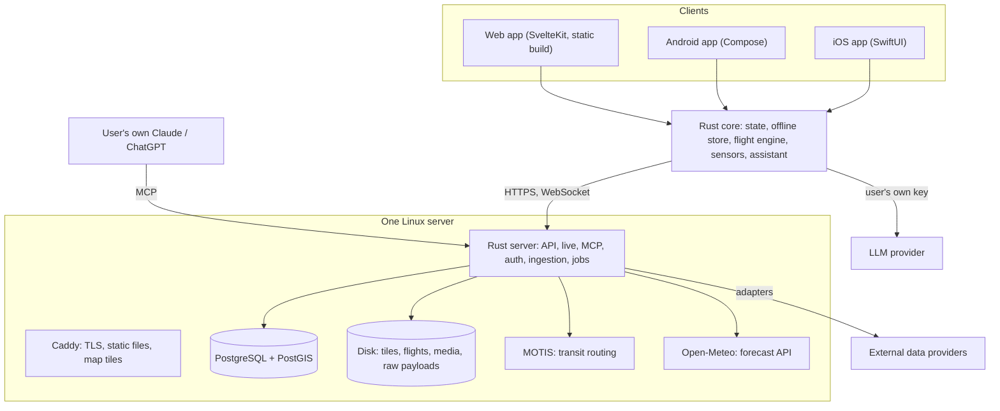

# Architecture

Last revised: 2026-11-19. Facts marked *(to verify)* come from research that could not reach the primary source and must be checked before they are relied on.

## Shape of the system



Three ideas carry the design:

1. **Rust owns everything except pixels and operating-system services.** The same flight engine runs in the phone's recorder, in the browser and on the server.
2. **Nothing outside an adapter knows a provider exists.** External data is normalised into one canonical model before anything else touches it.
3. **One server process, one database, one disk.** Extra services are added only when they are separate upstream projects (transit routing, forecast API).

## Rust workspace

Packages are named `venti-<directory>`, for example `venti-domain`. Built so far: `domain`, `sources`, `sources-dwd`, `sources-geosphere`, `sources-openaip`, `regions`, `api-types`, `store`, `server`, `flight` (flight files, track summary, track views for drawing, and the live flight computer), `airspace` (the OpenAir reader, airspace queries and airspace warnings; see [airspace.md](airspace.md)), `sensors` (sentence parsers for external varios), `llm` and `tools` (the assistant's provider format and its tools), `core` (the logbook on the device, the cockpit session and the assistant), `core-wasm` (the core for the browser), the iOS shell in `apps/ios`, the Android shell in `apps/android` and the web shell in `apps/web`. The rest are planned. `tools/uniffi-bindgen-swift` generates the Swift interface of `core`, and with its second program, `uniffi-bindgen`, the Kotlin interface.

```
crates/
  domain         Canonical types, units, identifiers. No I/O.
  flight         IGC read/write, vario filter, wind estimate, thermal detection,
                 glide geometry, scoring, task logic. No I/O.
  airspace       OpenAir files, airspace queries (what is here, what is near,
                 side view) and the cockpit's airspace warnings. No I/O.
  sensors        Parsers for external instrument protocols. No I/O.
  sources        Adapter traits, manifest types, registry, pipeline.
  sources-*      One crate per provider (sources-dwd, sources-geosphere, ...).
  regions        Loads and validates region packs.
  store          Server persistence behind one interface: PostgreSQL with PostGIS,
                 and an in-memory twin for tests and the development mode. Holds
                 what the data sources deliver, and pilots' accounts and flights.
  client-store   Client offline store (SQLite) and sync.
  api-types      The wire format of the HTTP API, shared by server and clients. No I/O.
  tools          Assistant tool definitions: one definition, served in-app and over MCP.
  llm            Provider clients for the in-app assistant.
  core           Client application core: state, events, view models. UniFFI exports.
                 Today it keeps the logbook: flight files in the app's storage and an
                 index beside them. This moves into `client-store` when sync arrives.
  core-wasm      The core as a WebAssembly module with TypeScript declarations
                 (wasm-bindgen). The web app's only way into Rust.
  terrain3d      Terrain and flight-replay renderer on wgpu.
  server         The server binary: ingestion scheduler, accounts, pilots' flights,
                 HTTP API, share pages, development mode, and the one-shot live
                 run that CI uses as its canary.
apps/
  ios/           SwiftUI shell
  android/       Compose shell
  web/           SvelteKit app
regions/         Region packs (configuration, no code)
deploy/          Compose files, Caddyfile, backup scripts
docs/
```

### Dependency rules

- Dependencies point inward. `domain` depends on nothing in the workspace. `flight`, `airspace`, `sensors` and `sources` depend on `domain`. Everything else may depend on those.
- A `sources-*` crate depends only on `domain` and `sources`. No other crate may name a provider-specific type; only `server`, which assembles the registry, depends on the provider crates.
- `api-types` and `store` depend only on `domain`. The wire format must stay usable in a browser and on a phone, and the store must not know how data was fetched.
- `server` may depend on `flight`: what it says about an uploaded flight is worked out by the code the apps run on the device. It never depends on a crate made for the apps alone (`core`, `core-wasm`, `llm`, `tools`, `sensors`).
- Nothing a client is built from reaches a server-side crate: `core`, and every crate that depends on it, never depends on `store`, `server`, `sources`, `regions` or a provider crate, not even through another crate.
- `flight`, `airspace` and `sensors` do no I/O and read no clock. Time, positions and bytes are passed in, which makes every algorithm replayable from recorded data.
- UI shells contain no business rules. If a shell needs an `if` about flying, the logic belongs in `core`.

The test `crates/sources/tests/dependency_rules.rs` enforces the first two rules on every CI run by reading the crate dependency graph. It also fails if anything other than `server` depends on a provider crate, if `api-types` or `store` grows a workspace dependency besides `domain`, if a client crate can reach a server-side one or a server-side crate depends on one made for the apps alone, and it holds `core-wasm` to depending on `core` alone. `flight`, `sensors` and `airspace` are held to `domain` alone.

## Clients

### The bridge

| Target | Mechanism |
|---|---|
| Swift, Kotlin | UniFFI (0.32 at the time of writing) |
| Web | wasm-bindgen (0.2.130 at the time of writing), in the crate `core-wasm` |

The core follows the one-way pattern used by Proton Mail, Bitwarden and the Crux framework: the shell sends events in, the core returns a view model, and the shell performs the side effects the core asks for (network, storage, sensors). We adopt the pattern, not the Crux framework, to keep the dependency surface small.

Bridge rules:

- The interface is coarse. A screen gets one view-model struct, not twenty getters.
- Per-frame and audio paths never cross the bridge. The vario tone is synthesised natively from a value the core updates a few times a second. Instruments are drawn natively from a snapshot struct.
- One error type crosses the bridge.

What the Phase 0 spike showed (2026-11-18, UniFFI 0.32, Xcode 26.6, Swift 6.3):

- The generated Swift interface compiles in Swift 6 language mode without changes. Records are `Sendable`, the core object can be shared across tasks, and Rust errors arrive as a Swift error with a readable message.
- The core is packaged as one XCFramework of static libraries (device, simulator, Mac) inside a local Swift package. The Mac slice lets the bridge tests run with `swift test` in seconds, without a simulator.
- The module map must be generated with the module name the generated Swift imports (`venti_coreFFI`); the generator's default name does not match.
- Not yet exercised: async functions, callbacks from Rust into Swift, and a physical device. UniFFI's own notes say async code does not yet conform to `Sendable`.

What the Android build showed (2026-11-19, UniFFI 0.32, Kotlin 2.4, Android Gradle plugin 9.5):

- The Kotlin interface is generated at build time by a Gradle task, from a build of the core for the build machine, and compiled with the app. Nothing generated is committed. The same library lets the unit tests call the real core on the JVM through JNA, in seconds and without an emulator: the counterpart of the Mac slice above.
- For the phone, `cargo ndk` builds `libventi_core.so` for `arm64-v8a` and `x86_64`, driven by a second Gradle task. Both tasks run again only when something under `crates/` has changed.
- The generated Kotlin did not compile as it came. The core's error carries its text in a field called `message`, and a Kotlin exception already has a property of that name. The generator's own rename setting (`apps/android/uniffi.toml`) calls the field `reason` on the Kotlin side; the core is unchanged. A new kind of error in the core needs a line there, and the build fails until it has one. A UniFFI "flat" error would give Kotlin the text as the exception's message and need no rename; that is a change to the core's interface and has not been made.
- A Rust error's text therefore reaches Kotlin as `reason`, not as the exception's message, which describes the fields. The app reads it through one extension, `pilotMessage`.
- Not yet exercised, as on iOS: async functions and callbacks from Rust into Kotlin. Not exercised at all: a physical device.

There is no first-party generator that covers WASM, so the web has its own binding crate, `core-wasm`. It is thin. The view types are the core's own: built with its `wasm` feature, the core derives their TypeScript declarations from the Rust definitions (with `tsify`), doc comments included. Only the list of calls exists twice, once for UniFFI and once for wasm-bindgen. A failed call throws a JavaScript `Error` whose message is the core's and whose name is the kind of error. BoltFFI would unify the two bindings but is young.

### Storage

The core keeps whole files under short names (`flights/<id>.igc`, `logbook-index.json`) and reaches them through one small interface, `Storage`: list a folder, read a file, write one, remove one. What makes two files the same flight, the index, summaries and totals are built on top of it and are the same code on every platform. There are two implementations:

- `DiskStorage` is a folder the app owns. The phones use it. The files are where they were before the interface existed.
- `StagedStorage` is for a host that can only store things asynchronously, which is every browser, while the core's interface is synchronous. It knows the names of the stored files and holds none of their contents. A read of a file that is not in memory fails and notes the file as wanted; the host fetches it, hands it over and makes the same call again. Writes and removals are staged, and the host applies them to its own store after the call, all together. What the host handed over is dropped once the call has succeeded.

This is the one-way pattern above applied to storage: the core decides what is stored, the shell does the reading and writing. It also keeps a long logbook out of memory. Opening needs the index only, and a flight's file is fetched when that flight is opened. A lost index is rebuilt a few files at a time.

One suite of tests runs against both implementations (`crates/core/src/storage.rs` and `crates/core/src/logbook.rs`). How the web app stores the files is under [Web](#web). The cockpit's recorder is not behind this interface: it appends to a file in the data folder and exists only on the phones.

### iOS (first target)

- SwiftUI, minimum iOS 26, iPhone in portrait for now. The Xcode project is generated from `apps/ios/project.yml` by XcodeGen and is not committed, so every project change is a readable diff. How the app looks and why is in [design.md](design.md).
- The shell holds no flying logic. One `Core` object is created at launch with the app's data folder; screens ask it for a view (`LogbookView`, `FlightView`) and draw it. Storing flights, recognising a flight that is already there, totals, grouping by year, climb rates and the reduced altitude profile are all the core's work.
- UI tests drive the real app on a simulator and keep a screenshot of every screen; the iOS workflow publishes them. This is how an AI session sees its own interface changes.
- Live wind follows the one-way pattern. For each thing a screen wants from the server the core has a pair of plain functions (`crates/core/src/wind.rs`): one says which path to ask for, one reads the answer into a view, with the wire format of `venti-api-types`. The shell does the request in between. The app asks for the stations of somewhat more than the map shows whenever the map comes to rest outside what it already has, and again every minute while the map is on screen. The age of a reading is measured against the server's clock, which the app reads from `/v1/health`, not against the phone's. There is no server address built in while the project has no server: the pilot types one in the settings, and with none the map has no wind. The UI tests run against `venti-server dev` on the same Mac.
- The cockpit's sensors live in `apps/ios/Venti/Fly`: positions from Core Location (best accuracy, airborne activity type, background updates with a `CLBackgroundActivitySession`), pressure from `CMAltimeter`, an external vario over Core Bluetooth, and the vario tone synthesised sample by sample in an `AVAudioSourceNode`. The app declares the location, audio and Bluetooth-central background modes. To verify on a real iPhone, none of it can be exercised on a simulator: that recording survives hours in the background, that the vario connects and reconnects, and that the tone sounds right.
- The vario is chosen in the app, from a list of every Bluetooth LE device nearby. On a device with one of the known serial services the app listens to that service; on any other it listens to everything the device notifies outside the standard Bluetooth services, and the core keeps whatever is a sentence it knows. That is how a vario whose service nobody has documented (the owner's MipBip) can work without a driver. The vario list shows what the connected device offers and the last lines it sent, and can share that as a report, so an unknown device can be worked out from one test.
- The pilot's name, glider and sound setting are kept in the phone's own settings store, not in the core: they are preferences of this device until accounts exist. The names are passed to the core when a recording starts.
- Map: MapLibre Native (7.0), wrapping `MLNMapView` directly. The SwiftUI wrapper is pre-1.0 and incomplete.
- Recorder: Core Location with a `CLBackgroundActivitySession` and `CLServiceSession` started in the foreground. Apple's guidance and a 2026 developer-forum thread both point to missing sessions as the cause of suspension about a minute after backgrounding.
- Barometer: `CMAltimeter`. The update rate is undocumented and reported at about 1 Hz, which is too slow for a responsive vario on its own.
- External vario over Core Bluetooth with the `bluetooth-central` background mode and state restoration. This is the primary vario source for the owner's setup.
- Vario audio through the background audio mode. It is real audible content, which is what App Review requires.
- Live Activity for a running flight. The system ends a Live Activity after eight hours, so long flights need a restart strategy.

### Android

Built 2026-11-19 with the same sections as the iPhone app; `apps/android/README.md` says how to build it and what has not been verified. It has run on an emulator in CI and on no phone.

- Kotlin and Jetpack Compose with Material 3, one module, minimum Android 8 (API 26), built against Android 17 (API 37). The Gradle wrapper pins Gradle and checks its download; library versions and their licences are in `apps/android/gradle/libs.versions.toml`. How the app looks and why is in [design.md](design.md#android).
- The shell holds no flying logic, as on iOS. What it holds for the life of the process (the logbook's model, the flying session, the vario link) belongs to the application object, not to a screen: Android rebuilds screens whenever it likes, and a recording has to carry on through that. Screens draw what these models hold as Compose state.
- No Google Play Services anywhere, so the app can be distributed through F-Droid: positions come from Android's `LocationManager` and its satellite receiver, and the map's own position marker uses MapLibre's built-in engine over the same manager. The UI tests run on an Android image without Google's services, which checks it on every push.
- Map: MapLibre Native Android 13.7, wrapped directly in a Compose `AndroidView`, in its OpenGL ES build. The library's default build draws with Vulkan, which not every phone from Android 8 on has and which the CI emulator would draw in software. To verify: Vulkan on the phones pilots fly with.
- The shared style is prepared as on iOS and handed to the map as text. The label fonts and the demo region ship inside the app as assets and are copied into the app's storage once per installed version: the map engine reads a tile archive in pieces by position, which it can do with a file and not with an asset.
- The cockpit's sensors live in `apps/android/app/src/main/kotlin/fly/venti/app/fly`: positions from `LocationManager` (satellite provider, one a second), pressure from `SensorManager` (twenty readings a second), an external vario over Bluetooth LE with the same rule for which characteristics to listen to as on iOS, and the vario tone synthesised sample by sample into an `AudioTrack`. Each sensor reports on its own thread straight into the core's session.
- Android reports altitude above the WGS 84 ellipsoid, where iOS reports it above sea level, which is what the core asks for. The shell converts: with the system's own converter from Android 14, and before that with the geoid height the satellite receiver states in its NMEA output. Without either, the ellipsoid height is passed on, about 45 to 50 m too high in the Alps.
- Recorder: a foreground service of type `location`, started while the cockpit is on screen, with a notification and a partial wake lock. It does nothing but keep the process alive and awake; the sensors and the session are the process's. If Android ends the process, the core's recording file is adopted at the next launch. Android 17 applies the same visibility rule to background audio *(to verify: that the tone keeps sounding with the screen off)*.
- The pilot's name, glider, sound setting and remembered vario are in the app's `SharedPreferences`. Cloud backup is switched off for the app, because it tells the pilot that flights stay on the phone; a direct transfer to a new phone is allowed from Android 12.
- The app's requests to servers, the assistant's and the wind map's, leave from one place (`Http`), with the platform's `HttpURLConnection`: no cache, no cookies, and no redirect is followed. What to ask and how to read the answer is the core's. When the assistant's model looks up live wind, the core names an address on the pilot's Venti server and the shell fetches it like the map does, without the key or the question; a server that cannot be reached is told to the model, not shown as an error. The assistant's key is encrypted with a key that lives in the Android Keystore and never leaves it, and only the result is written to the app's own storage. In tests the provider is a script and the key a value in memory.
- Live wind is the iPhone's in substance: no server is built in; the address is the pilot's setting; the server's own clock, read from its health answer, is what ages are measured against; stations are asked for the box in view and a quarter more, once the map rests, and again every minute while the map is on screen and the app in front; they leave the map after fifteen minutes without an answer. The symbols are drawn by the app into pictures the map places, turns and sizes by each station's reading.
- Requests without encryption: Android's network security configuration can allow them for named hosts or for all, not for "the pilot's own network". It allows all, and `Http` refuses every address that is not HTTPS unless its host is this device, a name without a dot or ending in `.local`, or a private, link-local or unique-local address. The map engine's own requests go to the HTTPS addresses in the style.
- Flight files arrive through the system's document picker, through "Open with" (Android knows no type for IGC files, so the app registers for the types other apps use for them and for names ending in `.igc`) and through "Share". A flight's file leaves through a `FileProvider`.
- UI tests are Compose tests that drive the real app on an emulator and keep a screenshot of every screen in both appearances; the Android workflow publishes them, and the debug build of the app. For the wind map the workflow starts `venti-server dev`, which the emulator reaches at `10.0.2.2`. The unit tests play the server with the answers the server's own tests keep in `crates/server/tests/golden`, so a change to the API that the app cannot read fails here too.
- The cockpit's map is given the glider and its track as one piece of data, at most four times a second, and moved at an even pace to arrive as the next position is due. Drawn as two pieces, or with the glider as a mark of the screen's own, one of them was a step behind the other whenever the map could not keep up: on the emulator's software renderer at twenty times the speed of flight, and so probably on a slow phone.

To verify on a real phone, none of it can be exercised on an emulator: that recording survives hours with the screen off and what manufacturers' battery savers do to it, the altitude conversion, the pressure sensor as a vario, everything about Bluetooth, the tone, and "Open with" from real file managers.

### Web

- SvelteKit built to static files and served by Caddy. No Node process on the server.
- MapLibre GL JS 6 for maps. The Rust core runs as WebAssembly for flight analysis and the offline store.
- Pages that must unfurl in chats and be indexed (flights, sites, profiles, events) get their HTML head and a text summary rendered by the Rust server; the web app then takes over. Revisit with a server-rendered SvelteKit build if search indexing proves too thin. Built for flights: see [Share pages](#share-pages). The web app is not linked from them yet.

What exists (2026-11-19, SvelteKit 3.4, Svelte 5, Vite 8, MapLibre GL JS 6.19): `apps/web` has the map tab with live wind, the logbook with its statistics, and the flight screen of the iPhone app, over the same core. It has no cockpit, no settings and no assistant. Nothing is deployed. `apps/web/README.md` says how to build, run and test it.

- **Static files and nothing else.** Every page is written out at build time as its own `index.html`, with compressed copies beside it. No page needs a rewrite rule or a fallback page, so any static file server serves the app. A flight is therefore named by a query parameter, `/logbook/flight/?id=…`, not by a part of the path. The pages hold the app's frame; flights exist only in the browser and are drawn there.
- **The shell holds no flying logic.** Screens ask the core for a view and draw it, as on the iPhone. What the TypeScript does besides drawing is what the Swift does: formatting numbers, the tables of climb and wind colours, cutting a track into runs of one colour, choosing a wind station's symbol and the numbers under it, fitting a thumbnail into its box, stepping the marker along the track when a flight is played.
- **The core runs in a worker.** The page sends it calls and waits for answers (`apps/web/src/lib/core`: `client.ts` on the page, `worker.ts` in the worker, `protocol.ts` the list of calls). Nothing the core does can hold up the page, which matters for long flights. Measured in Node on the build machine, with the browser tests running beside it: the sample flight of 29 minutes imports in about 90 ms and opens in about 20 ms; a flight of eight hours, 28,800 fixes, takes about 1.3 s to import, 0.2 s to open and 0.9 s to analyse. To verify on a phone.
- **Building the core.** `apps/web/scripts/build-core.sh` compiles `core-wasm`, runs the wasm-bindgen tool in the version `Cargo.lock` names, and then removes what only the phones use. The core is one crate, and its UniFFI interface is compiled into the browser's module too: well over a hundred exported functions that no page calls, each keeping alive what it reaches (the cockpit, the recorder, the assistant, airspace). The script takes those exports out with Binaryen and lets it drop everything they held, and prints what that saved. On 2026-11-19, with the wind map and the accounts in the core, 1,856 KB became 645 KB (259 KB compressed with gzip). The module grows with the core, the part for the browser much more slowly than the whole.
- **The label fonts and the sample flight** are the files in `apps/ios/Venti/Resources`. The repository holds one copy of each and the web build takes them from there.

#### The logbook in the browser

The core's files are kept in IndexedDB: one database, `venti`, with an object store `files` (a file's bytes under the name the core gives it, the same names as on a phone's disk) and an object store `meta` that holds one counter, the store's revision. `session.ts` and `idb-store.ts` in `apps/web/src/lib/core` are the browser's side of the [storage interface](#storage) and know nothing about flights.

| Situation | What happens |
|---|---|
| The page loads | The worker reads the names of the stored files and the revision, and hands the names to the core. The core asks for the index; a flight's file stays in the database until that flight is opened. |
| A flight is imported or deleted | The core stages the changes (the flight's file and the index). The worker writes them in one transaction and only then answers that it worked. |
| The index is missing, damaged or from an older version | The core rebuilds it from the flight files, which the worker fetches eight at a time, so memory stays bounded however long the logbook is. |
| Two tabs | Every write first checks, in the same transaction, that the revision is still the one the tab last saw, then raises it. A tab that is out of date writes nothing: it reads the store again and repeats its change, which then includes the other tab's. After a write the tab tells the others over a `BroadcastChannel`, and they read the store again and redraw. A browser without `BroadcastChannel` loses only the redraw. |
| The disk is full | The transaction fails as a whole. The worker rebuilds the core from what is stored, so the flight is not listed, and the page names the file with the reason. The rest of that import is not attempted. |
| The browser gives the page no storage (some do in private windows) | The logbook is kept in memory for the visit, and its screen says that the flights are gone when the page is closed. |
| The browser removes the site's data | Possible when the device is short of space, and in Safari after seven days without a visit *(to verify: Apple's stated policy for storage written by scripts; not tested)*. After the first import the page asks the browser to keep its data (`navigator.storage.persist()`), which browsers grant by their own rules. The imported files remain the pilot's copy until flights are synchronised with a server. |

A flight file is read as UTF-8, or as Western European text if it is not valid UTF-8, and handed to the core as text. Like on the iPhone, a file with characters outside ASCII is therefore not stored byte for byte. To verify: whether that breaks a recorder's signature check for such files; if it does, `import_flight` has to take bytes.

#### Maps in the browser

- The style is prepared from `map/style.json` as on the iPhone: OpenFreeMap for the base map, Mapterhorn for terrain up to zoom 12, with the terms and the limits given under [Maps and terrain](#maps-and-terrain). The map shows both sources' credits, written out on a wide map and folded into a button on a narrow one.
- Label fonts are served by the app. The build gives each font file a name with a hash of its contents, so the style's `{fontstack}/{range}.pbf` cannot name them; the style gives a `venti-font://` address instead and the page tells MapLibre how to answer it. A range the app has no file for (it has the two that cover Latin text) is answered with an empty font, so a label in another script loses those characters instead of failing its whole map tile.
- 3D terrain is MapLibre GL JS's own, on the flight screen: the same elevation tiles as the relief shading, added as a second source because MapLibre prepares a source differently for the two uses. The track lies on the ground in this view, not at the height it was flown; a replay at flown height is the `terrain3d` renderer's job.
- The end-to-end tests draw the map from the region bundled for the iPhone's tests, without the network and without a switch in the app: the test browser answers the app's requests to the two tile services from those files (`apps/web/e2e/bundled-map.ts`).

#### Wind in the browser

- **The server is the one the site is served from.** The app asks its own origin for `/v1/…`, beside its own files, as it will when one web server hands out both. There is no address to set, at build time or by the pilot, and no other origin to allow. A site that only hands out the files answers the first question, `/v1/health`, with "not found": the map then has no wind and says nothing about it, which is the iPhone app without a server address. Any other answer that cannot be used is told to the pilot in words: the core's for a server in trouble, "could not be reached" for none at all.
- **The worker sends the requests** (`apps/web/src/lib/core/wind-source.ts`). The core, which says what to ask for and reads the answer, runs there, so an answer never crosses to the page and back as bytes. The worker also keeps how far the server's clock is ahead of the device's, read from `/v1/health` at most once a minute.
- **The page keeps the wind for the part of the map in view** by the rules of the iPhone's `WindModel` (`apps/web/src/lib/wind/watch.ts`): it asks for a quarter more than the map shows, once the map has rested outside what it has, and again every minute while the map is on screen and the browser tab in front. After fifteen minutes without an answer the stations are taken off the map.
- **While developing and in the tests** Vite passes `/v1` on to `cargo run -p venti-server -- dev` on the same machine, so the app is used the way it will be served: one origin for both.

#### How it is tested

Unit tests (Vitest, in Node) call the real WebAssembly core over an IndexedDB implemented in memory: reload, two tabs, a full disk, a lost index, and the page's conversation with the worker. For the wind they read the server's own recorded answers (`crates/server/tests/golden`), so a wire format that drifts fails here too. End-to-end tests (Playwright, Chromium) use the built site as a pilot would, with the server in its development mode behind it, and keep a screenshot of every screen at a phone's width and a desktop's, in light and dark. The `Web` workflow runs both and publishes the screenshots. Not tested: Firefox, Safari, and any real phone.

## The cockpit

How a sensor reading becomes a number on the screen:

```
phone GPS, phone barometer, Bluetooth vario      (shell: owns the sensors)
        │  each sample with the time it was taken
        ▼
core::FlightSession                              (core: one object per flying session)
   ├─ sensors::SentenceReader + parse            bytes from the vario → readings
   ├─ flight::live::FlightComputer               pure; no clock, no I/O
   └─ Recorder                                   appends each fix to a file at once
        │  CockpitView, pulled about five times a second
        ▼
screen and vario tone                            (shell: draws and synthesises)
```

- **No clock in the computer.** Every sample carries its own time and the shell passes "now" when it asks for a view. A recorded flight replayed through the same code therefore shows exactly what the pilot saw; `core::Replay` does that, and it is how the cockpit is tried on the ground and tested.
- **Climb rate** comes from the best source that is still talking: the external instrument's own vario, else a Kalman filter over pressure altitude (the instrument's pressure if it sends any, else the phone's), else the same filter over satellite altitude. A source silent for three seconds is dropped. When the pressure sensor changes, the filter starts again, because two sensors disagree by a constant.
- **Altitude** is pressure altitude plus a slowly followed correction toward satellite altitude: as smooth as the barometer, as true as the satellites.
- **Wind** is fitted while circling: ground velocities around a circle lie on a circle whose centre is the wind and whose radius is the airspeed. It needs no compass and no airspeed sensor, and it does not assume the pilot flew a perfect circle over the ground.
- **Circling** uses the rule XCTrack documents (90° of turn within 30 s while not sinking faster than 0.5 m/s). It ends when the turn within 30 s drops under 30°.
- **Recording** cannot lose a track to a crash: each fix is appended to `recordings/<start>.igc` in the data folder as it arrives, and that file is a complete flight file at every moment. Stopping imports it into the logbook and removes it; one found at launch is imported then.
- **The vario tone** is described by the core (pitch, rhythm) and synthesised by the shell.
- **Airspace warnings** come from `airspace::WarningEngine`, which is fed the computer's state once a second and, like the computer, reads no clock. It is built and tested and not yet wired into the session; [airspace.md](airspace.md#feeding-the-engine-from-the-cockpit) says how.

To verify in the air: the take-off and landing thresholds, the tone table and the filter's settings are first values. None has flown yet.

## Maps and terrain

All map data is self-hosted open data, stored as PMTiles files and served as static files with HTTP range requests. The apps download the same files for offline use; MapLibre Native reads them from local storage.

Until the server exists, the iOS app fetches its tiles from two public services of the same open data, so that the map covers wherever a pilot has flown and not only the demo region:

| Layer | Service | Terms, read on the provider's page 2026-11-18 |
|---|---|---|
| Vector base map | OpenFreeMap, `tiles.openfreemap.org` (unmodified OpenMapTiles schema, the one our style is written for) | Free public instance, "no limits on the number of map views or requests", commercial use allowed, attribution required. [openfreemap.org](https://openfreemap.org/) |
| Terrain | Mapterhorn, `tiles.mapterhorn.com` | A public tile endpoint is documented on [mapterhorn.com/data-access](https://mapterhorn.com/data-access); no usage limit is stated there. To verify with the project before any public release. Attribution required. |

The app asks Mapterhorn for terrain only up to zoom 12, the level it serves for the whole world; finer tiles exist only for some countries and return "not found" elsewhere. Both services see the IP address and the map areas of whoever uses the app. This is a development arrangement, not the product: it ends when our own tile server is up, and it must end before a public release unless both projects agree.

| Layer | Source | Notes |
|---|---|---|
| Elevation | Mapterhorn | Includes Bavarian DGM1 (1 m), Austrian BEV (1 m), swissALTI3D and South Tyrol. Used for hillshade, colour relief, 3D and height-above-ground. |
| Contours | Pre-generated vector tiles from the same elevation data | MapLibre Native has no on-device contour generator, so all platforms use the same pre-built tiles. |
| Vector base map | OpenStreetMap through a custom Planetiler profile | Starts from the OpenMapTiles profile and adds what alpine flying needs: path difficulty (`sac_scale`), material ropeways, power lines, free-flying sites. |
| Style | Our own MapLibre style | One style shared by iOS, Android and web. A high-contrast variant for sunlight in the cockpit. |
| Official maps | basemap.at, Bavarian DTK25 | Switchable raster layers, both CC BY 4.0. |
| Imagery | basemap.at orthophoto, Bavarian DOP20, Sentinel-2 cloudless 2016 elsewhere | For the 3D viewer and an aerial layer. |

### What exists so far

- `map/style.json` is the shared style. It names its tiles and fonts with placeholders that each app replaces with local or remote URLs.
- A small demo region (the Tegernsee valley, about 7 MB) is bundled with the iOS app under `apps/ios/Venti/Resources/MapDemo`: a vector base map, terrain tiles and label fonts. `tools/demo-map/build.sh` rebuilds it. It uses the stock OpenMapTiles profile and terrain only to zoom 12; the custom profile, contours and high-resolution terrain are not built yet.
- The iOS app prepares the style for one of two tile sources: the public services above (the default), or that bundled region. The UI tests use the bundled region, so the offline path is drawn and checked on every push. Label fonts always come from inside the app.
- Confirmed on the simulator (2026-11-18): MapLibre Native reads vector and terrain archives through `pmtiles://file://` URLs, decodes the WebP elevation tiles, and loads label fonts from a `file://` glyph URL. No network is involved.
- The Android app prepares the style the same way and takes the same files, from where the iOS app keeps them, into its assets at build time.

### 3D

MapLibre Native has no production 3D terrain. The work exists as a draft pull request with no timeline. MapLibre GL JS on the web does have it.

The 3D viewer is therefore our own renderer: the `terrain3d` crate on wgpu, reading the same elevation and imagery tiles. It draws a quadtree terrain mesh with draped imagery, track ribbons and pilot markers, with a free camera. It embeds in a Metal layer on iOS, a surface view on Android and a canvas on the web (WebGPU, with a WebGL2 fallback because Firefox on Linux and Android still lacks WebGPU by default).

This is the largest single piece of custom engineering in the project. It is confined to replay and route preview; the cockpit and planning maps are 2D with hillshade and contours and do not depend on it. Revisit when MapLibre Native ships terrain pre-releases.

### Live overlays

MapLibre Native slows down with around a thousand symbols that use sort keys and halos. Overlay rules: few symbol layers, no sort keys, feature-state for updates, and a custom layer for objects that move every second (live pilots).

## Server

Everything runs on one Linux server under Docker Compose.

| Process | Role |
|---|---|
| Caddy | TLS, static web app, PMTiles, media files |
| `server` (Rust, Axum) | REST API, live WebSocket, MCP endpoint, authentication, ingestion scheduler, background jobs. One binary; roles can be split later with flags. |
| PostgreSQL + PostGIS | The only database |
| MOTIS | Public-transport routing, self-hosted with open timetable feeds |
| Open-Meteo | Forecast API, self-hosted, syncing open model data |

Deliberate omissions: no Redis (live fan-out is in-process, the job queue is a Postgres table), no object store (blobs live on disk behind a small trait, so an S3-compatible store can replace it), no search engine (Postgres full-text and trigram), no Node runtime, no managed services.

### What the server does today

The server collects station observations and serves them, and it keeps pilots' accounts and flights. The live channel, the MCP endpoint, MOTIS and Open-Meteo are not built.

`venti-server` is one program with these subcommands:

| Subcommand | What it does |
|---|---|
| `serve` | Runs the server: collects the sources of the configured regions on their schedule, keeps accounts and flights, stores everything in PostgreSQL, serves the API and the share pages, removes old data |
| `dev` | Serves the same API over payloads recorded from the providers and a demo account with three flights, from an in-memory store. No network, no database. Its clock stands still at the moment of the recording, so every start gives the same answers. For client work and UI tests |
| `ingest <region.toml>` | Runs a region's sources once against the live providers and prints a health line for each. Stores nothing. CI runs it daily as the canary, from the image a server runs |
| `invite` | Makes invite codes for a server that takes accounts by invite, and prints them |
| `derive` | Reads one flight file and prints what the server works out from it. The server runs this itself, as a child process, for every upload; see [Flights](#flights) |

**Collecting.** Each source has one task that runs it, waits and runs it again; that loop is what guarantees a source never runs twice at once and that a slow source delays no other. A run goes through the pipeline of the `sources` crate (fetch, archive, parse, merge, validate); the validated records and the outcome of the run are then written to the store in one transaction. The wait is measured from the start of one run to the start of the next and is never shorter than the source's cadence, which is what keeps the server inside a provider's hourly request limit. A random delay of up to a tenth of the cadence is added. After a second failed run in a row the wait doubles each time, up to an hour. A restarted server reads the run history and waits out what is left of the cadence. A run takes the last three hours from each payload, so values that a provider publishes late still arrive and a short database outage heals itself.

**Storing.** Stations carry a PostGIS geography position; a box query runs on a spatial index over its planar view. Observations are one row per station and time, in monthly partitions that are created when their first observation arrives. Writing an observation again merges it: a new measurement replaces the stored one, a missing measurement leaves it alone, and a row that would not change is not rewritten. Old data leaves by dropping whole months. Accounts, sessions and flights are described below. The schema is a numbered list of SQL files compiled into the program and applied at start.

**Serving.** The API is described in [api.md](api.md). Every answer with station data names the source of each record and carries that source's credit line; a station belongs to exactly one source, so data under different licences never shares a record. A station whose source is not in the server's configuration is not served, even if the store still holds it.

**Configuration** is a TOML file, environment variables, or both; a variable wins. `crates/server/config.example.toml` documents every setting. The database URL holds the only secret and is never printed.

How the server is run on a machine is in [deploy/README.md](../deploy/README.md).

### Flights

A pilot's flights live on the phone first. The server is where they are kept safe, reach the pilot's other devices, and can be shared.

**The file is the truth.** An uploaded IGC file is kept byte for byte: a recorder's signature covers every byte, and a league accepts only the file it signed. Everything else the server says about a flight (start, take-off and landing, airtime, distances, the score, an outline for thumbnails, an altitude profile) is worked out from the file by `venti-flight`, the code the apps run, and stored beside it with the version of the analysis that produced it. When that version goes up, the server works every stored flight out again after its next start, in the background, and each flight that changes shows up as changed to its pilot's devices.

**Identity and address.** A flight's identity is the hash of its fixes that the apps' logbooks use; the server computes it itself and never takes a client's word for it. One account holds an identity once, which is what makes an upload repeatable. The flight's address on the server, used in paths and share links, is a second identifier: it is derived from the account and the identity, so the same flight uploaded again gets the same address, and nobody who merely has the file can work out a link to it. Two accounts that upload the same recording hold two flights.

**Analysing a file from a stranger.** The analysis is quick on real flights (a made-up twelve-hour flight takes about half a second) and can be made to take minutes by a file built for it: 20 000 fixes that zigzag across the globe kept one core busy for two and a half minutes (measured 2026-11-19; the simplification of a track is quadratic in the worst case). A thread cannot be stopped from outside. So for every upload the server starts a copy of its own program (`venti-server derive`), hands it the file, and kills it if it is not done within ten seconds. Two run at a time; the rest wait. The server takes in eight files at once, two from any one account, and refuses further ones before reading them, so uploads cannot fill its memory. A file that had to be killed counts fifty times against its account's daily uploads. The same weakness exists on the phone, where a crafted file can hang an import; that is for the flight engine to fix.

**Who sees a flight.** Private (the default), unlisted (anyone with the link) or public (listed on the pilot's page). To everyone but its pilot a private flight does not exist: the answer is the one for an address that belongs to no flight, in status, headers and body. Followers-only joins the list when follows exist; the wire format already tells clients to expect values they do not know.

**Syncing devices.** Every upload, deletion or change to a flight takes the next *change number* of its account, in the same transaction, under a lock on the account's row. A device remembers the largest number it has seen and asks for what came after; because numbers are handed out in the order the changes become visible, it never misses one. A deleted flight leaves only its address and identity behind, so that other devices can be told. Change numbers follow the clock (microseconds, or one more than the last if the clock has not moved), so after a restore from a backup new changes still sort after everything a device saw before. A device whose number lies beyond the account's latest is told to start again and to compare its whole logbook.

**Where the files are.** In PostgreSQL, compressed with gzip, in the row of the flight. Compression saves about two thirds: the half-hour sample flight is 65 kB as a file and 20 kB stored, so a long flight is a few hundred kilobytes. In the database a flight and its file appear and disappear in one transaction, deleting an account is one statement that takes everything with it, and the nightly dump that already exists is the whole backup. On disk they would need a second backup, a way to find files whose row is gone, and care on every delete. The database stays manageable for a long time at these sizes; when the dump becomes too slow or the files too many, they move behind the blob trait the plan names for media.

### Share pages

A public or unlisted flight has a page at `/f/{id}` and a picture at `/f/{id}/preview.png`. The page is for people and for the preview fetchers of chat apps: its head carries Open Graph and Twitter-card lines, its body the flight's numbers, its track and altitude profile as inline drawings, and a link to the flight file. It is one HTML document with its style inside, light and dark, with no script and no request to anywhere else. The picture is drawn by the server in Rust (`tiny-skia`), with the Nunito typeface compiled in for the numbers; no map is under the track, because there is no tile server yet.

Everything on the page that a pilot or a file supplied is escaped, and the page forbids itself all scripts with a content security policy, so a mistake in the escaping could deface a page but not run code. The addresses in the page come from the configured `public_url`, never from the request.

### Storage

- **PostgreSQL:** users, flights with their files, sites, airspace, stations, community data. Observations are partitioned by month and kept for thirteen whole months unless configured otherwise.
- **Disk:** media under content-hash paths, PMTiles, and a rolling archive of raw provider payloads for replaying adapter bugs (one folder per source and day, fourteen days unless configured otherwise). Flight files are not on disk; see [Flights](#flights).
- **Backups:** nightly encrypted, incremental backups of the database and blobs to storage in a different location. This is the one recurring cost besides the server and it is not optional. Built so far: `deploy/backup.sh` writes a nightly dump of the database to the same machine and rotates old dumps. Since accounts and flights exist, that dump is what stands between a pilot's flights and a broken disk, and it holds personal data and password hashes. The copy at a different site is not set up; where it goes is the owner's decision.

### External dependencies that cannot be self-hosted

| Dependency | Why | Cost |
|---|---|---|
| Apple Push Notification service, Firebase Cloud Messaging | Push notifications | Free |
| An SMTP relay | Sign-in and notification email; self-hosted mail has poor deliverability | Small, or avoided at first with passkeys and Sign in with Apple |
| GitHub Actions | CI, including macOS runners for iOS builds | Free for public repositories |

### API and offline sync

- Static reference data (sites, airspace, obstacles, station metadata) ships as versioned, immutable **region bundles** that clients download and query locally. The map overlays render from the local bundle, so they work without a connection and need no tile server.
- Live data (observations, positions, forecasts) comes from the API with cache validators. Observations are built: see [api.md](api.md). Until region bundles exist, the station list of the API carries the station metadata too.
- Flights are recorded locally and uploaded later. Upload is repeatable: one account holds a flight, known by the hash of its fixes, once. A device learns what its other devices did from the account's list of changes; see [Flights](#flights). The server side of this is built; the apps do not sync yet.

### Authentication and accounts

The aim is unchanged: passkeys, email link and Sign in with Apple, and an OAuth 2.1 authorization server for MCP clients (PKCE, client ID metadata documents or dynamic registration). None of the three sign-in methods can ship today. Passkeys in an iPhone app need an associated domain, which needs a paid Apple developer membership and a domain; Sign in with Apple needs the same membership; email needs a mail relay. The owner has postponed all three.

What is built instead (2026-11-19) is the plainest thing that is still sound:

- **An account is a handle, a display name and a password.** The handle is unique whatever its case, from a narrow alphabet, with names such as `admin` kept back. No email address is stored, and nothing else about the person.
- **A forgotten password cannot be recovered.** There is nothing to recover it with. The apps must say so where a password is chosen. Sessions last 400 days without use, so that a pilot who does not fly all winter is still signed in when spring comes.
- **Passwords** are hashed with Argon2id at the cost OWASP's Password Storage Cheat Sheet gives as a minimum (19 MiB, two passes, one lane; read 2026-11-19). A password is 15 to 128 characters with no other rule, which is what NIST SP 800-63B-4 asks of a password that is the only thing protecting an account, and is brought to one Unicode spelling (NFC) before hashing. Not done: comparing new passwords with a list of leaked ones, which the same document also asks for.
- **Credentials have a table of their own**, with a kind. Today the only kind is the password. A passkey or an Apple identity becomes a further kind, with the columns it needs, beside it.
- **A session is a random token** of 256 bits, sent as `Authorization: Bearer`. The server keeps its SHA-256 hash, one row per signed-in device with the name the device gave itself and when it was last used. Devices can be signed out one by one. Changing the password signs out every other device. There are no cookies and no signed tokens that would stay valid after being revoked.
- **Who may register** is a setting: `invite` (the default), `open` or `closed`. An invite code creates one account and may expire; `venti-server invite` makes them.
- **Guessing is slow.** Wrong passwords are counted per handle (10 an hour) and per client address (30 an hour), attempts to register per address (10 an hour), uploads per account (1000 a day). The counters are in the server's memory. A handle that has used up its attempts cannot be signed in to until the hour is over, not even with the right password; devices that are signed in are not affected. Signing in takes the same time and gives the same answer for a wrong password and for a handle nobody has.
- **The client's address** is the address of the connection, or, when the connection comes from a reverse proxy the configuration names, the address that proxy reports. In the Compose deployment that proxy is Caddy, at a fixed address.
- **Deleting an account** needs the password, not just a token, and removes the account, its sessions, its flights and their files in one statement. What remains is in the nightly dumps until they rotate out.
- **An account that shares nothing cannot be found.** A pilot's public page exists once the pilot has made a flight public; before that, asking for it gives the answer for a handle nobody has. A handle and a display name stand on every flight the pilot shares, public or unlisted.

Not built: passkeys, Sign in with Apple, email, password recovery, changing a handle or a display name, the OAuth server for MCP clients, moderation tools, and any limit on how much one account may store in total.

### Sizing

The owner has no server yet and wants the system to carry many users. The recommendation is one machine that is large enough for development now and for a public launch, so nothing has to be migrated in between.

| Resource | Recommendation | Reason |
|---|---|---|
| CPU | 16 modern cores | Map builds, flight analysis and video transcoding. The API itself needs little. |
| Memory | 128 GB, error-correcting | Transit router (estimated 16 to 32 GB), forecast service (8 to 16 GB), database cache, map builds. 64 GB is the working minimum. |
| Fast storage | Two 2 TB NVMe drives, mirrored | Database, routing data, forecast data, map and terrain tiles |
| Bulk storage | None at first | Add mirrored hard disks or network storage when 3D imagery and user video arrive |
| Network | 1 Gbit/s without a traffic cap, in an EU data centre | Offline map downloads are the heaviest traffic |
| Backup | About 5 TB at a different site | See Storage above |

A Hetzner AX102 matches this (16 cores, 128 GB, two 1.92 TB NVMe drives). Its price could not be confirmed from this session: listings ranged from about 100 to 260 euros a month before VAT. Check the provider's configurator, and its auction of used servers, before ordering.

What this is expected to carry, as estimates that have not been measured:

- **API and live tracking:** tens of thousands of daily users and several thousand pilots in the air at once. Each pilot sends one small batch every 10 to 15 seconds.
- **First limit, bandwidth:** 1 Gbit/s moves at most about 10 TB a day. At 3 to 5 GB per offline region, that is roughly two thousand new installs a day. The remedy is a second machine or a content delivery network for the tile files only.
- **Second limit, disk:** user video. Clip length and resolution are capped from the start.
- **Single point of failure:** if the machine dies, restoring from backup takes hours. The cockpit is unaffected because it works offline. Before a public launch, add a second machine as a warm standby with database replication.

Growing beyond one machine does not need a redesign. The server binary's roles (API, live, ingestion, jobs) can run as separate processes on separate machines, PostgreSQL can replicate, and tiles are static files that any web server or CDN can serve.

The transit router's real memory use and the size of the terrain tiles for the Alps are measured in Phase 0 before these numbers are trusted.

### Deployment

What exists: the `deploy/` folder holds a Compose file (Caddy, the server, PostgreSQL with PostGIS), a Caddyfile, the server's Dockerfile, a backup script and a runbook for first install, update, backup and restore. The server builds its own image from a checkout of the repository. CI builds the same image on every push and starts it, so a broken Dockerfile is found early, but publishes it nowhere: publishing images is the owner's decision. The stack has run on a development machine only; the project has no server yet.

Recommended once the owner has a server: CI publishes container images to GitHub's registry, and a timer on the server pulls tagged releases and restarts the affected services. The owner runs one bootstrap script once. No credential that can reach the server is stored in GitHub, and a self-hosted CI runner on a public repository is ruled out because forks could run code on the server.

How an AI session inspects the running server when something breaks is still open. What exists for a person on the machine: `/v1/health`, the server's log with one line per collection run, the run history in the database, and the `ingest` subcommand to run a source by hand; see the runbook.

## Bring your own AI

The project pays for no inference. What the research found:

| Route | Allowed | Who pays | Notes |
|---|---|---|---|
| Sign in with a Claude subscription inside our app | **No** | | Anthropic's terms forbid third parties offering claude.ai login or routing requests through subscription credentials. |
| Our server as an MCP connector in the user's Claude | Yes | The user's Claude plan | Works on every plan including Free (one custom connector). A connector added on the web appears in the mobile apps. Use in voice mode with custom connectors is unproven and must be tested. |
| Our server as a custom MCP server in ChatGPT | Partly | The user's ChatGPT plan | Full custom MCP is documented for Business and Enterprise on the web; consumer plans realistically need a directory listing *(to verify)*. |
| User's own Anthropic API key in our app | Yes | The key owner | Anthropic states developers should use API-key authentication. The key stays in the device keychain and calls go from the device to Anthropic. |
| User's own OpenAI API key in our app | Grey | The key owner | Common practice, no explicit approval found. On-device storage only. |
| OpenRouter account connect (OAuth with PKCE) | Yes | The user's OpenRouter account | Best "connect" experience; needs no app registration. |
| Sign in with ChatGPT for open-source apps | Yes, in preview | The user's ChatGPT plan | Announced autumn 2026. Preview limits include no audio input and a loopback redirect, so the fit for a mobile app is unverified *(to verify)*. |

So the owner's wish is met in two ways:

1. **Connector.** The `tools` crate defines each tool once. The server exposes them over MCP at `/mcp` (Streamable HTTP, OAuth). A pilot adds the connector to their own assistant and asks there. This costs the project nothing and ships as soon as the API exists.
2. **In-app assistant.** The same tools run inside the app against the same API. The tool loop runs on the device in the Rust core, calling the provider directly with the user's credential. The server never sees a key. Providers sit behind one `LlmProvider` trait: Anthropic (Messages API over plain HTTPS, as there is no official Rust SDK), OpenAI, OpenRouter. Speech recognition and speech output use the phone's own engines.

What is built (2026-11-19): the in-app route for Anthropic, answering from the logbook on the device and, when the pilot has set a Venti server, from its live wind stations.

- `crates/llm` knows a provider's wire format and does no I/O: it builds the request and reads the reply. Anthropic's Messages API is the first, written against API version `2026-10-21` from the documentation; a reply's content is returned to the provider unchanged, so parts this code does not model (the model's reasoning) survive a tool loop. Its fixtures are written from the documented format, not recorded. To verify with a real key: one full conversation.
- `crates/tools` defines each tool once: `logbook_statistics`, `list_flights`, `get_flight`, and the two wind tools `wind_stations` (the stations around a place, nearest first, with wind and gusts in km/h, direction, and the age of each reading) and `station_history` (one station hour by hour). All only read. Results carry units in their field names and say where they come from; a reading older than an hour is marked `too_old`, on the same line the map draws.
- The wind tools read from a Venti server and are answered in two steps, so the crate does no I/O: one function says which path to ask the server for, one turns the server's answer (the types of `venti-api-types`) into the tool's result. The server's MCP connector will build the same answer types from its database and use the same second step.
- `core::Assistant` runs the conversation as steps: the shell gets a request to send, sends it, and hands back the answer; the core runs the tools between. For a wind tool the step is an address on the pilot's server to fetch with a plain `GET`: the key, the question and the conversation never go to a Venti server, which sees an area of the map and nothing else. The wind tools are offered to the model only when a server is set. A server that cannot be reached is told to the model as the tool's result, and the conversation goes on. The key is passed in with each step and stored nowhere in the core. A failure of the provider puts the conversation back to where it was before the question.
- The iOS app keeps the key in the Keychain (this device only), sends requests with an ephemeral URL session, and says on the screen where the key is entered what leaves the phone: the question and whatever the tools looked up, to Anthropic, billed to the pilot's account.
- Not built: OpenAI and OpenRouter, streaming replies, voice, anything proactive, and the MCP connector on the server.

Only the in-app assistant can speak first. An MCP connector can only answer. Proactive in-flight alerts therefore need the in-app route, and anything safety-relevant is deterministic code that works with no assistant at all.

Tool design rules: tools return numbers with their source and timestamp; calculations (glide range, airspace conflicts, itineraries) are done by the flight engine, never by the model; every tool declares whether it is read-only.

## Transit

Google's transit data is good, but its terms rule out the API for this project. The Routes API may not be used with a non-Google map; under the terms that apply to customers billed in the EEA, route steps may not be shown with any map at all; and passing raw results to a language model is not licensed. A plain "open in Google Maps" link is free, needs no key and is allowed.

- **Primary:** self-hosted MOTIS with the open timetable feeds that the community project Transitous uses (Germany-wide DELFI, the Austrian transport associations, Switzerland, South Tyrol and Trentino), plus OpenStreetMap for the walking legs. Results can be drawn on our map and given to the assistant.
- **Bootstrap:** the public Transitous API, which is the same software. It is free for open-source, non-commercial projects, asks for coordination above 720 routing requests a day and for automated use, and requires a link to its sources page.
- **Hand-off:** "open in Google Maps" and "open in Apple Maps" buttons as a cross-check for the pilot.

Realtime coverage is uneven: Germany has it, Tirol and Salzburg do not *(to verify)*. Small alpine bus lines should be tested against known routes before the feature is trusted.

## Quality rules

- **Replay tests.** The flight engine is tested by feeding it recorded flights and sensor logs and comparing against stored results. The cockpit can be run on the ground from a recorded flight.
- **Adapter contract tests.** See [data-sources.md](data-sources.md#testing).
- **One store suite, two stores.** The behaviour of the store is written once (`crates/store/tests/suite`) and run against the in-memory store everywhere and against a real PostgreSQL with PostGIS in CI. Locally the PostgreSQL run needs `VENTI_TEST_DATABASE_URL` and is skipped without it; CI refuses to skip it.
- **API tests through the real router.** They run against what the development mode serves and compare the answers with golden files, which are also the examples in [api.md](api.md); a test fails when the document and the files differ.
- **Tests that play the attacker.** Accounts and flights are tested for what must not happen: telling a wrong password from an unknown handle by the answer or by the time it takes, telling a private flight from no flight, guessing without limit, finding a password or a token in the log, markup from a display name or a flight file reaching a share page, and a flight file that takes minutes to analyse. They live beside the other API tests in `crates/server/tests`.
- **Scheduler tests on virtual time.** The schedule is tested with a clock that the test moves; nothing sleeps.
- **CI gates:** formatting, lints with warnings as errors, tests, the dependency-graph test, a licence check on dependencies (`deny.toml`, which also bans OpenSSL and native-tls: TLS is rustls), and a build and start of the server image. All of them run on every push.
- **Decisions are written down.** A change to anything in the decision log below updates the log in the same commit.

## Decision log

| Date | Decision | Reason | Revisit when |
|---|---|---|---|
| 2026-11-18 | Native UI per platform over a shared Rust core; no cross-platform UI toolkit | Owner decision; performance and feel | Not open |
| 2026-11-18 | UniFFI for Swift/Kotlin, wasm-bindgen for web | Most widely deployed; used by Mozilla, Bitwarden, Element. Confirmed by the Phase 0 bridge spike. | Async or callback interfaces hit Swift 6 problems, or BoltFFI matures |
| 2026-11-18 | The iOS project is generated by XcodeGen; the core ships to the app as a local Swift package around an XCFramework | AI sessions cannot open Xcode, so the project must be editable as text and buildable from the command line | Not expected |
| 2026-11-18 | MapLibre Native and MapLibre GL JS for 2D maps | Open, one style on all platforms, local PMTiles, hillshade and colour relief built in | Not expected |
| 2026-11-18 | Own wgpu renderer for 3D | MapLibre Native has no 3D terrain; no web views allowed | MapLibre Native terrain pre-releases appear |
| 2026-11-18 | Pre-generated contour tiles on all platforms | No native contour generator | A native equivalent appears |
| 2026-11-18 | One server, PostgreSQL + PostGIS, disk storage, Docker Compose | Owner decision; cost | Load that one server cannot carry |
| 2026-11-18 | Static web build, no Node on the server | Fewer processes to run | Search indexing proves too thin |
| 2026-11-18 | Self-hosted MOTIS for transit; Google by link only | Google's terms forbid the API with our map and with an assistant | Not expected |
| 2026-11-18 | Self-hosted Open-Meteo for forecasts first, own model pipeline later | It already handles DWD's new native-grid feed; no usage limits when self-hosted | Soaring fields it lacks (boundary-layer height, model levels) are needed |
| 2026-11-18 | Users bring their own AI; MCP connector plus in-app assistant on user credentials | Owner decision; Claude subscription login in third-party apps is prohibited | Provider policies change |
| 2026-11-18 | Name: Venti | Owner decision. It is a common word (Italian for "winds" and "twenty", a coffee size, a game character), so plain searches for "Venti" will not find the app; the domain and "Venti paragliding" will. | Not open |
| 2026-11-18 | Licence: AGPL-3.0-or-later | Owner decision. Keeps forks open and allows reuse of GPL flight software such as XCSoar. The owner, as sole copyright holder, can publish in app stores. Before the first outside contribution is merged, a contributor agreement must let the owner keep doing so. | First outside contribution |
| 2026-11-18 | All work is committed straight to `main`; no branches, no pull requests | Owner decision; one person works on the project | Not open |
| Recommended | Pull-based deployment from GitHub's container registry. Until the owner decides, the server builds its image from a checkout and CI publishes nothing. | No server credential in GitHub | Owner orders the server |
| 2026-11-18 | iOS 26 is the minimum | The current system design (floating glass panels, the new tab bar) exists only from iOS 26. Supporting iOS 18 would mean a second, untested version of every such surface. iOS 26 runs on iPhone 11 and later. | Pilots with older iPhones ask for it |
| 2026-11-18 | Until the tile server exists, the iOS app fetches base map tiles from OpenFreeMap and terrain from Mapterhorn's public endpoint | A logbook has to show flights wherever they were flown, and the bundled demo region covers one valley. Both are the same open data we will host. | The server is up; in any case before a public release |
| 2026-11-18 | The logbook lives in the core: flight files kept as received plus a rebuildable index | All three apps get the same import, duplicate detection and totals. Keeping the original file keeps the recorder's signature for later upload to leagues. | Sync with the server is built (`client-store`) |
| 2026-11-18 | A flight's identity is a hash of its fixes, not of its file | The same recording downloaded from two places differs in headers but is one flight | Two recorders on one flight need to be recognised as one flight |
| 2026-11-19 | A flight's identity is worked out by one function in `venti-flight` (`identity`), which the core and the server both call; a test pins its value for the sample flight | The server must give an uploaded file the identity the phone gave it, and must work it out itself rather than believe the client. Positions enter the hash as the numbers the file reader produced, so a change to the reader would silently give every flight a new identity: the test is what notices. | The reader has to change how it turns a line into a position; then identities need a version |
| 2026-11-19 | The core reaches its files through a storage interface with two implementations: a folder on disk, and a staged one for hosts that can only store asynchronously | A browser has no synchronous storage that fits a logbook, and the core's interface stays synchronous for UniFFI. With the seam at whole files, a flight's identity, the index, summaries and totals stay one piece of code. | `client-store` (SQLite) replaces the logbook's files, or the core gets an asynchronous interface |
| 2026-11-19 | In a browser the core holds the names of the stored files and the index, never every flight file | A logbook of a thousand flights is several hundred megabytes of text, more than a phone's browser should hold | Not expected |
| 2026-11-19 | The web binding is its own crate, `core-wasm`; TypeScript types are generated from the core's Rust types with tsify, behind the core's `wasm` feature | A second, hand-written copy of every view type would drift. A separate crate keeps wasm-bindgen out of the phones' builds. | UniFFI or BoltFFI can generate the web binding |
| 2026-11-19 | The UniFFI derives stay on in the WebAssembly build, and the web's build script removes their exports from the finished module | The core compiles for `wasm32-unknown-unknown` with them. Switching them off would put a second attribute on every type in the core and break only the web build when one is forgotten. Left in, they keep every phone-only part of the core in the browser's module; taking the exports out afterwards leaves well under half of it (1,856 KB became 645 KB on 2026-11-19) and asks nothing of whoever writes the core. | UniFFI can leave its scaffolding out for a target |
| 2026-11-19 | The browser keeps the core's files in IndexedDB, under the names they have on a phone's disk | It holds megabytes, survives a reload, is shared by all tabs, writes several files in one transaction, works in a worker, and exists in every browser. The origin private file system still makes a page wait to open a file, and has no transactions over several files. | `client-store` (SQLite) arrives and needs a file system |
| 2026-11-19 | Tabs are kept apart by a revision counter checked inside every write, and told of changes over a `BroadcastChannel` | Two tabs each hold an index in memory; without the check the second writer would silently drop the first one's flight from it. The counter needs nothing but IndexedDB's own transactions. | Not expected |
| 2026-11-19 | In the browser the core runs in a worker, and the page talks to it in messages | Importing or analysing a long flight takes the core about a second, during which a page that ran it itself would not scroll or answer a tap. The iPhone app moves the same calls off its main thread. | Not expected |
| 2026-11-19 | The web app is built with the wasm-bindgen tool directly, not wasm-pack | One tool whose version `Cargo.lock` already fixes, and one build script that says everything it does | Not expected |
| 2026-11-19 | Every page of the web app is written out at build time; a flight is named by a query parameter | Static files that any server serves without rewrite rules or a fallback page, which is the owner's hosting decision taken literally | The server renders flight pages for sharing |
| 2026-11-19 | The web shell, like the iOS shell, holds the table of climb colours and cuts the track into coloured runs itself | It is what the iPhone app does today, and one way in two shells is easier to follow than two. It is a rule about flying in a shell all the same. | A third shell is written: then the core should hand out the band of each point |
| 2026-11-19 | The sample flight and the label fonts stay where the iPhone app keeps them, and the web build takes them from there | One copy of each in the repository | Shared files get a folder of their own |
| 2026-11-19 | 3D terrain on the web's flight screen uses MapLibre GL JS's terrain | It is there, it needs no code of ours, and it uses the tiles the map already fetches | The `terrain3d` renderer exists; then the web shows flights at the height they were flown |
| 2026-11-19 | The web's end-to-end tests answer the app's tile requests from the bundled region instead of switching the app to it | The tests see the app as it ships, and the app has no test mode to keep working | The app can use stored regions itself |
| 2026-11-19 | The web app asks the origin it is served from for the server's API, and takes "not found" for the health check to mean that the site has no server | One web server will hand out the app and the API, so the address needs no setting, no build variable and no permission for another origin. A site that only hands out the files then simply has a map without wind, like the iPhone app without an address | The app is hosted apart from the API; then the address is given when the app is built |
| 2026-11-19 | In the browser the worker sends the requests to the server | The core that names the path and reads the answer runs in the worker, and the page stays free while a long station list is read | Not expected |
| 2026-11-19 | npm packages are held to a licence allowlist in CI, like crates | The app is distributed; what it is built from must allow that. One exception: lightningcss (MPL-2.0), Vite's own CSS minifier, which runs at build time and is not in the built site. | Not expected |
| 2026-11-19 | The flight computer takes time from its samples and reads no clock | A recorded flight replays to exactly what the pilot saw, which makes the cockpit testable on the ground and in CI | Not expected |
| 2026-11-19 | Climb rate from a two-state Kalman filter over altitude, with the external instrument's own vario preferred | Works at any sample rate and for any source; an instrument's vario already fuses sensors we cannot see | Accelerometer fusion is added for pilots without an external vario |
| 2026-11-19 | Wind by fitting a circle to ground velocities | XCTrack's own tracker lists its perfect-circle wind estimate as weak; this needs only GPS and tolerates uneven circles | A compass or airspeed sensor is available |
| 2026-11-19 | A recording is a flight file appended fix by fix in the data folder | A crash, a kill by the system or a dead battery costs at most the last seconds | Not expected |
| 2026-11-19 | The cockpit session is its own core object beside the logbook, and the shell imports a finished recording | Keeps the cockpit out of the logbook's storage while that is being reworked for the web | The storage interface has settled; then stopping can import in one call |
| 2026-11-19 | Everything shown about a flight describes the flown part of its recording: take-off to landing, found by the cockpit's own rules. The file is kept whole. | A recorder left on at the car park would otherwise inflate airtime and distance, and the app's own recorder runs from "Start flight", not from take-off | Recordings with several flights turn out to be common; then they are split |
| 2026-11-19 | Flight analysis judges circling with a window centred on each moment, unlike the cockpit's backward-looking rule | With the whole track available a thermal can be dated to when circling began, not to when it could be recognised | Not expected |
| 2026-11-19 | Flights are scored by the World XContest's published rules (free flight, free and FAI triangle, the 20% and 5% closing limits), searched on the track's corners: at most 400 for free flight with dynamic programming, at most 240 for triangles by trying every three | Exact search over every fix is far too slow, and the best turnpoints lie on corners. The points are labelled as ours: to verify against XContest's own result for the same flights, including which Earth model it measures on. | A flight scores differently on XContest |
| 2026-11-19 | Airspace is its own crate, `airspace`, depending on `domain` only, and not a part of `flight` | The server must read and check airspace without the flight engine, and a client must have it without the source framework | Not expected |
| 2026-11-19 | An airspace's edges are straight lines in longitude and latitude; distances are measured on the FAI sphere | It is the GeoJSON standard's definition and what a map draws; no source in use says otherwise | A source defines edges as great circles or rhumb lines (the DFS data sets do) |
| 2026-11-19 | Circles and arcs are turned into polygons that are never smaller than the true shape and at most 10 m larger | A pilot the polygon reports as outside must be outside | Not expected |
| 2026-11-19 | What is unknown about height is taken toward the pilot: a limit above ground without the ground elevation, and a flight level without a pressure altitude (standard atmosphere, widened for 980 to 1040 hPa and 7 % of temperature), make the answer "inside, uncertain" | A wrong "clear" is the worst answer. The phone's barometer makes the flight-level case exact | A terrain lookup exists; then pass it in everywhere |
| 2026-11-19 | Limits above mean sea level are compared with the cockpit's altitude, not with a barometric altitude at the local pressure setting | The app has no QNH. XCTrack uses one | A QNH is available, from the pilot or from nearby airfield reports |
| 2026-11-19 | Every airspace counts as active, and glider sectors, Austrian TRAs and HX airspace never open the airspace around them by themselves | There is no feed of activations. The pilot opens an airspace by hand, for a time | An activation source is built |
| 2026-11-19 | Airspace warnings use XCTrack's margins (100 m and 500 m of height, four times that over the ground) as two boxes, with a prediction of our own from the path of the last 20 s | The benchmark's values, read in its manual; a box is never later than its blended distance. The course of one second is useless in a thermal | The first flights with it |
| 2026-11-19 | Which airspaces warn is a table of data, read top down, with "avoid" for whatever fits no rule | It is a question about air law, which must be reviewable in one place, with its sources, by someone who does not read code | A pilot profile exists (radio, transponder, country) |
| 2026-11-19 | The OpenAir reader replaces a limit it cannot read by the widest one and skips, with a report, an airspace whose shape it cannot read | Larger than published is safe; half a shape is not; silence is worst | Not expected |
| 2026-11-19 | An airspace run delivers the whole set and is fit to replace the last one only if every request worked; records that fail validation are removed and reported and do not make it unfit | A run that missed one country's file would replace a complete set by one with a country missing, and a pilot is not warned about airspace that is missing. One bad record must not freeze the set | The server stores airspace per country; then one country can be replaced without the other |
| 2026-11-19 | openAIP is read from its public export files as GeoJSON, not from its API and not as OpenAir | The files need no key, so the owner has nothing to sign up for. GeoJSON carries more than OpenAir (hours, activation flags, a second floor, an identifier) and unrounded corners | openAIP moves or closes the export store, or the OpenAir export gains what it lacks |
| 2026-11-19 | openAIP's licence is declared as non-commercial and share-alike | CC BY-NC 4.0 has no share-alike term, but openAIP's own terms of use add one. The stricter reading keeps it apart from every other licence family | openAIP says in writing which holds |
| 2026-11-19 | A region pack's airspace sources are checked against the registry only by a build that has airspace adapters | The first region names openAIP, and the server, which collects observations only so far, must keep starting | The server registers the openAIP adapter; then the check can be made unconditional |
| 2026-11-19 | The assistant's provider code builds requests and reads replies without doing I/O; the core steps the conversation and the shell sends the bytes | The same pattern as the data-source adapters: testable from fixed replies, and the pilot's key touches one header and nothing else | Streaming replies need a different shape |
| 2026-11-19 | The assistant defaults to Anthropic's most capable current model and lets the pilot choose a cheaper one | The pilot pays per token on their own account; the choice is theirs | Not expected |
| 2026-11-19 | The Android app is one Gradle module in Kotlin and Compose with Material 3; Gradle builds the Rust core and generates its Kotlin interface | One command from a fresh clone, as on iOS, and nothing generated in the repository. One module, because there is one app and the bridge has no code of ours to keep apart. | A second Android target (a watch, a widget) needs the core |
| 2026-11-19 | The core's error field `message` is renamed to `reason` for Kotlin in the binding's settings | The generated exception would declare `message` twice and not compile, and the core's interface was not this work's to change | The core's error becomes a flat UniFFI error, or UniFFI handles the clash |
| 2026-11-19 | Android: no Google Play Services; positions from `LocationManager` | The app must be installable from F-Droid, and a flight computer should not depend on a service a phone may not have | Not expected |
| 2026-11-19 | Android: MapLibre's OpenGL ES build, not its default Vulkan build | OpenGL ES 3 is on every phone the app supports and on the CI emulator; Vulkan is not on every phone from Android 8 on | Vulkan is verified on the phones pilots use, or MapLibre drops OpenGL |
| 2026-11-19 | Android 8 (API 26) is the minimum | Notification channels, foreground services and the Bluetooth LE calls the cockpit uses are all there from that version, so there is one code path. Old phones are common as flight instruments, which argues against going higher. | Pilots with older phones ask for it, or a library drops API 26 |
| 2026-11-19 | Android: the flying session and its sensors belong to the process; the foreground service only keeps the process alive | Android rebuilds the screen on any configuration change, and a session tied to a screen would restart with it. A service that owned the sensors would need a second way for the screen to reach them. | Recording is found to stop on real phones; then the service may have to own the sensors |
| 2026-11-19 | Android converts the satellite altitude to height above sea level in the shell: the system's converter from Android 14, the receiver's NMEA geoid height before | The core asks for altitude above sea level and iOS supplies it; Android supplies height above the ellipsoid, 45 to 50 m more in the Alps. It is the same kind of work as iOS turning kilopascals into hectopascals, but more of it. | The core gets a geoid model and takes ellipsoid heights |
| 2026-11-19 | The Android shell, like the other two, holds the table of climb colours and cuts the track into coloured runs itself | The core's interface was not this work's to change. This is the third shell the web's entry above names as the moment to move it. | The core hands out the band of each point |
| 2026-11-19 | Android keeps its own small navigation state and draws its two charts itself, without a navigation or a chart library | Four tabs, a stack under one of them and two charts are less code than the configuration of a library, and every library is one more licence and one more thing to update | Deep links, or a third kind of chart |
| 2026-11-19 | The Android build reads the sample flight, the label fonts and the demo map region from the iOS app's resources folder | One copy of each in the repository, and the iOS and web builds were using those paths while this was written | Shared files get a folder of their own |
| 2026-11-19 | Android keeps the assistant's key encrypted under a key in the Android Keystore; the encrypted text is in the app's private storage | Android has a keystore for encryption keys and none for secrets as such. The key that can decrypt never leaves the keystore, which on most phones is separate hardware. | Android gets a store for secrets, or accounts replace the pasted key |
| 2026-11-19 | Android: nothing of the app goes to a cloud backup | The app tells the pilot that flights stay on the phone | Accounts and sync exist |
| 2026-11-19 | Android allows requests without encryption in its network security configuration and draws the line in the app's own code: HTTPS anywhere, plain HTTP only to this device, a name without a dot or ending in `.local`, or a private address | A pilot's server at home has no certificate and no name known in advance, and Android's configuration knows host names, not address ranges. One function decides, and every request of the app's own passes it. A name can lie about where it leads; an address written in numbers cannot. | Android can allow the local network as such, or the project's server is online and home servers stop mattering |
| 2026-11-19 | Android sends all its own requests with `HttpURLConnection`, without an HTTP cache and without following redirects | The wind map asks at most once a minute for an area and the assistant's answers must not be stored, so a cache has nothing to do; a redirect could lead from the home network to an unencrypted request elsewhere. No HTTP library of the app's own to keep up to date. | The app fetches things worth caching itself, such as forecasts |
| 2026-11-19 | Android's wind tests read the server's recorded answers from `crates/server/tests/golden` | They are what the real server sends, kept current by the server's own tests, so the app is tested against the API as it is and not as it was copied | The server's tests stop keeping them, or the API gets a published schema to test against |
| 2026-11-19 | Android's cockpit map takes glider and track as one source, in at most four steps a second | Two sources, or a mark drawn by the screen, came apart under load: a track that ended short of the glider. One source cannot. | Seen on a phone to be too coarse at a real flight's one position a second |
| 2026-11-19 | The Android workflow publishes a debug build of the app, signed with the build machine's throwaway key | The owner can install it without a signing key existing anywhere. Nothing is published to a store. | A release is wanted; then a key, kept outside the repository |
| 2026-11-18 | The interface is checked by UI tests that publish screenshots | AI sessions cannot run Xcode or a simulator; without this nobody sees a change before the owner does | A session can drive a Mac directly |
| 2026-11-18 | Adapters are pure: they plan requests and parse responses, and the pipeline does all I/O | Adapters are testable from recorded payloads alone, and none can skip archiving, request budgets or validation | Not expected |
| 2026-11-18 | Validation removes an implausible value rather than the whole observation | One faulty sensor should not cost a good wind reading | Not expected |
| 2026-11-19 | `ingest` is a subcommand of the server, not a crate | One place holds the HTTP fetcher, the archive and the registry; the canary runs the code the server runs | Not expected |
| 2026-11-19 | The store is one interface with two implementations, PostgreSQL and in memory, held to one behavioural suite | The development mode and every API test run without a database, and cannot drift from what PostgreSQL does | A third store is wanted |
| 2026-11-19 | `tokio-postgres` with a `deadpool` pool and hand-written SQL; migrations are numbered SQL files compiled in and applied at start, all pending ones in one transaction | Few dependencies, no macros, no build-time database; a failed upgrade leaves the schema as it was. The connection is not encrypted because the database is on the same host. | The database moves to another machine (add TLS), or a migration needs a statement that cannot run in a transaction |
| 2026-11-19 | Observations are partitioned by month; a partition is created when its first observation arrives, and retention is counted in whole months (thirteen by default) | Dropping a partition removes a month at almost no cost, where deleting rows by time would scan the table. Creating on arrival cannot be forgotten the way a scheduled job can. | A source with far finer resolution than ten minutes makes a month too large |
| 2026-11-19 | A station's position is a `geography` column; box queries use a spatial index over its planar (`geometry`) view | A map viewport is a box in longitude and latitude, whose edges are not straight on the globe: the geography index would miss stations near them. Geography stays the column type for distance queries, which get their own index when the first one is written. | Queries by distance arrive |
| 2026-11-19 | Storing an observation again merges it field by field, and unchanged rows are not rewritten | Providers publish wind and temperature at different times, and one failed request must not erase what an earlier run stored. Each run delivers hours of data again; rewriting it would only make garbage. | Not expected |
| 2026-11-19 | One task per source; waits run from start to start and are never shorter than the cadence; backoff doubles from the second failure up to an hour; a restart honours the run history | The pipeline's per-run request budget assumes one run per cadence interval, so this is what keeps the hourly limits, also while a provider fails or the server restarts in a loop | A provider needs runs aligned to its publication times |
| 2026-11-19 | A source listed by several regions is collected once, over one box around all of them | A provider's limits apply to the source, not to a region | Regions far apart make the box wasteful; then a run takes a list of areas |
| 2026-11-19 | The API is versioned in the path (`/v1`); within a version answers only gain fields; an unknown value is left out, never `null` | Old apps keep working against a newer server, and stay installed for years | A breaking change is needed: add `/v2` beside `/v1` |
| 2026-11-19 | Every station belongs to one source and names it; every answer carries the credit of each source in it; stations of a source that is not configured are not served | The licences require credit, and data under different licences must not be merged. Without a manifest there is no licence to serve under. | The resolve stage links stations across sources: links, never merged records |
| 2026-11-19 | Data answers may be cached for 60 seconds and carry a weak `ETag`; the server compresses with gzip only | Data changes every ten minutes and is the same for everyone, so most repeated requests end as a bodiless 304. Weak, because compression changes the bytes and not the meaning. | Measurements show another codec is worth its dependency |
| 2026-11-19 | `/v1/health` answers 200 while the database is reachable and reports staleness in its body; a source is stale after three cadence intervals without a healthy run | A monitor needs "the server works" and "the data is fresh" as two separate facts | Not expected |
| 2026-11-19 | The station list is capped at 5000 stations with a `truncated` flag; an observation window is at most seven days | No request can ask for everything at once | The map needs clustering or tiles for station data |
| 2026-11-19 | The development mode runs the real adapters over the fixtures compiled into the provider crates, with the clock stopped at the recording | Client work needs neither network nor database and gets the same answers every time; the tests' recorded payloads have one definition | A client needs data that moves; then a replay mode |
| 2026-11-19 | Configuration is a TOML file plus `VENTI_*` variables, and the command line is parsed by hand | Compose sets variables, a developer keeps a file; three subcommands with a handful of options do not need a library | The command line grows |
| 2026-11-19 | Sign-in is a handle and a password for now; no email address is stored; a forgotten password cannot be recovered | Owner decision. Passkeys and Sign in with Apple need a paid Apple membership and a domain, email needs a mail relay; the owner has postponed all three | The domain and the Apple membership exist: add passkeys as a second kind of credential, then a way back into an account |
| 2026-11-19 | Passwords: Argon2id at OWASP's minimum cost (m=19456, t=2, p=1), 15 to 128 characters and no other rule, NFC before hashing; no list of leaked passwords | OWASP Password Storage and Authentication Cheat Sheets and NIST SP 800-63B-4, read 2026-11-19. A blocklist needs a list with a licence or an outside service | Hashing shows up in the server's load (raise the cost when it does not); a blocklist the project may ship is found |
| 2026-11-19 | A session is an opaque random token kept as a hash, one row per device, revocable one by one; no JWT, no cookies | Owner decision. A stolen database cannot be used to sign in, a lost phone can be signed out, and nothing the browser sends by itself acts for an account | Not expected |
| 2026-11-19 | A session that is not used for 400 days expires | With no way to recover a password, a pilot who does not fly all winter must not find themselves signed out in spring. Without any limit, tokens of long-forgotten devices would work for ever | Password recovery exists: shorten it |
| 2026-11-19 | Registration is by invite unless configured `open` or `closed`; invite codes are single-use, may expire, are kept as hashes and made by `venti-server invite` | Owner decision: a closed beta first. A server that was just set up should not take accounts from whoever finds it | The beta opens |
| 2026-11-19 | A flight's identity is the hash of its fixes, computed by the server; its address in paths and links is a second identifier, derived from the account and the identity | The identity is the owner's decision and what makes an upload repeatable. As the only identifier it would let whoever holds a flight's file work out the link to it, and would force a choice when two accounts upload the same recording: refuse the second (anyone could claim a flight before its pilot does) or reveal the first. With an address per account neither arises | Not expected |
| 2026-11-19 | The uploaded file is kept byte for byte, compressed, in PostgreSQL; everything else is derived from it and carries the version of the analysis | Owner decision for the file. In the database a flight and its file live and die in one transaction and the existing dump is the whole backup; see [Flights](#flights) | The nightly dump takes too long, or flight files exceed some tens of gigabytes: move them behind the blob trait |
| 2026-11-19 | Flights are private by default; unlisted and public are the other two settings; a private flight answers exactly like no flight | Owner decision. Any difference, even in a header, would tell a stranger that a flight exists | Follows arrive: add followers-only |
| 2026-11-19 | An account is deleted by its owner at once, with the password and not just a token, and takes its sessions and flights with it; a deleted flight leaves its address and identity so that other devices can be told | Owner decision. The copies in the nightly dumps go when the dumps rotate out, after fourteen days by default; that is said in the API document and the runbook | A legal reason to answer faster than the dumps rotate |
| 2026-11-19 | Attempts are counted in the server's memory: wrong passwords per handle and per address, registrations per address, uploads per account; a handle over its limit is closed to everyone until the hour is over | Owner decision: no paid service. Counting per handle is what stops guessing from many addresses; that it lets a stranger keep a pilot from signing in on a new device for an hour is the price, and devices that are signed in do not notice | The API runs as more than one process: move the counters into the database |
| 2026-11-19 | A client's address is taken from `X-Forwarded-For` only when the connection comes from a proxy named in the configuration; in the Compose deployment Caddy has a fixed address for that | Anyone can send that header. Caddy ignores one that arrives from outside and writes its own (its documentation, read 2026-11-19) | Another proxy or a CDN is put in front |
| 2026-11-19 | An uploaded flight file is analysed in a child process of the server's own program, which is killed after ten seconds; a file is at most 4 MB and 100 000 fixes, an account uploads at most 1000 files a day and two at a time | A file built for it keeps the analysis busy for minutes, and a thread cannot be stopped. Measured: 20 000 zigzagging fixes, 144 seconds. 4 MB is twice the longest real flight at one fix a second | The flight engine's simplification gets a bound of its own; then a thread is enough |
| 2026-11-19 | Changes to an account's flights are numbered under a lock on the account's row, and the numbers follow the clock | A device that asks for "everything after n" must never miss a change, which needs numbers in the order changes become visible; following the clock keeps that true across a restore from a backup | Not expected |
| 2026-11-19 | The page of a shared flight is one HTML document rendered by the server, with no script and a content security policy that allows none; its preview picture is drawn in Rust with `tiny-skia` and the Nunito typeface (SIL OFL 1.1), without a map | It has to work in a chat app's preview fetcher and without the web app. No map because there is no tile server | The tile server exists: draw the track on a map. The web app exists at the same address: link it from the page |
| 2026-11-19 | An answer to a request with a session token is `no-store` and has no `ETag`; an answer about a shared flight to anyone else may be kept and must be checked before every reuse (`no-cache`) | A fingerprint of private data does not belong in a cache or a log. A flight made private must be gone at once, not when a cache gets round to it | Measurements show the checks cost too much; then a short `max-age` for public flights |
| 2026-11-19 | The request log names a request's method and path, and nothing else of it | Headers carry tokens and bodies carry passwords; a query string should carry neither, but a client that puts one there by mistake must not find it in the log | Not expected |
| 2026-11-19 | The development mode starts with one demo account, three flights and a session token that is written down in the API document; it takes any registration and has no limits on attempts | The apps' tests need an account without creating one, and its clock stands still, so a limit's window would never close | Not expected |
| 2026-11-19 | Caddy in front for TLS and static files; database dumps with rotation on the same machine | Automatic certificates and range requests with a dozen lines of configuration. Off-site backup needs storage the owner has not chosen. | The owner chooses backup storage |
| 2026-11-19 | The core talks to the server through pairs of plain functions, one that names the path and one that reads the answer; the shells send the request | The core does no I/O, and three shells get the same reading of the wire format, of ages and of errors | A call needs more than one round trip, as sign-in will; then a small step machine like the assistant's |
| 2026-11-19 | A reading older than 60 minutes is shown as old: a grey dot without numbers | An old number on a map reads as the wind now. The German stations are regularly 45 minutes behind, so the line cannot be tighter | Providers get faster or slower |
| 2026-11-19 | Wind strength on the map is one hue in four steps, not green to red | Colour that says "fine" or "too much" is a verdict the app cannot give from one number; see [design.md](design.md#wind) | Sites with allowed directions and limits exist; then flyability gets its own colours |
| 2026-11-19 | The apps have no server address built in; the pilot sets one | The project runs no server yet, and a self-hosted server is part of the idea | The project's own server is online; it becomes the default |
| 2026-11-19 | Station names a provider publishes in capitals throughout are set in ordinary case by the core | A list of shouted names is hard to read, and all shells should show the same name | A provider's capitals carry meaning |
| 2026-11-19 | The assistant gets live wind through the pilot's Venti server, by an address the core names and the shell fetches; the model gives a place as coordinates from its own knowledge | No place search exists yet, and a model knows where the Zugspitze is. The server learns an area and nothing about the pilot | Sites exist in the app; then places are looked up, not recalled |
| 2026-11-19 | The pilot's waypoints are stored as one SeeYou CUP file, written by the flight engine | It is the format every flying program reads, so the pilot's data is never locked in, and the reader is tested by reading what the writer wrote | Waypoints need fields the format has no place for |
| 2026-11-19 | The arrival height is predicted from a trim speed and a glide ratio the pilot sets (38 km/h and 8 until then) and the wind last measured, in air assumed neither rising nor sinking | Two numbers a pilot knows about their wing; a polar curve and speed-to-fly need more than pilots can tell the app. The screen says when no wind is known | Flown and found too optimistic or too cautious; a measured polar becomes available |
| 2026-11-19 | Without a chosen place the cockpit navigates back to the take-off | It is where the car is, and XCTrack's first navigation mode | Sites with landings exist; then the nearest landing may be the better default |
| 2026-11-19 | Until the server serves airspace, the pilot brings it in as OpenAir files, which the core keeps as they came | It is the format pilots already have and XCTrack imports; the app is useful for airspace before any server exists; a kept original can be read again when the reader improves | The server's region bundles exist; files then remain for what a bundle lacks |
| 2026-11-19 | The wording of an airspace warning is made in the core | Three shells must say the same thing about the same airspace, and the words carry the safety rules ("possibly clear") | Localisation: the core then returns the parts and each shell its language |
| 2026-11-19 | Airspace warnings are spoken on the iPhone, vario muted or not | The pilot looks outside; the mute button says it mutes the vario | Pilots want it quiet; then a setting of its own |
| 2026-11-19 | The apps keep the logbook in step with the server through a loop of steps in the core (`FlightSync`): send what was deleted here, read the server's changes, fetch what is missing here, send what is missing there. Every finished step is saved | The core does no I/O; a sync cut off by a tunnel or a closed app loses nothing; three shells get the same behaviour | Flights become too many to walk through; then the server's change list carries more |
| 2026-11-19 | The session token is the shell's to keep (Keychain, Keystore) and is handed to no file of the core; the core stores which account this is and what it knows of the server's side | A file in the app's folder is in backups and is readable to anything that reads the folder | Not expected |
| 2026-11-19 | A flight deleted on one device is deleted on the server and on the pilot's other devices; a flight that was only ever on one device is never removed by a sync | Deleting must mean deleting, and a sync must never cost a pilot a flight the server has not had | Pilots lose flights to a mistaken deletion; then a bin on the server |
| 2026-11-19 | The flight file reader keeps only fixes whose time moves forward; the others are left out and counted. A jump back by most of a day is midnight only if the next fix stays on the far side | Everything that works with a track counts on time going forward, and a recorder that writes a second twice or a time from nowhere must not crash an import or turn a flight into one of 24 hours. The cost: a recorder that loses its clock mid-flight loses the fixes after it | Pilots bring files that lose real flying this way; then such fixes are re-timed instead |
| 2026-11-19 | The track simplification gives up on a track that needs more than 64 looks per point and thins it to 2000 points first | Found by the server workstream: a file that zigzags at every fix took minutes, on a phone as on the server. A flown track needs under 20 looks per point and is simplified exactly as before | Not expected |
| Open | How AI sessions inspect the running server | Needed to maintain it | Owner orders the server |
