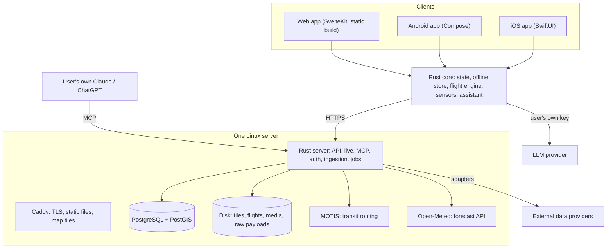

# Architecture

Last revised: 2026-11-20. Facts marked *(to verify)* come from research that could not reach the primary source and must be checked before they are relied on.

## Shape of the system



Three ideas carry the design:

1. **Rust owns everything except pixels and operating-system services.** The same flight engine runs in the phone's recorder, in the browser and on the server.
2. **Nothing outside an adapter knows a provider exists.** External data is normalised into one canonical model before anything else touches it.
3. **One server process, one database, one disk.** Extra services are added only when they are separate upstream projects (transit routing, forecast API).

## Rust workspace

Packages are named `venti-<directory>`, for example `venti-domain`. Built so far: `domain`, `sources`, `sources-dwd`, `sources-geosphere`, `sources-openaip`, `sources-osm`, `sources-openmeteo`, `regions`, `api-types`, `store`, `server`, `flight` (flight files, track summary, track views for drawing, and the live flight computer), `airspace` (the OpenAir reader, airspace queries and airspace warnings; see [airspace.md](airspace.md)), `sensors` (sentence parsers for external varios), `leagues` (what XContest and the DHV-XC take from an app: the days, the signature, the DHV-XC's upload request), `llm` and `tools` (the assistant's provider format and its tools), `mcp` (the protocol of the server's connector), `core` (the logbook on the device, the cockpit session and the assistant), `core-wasm` (the core for the browser), the iOS shell in `apps/ios`, the Android shell in `apps/android` and the web shell in `apps/web`. The rest are planned. `tools/uniffi-bindgen-swift` generates the Swift interface of `core`, and with its second program, `uniffi-bindgen`, the Kotlin interface.

```
crates/
  domain         Canonical types, units, identifiers. No I/O.
  flight         IGC read/write, vario filter, wind estimate, thermal detection,
                 glide geometry, scoring, task logic. No I/O.
  airspace       OpenAir files, airspace queries (what is here, what is near,
                 side view) and the cockpit's airspace warnings. No I/O.
  sensors        Parsers for external instrument protocols. No I/O.
  sources        Adapter traits, manifest types, registry, pipeline.
  sources-*      One crate per provider (sources-dwd, sources-geosphere, ...).
  regions        Loads and validates region packs.
  store          Server persistence behind one interface: PostgreSQL with PostGIS,
                 and an in-memory twin for tests and the development mode. Holds
                 what the data sources deliver (stations, observations, airspace),
                 pilots' accounts and flights, the live tracks of flights under
                 way, and pilots' groups with their plans for a flying day.
  client-store   Client offline store (SQLite). Not built: the logbook and its sync
                 with the server live in `core` so far.
  api-types      The wire format of the HTTP API, shared by server and clients. No I/O.
  tools          Assistant tool definitions: one definition, served in-app and over MCP.
  mcp            The Model Context Protocol as a server speaks it over HTTP: reads a
                 request into what is asked, builds the answer. No I/O.
  llm            Provider clients for the in-app assistant.
  core           Client application core: state, events, view models. UniFFI exports.
                 Today it keeps the logbook: flight files in the app's storage and an
                 index beside them, kept in step with the pilot's server
                 (`account.rs`). It also runs the cockpit session, the assistant,
                 the ground from elevation tiles and every request the apps make
                 of a Venti server.
  core-wasm      The core as a WebAssembly module with TypeScript declarations
                 (wasm-bindgen). The web app's only way into Rust.
  terrain3d      Terrain and flight-replay renderer on wgpu.
  server         The server binary: ingestion scheduler, accounts, pilots' flights,
                 live tracks, map regions for download,
                 HTTP API, share pages, development mode, and the one-shot live
                 run that CI uses as its canary.
apps/
  ios/           SwiftUI shell
  android/       Compose shell
  web/           SvelteKit app
regions/         Region packs (configuration, no code)
deploy/          Compose files, Caddyfile, backup scripts
docs/
```

### Dependency rules

- Dependencies point inward. `domain` depends on nothing in the workspace. `flight`, `airspace`, `sensors`, `leagues` and `sources` depend on `domain`. Everything else may depend on those.
- A `sources-*` crate depends only on `domain` and `sources`. No other crate may name a provider-specific type; only `server`, which assembles the registry, depends on the provider crates.
- `api-types` and `store` depend only on `domain`. The wire format must stay usable in a browser and on a phone, and the store must not know how data was fetched.
- `server` may depend on `flight`: what it says about an uploaded flight is worked out by the code the apps run on the device. It may depend on `tools`: its connector offers the tools the app's assistant has, from the one definition. It never depends on a crate made for the apps alone (`core`, `core-wasm`, `llm`, `sensors`).
- `tools` depends on `domain`, `api-types` and `airspace`. `mcp` depends on no other crate of the workspace, and only `server` uses it. Neither is built from anything that can open a connection, here or outside the workspace.
- Nothing a client is built from reaches a server-side crate: `core`, and every crate that depends on it, never depends on `store`, `server`, `sources`, `regions` or a provider crate, not even through another crate.
- `flight`, `airspace`, `sensors` and `leagues` do no I/O and read no clock. Time, positions and bytes are passed in, which makes every algorithm replayable from recorded data.
- UI shells contain no business rules. If a shell needs an `if` about flying, the logic belongs in `core`.

The test `crates/sources/tests/dependency_rules.rs` enforces the first two rules on every CI run by reading the crate dependency graph. It also fails if anything other than `server` depends on a provider crate, if `api-types` or `store` grows a workspace dependency besides `domain`, if a client crate can reach a server-side one or a server-side crate depends on one made for the apps alone, and it holds `core-wasm` to depending on `core` alone. `flight`, `sensors` and `airspace` are held to `domain` alone. For `mcp` and `tools` it reads the lock file as well and fails if either can reach an HTTP client, a socket library or the runtime such code needs.

## Clients

### The bridge

| Target | Mechanism |
|---|---|
| Swift, Kotlin | UniFFI (0.32 at the time of writing) |
| Web | wasm-bindgen (0.2.130 at the time of writing), in the crate `core-wasm` |

The core follows the one-way pattern used by Proton Mail, Bitwarden and the Crux framework: the shell sends events in, the core returns a view model, and the shell performs the side effects the core asks for (network, storage, sensors). We adopt the pattern, not the Crux framework, to keep the dependency surface small.

Bridge rules:

- The interface is coarse. A screen gets one view-model struct, not twenty getters.
- Per-frame and audio paths never cross the bridge. The vario tone is synthesised natively from a value the core updates a few times a second. Instruments are drawn natively from a snapshot struct.
- One error type crosses the bridge.

What the Phase 0 spike showed (2026-11-18, UniFFI 0.32, Xcode 26.6, Swift 6.3):

- The generated Swift interface compiles in Swift 6 language mode without changes. Records are `Sendable`, the core object can be shared across tasks, and Rust errors arrive as a Swift error with a readable message.
- The core is packaged as one XCFramework of static libraries (device, simulator, Mac) inside a local Swift package. The Mac slice lets the bridge tests run with `swift test` in seconds, without a simulator.
- The module map must be generated with the module name the generated Swift imports (`venti_coreFFI`); the generator's default name does not match.
- Not yet exercised: async functions, callbacks from Rust into Swift, and a physical device. UniFFI's own notes say async code does not yet conform to `Sendable`.

What the Android build showed (2026-11-19, UniFFI 0.32, Kotlin 2.4, Android Gradle plugin 9.5):

- The Kotlin interface is generated at build time by a Gradle task, from a build of the core for the build machine, and compiled with the app. Nothing generated is committed. The same library lets the unit tests call the real core on the JVM through JNA, in seconds and without an emulator: the counterpart of the Mac slice above.
- For the phone, `cargo ndk` builds `libventi_core.so` for `arm64-v8a` and `x86_64`, driven by a second Gradle task. Both tasks run again only when something under `crates/` has changed.
- The generated Kotlin did not compile as it came. The core's error carries its text in a field called `message`, and a Kotlin exception already has a property of that name. The generator's own rename setting (`apps/android/uniffi.toml`) calls the field `reason` on the Kotlin side; the core is unchanged. A new kind of error in the core needs a line there, and the build fails until it has one. A UniFFI "flat" error would give Kotlin the text as the exception's message and need no rename; that is a change to the core's interface and has not been made.
- A Rust error's text therefore reaches Kotlin as `reason`, not as the exception's message, which describes the fields. The app reads it through one extension, `pilotMessage`.
- Not yet exercised, as on iOS: async functions and callbacks from Rust into Kotlin. Not exercised at all: a physical device.

There is no first-party generator that covers WASM, so the web has its own binding crate, `core-wasm`. It is thin. The view types are the core's own: built with its `wasm` feature, the core derives their TypeScript declarations from the Rust definitions (with `tsify`), doc comments included. Only the list of calls exists twice, once for UniFFI and once for wasm-bindgen. A failed call throws a JavaScript `Error` whose message is the core's and whose name is the kind of error. BoltFFI would unify the two bindings but is young.

### Storage

The core keeps whole files under short names (`flights/<id>.igc`, `logbook-index.json`) and reaches them through one small interface, `Storage`: list a folder, read a file, write one, remove one. What makes two files the same flight, the index, summaries and totals are built on top of it and are the same code on every platform. There are two implementations:

- `DiskStorage` is a folder the app owns. The phones use it. The files are where they were before the interface existed.
- `StagedStorage` is for a host that can only store things asynchronously, which is every browser, while the core's interface is synchronous. It knows the names of the stored files and holds none of their contents. A read of a file that is not in memory fails and notes the file as wanted; the host fetches it, hands it over and makes the same call again. Writes and removals are staged, and the host applies them to its own store after the call, all together. What the host handed over is dropped once the call has succeeded.

This is the one-way pattern above applied to storage: the core decides what is stored, the shell does the reading and writing. It also keeps a long logbook out of memory. Opening needs the index only, and a flight's file is fetched when that flight is opened. A lost index is rebuilt a few files at a time.

One suite of tests runs against both implementations (`crates/core/src/storage.rs` and `crates/core/src/logbook.rs`). How the web app stores the files is under [Web](#web). The cockpit's recorder is not behind this interface: it appends to a file in the data folder and exists only on the phones.

### iOS (first target)

- SwiftUI, minimum iOS 26, iPhone in portrait for now. The Xcode project is generated from `apps/ios/project.yml` by XcodeGen and is not committed, so every project change is a readable diff. How the app looks and why is in [design.md](design.md).
- The shell holds no flying logic. One `Core` object is created at launch with the app's data folder; screens ask it for a view (`LogbookView`, `FlightView`) and draw it. Storing flights, recognising a flight that is already there, totals, grouping by year, climb rates and the reduced altitude profile are all the core's work.
- UI tests drive the real app on a simulator and keep a screenshot of every screen; the iOS workflow publishes them. This is how an AI session sees its own interface changes.
- Live wind follows the one-way pattern. For each thing a screen wants from the server the core has a pair of plain functions (`crates/core/src/wind.rs`): one says which path to ask for, one reads the answer into a view, with the wire format of `venti-api-types`. The shell does the request in between. The app asks for the stations of somewhat more than the map shows whenever the map comes to rest outside what it already has, and again every minute while the map is on screen. The age of a reading is measured against the server's clock, which the app reads from `/v1/health`, not against the phone's. There is no server address built in while the project has no server: the pilot types one in the settings, and with none the map has no wind. The UI tests run against `venti-server dev` on the same Mac.
- The cockpit's sensors live in `apps/ios/Venti/Fly`: positions from Core Location (best accuracy, airborne activity type, background updates with a `CLBackgroundActivitySession`), pressure from `CMAltimeter`, an external vario over Core Bluetooth, and the vario tone synthesised sample by sample in an `AVAudioSourceNode`. The app declares the location, audio and Bluetooth-central background modes. To verify on a real iPhone, none of it can be exercised on a simulator: that recording survives hours in the background, that the vario connects and reconnects, and that the tone sounds right.
- The vario is chosen in the app, from a list of every Bluetooth LE device nearby. On a device with one of the known serial services the app listens to that service; on any other it listens to everything the device notifies outside the standard Bluetooth services, and the core keeps whatever is a sentence it knows. That is how a vario whose service nobody has documented (the owner's MipBip) can work without a driver. The vario list shows what the connected device offers and the last lines it sent, and can share that as a report, so an unknown device can be worked out from one test.
- The pilot's name, glider and sound setting are kept in the phone's own settings store, not in the core: they are preferences of this device until accounts exist. The names are passed to the core when a recording starts.
- Map: MapLibre Native (7.0), wrapping `MLNMapView` directly. The SwiftUI wrapper is pre-1.0 and incomplete.
- Recorder: Core Location with a `CLBackgroundActivitySession` and `CLServiceSession` started in the foreground. Apple's guidance and a 2026 developer-forum thread both point to missing sessions as the cause of suspension about a minute after backgrounding.
- Barometer: `CMAltimeter`. The update rate is undocumented and reported at about 1 Hz, which is too slow for a responsive vario on its own.
- External vario over Core Bluetooth with the `bluetooth-central` background mode and state restoration. This is the primary vario source for the owner's setup.
- Vario audio through the background audio mode. It is real audible content, which is what App Review requires.
- Live Activity for a running flight. The system ends a Live Activity after eight hours, so long flights need a restart strategy.

### Android

Built 2026-11-19 with the same sections as the iPhone app; `apps/android/README.md` says how to build it, and `apps/android/AGENTS.md` what has not been tried. It has run on an emulator in CI and on no phone.

- Kotlin and Jetpack Compose with Material 3, one module, minimum Android 8 (API 26), built against Android 17 (API 37). The Gradle wrapper pins Gradle and checks its download; library versions and their licences are in `apps/android/gradle/libs.versions.toml`. How the app looks and why is in [design.md](design.md#android).
- The shell holds no flying logic, as on iOS. What it holds for the life of the process (the logbook's model, the flying session, the vario link) belongs to the application object, not to a screen: Android rebuilds screens whenever it likes, and a recording has to carry on through that. Screens draw what these models hold as Compose state.
- No Google Play Services anywhere, so the app can be distributed through F-Droid: positions come from Android's `LocationManager` and its satellite receiver, and the map's own position marker uses MapLibre's built-in engine over the same manager. The UI tests run on an Android image without Google's services, which checks it on every push.
- Map: MapLibre Native Android 13.7, wrapped directly in a Compose `AndroidView`, in its OpenGL ES build. The library's default build draws with Vulkan, which not every phone from Android 8 on has and which the CI emulator would draw in software. To verify: Vulkan on the phones pilots fly with.
- The shared style is prepared as on iOS and handed to the map as text. The label fonts and the demo region ship inside the app as assets and are copied into the app's storage once per installed version: the map engine reads a tile archive in pieces by position, which it can do with a file and not with an asset.
- The cockpit's sensors live in `apps/android/app/src/main/kotlin/fly/venti/app/fly`: positions from `LocationManager` (satellite provider, one a second), pressure from `SensorManager` (twenty readings a second), an external vario over Bluetooth LE with the same rule for which characteristics to listen to as on iOS, and the vario tone synthesised sample by sample into an `AudioTrack`. Each sensor reports on its own thread straight into the core's session.
- Android reports altitude above the WGS 84 ellipsoid, where iOS reports it above sea level, which is what the core asks for. The shell converts: with the system's own converter from Android 14, and before that with the geoid height the satellite receiver states in its NMEA output. Without either, the ellipsoid height is passed on, about 45 to 50 m too high in the Alps.
- Recorder: a foreground service of type `location`, started while the cockpit is on screen, with a notification and a partial wake lock. It does nothing but keep the process alive and awake; the sensors and the session are the process's. If Android ends the process, the core's recording file is adopted at the next launch. Android 17 applies the same visibility rule to background audio *(to verify: that the tone keeps sounding with the screen off)*.
- The pilot's name, glider, sound setting and remembered vario are in the app's `SharedPreferences`. Cloud backup is switched off for the app, because it tells the pilot that flights stay on the phone; a direct transfer to a new phone is allowed from Android 12.
- The app's requests to servers, the assistant's and the wind map's, leave from one place (`Http`), with the platform's `HttpURLConnection`: no cache, no cookies, and no redirect is followed. What to ask and how to read the answer is the core's. When the assistant's model looks up live wind, the core names an address on the pilot's Venti server and the shell fetches it like the map does, without the key or the question; a server that cannot be reached is told to the model, not shown as an error. The assistant's key is encrypted with a key that lives in the Android Keystore and never leaves it, and only the result is written to the app's own storage. In tests the provider is a script and the key a value in memory.
- Live wind is the iPhone's in substance: no server is built in; the address is the pilot's setting; the server's own clock, read from its health answer, is what ages are measured against; stations are asked for the box in view and a quarter more, once the map rests, and again every minute while the map is on screen and the app in front; they leave the map after fifteen minutes without an answer. How a station is marked (arrow, calm or too old, its heading and its numbers) is the core's, with every station; the app keeps the colours, the sizes and the pictures the map places and turns.
- Requests without encryption: Android's network security configuration can allow them for named hosts or for all, not for "the pilot's own network". It allows all, and `Http` refuses every address that is not HTTPS unless its host is this device, a name without a dot or ending in `.local`, or a private, link-local or unique-local address. The map engine's own requests go to the HTTPS addresses in the style.
- Flight files arrive through the system's document picker, through "Open with" (Android knows no type for IGC files, so the app registers for the types other apps use for them and for names ending in `.igc`) and through "Share". A flight's file leaves through a `FileProvider`. A whole folder is picked in the system's folder picker and read through the document tree it grants, with the platform's own calls and no library: every name ending in `.igc` in it and in the folders inside it, eight levels deep at most, hidden entries left out, oldest name first. Listing a folder and importing run in the app's own scope, away from the screen, so an import carries on when the pilot leaves the logbook; the model counts the files for the screen and reads the list again after every twentieth. The UI test for it shares 22 flights to the app, one of them a named pipe the test fills when it has taken its picture: the count then stands still at a known number on any device.
- UI tests are Compose tests that drive the real app on an emulator and keep a screenshot of every screen in both appearances; the Android workflow publishes them, and the debug build of the app. For the wind map the workflow starts `venti-server dev`, which the emulator reaches at `10.0.2.2`. The unit tests play the server with the answers the server's own tests keep in `crates/server/tests/golden`, so a change to the API that the app cannot read fails here too.
- Map labels: the app ships a font file for every range of Unicode's first 65,536 characters, taken with the demo region from the iOS app's resources; a unit test counts them. An airspace's names have a source apart from its outlines, because a name from a pilot's file can still hold a character from beyond those.
- Airspace is the iPhone's in substance: the core keeps the pilot's OpenAir files, reads them into one index, gives a map the airspaces in view and the session the warnings, worded. The shell draws them on the map tab (not when zoomed out past six degrees of longitude) and around the glider in the cockpit (about 40 km, drawn again every 10 km flown), shows the most urgent warning, passes on "seen" and "does not apply today", and says a new warning aloud with Android's `TextToSpeech`, in British English like the words. To verify: speech on a real phone, with the screen off, and over the vario's tone.
- Airspace from the pilot's server is the iPhone's too ([airspace.md](airspace.md)): the core says when it is due, what to ask and how to keep the answer; `AirspaceModel` sends the request through the app's one place for requests, to the server the wind comes from, when the map has come to rest on a place less than four degrees of latitude high and when a flight has its first position. The request runs in the app's own scope, not the screen's, so an answer is kept when the pilot has moved on. A server that failed is left alone for five minutes. The pilot's choice not to use the server is a preference of the phone, under the iPhone's name. The cockpit's map works out the zoom that shows the airspace of the loudest warning as the iPhone's does, from the map's size in density-independent pixels (`CockpitMap.zoom`, with a unit test). To verify on a phone: a country's whole airspace (a megabyte to read and to write) on a slow phone. A finished flight is checked by the core against the same set (`Core.flightAirspace`); the flight screen asks when it opens and again when the set changes, draws the airspace around the flight under its track, and lists the stretches inside.
- Flying sites are the iPhone's in substance (`apps/android/app/src/main/kotlin/fly/venti/app/sites`): asked of the pilot's server once the map has rested on a part no wider than 0.8 degrees of longitude, for half as much again on every side, used for an hour and not stored; the core says what to ask and reads the answer into what the screens show, words included. They are one source and one symbol layer between the flights and the wind, from zoom 9, with signs the app draws from its own icons at the screen's density. A tap goes to a wind station first where a station and a site lie under the same finger. Keeping a site as a waypoint is the core's `add_waypoint`. The wind measured near a site is the core's `stations_near` over the stations the wind model holds for the map, so a station outside the map and its margin is not listed. The sites of another server, or of none, are dropped at the map's next move. The unit tests play the server with its own recorded answer for `/v1/sites`.
- The forecast of a place is the iPhone's in substance (`apps/android/app/src/main/kotlin/fly/venti/app/forecast`): `WindModel.forecast` asks the pilot's server, for a site, a station or a place pressed on the map (MapLibre's long-click listener), and asks again every five seconds, seven times at most, while the server answers that it is still fetching; the core reads the answer into models, days and hours, with the phone's own offset from UTC for where a day begins. `ForecastRows` lays one day of one model out as rows of cells, as the iPhone's `ForecastTable` does, and words what stands around the table. Which rows a table has and what they are called is therefore written twice, in Swift and in Kotlin; a third shell is the moment to move it into the core. The unit tests read a canned answer in the server's format and the server's own recorded one.
- The account is the iPhone's in substance (`apps/android/app/src/main/kotlin/fly/venti/app/account`): the core hands out each request and reads the answer, `AccountModel` sends it through the app's one place for requests, with the token only where the request asks for it, and runs the sync as the core's loop of steps, every step off the main thread. A sync runs after signing in, when the app comes to the front (at most once a minute), after the number of flights in the logbook has changed by anything but a sync, and when the pilot asks; only one the pilot asked for reports a failure. Sign-in, sync and sharing run in the app's own scope, so leaving a screen cuts none of them short. The session token is sealed under a key in the Android Keystore (`SealedStore`, which the assistant's key uses too, each under a key of its own) and kept in a preferences file that no backup takes and that stays behind when the app's data moves to a new phone; a phone that knows the account and has no token says that it was signed out. This phone's name in the account's list of devices is its maker and model, not the name the pilot gave it. Changing who may see a flight is a `PATCH`, and deleting the account a `DELETE` with a body. Android's `HttpURLConnection` is asked to send both; the UI tests do both on an emulator against the server's development mode, and that is the only check there is, because the class of the same name in desktop Java refuses `PATCH` (tried on Java 21) and the unit tests do not send through it.
- A task is the iPhone's in substance (`apps/android/app/src/main/kotlin/fly/venti/app/task`, and `TaskStrip.kt` beside the cockpit): the core reads, keeps and measures it and makes a route of waypoints; `TaskModel` hands it the text of a file, of the clipboard or of a file another app opens with Venti (told from a flight file by its name, `.xctsk`). When a session starts, `FlySession` gives the core's session the kept task, on the day of the flight, which for a replay is the day it was flown; with every refresh it asks where the flight stands in it and says each of the core's task events aloud once, through the voice that speaks the airspace warnings. The cockpit's map draws the cylinders from the task's outlines, the next one heavier, and the way still to fly, in two sources of their own, and takes the cylinders into the whole-flight view. No QR code is drawn or read: both need a library on Android, and none has been chosen. To verify on a phone: opening a task from a messenger or a mail app, and the voice over the vario's tone.
- Sharing a flight while it is under way is the iPhone's in substance ([Live tracks](#live-tracks)). `FlySession` asks the core once a second whether a request is due; `AccountModel.carry` takes it to the pilot's server with the session token and waits twenty seconds for the answer; the answer, or word that none came, goes back to the core. The session belongs to the app's process, which the recording's foreground service keeps alive with the screen off, so the positions go out wherever the pilot looks, and no screen sends anything. The 26 bytes a link is made of come from `java.security.SecureRandom`. The audience is the setting `VentiLiveAudience`, as on the iPhone, and is taken up when a flight starts; a replay shares nothing. When the pilot ends the flight, the session first lets a request that is on its way be answered, because the core hands out nothing until then, the landing included, and then tells the server of the landing and goes on with positions that still wait from a gap in the network, a batch every quarter of a minute, for a minute and a half at most. That runs in the app's own scope after the service has stopped: Android may end the app before it is done if the pilot leaves it at once, and the track then goes quiet instead of landed. To verify on a phone: that, and what a battery saver does to requests sent with the screen off.
- Who is in the air is the iPhone's in substance (`apps/android/app/src/main/kotlin/fly/venti/app/live`). `LiveModel` asks the pilot's server for the gliders of the part of the map in view once the map rests, a quarter more on every side, and again every fifteen seconds while the map tab is on screen, through the app's own networking, which keeps no answer; a map wider than six degrees asks for nobody. A glider's age is the server's at the moment of its answer plus the time since on the phone's clock, put into words by the core when the screen is drawn: nothing ticks between two answers. While a glider's page is open, a coroutine of that page follows the flight with the core's `LiveFollow`, every ten seconds, and ends with the page. The overview map draws the track with the layers of a flight's line, in a source of its own, and fits it once into the part of the map above the page. To verify on a phone: tapping a glider among wind arrows and site signs.
- The ground is the iPhone's in substance (`apps/android/app/src/main/kotlin/fly/venti/app/terrain/TerrainModel.kt`). The model asks the core which tiles to have around the glider (`Terrain.tilesWanted`), takes each from its folder in the app's files outside the backup where it has it, else from the tile server the map's style names (`MapStyle.Online.TERRAIN_TILES`) with the app's own networking, hands the bytes to the core (`addTile`) and keeps them as `z-x-y.webp`, written beside and moved into place so that a tile cut short is never taken for a whole one. A round ends at the first tile that gets no answer at all: without a network the others would not come either. When the map is drawn from the region that comes with the app, that region's `terrain.pmtiles` is read once (`addArchive`) and nothing is fetched, which is how the unit tests and the UI tests have ground without a network. `FlySession` hands the terrain to the core's session at the start (`useTerrain`) and asks for the ground around the glider with the first position and every ten seconds after; reading, decoding and writing run off the main thread. What the cockpit then says, the height over the ground, a ridge in the way of a glide, a landing with nothing in the way, is the core's. So is the edge of what a straight glide reaches (`FlightSession.glideRange`, asked with the score once a second and drawn by `CockpitMap` as one closed line, `rangeFeatures`), and so is the side view (`FlightSession.airspaceAhead`, asked with each refresh while its sheet is open): `AheadSheet.kt` draws the record it is given, and works out only where the glider's line ends in the picture, as the iPhone's view does.
- A flight of the logbook is replayed from its own file: `LogbookModel.fileText` hands the text the core keeps to `FlySession.startReplay`, at one of three speeds. It is the session a replay of the sample flight uses, so nothing is recorded, and the core refuses to share what is replayed. A replay moves on by the time since the last refresh, and by two seconds of the clock at most (`FlySession.replayStep`): after the app was held for longer it carries on where it was, as on the iPhone.
- The landing within reach is the core's (`FlightSession.landingOption`, `reach`). The session asks once a second with the pilot's waypoints whose kind is landing, and the list of places to fly to asks for the reach of the places it shows with every new position. The shell words a height to ten metres and takes one of three tones from the core's `Reach` (`fly/Reach.kt`); it compares no heights and knows no margin. The amber and the red of everything that warns over a map, the airspace banner included, are now two colours in `Palette`.
- Groups and their plans are the iPhone's in substance (`apps/android/app/src/main/kotlin/fly/venti/app/groups`). `GroupsModel` holds the board the server last gave and nothing else: it asks the core for each request, hands it to `AccountModel.answer`, which sends another part's request to the account's server with the session token and throws where the phone is signed out or no answer came, and lets the core read the answer. The board is asked for from the pilot's own today, which the phone knows and the server does not, when the sheet opens and after every change; what went wrong comes back in the account's words (`GroupsModel.attempt`). The pages are one sheet with a path of its own (`PlansSheet.kt`, `GroupsPages.kt`); what a day is called, how a time is written and what each thing done to a group means are in `PlanWords.kt`, apart from the screens, for the unit tests.
- Everyone's flights are the iPhone's in substance (`apps/android/app/src/main/kotlin/fly/venti/app/community`). `CommunityModel` asks the pilot's server with the core's path, keeps the pages it was given, and asks for the next when the last row of the list is drawn. A flight is opened by fetching its file, which the core prepares as it prepares one of the logbook's (`flightFromFile`, `flightAnalysisFromFile`) for the flight screen's own map and panel; the bytes are held for that screen and written nowhere. A pilot's page (`pilotPagePath`, `pilotPage`) is kept in the model as well, so that it is there when the pilot comes back to it from one of its flights. Every flight a list has shown is remembered by its identifier while the app runs, and the one that is opened is looked up there, whichever list it came from. Where the pilot is, is kept by that identifier alone: when Android has ended the app in between, the lists are gone, and the route leads back. A report is the core's as well (`reportForm`, `reportRequest`, `reportSent`): `ReportSheet` shows the form, and `AccountModel.report` sends the request to the account's server with the session token, from the app's own scope so that it goes on when the form is closed, and hands back the core's line or its refusal. Nothing of a report is kept on the phone. Whether a report can be sent at all, with an account on the server the thing is on, is decided in `ReportWords.obstacle` as the iPhone decides it in its form.
- The cockpit's map is given the glider and its track as one piece of data, so it cannot draw one without the other, and is moved at an even pace to arrive as the next position is due. The thermals the glider has left, and the wind in each band of height, are the core's lists (`CockpitView.thermals`, `windsByHeight`); the shell draws the first as dots with the core's label, in a source of their own, and lists the second. The picture of the thermal being circled in is the core's as well (`CockpitView.lift`), and the shell works out nothing of it: the circle to fly, the places of the last circles and the middle are features of the glider's own source, each marked with what it is (`CockpitMap.liftPicture`), drawn by layers between the thermals left and the glider, the places with a layer for each band of climb, as the trail has, and a size from the core's strength; when the core gives no picture, none of it is in the source. The iPhone has three sources for them. Here the map draws each source in its own time: an emulator's screenshot showed the dots a refresh ahead of their ring and of the glider, and what cannot be drawn apart is one piece of data, as the glider and its track are. The badge's words and the way its arrow points are the core's too. So are the wind's age and the line about a wind that leaves the glider little way (`CockpitView.windAgeS`, `strongWind`): the shell shows an age from 300 seconds on, as the iPhone does, shows the line while the core hands one out, and knows no other threshold. Where to fly for an FAI triangle is the core's too (`FlightSession.faiAreas`, asked with the score): two outlines drawn dashed, unless the pilot's setting leaves them out. The whole-flight view fits the smallest box around the glider, the scored route, those areas, the take-off and the place flown to, and fits again only when something has grown out of it. To verify on a phone: how the map follows at a real flight's one position a second.
- Compose draws a UI test's frames only when the test asks for them. A test that sleeps looks at a screen frozen at the moment it fell asleep, the map included, which made the cockpit's map look as if it could not keep up with a replay. The tests' waits therefore keep asking for frames (`TestDevice.letTheAppRun`). A screenshot is the other way round: the last frame is asked for, the map is waited for until a frame it draws has all it was given (`TestDevice.letTheMapFinish`, two seconds at the most: a long track takes the emulator longer than a line of two points, and the glider then stood beside the line that starts at it), its thread is given four tenths of a second more, and no frame is asked for in between (`TestDevice.keepScreenshot`), so that the map and the numbers around it are of one moment; taken straight after the frame, a picture of a replay at twenty times its speed showed the numbers of one refresh over the map of the one before. A test's look at the screen also waits for the screen to come to rest, and gives up after a minute. The cockpit refreshes five times a second; on the emulator's software renderer a frame of it takes most of a second, more with a sheet open over the map, so it never rested and two cockpit tests failed that way in one run. In a UI test the cockpit therefore refreshes every two seconds (`FlySession.SLOW_REFRESH_MILLISECONDS`); the unit tests run it at its real pace. A replay goes on while a test looks, so what a test wants to see together during a thermal or a glide it looks for at one look (`waitForAll`), and what comes late in a flight it waits eight minutes for (`TestDevice.WHOLE_FLIGHT_SECONDS`): a replay that does not leap takes as long as the emulator needs.

To verify on a real phone, none of it can be exercised on an emulator: that recording survives hours with the screen off and what manufacturers' battery savers do to it, the altitude conversion, the pressure sensor as a vario, everything about Bluetooth, the tone, and "Open with" from real file managers.

### Web

- SvelteKit built to static files and served by Caddy. No Node process on the server.
- MapLibre GL JS 6 for maps. The Rust core runs as WebAssembly for flight analysis and the offline store.
- Pages that must unfurl in chats and be indexed (flights, sites, profiles, events) get their HTML head and a text summary rendered by the Rust server; the web app then takes over. Revisit with a server-rendered SvelteKit build if search indexing proves too thin. Built for flights: see [Share pages](#share-pages). The web app is not linked from them yet.

What exists (2026-11-19, SvelteKit 3.4, Svelte 5, Vite 8, MapLibre GL JS 6.19): `apps/web` has the map tab with live wind, flying sites, the forecast for a place and who is in the air, the logbook with its statistics and with everyone's public flights beside it, and the flight screen of the iPhone app, over the same core, the pilot's account (signing in, keeping the logbook in step with the server, sharing a flight with a link), and airspace on both maps, from the server and from the pilot's files, with a flight checked against it. Since 2026-11-20 it also has the flying plans of the pilot's groups, as a section of its own, and draws a flight's altitude profile over the ground it was flown over. It has no cockpit and no assistant, and of the settings only what a browser has use for. Nothing is deployed. `apps/web/README.md` says how to build, run and test it.

- **Static files and nothing else.** Every page is written out at build time as its own `index.html`, with compressed copies beside it. No page needs a rewrite rule or a fallback page, so any static file server serves the app. A flight is therefore named by a query parameter, `/logbook/flight/?id=…`, not by a part of the path. The pages hold the app's frame; flights exist only in the browser and are drawn there.
- **The shell holds no flying logic.** Screens ask the core for a view and draw it, as on the iPhone. What the TypeScript does besides drawing is what the Swift does: formatting numbers, the tables of climb and wind colours, cutting a track into runs of one colour, the pictures for the symbols the core gives the wind stations, fitting a thumbnail into its box, stepping the marker along the track when a flight is played.
- **The core runs in a worker.** The page sends it calls and waits for answers (`apps/web/src/lib/core`: `client.ts` on the page, `worker.ts` in the worker, `protocol.ts` the list of calls). Nothing the core does can hold up the page, which matters for long flights. Measured in Node on the build machine, with the browser tests running beside it: the sample flight of 29 minutes imports in about 90 ms and opens in about 20 ms; a flight of eight hours, 28,800 fixes, takes about 1.3 s to import, 0.2 s to open and 0.9 s to analyse. To verify on a phone.
- **Building the core.** `apps/web/scripts/build-core.sh` compiles `core-wasm`, runs the wasm-bindgen tool in the version `Cargo.lock` names, and then removes what only the phones use. The core is one crate, and its UniFFI interface is compiled into the browser's module too: well over a hundred exported functions that no page calls, each keeping alive what it reaches (the cockpit, the recorder, the assistant, airspace). The script takes those exports out with Binaryen and lets it drop everything they held, and prints what that saved. On 2026-11-19, with the account, the sync and airspace bound for the browser, 2,194 KB became 947 KB (386 KB compressed with gzip). On 2026-11-20, with everything since bound too, the reader of elevation tiles with its WebP decoder and groups and their plans the last of it, 3,923 KB became 1,577 KB (618 KB compressed with gzip); the groups and plans are 88 KB of that. The module grows with the core, the part for the browser more slowly than the whole.
- **The label fonts and the sample flight** are the files in `apps/ios/Venti/Resources`. The repository holds one copy of each and the web build takes them from there.

#### The logbook in the browser

The core's files are kept in IndexedDB: one database, `venti`, with an object store `files` (a file's bytes under the name the core gives it, the same names as on a phone's disk) and an object store `meta` that holds one counter, the store's revision. `session.ts` and `idb-store.ts` in `apps/web/src/lib/core` are the browser's side of the [storage interface](#storage) and know nothing about flights.

| Situation | What happens |
|---|---|
| The page loads | The worker reads the names of the stored files and the revision, and hands the names to the core. The core asks for the index; a flight's file stays in the database until that flight is opened. |
| A flight is imported or deleted | The core stages the changes (the flight's file and the index). The worker writes them in one transaction and only then answers that it worked. |
| The index is missing, damaged or from an older version | The core rebuilds it from the flight files, which the worker fetches eight at a time, so memory stays bounded however long the logbook is. |
| Two tabs | Every write first checks, in the same transaction, that the revision is still the one the tab last saw, then raises it. A tab that is out of date writes nothing: it reads the store again and repeats its change, which then includes the other tab's. After a write the tab tells the others over a `BroadcastChannel`, and they read the store again and redraw. A browser without `BroadcastChannel` loses only the redraw. |
| The disk is full | The transaction fails as a whole. The worker rebuilds the core from what is stored, so the flight is not listed, and the page names the file with the reason. The rest of that import is not attempted. |
| The browser gives the page no storage (some do in private windows) | The logbook is kept in memory for the visit, and its screen says that the flights are gone when the page is closed. |
| The browser removes the site's data | Possible when the device is short of space, and in Safari after seven days without a visit *(to verify: Apple's stated policy for storage written by scripts; not tested)*. After the first import the page asks the browser to keep its data (`navigator.storage.persist()`), which browsers grant by their own rules. The imported files remain the pilot's copy until flights are synchronised with a server. |

A flight file is read as UTF-8, or as Western European text if it is not valid UTF-8, and handed to the core as text. Like on the iPhone, a file with characters outside ASCII is therefore not stored byte for byte. To verify: whether that breaks a recorder's signature check for such files; if it does, `import_flight` has to take bytes.

#### Maps in the browser

- The style is prepared from `map/style.json` as on the iPhone: OpenFreeMap for the base map, Mapterhorn for terrain up to zoom 12, with the terms and the limits given under [Maps and terrain](#maps-and-terrain). The map shows both sources' credits, written out on a wide map and folded into a button on a narrow one.
- Label fonts are served by the app. The build gives each font file a name with a hash of its contents, so the style's `{fontstack}/{range}.pbf` cannot name them; the style gives a `venti-font://` address instead and the page tells MapLibre how to answer it. The shared folder has a file for every range of 256 characters up to 65,535, most of them without glyphs; the build takes all 256 in, the small ones inside the script that names them. A font or a range that is in no file is answered with an empty font and not with an error, so a label loses those characters instead of failing its whole map tile.
- 3D terrain is MapLibre GL JS's own, on the flight screen: the same elevation tiles as the relief shading, added as a second source because MapLibre prepares a source differently for the two uses. The track lies on the ground in this view, not at the height it was flown; a replay at flown height is the `terrain3d` renderer's job.
- The end-to-end tests draw the map from the region bundled for the iPhone's tests, without the network and without a switch in the app: the test browser answers the app's requests to the two tile services from those files (`apps/web/e2e/bundled-map.ts`).

#### Wind in the browser

- **The server is the one the site is served from.** The app asks its own origin for `/v1/…`, beside its own files, as it will when one web server hands out both. There is no address to set, at build time or by the pilot, and no other origin to allow. A site that only hands out the files answers the first question, `/v1/health`, with "not found": the map then has no wind and says nothing about it, which is the iPhone app without a server address. Any other answer that cannot be used is told to the pilot in words: the core's for a server in trouble, "could not be reached" for none at all.
- **The worker sends the requests** (`apps/web/src/lib/core/wind-source.ts`). The core, which says what to ask for and reads the answer, runs there, so an answer never crosses to the page and back as bytes. The worker also keeps how far the server's clock is ahead of the device's, read from `/v1/health` at most once a minute.
- **The page keeps the wind for the part of the map in view** by the rules of the iPhone's `WindModel` (`apps/web/src/lib/wind/watch.ts`): it asks for a quarter more than the map shows, once the map has rested outside what it has, and again every minute while the map is on screen and the browser tab in front. After fifteen minutes without an answer the stations are taken off the map.
- **While developing and in the tests** Vite passes `/v1` on to `cargo run -p venti-server -- dev` on the same machine, and `/f` and `/live`, where the pages of shared flights and of live tracks are, so the app is used the way it will be served: one origin for both.

#### The account in the browser

- **The server is the one the site is served from**, as for the wind. The core remembers the account by that address, and the link to a shared flight is that address with `/f/…`; the web server in front has to pass both `/v1` and `/f` on.
- **The worker sends the requests** (`apps/web/src/lib/core/account-source.ts`). The core hands out a request and reads the answer; the worker sends it in between, without the browser's cache, without cookies, and without following a redirect.
- **The session token is kept in IndexedDB**, in the `meta` object store beside the store's revision: not among the core's files, read by the worker only, and written in the same transaction as the account the core remembers, so the two arrive and leave together. A page has no Keychain. Whatever its code can read, a script on the same origin can read, and with the server's API as it is the token has to be readable to the code that sends it. `apps/web/AGENTS.md` says what was weighed; the decision log has what the server would need for something better.
- **A sync is the core's step machine, one step to a turn.** Each step is a call to the core like any other: the files it turns out to need (the account, a flight's file to send) are fetched and the step is taken again, and what it changed is stored before the next request goes out. Between two steps the page's other calls take their turns, so the app stays usable while flights travel. A sync that is cut off has lost nothing.
- **When a sync runs** is the iPhone's rule (`apps/web/src/lib/account/model.svelte.ts`): after signing in, when the site is opened, when its tab comes back to the front (at most once a minute), after an import or a deletion, and when the pilot asks. Only one asked for by the pilot reports a failure; being offline is no news.
- **Two tabs.** Only one tab of the site syncs at a time (a Web Lock, where the browser has them); the next one waits and finds the work done. A run belongs to the core that began it: when another tab changes the store under it, the run's next step is refused, and a new run starts from what is stored. Signing in or out in one tab is seen by the others through the store, like an import.
- **Who may create an account** is in the server's health answer, and the core hands it out with the rest of that answer (`ServerStatus.registration`: open, by invite, closed, or nothing). The worker reads it with the server's clock, the account's model asks for it when the app starts, and the form for a new account shows the field for an invite code, or no form, by it.
- **Storage that fetches on request** needed three things of the core that a phone's disk never asked for: a sync step that can say "fetch this file and call me again" instead of failing or skipping (`FlightSync::start_when_fetched`, `receive_when_fetched`), a deletion that reads the account before it deletes, and an airspace set that is not built from the files that happen to be in memory.

#### Airspace in the browser

- **The core keeps it and answers for it**, as on the phones: the pilot's OpenAir files and the one answer kept from the server are files in the browser's store, and the core builds one set from them, in the worker. It reads every file once and keeps the set; a map's question is then a look-up. [airspace.md](airspace.md) has the rules.
- **The server's airspace** is fetched by the worker (`apps/web/src/lib/core/airspace-source.ts`) when the core says it is due, around the middle of what a map shows; when is the iPhone's rule (`apps/web/src/lib/airspace/model.svelte.ts`): whenever a map has come to rest somewhere, not while a request is under way, and not for five minutes after one failed. A site without a server is never asked. The pilot can switch it off, which deletes what is kept; that choice is a preference of this browser (`localStorage`), like the phone's.
- **A map asks when it has moved, not for a frame** (`apps/web/src/lib/airspace/view.ts`): once it has come to rest outside the area it has the airspace of, it asks the core for a quarter more than it shows; again when the airspace itself has changed; and not at all below zoom 7, where nothing is drawn. The shapes cross from the worker to the page as plain objects and become one GeoJSON source with five layers, under the flights.
- **A finished flight is checked by the core** against the same set (`Core::flight_airspace`, bound as `flightAirspace`), and the flight's details list what it entered. The flight screen asks when it opens and again whenever the airspace changes, as when the server's arrives a moment after the flight is on screen. Over the browser's storage the question is repeated until the flight's file and every airspace file have been handed over; it is never answered from the airspace that happens to be in memory, which would say "nothing was checked". A test in `core-wasm` and one over IndexedDB (`session.test.ts`) reload the store between bringing the airspace in and checking.
- **What a file left out, and whose the server's airspace is**, is said where the phone says it: at import, on the file's row, and with the provider's credit, licence and notice on the airspace screen. On the maps the credit is a line. The sentences about files speak of the map where the phone's speak of warnings: a browser has no cockpit.

#### Flying sites in the browser

- **Asked for, not kept**, as on the iPhone. The worker sends the request (`apps/web/src/lib/core/sites-source.ts`); the core says what to ask and reads the answer into what the screens show, words included. Nothing is stored among the core's files: the browser's own cache reuses an answer for the hour the server allows.
- **When** is the iPhone's rule with the zoom in place of the map's width (`apps/web/src/lib/sites/watch.ts`): from zoom 9, once the map has rested outside what it has the sites of, for half as much again on every side, and an answer is used for an hour. Zoomed out, the screens are shown no sites; the answer is kept for when the map comes back.
- **A layer of their own.** The sites are one GeoJSON source and one symbol layer, between the flights and the wind, with signs the app draws itself (`symbols.ts`), and their credit is a line of its own on the map. OpenStreetMap's licence is share-alike, and nothing here joins its records to other data.
- **A site without a server** has no signs and no button for them, like the wind.

#### Forecasts in the browser

- **Asked for when looked at, and not kept.** A site's page and a station's page lead to the forecast for their place. The worker sends the request (`apps/web/src/lib/core/forecast-source.ts`); the core says what to ask and reads the answer: every model by itself with its run, its grid cell and its ground, the levels named, each wind with its band and its label. The browser's own cache reuses an answer for the minute the server allows.
- **The days are cut by the browser's clock**: the worker tells the core how far that clock is ahead of UTC, as the phones tell it theirs.
- **The table is laid out in the shell** (`apps/web/src/lib/forecast/table.ts`), as on the iPhone: which days and hours are shown, the order of the rows, a height rounded to the hundred, a dot for an hour without rain, and the sentence that says what the numbers are. It is the iPhone's layout written a second time; what the values are and what the levels are called is the core's.
- **A site without a server** has no forecast and says so in the sheet; the server's own refusals (no forecast service, outside its area, busy) are shown in the core's words with a way to ask again.

#### Who is in the air, in the browser

- **Asked for, not kept**, by the worker (`apps/web/src/lib/core/live-source.ts`). The core says what to ask and reads the answer: `liveMapPath` and `liveMap` for the gliders of a box, and its reader of one track, `LiveFollow`, which lives in the worker for as long as a glider's page is open and is let go of when it closes. `crates/core-wasm` binds the three and `liveAgeInWords`.
- **Past the browser's cache, with the validator named by hand.** The server lets these answers be kept and checked again, and says "not modified" while nothing has changed. A browser's own cache would then hand the app the body it kept, with the server's clock of an earlier moment in it, and every age would start again from that moment at each question. So the worker asks with `cache: 'no-store'` and sends `If-None-Match` itself, with the validator of its last answer to the same address; the browser then hands the `304` over as it is. On a `304` the worker hands the page its last answer again under the same number, and the page keeps the moment that answer first came. A position's age is its age at the server's `time` in the last answer given in full, plus the time since by the browser's clock: what [api.md](api.md#live-tracks) asks of a client. The server is spared the full answer, which the iPhone asks for every time.
- **When** is the iPhone's rule (`apps/web/src/lib/live/watch.ts`): a quarter more than the map shows, once the map has rested outside what was asked for; again every fifteen seconds; nobody on a map wider than six degrees; and an answer that does not come leaves the gliders where they were, with their ages counting on. A followed flight is asked for whole, then every ten seconds for what arrived since, and at once while the server has more. Neither is asked while the browser tab is not in front (`model.svelte.ts`), and both are asked at once when it is again.
- **The words for an age are the core's, second by second.** The page works out each age and has the worker put it in words (`liveAgeInWords`), once a second while a list or a glider's page shows ages. Which words an age gets, and that silence is never called a landing, stays the core's.
- **On the map** the gliders are one GeoJSON source and one symbol layer above everything but the pilot's own position, with pictures the app draws itself (`symbols.ts`: the iPhone's wing and disc). The followed flight is a second source under the sites and the wind, drawn in the climb colours by the layers a logbook flight has on its own screen. Whether a glider has landed or gone quiet, and its label, arrive with it from the core.
- **The link goes to the server's page.** `/live/…` is the server's, which the web server in front passes on like `/v1` and `/f`; the web app has no route under it.
- **A site without a server** has no gliders and no button for them, like the wind.

#### Everyone's flights in the browser

- **Asked for, not kept**, by the worker (`apps/web/src/lib/core/community-source.ts`). The core says what to ask and reads the answers: one page of everyone's public flights (`public_flights_path`, `public_flights`), one pilot's (`pilot_page_path`, `pilot_page`), and one flight by its address (`public_flight_path`, `public_flight`). The browser's own cache keeps an answer and checks it with the server before every reuse, as the server asks.
- **A flight is opened in two steps**: first what the list says about it, which names the pilot and the paths of its file and of its page, then the file, which the core reads by the code that reads the logbook's (`flight_from_file`, `flight_analysis_from_file`). The result crosses to the page as a view and is gone with the page: nothing is written to the browser's store, and the logbook does not know the flight. Because the first step is the server's `GET /v1/flights/{id}`, a flight shared by link only opens the same way for whoever has its address.
- **The page keeps the list for as long as the app is open** (`apps/web/src/lib/community/pages.ts` holds the rules, `model.svelte.ts` the state): what is asked for, the pages fetched so far, and where the next begins. Another order or other days are another list, read from its top. A page that cannot be fetched leaves what is listed and says why.
- **The days are the reader's**: a day chosen in a date field is the span from its first second to the first second of the day after, by the browser's clock, handed to the core as moments. That is the offset the API's document asks a client to write.
- **Three pages, written out like the others**: `/logbook/everyone/`, `/logbook/everyone/pilot/?handle=…` and `/logbook/everyone/flight/?id=…`. What is asked of the list is in the first one's query.
- **A site without a server** has no switch in its logbook, and the pages say that there is no server.
- **A place's page is two answers, kept apart** (`/logbook/everyone/place/`). The worker first asks for the sites around the place (`site_at_path`, `site_at`: the site named in the address, or the take-off nearest to the place within a kilometre), then for the public flights and the ranking of the square a kilometre and a half to each side of the site, or of the place where there is no site (`area_around` with `FLOWN_FROM_HERE_M`, bound as `flownFromHere`). The site is shown as the map shows it, in a section of its own with its source's credit and notice; the flights and the ranking are the server's answers about the pilots' flights. Nothing of the site goes into a row, a flight or the ranking, and nothing of them into the site: the only thing they share is where on the map they were asked about. The page's title is the site's name, read from the site's answer.

#### Reports in the browser

- **Sent by the worker, from the pilot's account** (`apps/web/src/lib/core/account-source.ts`): the core hands out the request, which needs the session token, and reads the answer into the one line the form shows afterwards. What the core refuses, words missing with "Something else" or more words than a report has room for, never reaches the server.
- **The form is the core's** (`reportForm` in the browser's binding): its six reasons, the line about each, how long the words may be, and the notice that says who reads a report. The page asks for it once. `apps/web/src/lib/community/ReportSheet.svelte` lays it out and holds no rule: that nothing is sent before a reason is chosen is the one thing it enforces by itself, as the iPhone's form does.
- **Three entries, one form**: another pilot's flight (by its address), a pilot's page (by handle) and a live track (by its identifier), each handed to the form as the subject the core's request takes.

#### Flying plans in the browser

- **Sent by the worker, from the pilot's account** (`apps/web/src/lib/core/groups-source.ts`): the core hands out each request about a group or a plan and reads the answer, refusals included, and the worker sends it in between with the session token, as it sends a report. Nothing is kept: no group and no plan is among the core's files or in the browser's storage, and an invite code is held by the page for as long as its sheet is open.
- **The account is read before an answer is.** In an answer about groups the pilot is "you", a plan is "mine", a group "kept by you", and the core tells by the handle of the stored account. Over a browser's storage that file is fetched on request, and the core's readers take "not fetched yet" for "signed out": read as they are, every plan would be somebody else's after a reload. So the binding looks at the account first (`call_as_the_pilot` in `crates/core-wasm`), which makes the call fail for want of the file, and the session fetches it and calls again like for any other file. A test in `core-wasm` and one over IndexedDB (`groups-source.test.ts`) reload the store between signing in and reading the board.
- **Today is the browser's.** The board is asked for from a day on, and that day is the date of the browser's clock where the pilot is (`apps/web/src/lib/groups/days.ts`), worked out on the page and handed to the worker with the question. It is the iPhone's rule. [api.md](api.md#plans-for-a-flying-day) suggests the server's clock read in the device's zone; the two differ only where a device's clock is wrong, and the development mode's clock, which stands still, would make every day the 18th of November.
- **The rules of asking are apart from the state** (`apps/web/src/lib/groups/board.ts` and `model.svelte.ts`, as for everyone's flights): signed out nothing is asked and a board from before is put away; only the newest answer is shown, so that a board asked for before a change does not come back after it; an answer that does not come leaves the board and says why. The board is asked for when one of the four pages opens, after every change, when the pilot signs in or out, and when the tab comes back to the front.
- **Four pages, written out like the others**: `/plans/`, `/plans/plan/?id=…`, `/plans/groups/` and `/plans/groups/group/?id=…`, under a fourth section of the navigation. A plan's page reads the plan from the board, as the iPhone's does, because the server has no address for one plan; a plan that is not on the board, deleted or of a day gone by, is said to be no longer there. A group's page asks for the group with its members.
- **What the screens hold is words and layout.** Who may change or delete a plan, who keeps a group, who is in "in a line", a group's "3 members · kept by you" and every refusal arrive from the core. The page's own sentences are the iPhone's (`apps/web/src/lib/groups/words.ts`), with the questions asked before something is done to a group.
- **A site without a server** has the section and says there that groups and plans are kept by a Venti server; signed out, it says that plans need an account, and nothing is asked.

#### The ground under a flight, in the browser

- **The core reads it, in the worker** (`apps/web/src/lib/core/terrain-source.ts`, and `Terrain` in `crates/core-wasm`, bound like the reader of a live track). When a flight's screen opens, the page hands the worker the flight's bounds and its track; the core says which tiles cover the flight (`tilesCovering`), the worker fetches each and hands it over as it came (`addTile`), and the core answers with the ground at up to 240 moments of the flight (`groundUnder`). The terrain is one of its own for each flight and is freed with the answer: a tile's heights are half a megabyte, and a flight of some tens of kilometres has up to three dozen.
- **From the map's own tile server, and no other host.** The address is the one the map's style has for its relief (`ONLINE.terrainTiles` in `apps/web/src/lib/map/online.ts`), which the content security policy and the header for the workers already allow. The requests are plain ones, as the map makes them, six at a time.
- **Nothing is kept but what the browser's cache keeps.** The tile server lets a tile be kept for a week (`Cache-Control: public, max-age=604800`, seen on 2026-11-20), so a flight opened again, and the map and the ground between them, fetch a tile once. The app stores no tile and no height: the phones keep tiles on the device to have the ground without a network in the air, and a browser has no cockpit.
- **What does not come is left out.** A tile the server does not have leaves the ground under that stretch unknown (the public server answers `404`, seen on 2026-11-20; any answer but `200` is read the same way); so do bytes that are no elevation tile. A request without any answer ends the fetching: without a network the others would not come either. The page then has fewer moments or none, draws no ground where there is a gap, and reads the time in the air at the marker as before.
- **Only the newest flight is worked on.** The page numbers its questions; opening another flight, or leaving the flight's screen, lets go of the one before, and its remaining tiles are not asked for.
- **The whole track crosses to the worker and into the core.** `ground_under` takes the track and chooses the moments itself, so the shell chooses none. For a flight of eight hours, 28,800 positions, fetching apart, that and reading the ground from two tiles took about 50 ms in Node on the build machine (2026-11-20). To verify on a phone.
- **Drawn by the chart** (`apps/web/src/lib/flight/ground.ts`, `AltitudeChart.svelte`): one filled shape for each stretch the ground is known along, between the flight's own shape and its line; the height over the ground at the marker is that of the nearest moment the ground was read at, as on the iPhone.
- **A site without a Venti server** has the ground all the same: the tiles are the map's, not the server's.

#### The content security policy

- **Every page carries one**, written into it by the build as a `meta` element ahead of everything the page loads: SvelteKit's `csp` setting with hashes (`apps/web/vite.config.ts`), over the list in `apps/web/src/lib/app/security-policy.ts`. `apps/web/AGENTS.md` has every entry with the reason it is there. The policy starts from "nothing" and allows the app's own files, the two tile hosts, and `data:` addresses for images and for the label fonts the build keeps inside a script. No inline script but the one that starts the app, by its hash; no inline style but one of SvelteKit's, by its hash; no text made into code.
- **It is what protects the session token** against a script that is not the app's: such a script does not run, and a page can send nothing to a host the app does not use.
- **It does not reach the workers**, and it cannot say who may frame the site. Both need a header from the web server; `apps/web/AGENTS.md` has the two lines. The core's WebAssembly is compiled in its worker, which is why the page's policy needs no `'wasm-unsafe-eval'`.
- **The browser tests fail on anything the browser refuses** under the policy (`refused` in `apps/web/e2e/helpers.ts`), which is how the list was found and how it stays true.

#### How it is tested

Unit tests (Vitest, in Node) call the real WebAssembly core over an IndexedDB implemented in memory: reload, two tabs, a full disk, a lost index, and the page's conversation with the worker. For the wind and the flying sites they read the server's own recorded answers (`crates/server/tests/golden`), so a wire format that drifts fails here too. For groups and plans they play the server from its recorded answers too. For the ground under a flight they hand the core real elevation tiles, cut one by one from the region the iPhone app bundles (`apps/ios/Venti/Resources/MapDemo/terrain.pmtiles`), on the way the app takes them: fetched by address and added as images. End-to-end tests (Playwright, Chromium) use the built site as a pilot would, with the server in its development mode behind it, and keep a screenshot of every screen at a phone's width and a desktop's, in light and dark; the test browser answers the worker's requests for elevation tiles from that same region, as it answers the map's. The `Web` workflow runs both and publishes the screenshots. Not tested: Firefox, Safari, and any real phone.

## The cockpit

How a sensor reading becomes a number on the screen:

```
phone GPS, phone barometer, Bluetooth vario      (shell: owns the sensors)
        │  each sample with the time it was taken
        ▼
core::FlightSession                              (core: one object per flying session)
   ├─ sensors::SentenceReader + parse            bytes from the vario → readings
   ├─ flight::live::FlightComputer               pure; no clock, no I/O
   └─ Recorder                                   appends each fix to a file at once
        │  CockpitView, pulled about five times a second
        ▼
screen and vario tone                            (shell: draws and synthesises)
```

- **No clock in the computer.** Every sample carries its own time and the shell passes "now" when it asks for a view. A recorded flight replayed through the same code therefore shows exactly what the pilot saw; `core::Replay` does that, and it is how the cockpit is tried on the ground and tested.
- **Climb rate** comes from the best source that is still talking: the external instrument's own vario, else a Kalman filter over pressure altitude (the instrument's pressure if it sends any, else the phone's), else the same filter over satellite altitude. A source silent for three seconds is dropped. When the pressure sensor changes, the filter starts again, because two sensors disagree by a constant.
- **Altitude** is pressure altitude plus a slowly followed correction toward satellite altitude: as smooth as the barometer, as true as the satellites.
- **The ground** comes from the map's own elevation tiles, the ones that shade its relief (`flight::terrain`, `core::Terrain`). A tile is a square image on the web map's grid in which a pixel's colour is a height (Terrarium: red × 256 + green + blue / 256 − 32768 metres). The shell fetches tiles as WebP images, or has an archive of them in the PMTiles format, and hands the bytes over; the core decodes them and keeps the heights, a metre apart at the finest. It works with zoom 12, where a pixel of a 512-pixel tile is 13 m wide at the latitude of the Alps, asks for the five by five tiles around the glider, and lets go of those more than four tiles away. Between pixels the height is the mean of the four around. A session that was given terrain (`FlightSession::use_terrain`) knows the height above ground wherever a tile covers the glider, hands the ground to the airspace warnings, so that a limit given above ground is placed exactly and a warning is no longer "possibly", and draws the ground in the side view. Checked on the tiles that come with the iPhone app: they give the Wallberg's summit as 1,717 m (published: 1,722 m), the Tegernsee as 725 m (published: 725 m) and the sample flight's take-off as 1,621 m. **To verify:** the height above ground in the air against a landing and against known ground; what the model does over forest, cables and buildings, which it does not know; and tiles finer than zoom 12, which Mapterhorn has for some countries.
- **Wind** is fitted while circling: ground velocities around a circle lie on a circle whose centre is the wind and whose radius is the airspeed. It needs no compass and no airspeed sensor, and it does not assume the pilot flew a perfect circle over the ground. Only one unbroken stretch of turning is fitted. The glider counts as turning while its velocity over the ground changes by 0.7 m/s each second or more, which is a turn of 4°/s at 10 m/s whatever the wind. The change is taken over four seconds, each velocity against the one four seconds before, and dated to the middle of them: from one second to the next a velocity worked out from a flight file's positions, which are rounded to two metres, changes by more than that with the glider flying straight. So the fit runs two seconds behind the glider, and the stretch counts as a circle when, seen from the fitted centre, its velocities lie in ten of twelve sectors: that is the direction the glider pointed in, which goes around once per circle in any wind. The direction of travel over the ground does neither in a wind near or above the glider's speed. The circle is fitted twice: the second time without the velocities that lie more than 1.5 m/s off the first, or more than twice what they all do on average if that is more. Those are the seconds of rolling in and out, where the glider flies faster than in its circles; the fit made as the glider leaves a thermal is the one that stands for the whole glide after it. From one velocity to the next the glider is taken to have pointed at everything in between, up to a third of a circle, so that a recorder writing a position every four or five seconds, which leaves five or six to a circle, gives a wind too; a fit needs six velocities. A circle is flown one way round: of all the turning from one velocity to the next, seen from the fitted centre, four fifths must be left when left and right are set against each other. Velocities that ring a point in no order, which is what pulling up and pushing over or straight flight through rough air leaves, are no circle however well they fit one. A wind more than twice the speed the glider circled at is refused as well. A fit is refused when the velocities lie further from the circle than 2 m/s or a quarter of its radius, root mean square, and each fit carries a quality (how close they lay, times the share of the circle covered) by which it counts in the mean of its band of height.
- **Circling** uses the rule XCTrack documents (90° of turn within 30 s while not sinking faster than 0.5 m/s). It ends when the turn within 30 s drops under 30°. The turn is measured over the ground and, once a wind is known, through the air with that wind taken off, and the larger counts: in a wind stronger than the glider is fast the track over the ground swings from side to side and never comes around.
- **The thermal's picture** (`live::thermal`) is what a thermal assistant draws. Each place flown through in the last fifty seconds of a climb is moved with the wind to where its air is now, which turns the loops over the ground back into the circles flown. A circle is fitted to those places, and around it the climb as a mean and a lean (least squares, both). The middle of the lift is the circle's middle moved toward the stronger side: a full radius for a lean of 1 m/s, never more. No centre is given for less than three quarters of a circle or for places that lie further from the circle than 0.35 of its radius, which is what a wrong wind leaves. The climb shown at a place is the mean over two seconds either side; the fit takes the readings as they came. To verify in the air: the measure of 1 m/s for a radius, and that a vario's delay and a position's cancel.
- **Recording** cannot lose a track to a crash: each fix is appended to `recordings/<start>.igc` in the data folder as it arrives, and that file is a complete flight file at every moment. Stopping imports it into the logbook and removes it; one found at launch is imported then.
- **The vario tone** is described by the core (pitch, rhythm) and synthesised by the shell.
- **Airspace warnings** come from `airspace::WarningEngine`, which is fed the computer's state once a second and, like the computer, reads no clock. It is built and tested, and since 2026-11-19 the session feeds it (`crates/core/src/airspace.rs`); [airspace.md](airspace.md#feeding-the-engine-from-the-cockpit) says how.

To verify in the air: the take-off and landing thresholds, the tone table and the filter's settings are first values. None has flown yet.

## Maps and terrain

All map data is self-hosted open data, stored as PMTiles files and served as static files with HTTP range requests. The apps download the same files for offline use; MapLibre Native reads them from local storage.

Until the server exists, the iOS app fetches its tiles from two public services of the same open data, so that the map covers wherever a pilot has flown and not only the demo region:

| Layer | Service | Terms, read on the provider's page 2026-11-18 |
|---|---|---|
| Vector base map | OpenFreeMap, `tiles.openfreemap.org` (unmodified OpenMapTiles schema, the one our style is written for) | Free public instance, "no limits on the number of map views or requests", commercial use allowed, attribution required. [openfreemap.org](https://openfreemap.org/) |
| Terrain | Mapterhorn, `tiles.mapterhorn.com` | A public tile endpoint is documented on [mapterhorn.com/data-access](https://mapterhorn.com/data-access); no usage limit is stated there. To verify with the project before any public release. Attribution required. |

The app asks Mapterhorn for terrain only up to zoom 12, the level it serves for the whole world; finer tiles exist only for some countries and return "not found" elsewhere. Both services see the IP address and the map areas of whoever uses the app. This is a development arrangement, not the product: it ends when our own tile server is up, and it must end before a public release unless both projects agree. Since 2026-11-20 the same terrain tiles are also read for their heights: the 25 tiles around the glider while the cockpit is open, fetched once each and kept on the iPhone and, since the same day, on Android, and the tiles under a flight when its page is opened. That is a few megabytes per place flown at and no more requests than the map itself makes for the same tiles, but it is one more thing that depends on this arrangement, and a cockpit that knows the ground only where it has had a network; downloading a region's terrain ahead of a flight is being built: since 2026-11-20 the core reads a region's elevation archive from its file, tile by tile as the glider moves (`Terrain::open_archive`), and reads the list of regions a server hands out (`crates/core/src/maps.rs`); since the same day the iPhone app downloads a region from the pilot's server and flies with it (`apps/ios/Venti/Maps`), and the Android and the web app do not.

| Layer | Source | Notes |
|---|---|---|
| Elevation | Mapterhorn | Includes Bavarian DGM1 (1 m), Austrian BEV (1 m), swissALTI3D and South Tyrol. Used for hillshade, colour relief, 3D and height-above-ground. |
| Contours | Pre-generated vector tiles from the same elevation data | MapLibre Native has no on-device contour generator, so all platforms use the same pre-built tiles. |
| Vector base map | OpenStreetMap through a custom Planetiler profile | Starts from the OpenMapTiles profile and adds what alpine flying needs: path difficulty (`sac_scale`), material ropeways, power lines, free-flying sites. |
| Style | Our own MapLibre style | One style shared by iOS, Android and web. A high-contrast variant for sunlight in the cockpit. |
| Official maps | basemap.at, Bavarian DTK25 | Switchable raster layers, both CC BY 4.0. |
| Imagery | basemap.at orthophoto, Bavarian DOP20, Sentinel-2 cloudless 2016 elsewhere | For the 3D viewer and an aerial layer. |

### What exists so far

- `map/style.json` is the shared style. It names its tiles and fonts with placeholders that each app replaces with local or remote URLs.
- A small demo region (the Tegernsee valley, about 7 MB) is bundled with the iOS app under `apps/ios/Venti/Resources/MapDemo`: a vector base map, terrain tiles and label fonts. `tools/demo-map/build.sh` rebuilds it. It uses the stock OpenMapTiles profile and terrain only to zoom 12; the custom profile, contours and high-resolution terrain are not built yet.
- The iOS app prepares the style for one of two tile sources: the public services above (the default), or that bundled region. The UI tests use the bundled region, so the offline path is drawn and checked on every push. Label fonts always come from inside the app.
- Confirmed on the simulator (2026-11-18): MapLibre Native reads vector and terrain archives through `pmtiles://file://` URLs, decodes the WebP elevation tiles, and loads label fonts from a `file://` glyph URL. No network is involved.
- The Android app prepares the style the same way and takes the same files, from where the iOS app keeps them, into its assets at build time.
- Since 2026-11-20 the iOS app downloads a region from the pilot's Venti server (`apps/ios/Venti/Maps`). The two archives are fetched with range requests into `Application Support/Maps/.incoming/<id>/<version>/`, checked by the core against the size and SHA-256 the server listed, and moved to `Maps/<id>/<version>/` with a `region.json` beside them: the region as the server described it, in the server's own format, so that the app knows what it holds without a server to ask. The folder is left out of the iPhone's backup. A third source of the style, a kept region, points the shared style at those two files, and the terrain model opens the elevation archive for the core to read heights from.
- Since 2026-11-20 the server hands out map regions for download, which is its side of "the apps download the same files" (`crates/server/src/maps.rs`, [api.md](api.md#maps)). Whoever runs it keeps one folder for each region, with the region's archives and a `map.toml` that names them, their SHA-256 and their credits. `GET /v1/maps` lists the regions whose files the server has read and found to have those hashes, and a file is fetched whole or by its range of bytes under an address that holds the region's version. The files are never compressed on the way and no time limit applies to them. The bundled demo region has such a `map.toml`, and the development mode hands it out when it is started with `--maps apps/ios/Venti/Resources`. `tools/region-map/build.sh` is written to build the first region's folder and has not been run: no region of real size exists, and every size named for one is an estimate. [deploy/README.md](../deploy/README.md#map-regions) says where regions go and how one is renewed, and [deploy/AGENTS.md](../deploy/AGENTS.md#map-regions) what was tried and what the estimates rest on. Mapterhorn's terms for handing an extract of its tiles on to many pilots are *to verify* before a public release, like its tile service above.

### 3D

MapLibre Native has no production 3D terrain. The work exists as a draft pull request with no timeline. MapLibre GL JS on the web does have it.

The 3D viewer is therefore our own renderer: the `terrain3d` crate on wgpu, reading the same elevation and imagery tiles. It draws a quadtree terrain mesh with draped imagery, track ribbons and pilot markers, with a free camera. It embeds in a Metal layer on iOS, a surface view on Android and a canvas on the web (WebGPU, with a WebGL2 fallback because Firefox on Linux and Android still lacks WebGPU by default).

This is the largest single piece of custom engineering in the project. It is confined to replay and route preview; the cockpit and planning maps are 2D with hillshade and contours and do not depend on it. Revisit when MapLibre Native ships terrain pre-releases.

### Live overlays

MapLibre Native slows down with around a thousand symbols that use sort keys and halos. Overlay rules: few symbol layers, no sort keys, feature-state for updates, and a custom layer for objects that move every second (live pilots).

## Server

Everything runs on one Linux server under Docker Compose.

| Process | Role |
|---|---|
| Caddy | TLS, static web app, PMTiles, media files |
| `server` (Rust, Axum) | REST API, live tracks, MCP endpoint, authentication, ingestion scheduler, background jobs, map regions for download. One binary; roles can be split later with flags. |
| PostgreSQL + PostGIS | The only database |
| MOTIS | Public-transport routing, self-hosted with open timetable feeds |
| Open-Meteo | Forecast API, self-hosted, syncing open model data |

Deliberate omissions: no Redis (live tracks are rows in PostgreSQL that clients ask for; the job queue is a Postgres table), no WebSocket ([Live tracks](#live-tracks) says why), no object store (blobs live on disk behind a small trait, so an S3-compatible store can replace it), no search engine (Postgres full-text and trigram), no Node runtime, no managed services.

### What the server does today

The server collects station observations, airspace and flying sites and serves them, it answers point forecasts from an Open-Meteo instance of the operator's when it is told where one is ([Forecasts](#forecasts)), it keeps pilots' accounts and flights, it takes the positions of flights under way and shows them to those their pilots let see them ([Live tracks](#live-tracks)), it takes pilots' reports about what is shared and lets whoever runs it take things down ([Reports and taking down](#reports-and-taking-down)), it keeps the groups pilots make and the plans their members post for a flying day ([Groups and plans](#groups-and-plans)), it hands out the map regions that whoever runs it put in a folder, for apps to draw without a network ([Maps and terrain](#what-exists-so-far)), and it answers a pilot's own assistant over MCP at `/mcp` ([mcp.md](mcp.md)). MOTIS is not built.

`venti-server` is one program with these subcommands:

| Subcommand | What it does |
|---|---|
| `serve` | Runs the server: collects the sources of the configured regions on their schedule, keeps accounts and flights, stores everything in PostgreSQL, serves the API and the share pages, hands out the map regions of its maps folder, removes old data |
| `dev` | Serves the same API over payloads recorded from the providers, a demo account with three flights and three live tracks, two further pilots with three flights each, and two groups with four plans for a flying day between them, from an in-memory store. No network, no database. Its clock stands still at the moment of the recording, so every start gives the same answers. With `--maps FOLDER` it also hands out the map regions of that folder, as `serve` hands out those of its `maps_dir`. For client work and UI tests |
| `ingest <region.toml>` | Runs a region's sources once against the live providers, those of observations, of airspace and of flying sites, and prints a health line for each. A forecast source is asked for the forecast of the middle of the region, if `VENTI_OPEN_METEO_URL` says where it is, and passed over if not. Stores nothing. CI runs it daily as the canary, from the image a server runs |
| `invite` | Makes invite codes for a server that takes accounts by invite, and prints them |
| `reports`, `close-report` | Lists what pilots reported, with who reported it; closes a report with a note. See [Reports and taking down](#reports-and-taking-down) |
| `take-down`, `release` | Makes one flight private against its pilot's setting and keeps it so; lets it go again |
| `remove-live-track` | Removes one live track and retires its identifier |
| `suspend-publishing`, `resume-publishing` | Takes from an account the ability to make a flight or a live track public, without deleting anything; gives it back |
| `derive` | Reads one flight file and prints what the server works out from it. The server runs this itself, as a child process, for every upload; see [Flights](#flights) |

**Collecting.** Each source has one task that runs it, waits and runs it again; that loop is what guarantees a source never runs twice at once and that a slow source delays no other. A run goes through the pipeline of the `sources` crate (fetch, archive, parse, merge, validate); the validated records and the outcome of the run are then written to the store in one transaction. The wait is measured from the start of one run to the start of the next and is never shorter than the source's cadence, which is what keeps the server inside a provider's hourly request limit. A random delay of up to a tenth of the cadence is added. After a second failed run in a row the wait doubles each time, up to an hour. A restarted server reads the run history and waits out what is left of the cadence. A run takes the last three hours from each payload, so values that a provider publishes late still arrive and a short database outage heals itself.

**Fetching.** Every request to a provider leaves through one fetcher, which keeps to bounds of its own whatever an adapter or a provider's answer asks: HTTPS only, except to the addresses the server's configuration names with `http://`; no redirect to another host; no answer larger than the source's manifest allows, read in pieces and not taken into memory whole; ten seconds to connect and two minutes for a request. [data-sources.md](data-sources.md#what-the-fetcher-will-not-do) has the details and what a new source declares.

**Collecting airspace** uses the same loop, with one source so far: openAIP, once a day, one file for each of the eight countries the first region's box reaches into. What differs is what a run is. It delivers the whole airspace the source has for the server's regions, and that set replaces the one stored before, in the same transaction that writes down the run. It does so only if the run was healthy, which for airspace means that every request worked. A run that could not fetch one country's file changes nothing: half an airspace set is worse than yesterday's whole one, because a pilot is not warned about airspace that is missing. The store holds to that rule itself, whoever calls it. A failed run is tried again a day later, by the rule above that no wait is shorter than the cadence.

Every airspace carries the date of the file it was read from. openAIP's files have no date inside, so the pipeline takes the date its file store puts on each file (the `Last-Modified` of the response), and the time of the run where a provider gives none. On 2026-11-19 a live run dated the Austrian airspace 01:12 UTC and the German 01:57 UTC, which is when openAIP had written the two files.

**Collecting flying sites** is the same loop and the same kind of run: once a day the server asks an Overpass API instance for every place in its regions' box that carries OpenStreetMap's free-flying tags, in one request, and the set replaces the stored one if the request worked and the instance finished its query. The set is dated by the instance's own word for how old its copy of OpenStreetMap is. Which instance is asked is a setting (`overpass_url`). The server has not yet run this against the main public instance: *to verify* on the first installation.

**Storing.** Stations carry a PostGIS geography position; a box query runs on a spatial index over its planar view. Observations are one row per station and time, in monthly partitions that are created when their first observation arrives. Writing an observation again merges it: a new measurement replaces the stored one, a missing measurement leaves it alone, and a row that would not change is not rewritten. Old data leaves by dropping whole months. Airspace is one row per airspace: the canonical record as the JSON the API sends, and the box around its outline in four columns with a spatial index over them. A second table has one row per source with the set it holds: when it was fetched, how many airspaces, the oldest file date and the newest change, and where the set is whole (the box its run collected for and the countries it fetched). Airspace is not removed by age; a source's set stays until a healthy run replaces it. Flying sites are kept the same way: one row per site with the canonical record as JSON and its position in two columns under a spatial index, and one row per source with the set it holds. Of forecasts the store keeps one small table, the run each weather model was at when the server last looked; the forecasts themselves stay with the forecast service. Accounts, sessions, flights and live tracks are described below. The schema is a numbered list of SQL files compiled into the program and applied at start.

**Serving.** The API is described in [api.md](api.md). Every answer with station data names the source of each record and carries that source's credit line; a station belongs to exactly one source, so data under different licences never shares a record. A station whose source is not in the server's configuration is not served, even if the store still holds it. Airspace goes out in layers, one per source, each with the time the server fetched it, the date of its files and the area in which the set is whole, and the answer carries each source's credit and the notice its terms ask for. A source is a layer in every answer, also where it has nothing: only so can a client tell "no airspace here" from "not held". openAIP's licence is non-commercial with a share-alike condition, so its layer is never mixed with another's: not in a record, not in a list. The measured size of a whole region's airspace, and why one answer carries it, are in [api.md](api.md#get-v1airspacebboxwestsoutheastnorth). Flying sites go out the same way, in layers by source, each with the date its source's data is of. OpenStreetMap's licence is share-alike, so its layer too is never mixed with another's.

**Configuration** is a TOML file, environment variables, or both; a variable wins. `crates/server/config.example.toml` documents every setting. The database URL holds the only secret and is never printed.

How the server is run on a machine is in [deploy/README.md](../deploy/README.md).

### Forecasts

Decided and built on 2026-11-19: the canonical series in `domain`, the adapter trait and the run in `sources`, the adapter in `sources-openmeteo`, and the server's part in `crates/server/src/forecast.rs`. It has run against recorded answers and against no instance on a schedule: *to verify* on the first installation.

A point forecast is the one kind of data the server does not collect ahead. The self-hosted Open-Meteo instance beside it already is a store of forecasts that answers for any point at the model's own resolution. So the server asks it when a pilot asks, and keeps the answer for a while:

```
GET /v1/forecast?lat=&lon=
        │  the place, rounded to 0.02°; refused if outside the regions
        ▼
  an answer kept for that place, younger than half an hour?  ── yes ──▶ serve it
        │ no
        ▼
  is it being fetched already?  ── yes ──▶ wait for that answer
        │ no
        ▼
  has the instance been asked as often as it may this hour?  ── yes ──▶ 503, Retry-After
        │ no
        ▼
  sources::run_forecast (the pipeline: plan, fetch, parse, validate)
        │  per model: which run does the instance hold, then the series
        ▼
  keep the answer, serve it
```

- **One path.** A forecast goes through the pipeline and a fetcher of the kind every source uses, so it is budgeted and validated like everything else, and the adapter stays pure.
- **Honest about age.** Every series names its model and the run of the model, holds only the hours that run computed, and the answer says when the server fetched it. An answer is reused for half an hour at most, so what a pilot sees is never more than that behind what the instance holds. An answer that lacks a model is handed on and kept for two minutes.
- **One client cannot take the hour.** What the instance may be asked is one budget for everyone, so a request that makes the server fetch is counted for the address it comes from: 12 places an hour for one address, 48 for an IPv6 /48 network, counted before the fetch like every other attempt. A forecast that is at hand is not counted, nor is a request the budget itself turns away.
- **Bounded load on the instance.** Answers are reused; a place that many ask for at once is fetched once, by a task that finishes also when those who asked give up; two places are fetched at a time; and every request to the instance is counted against the manifest's hourly limit (400), whoever caused it. A tenth of the hour is held back for the server's own look. When the rest is used up, a place that is not at hand gets `503` with `Retry-After`. A request waits eight seconds for a forecast that is being fetched and is then told to ask again.
- **Health on a schedule.** The scheduler has a job for the forecast source like for every other. Every ten minutes the collector asks the forecast service for the forecast of the middle of the source's area, fetched afresh and archived, and writes down whether that worked and which run each model is at. That is the source's entry in `/v1/health`. The forecasts that pilots cause are not archived: there would be a copy of the instance's data on disk within days.
- **No fallback.** A server that was not told where its Open-Meteo instance is has no forecasts and says so, in `/v1/health` and with `501` at the endpoint. No adapter knows an address of its own, and the server never asks Open-Meteo's public service, whose terms are for non-commercial use within daily limits per address.
- **The one request that makes the server ask a provider.** Everything else the API answers from the database. Here a request leads to a fetch, and what it contributes is two numbers, checked and rounded; the address is the adapter's, made from the server's configuration at start. The request handlers still name no fetcher: they hold the forecast service, which lives outside `api/`.

In the development mode the service answers from recorded answers, which exist for five places. A place anywhere in the first region gets the forecast of the nearest of them, and the answer's `point` says which. That mode's forecasts were recorded a day after its wind, so the forecast service has a clock of its own there.

What a series holds and lacks is in [data-sources.md](data-sources.md#forecasts); what the instance needs is in [deploy/README.md](../deploy/README.md#forecasts).

### Flights

A pilot's flights live on the phone first. The server is where they are kept safe, reach the pilot's other devices, and can be shared.

**The file is the truth.** An uploaded IGC file is kept byte for byte: a recorder's signature covers every byte, and a league accepts only the file it signed. Everything else the server says about a flight (start, take-off and landing, airtime, distances, the score, an outline for thumbnails, an altitude profile) is worked out from the file by `venti-flight`, the code the apps run, and stored beside it with the version of the analysis that produced it. When that version goes up, the server works every stored flight out again after its next start, in the background, and each flight that changes shows up as changed to its pilot's devices.

**Identity and address.** A flight's identity is the hash of its fixes that the apps' logbooks use; the server computes it itself and never takes a client's word for it. One account holds an identity once, which is what makes an upload repeatable. The flight's address on the server, used in paths and share links, is a second identifier: it is derived from the account and the identity, so the same flight uploaded again gets the same address, and nobody who merely has the file can work out a link to it. Two accounts that upload the same recording hold two flights.

**Analysing a file from a stranger.** The analysis is quick on real flights (a made-up twelve-hour flight takes about half a second) and can be made to take minutes by a file built for it: 20 000 fixes that zigzag across the globe kept one core busy for two and a half minutes (measured 2026-11-19; the simplification of a track is quadratic in the worst case). A thread cannot be stopped from outside. So for every upload the server starts a copy of its own program (`venti-server derive`), hands it the file, and kills it if it is not done within ten seconds. Two run at a time; the rest wait. The server takes in eight files at once, two from any one account, and refuses further ones before reading them, so uploads cannot fill its memory. A file that had to be killed counts fifty times against its account's daily uploads, and one that was not killed counts in proportion to the time its analysis took beyond the first second, which no real flight needs. A file gets 100 seconds to arrive and may not stand still for more than 10, so a place cannot be held by a connection that sends nothing; an upload that ends that way counts for fifty as well. The same weakness exists on the phone, where a crafted file can hang an import; that is for the flight engine to fix.

**How much an account keeps.** 25,000 flights and 4,096 MB of flight files, counted as they were uploaded, unless the configuration says otherwise (`accounts.flights`, `accounts.storage_mb`). The numbers are meant never to be met by a pilot: twenty years of a thousand tandem flights a year are 20,000 files and about a gigabyte, twenty years of 150 four-hour flights a year about two. Whether a flight fits is decided by the store in the transaction that stores it, under the lock on the account's row, so two uploads cannot share the last place. And a file is taken only if it is mostly positions: the flight file reader skips every line it does not know, so a date, one position and megabytes of anything else read as a flight, and the server would keep that byte for byte and hand it out. What is not a position line may be as large as the position lines plus 64 kB. Neither rule stops someone who writes their bytes as lines that read as positions; the room of an account is what bounds that.

**Who sees a flight.** Private (the default), unlisted (anyone with the link) or public (listed on the pilot's page). To everyone but its pilot a private flight does not exist: the answer is the one for an address that belongs to no flight, in status, headers and body. Followers-only joins the list when follows exist; the wire format already tells clients to expect values they do not know. The pilot chooses, with two exceptions that whoever runs the server can make by hand: a flight that was taken down is private until it is released, and an account whose publishing is suspended shares by link at most ([Reports and taking down](#reports-and-taking-down)).

**Everyone's public flights.** Since 2026-11-20 one list holds the public flights of all pilots ([api.md](api.md#public-flights)): the newest first, or the best first by the points the server works out for every flight; narrowed, if asked, to the flights that took off in a box of the map and to those that started in a span of time. It is what a page of "flights of today" or "best flights from here" needs, and it is the community's first list: there are no follows yet, so it is not a feed of the pilots one follows.

- **The row is the flight.** A row of the list is the record that a pilot's page lists and that `GET /v1/flights/{id}` answers, and the answer has the shape of the logbook's own list. The apps read it with what they have. It is larger than a row has to be, by the outline for a thumbnail: [api.md](api.md#public-flights) has the sizes.
- **One truth about who sees a flight.** The list reads the one column that says who may see a flight, and three indexes that hold the public flights and no others: by start, by points, and by where they took off. Nothing a request carries can take the condition out of the question. An answer has no count of anything, and the mark from which a next page goes on names the last flight that was listed: a flight that is private or shared by link shows in no page, behind no filter and after no mark. The handler looks at what the store hands it once more before it answers.
- **Which index answers depends on what is asked.** A box around one take-off holds a few flights, which are found by their place and sorted. A box around the Alps holds most, and then the list is walked in its order and what lies elsewhere is left out. PostgreSQL chooses, and it can only choose with the box and the times in hand, so this one question is planned for every request and not kept prepared like the store's others. It also needs the take-off as a column of its own: for a point worked out inside an index PostGIS guesses one row in ten thousand whatever the box.
- **Measured** on 2026-11-20 with PostgreSQL 16 and PostGIS 3.4, on a million made-up flights of 2,000 pilots over ten years, three in four of them public and a tenth of them from one valley: of twenty-two questions (either order; no bound, a day, a week, a month, a year; a box around one take-off, a valley, a quarter of the region, everything and nothing; a page deep in the list), seventeen took under 2 ms and the other five between 2 and 15 ms. The slowest was the best of a box that holds one flight in two hundred: 3,645 flights found by their take-off and sorted. None read the table from end to end. Planning adds about 0.3 ms. The machine was a development container with a warm cache: *to verify* on the server, with real flights.
- **Not built:** a name for the place a flight took off from. The server has flying sites, from OpenStreetMap under a share-alike licence, and a flight is its pilot's own; nothing of the one is put into the other. A client that wants a name asks for the sites near the take-off.

**Syncing devices.** Every upload, deletion or change to a flight takes the next *change number* of its account, in the same transaction, under a lock on the account's row. A device remembers the largest number it has seen and asks for what came after; because numbers are handed out in the order the changes become visible, it never misses one. A deleted flight leaves only its address and identity behind, so that other devices can be told. Change numbers follow the clock (microseconds, or one more than the last if the clock has not moved), so after a restore from a backup new changes still sort after everything a device saw before. A device whose number lies beyond the account's latest is told to start again and to compare its whole logbook.

**Where the files are.** In PostgreSQL, compressed with gzip, in the row of the flight. Compression saves about two thirds: the half-hour sample flight is 65 kB as a file and 20 kB stored, so a long flight is a few hundred kilobytes. In the database a flight and its file appear and disappear in one transaction, deleting an account is one statement that takes everything with it, and the nightly dump that already exists is the whole backup. On disk they would need a second backup, a way to find files whose row is gone, and care on every delete. The database stays manageable for a long time at these sizes; when the dump becomes too slow or the files too many, they move behind the blob trait the plan names for media.

### Share pages

A public or unlisted flight has a page at `/f/{id}` and a picture at `/f/{id}/preview.png`. The page is for people and for the preview fetchers of chat apps: its head carries Open Graph and Twitter-card lines, its body the flight's numbers, its track and altitude profile as inline drawings, and a link to the flight file. It is one HTML document with its style inside, light and dark, with no script and no request to anywhere else. The picture is drawn by the server in Rust (`tiny-skia`), with the Nunito typeface compiled in for the numbers; no map is under the track, because there is no tile server yet. A picture is drawn once and kept in memory under the flight's address and change number, the last 64 of them: a link posted to a chat is fetched by every member's app, and drawing takes about ten milliseconds of a whole core. Who may see the flight is asked before a kept picture is handed out, every time.

Everything on the page that a pilot or a file supplied is escaped, and the page forbids itself all scripts with a content security policy, so a mistake in the escaping could deface a page but not run code. The addresses in the page come from the configured `public_url`, never from the request.

#### Proposal, not built: a link the pilot can renew

Finding L7 of the security review of 2026-11-19. This is a design for the owner to accept, change or drop. Nothing of it is in the code.

**What is so today.** The link to a flight is `/f/` and the flight's address, and the address is worked out from the account and the flight's identity (above). It is the same value that names the flight in every path of the API. So:

- A link never changes. A pilot who made a flight unlisted, sent the link to a group and later thinks better of it can make the flight private; when they share it again, with anyone, the old link works again for everyone who ever had it.
- A flight that is deleted and uploaded again gets its old address, and its old links with it.
- The key to an unlisted flight is in every path its pilot's own devices ask for, and so in any log of requests. The server names the path when it logs a request that failed; Caddy keeps no log of requests as it is set up.

**The proposal.**

| | |
|---|---|
| A share token | Each flight gets a second value beside its address: 26 characters from 128 random bits, like a session's identifier. It is drawn when the flight first becomes unlisted or public, and kept in a column of its own with a unique index. A private flight that was never shared has none |
| The link | `/f/{token}` and `/f/{token}/preview.png`. The flight's address opens no page |
| What goes with a link | Without a session, a public flight is still read by its address under `/v1/flights/{id}`: it is listed in its pilot's public logbook anyway. An unlisted flight is read without a session only by its token, under `/v1/shared/{token}` and `/v1/shared/{token}/igc`, which are what its page links to |
| For the pilot | The flight as its own pilot reads it gains `share_path`, the text `/f/{token}`, left out while the flight is private. Nobody else is shown it |
| Renewing | `POST /v1/flights/{id}/share-link`, signed in, for one's own flight that is not private: a new token is drawn, the old link answers with the page for "no such flight" from that moment, and the answer is the flight with its new `share_path`. Counted per account, as uploads are, so that it cannot be asked for without end |
| Going private | Discards the token. Sharing the flight again draws a new one: a link lives until the pilot stops sharing or asks for another. *(For the owner to decide: the other choice keeps the token, so that hiding a flight for a while breaks no link)* |
| Flights shared before the change | Their token is set to their address, once, when the column is added, so every link that was handed out keeps working until its pilot renews it |

**Why it is not built.** The apps make the link themselves: the core builds it from the server's address and the flight's `id` (`crates/core/src/account.rs`; `share_path` in the API's types does the same). A server that changed what a link is made of would have every app showing links that open nothing. The change therefore starts in the core and the three apps, which were outside the work that wrote this down.

**What it takes.**

1. Server and store: the column and its index, the token drawn on the first sharing, `share_path` in the pilot's view of a flight, the page and the picture found by token, the two `/v1/shared/` reads, the renewing request, and the store's suite for all of it on both stores.
2. The API's types and the core: `share_path` read from the flight instead of built, and a call for renewing. A record of the core gains a field, which the web app's hand-built test records then need.
3. The apps: "New link" beside "Copy link", with one sentence saying that the old link stops working.
4. In this order, so that nothing breaks on the way: the server first, answering both the old address and the token; the apps next; then the server stops opening pages by address for flights whose token was renewed or drawn after the change. Flights shared before it keep their old link, which is their address, until renewed.

**What it does not change.** Whoever has a link sees what an unlisted flight shows: its numbers, its track and its file. What a share hands out is a separate decision of the owner's.

### Live tracks

Built on 2026-11-19: on the server the storage, the API ([api.md](api.md#live-tracks)), the page a link opens, and the development mode's three demo tracks; in the core what an app needs to send (`core::live`, below) and to read the list of who is in the air; on the iPhone the sending, the public gliders on the map tab with a page for each, and the flight of the glider whose page is open as a line on the map. The Android app sends and shows gliders as the iPhone does; since 2026-11-20 the web app shows the public gliders too, with a page for each and the followed flight as a line ([below](#who-is-in-the-air-in-the-browser)), and sends nothing, having no cockpit. The server runs on no machine.

**The app's side.** A flight is shared only when the pilot switched that on, and from take-off: positions on the ground before it are not collected. `LiveShare` in the core follows "How an app sends" in the API's document. It keeps every position until a request that carried it was answered, sends what has gathered every fifteen seconds, the newest sixty first (which fills a gap at 240 positions a minute, under the account's 300), says a landing and a narrower audience at once with the newest position, waits as long as the server asks (two minutes at most) and twice as long after each request without an answer (a minute at most), drops what the server refuses for good, and stops in words when the identifier takes no more. It reads no clock and sends nothing: the shell asks once a second whether a request is due, carries it with the account's token, and hands back the answer or says that none came. The identifier is made from 26 bytes the shell takes from the system's source of random numbers; the core has none of its own, and it refuses 26 equal bytes. A flight replayed in the cockpit is never shared: the session notes the replay, drops any sharing and refuses to begin one. When the pilot ends the flight the app tells the server "landed" with what still waits, trying for a minute and a half after the cockpit has closed.

**Who is in the air.** `live_map_path` and `live_map` in the core are the usual pair: what to ask for a box, and the answer read into gliders for a map, each with its age by the server's own clock at the moment of the answer; the shell lets its clock run on from there. `live_age_in_words` puts an age into words and never calls a quiet glider landed. The iPhone asks with the cache switched off: the answers may be kept and revalidated, but a kept answer carries the server's time of an earlier moment, and an age worked out from it would start again from nothing.

**Following one flight.** `LiveFollow` in the core is the reader of one track: its `path` asks for the whole track the first time and afterwards for what arrived since the last answer (`since`), and `receive` puts the answers together by the positions' seconds, so that one that arrives late out of a tunnel finds its place and one that comes twice is held once. It starts again when the server says `reset`, and a `404` ends it in words. For the map it hands out at most 4,000 points, every second or third position of a long flight and always the newest.

A signed-in pilot's app sends the positions of one flight in batches; the server keeps them as a live track and hands them to whoever may see it: everyone, for a track its pilot made public, or whoever has the track's identifier, which is its link.

```
POST /v1/live/positions            a batch of 1 to 120 fixes, with the track's identifier,
        │                          who may see it, and whether the glider has landed
        ▼
  counted for the account (300 fixes a minute)
        │
        ▼
  looked at (crate::live::check)   not what the API asks for: refused whole
        │                          a fix from the future or older than 12 h: left out, counted
        ▼
  store.save_live_fixes            one transaction under a lock on the track's row;
        │                          a fix for a second the track has: nothing changes
        ▼
  live_tracks  (one row: who, who may see it, landed, the newest fix, how many)
  live_fixes   (one row a fix: time, where, and its number in the order of arrival)

GET /v1/live?bbox=                 the public tracks with a fix in the last 30 min, from live_tracks alone
GET /v1/live/{id}?since=           one track; the fixes that arrived since, by their numbers
GET /live/{id}                     the same as a page of words for people
```

- **The app makes the identifier**, 130 random bits. A batch sent twice adds nothing, the link exists before the first answer, and nobody can guess it. Whoever has it sees the track, so it is treated as a secret everywhere: it is in no log line and no error message, and the request log leaves it out of the path (`api::log::logged_path`).
- **An identifier is used once.** A track that is deleted, or removed for its age, leaves its identifier behind in `live_retired`, and fixes sent under it are refused for good. A link that was handed out can therefore never come to show another track, and a deleted track cannot come back with fixes that were still on their way. Deleting an identifier nothing has arrived under yet takes it out of use in the same way.
- **Any order.** After a gap in the network an app sends where the glider is now and then what it missed, and a request that was lost is sent again. So nothing depends on the order in which requests arrive: a fix is known by its second; and who may see the track and whether it landed is what the request with the newest fix said, where a request for the same moment can only narrow the one and assert the other. Both stores decide this with one function (`venti_store::live::merge`), whose test tries the same batches in six orders.
- **Followed by arrival, not by time.** Every fix gets its track's next number as it is stored. A viewer asks for the fixes after the last number it saw (`since`) and misses none, also not those that fill a gap behind what it already has. Asking by time alone would never show them.
- **Asking again is cheap.** The validator of an answer about a track is worked out from the track's one row and the request's parameters, before any fix is read. A viewer that asks every few seconds and finds nothing new costs one indexed read and gets a `304`. That is what stands in for a WebSocket: no connection is held open, nothing is kept per viewer, and any number of server processes could answer.
- **The server never says "landed" by itself.** A track has landed when its app said so. A track whose newest fix is older than half an hour is quiet, which the API leaves to the reader to see from the times and the page says in those words; it leaves the list of public tracks and stays readable by its link.
- **Kept for 48 hours** after its newest fix (`retention.live_hours`), then gone: the API stops answering for it at that moment, the maintenance job deletes the rows within the hour, and the nightly dump never held them. A live track is where a person was, and it is not a flight: nothing turns one into a logbook entry.
- **Bounded.** Per account, counted in memory like uploads: 300 fixes a minute, 30 tracks a day. Per track 43,200 fixes, twelve hours at one a second, decided by the store in the transaction that stores them. Per request 120 fixes and 32 kB; per answer 5,000 fixes or 1,000 tracks. Measured on 2026-11-19 with PostgreSQL 16: a fix costs 165 bytes with its two indexes and a full track 7 MB; out of such a track the database reads 5,000 fixes in about three milliseconds, the 1,800 newest for the page in two, and the ten that arrived last in a third of one. Over HTTP a track of twenty minutes at a fix a second is 204 kB, 28 kB with gzip.
- **Apart from what sources deliver.** These positions are the pilots' own, like their flights. Positions from the Open Glider Network or from trackers will arrive through adapters under their own licences ([data-sources.md](data-sources.md#live-tracking)) and will not be stored in these tables or merged into these records.

The page at `/live/{id}` is described in [design.md](design.md#the-page-of-a-live-track). Not built: a map under its line, a track only followers see, and a track shown with a delay. Reporting a track and taking one down are built; see the next section.

### Reports and taking down

Built on 2026-11-20 on the server; the core has the form's reasons, the request and the answer since the same day (`report_form`, `report_request`, `report_sent`), and the iPhone, the Android and the web app send reports with them. No app shows what the operator did before the pilot runs into it. It is what a server needs before people its owner does not know share flights and gliders on it, in its plainest form: pilots report, and a person decides, by hand. [api.md](api.md#reports) has the endpoint, [deploy/README.md](../deploy/README.md#reports-and-taking-things-down) the operator's commands.

```
POST /v1/reports                   a signed-in pilot: what (a flight, a pilot's page, a live track),
        │                          one of six reasons, at most 1,000 characters of their own
        ▼
  counted for the account (20 a day), before the report is read
        │
        ▼
  the subject is looked up as the reporter may see it: what the endpoint that
        │                          shows it would not show this reporter is not there to report
        ▼
  reports  (one row: who reported, whose it is, what, why, the words;
            later: when it was closed, with what note)

venti-server reports               whoever runs the server reads them; nothing else does
venti-server take-down, release, remove-live-track, suspend-publishing, resume-publishing, close-report
```

- **Nothing happens by itself.** A report is stored. No number of reports hides a flight and no reason does: the server cannot tell a true report from a false one, and a rule that acts on reports is a tool for whoever wants another pilot gone.
- **Nobody learns from the server who reported them.** The API cannot read a report back, list reports or count them. A test asks everything the reported pilot can ask, before reports and after, and holds the answers equal in status, headers and body. What the operator's command prints does name the reporter; it goes to the terminal and to no log.
- **Reporting finds nothing out.** What is reported is found by the function the endpoint that shows it uses, with the reporter as the viewer. A private flight, an account that shares nothing and an address nobody has answer a report exactly as they answer a reader.
- **Nothing of a report is in the log.** What is reported stands in the body and not in the path, no line is written for a report, and no error message repeats a part of the request. `crates/server/tests/reports_log.rs` holds the log to that at its most talkative level, as `live_log.rs` does for live tracks.
- **Still one truth about who sees a flight.** A flight that is taken down has `private` in the one column every reader asks, and beside it the moment (`taken_down_at`); a constraint in the database holds every writer to "taken down means private". No list, page, picture or index had to learn a rule, and the tests that try to find a private flight cover one that was taken down. A suspension is the same idea: it is carried out when it is ordered (the account's public flights become unlisted, each as a change its pilot's devices hear of, and its public live tracks become `link`), and from then on it is a rule for writes alone: no flight of the account is made public, and a batch of live fixes is stored as `link`. No reader asks whether an account is suspended.
- **Neither can be raced past.** A change of who sees a flight, a take-down and a suspension all take the lock on the account's row. A batch of live fixes reads whether the account is suspended inside the transaction that stores it, behind a lock the suspension needs as well. The stores' shared suite runs a suspension against four publications and three public live batches at once, on both stores: whatever the order, nothing of the account is public afterwards.
- **Deleting and uploading again undoes no take-down.** A deleted flight leaves its address and identity behind for the pilot's other devices. It now leaves "taken down since" behind as well, and a flight that comes back under that address comes back taken down. A file with one fix changed is another flight under another address: that is not stopped, and it is what suspending the account's publishing is for.
- **A suspension narrows live tracks and refuses none.** A batch from a suspended account is stored, and its track is for those with the link. Refusing it would lose the positions of a pilot in the air, and the people who were given the link are the ones who would go and look for that pilot.
- **Removing a live track is the pilot's own deletion, done by someone else.** The track and its fixes go and the identifier is retired. An app that follows the rules then begins a new track under a new identifier: removing takes one link away and keeps no glider off the map. The suspension does that.
- **Kept**: an open report until it is closed, a closed one for 90 days (`retention.report_days`), then removed by the daily job. A report goes with either of its two accounts. Reports are in the nightly dump.
- **Bounded.** 20 reports a day for one account, counted in memory before the report is read. One open report per reporter and thing, which the database holds with a unique index, so the same report sent twice at one moment is kept once. 1,000 characters of text, cleaned of what a terminal acts on when it is stored and again when it is printed.
- **The operator is whoever can run the program with the database.** There is no operator's account, no role, no page and no endpoint, so there is nothing of the kind to break into from the network. The server says once a day in its log how many reports are open, and nothing else about them.

Not built: an answer to the reporter, a way for a pilot to object, a message to the pilot whose flight was taken down, one pilot hiding another's flights from their own view, anything automatic, a record of what the operator did beyond the note on a closed report and the moment on a flight or an account, and a command that lists what is taken down or suspended (two queries in [deploy/README.md](../deploy/README.md#reports-and-taking-things-down) do). A group and a plan cannot be reported; [Groups and plans](#groups-and-plans) says why.

### Groups and plans

Built on 2026-11-20, on the server first: the wire format in `venti-api-types`, the storage, the API ([api.md](api.md#groups)) and the development mode's two groups. The core has the requests and the readers since the same day (`crates/core/src/groups.rs`), and the three apps the board and the groups; for the web see [Flying plans in the browser](#flying-plans-in-the-browser). It is the first piece of what the plan calls Community, in its plainest form: a circle of pilots plans a flying day.

```
POST /v1/groups                    a signed-in pilot makes a group and keeps it;
        │                          the answer carries its invite code, this once
        ▼
  groups         (one row: the name, who keeps it, the hash of the invite code)
  group_members  (one row a member: who, since when)

POST /v1/groups/join               the code, in the body; counted for the account (20 a day)
        │                          before it is looked at
        ▼
  the group's row, locked as the row of this code: a code that was replaced
        │                          in the meantime finds no row
        ▼
  room for one more?               in the account (20 groups), in the group (50 members)

POST /v1/groups/{id}/plans         a member: a day, a place in their own words, perhaps
        │                          a position, a time to meet and a note
        ▼
  group_plans        (one row a plan; it hangs on its author's row in group_members)
  group_plan_pilots  (one row for each member who is in; it hangs on the plan and on the member)

GET /v1/groups/{id}/plans?from=&to=    a group's plans, for its members
GET /v1/groups/plans?from=&to=         the plans of all of a pilot's groups: the board
```

- **To anyone else a group does not exist.** A group is in no list but its members' own and cannot be found, by its name or otherwise. Every call of the store about a group names the account that asks, and the store answers an account that is not in the group as it answers for a group that is not there: the two are one value before a handler sees them, so no handler can tell them apart by mistake, and none looks a group up first and asks afterwards who may see it. A test sends every request there is about a group, as a pilot who was never in it, as one who was removed and as one who left, once at the group and once at an identifier nothing has, and holds each pair of answers equal in status, in every header and in every byte (`crates/server/tests/groups.rs`).
- **The invite code is a secret, kept as a hash.** Sixteen characters, 80 random bits, made by the server and shown to the keeper once. The store holds its SHA-256, taken with a prefix of its own, so that the code of a group and the code that creates an account can never stand in for each other. One code lets in as many pilots as the group has room for. It travels in a request's body and never in a path, which is what a log names. Trying codes is counted per account before the code is looked at.
- **A code ends when a member is removed.** Whoever the keeper takes out knew the code and would be back in a moment. The removal therefore ends the code, and nobody comes in until the keeper has made a new one. A member who leaves by themselves ends none. A new code ends the one before it.
- **A group has a keeper, and the keeper is a member, at every moment.** The pilot who makes a group keeps it and can hand the keeping on. When the keeper leaves, or deletes their account, the member who has been in the group longest keeps it; when the last member goes, the group is deleted. The database holds every writer to this: `groups.keeper_id` with the group's own identifier is a foreign key into `group_members`, looked at when a transaction ends, so a step that would leave a group without a keeper who is in it fails as a whole (`crates/store/tests/postgres.rs` tries it past the store).
- **What a pilot put into a group hangs on their place in it.** A plan refers to its author's row in `group_members`, and a pilot's "I am in" to the pilot's row there and to the plan. Leaving, being removed, deleting the account and deleting the group are each the removal of rows that the rest follows; no code has to remember what else to delete. One thing a pilot typed can stay behind: the name of a group, which is the group's and not the pilot's once others are in it.
- **One change to a group at a time.** Whatever changes who is in a group, who keeps it, which code lets a pilot in or how many plans it holds locks the group's row first, so two pilots who race for the last place get it one after the other, and a pilot who comes in while the code is replaced either held the row first, and is in, or finds the code gone. Where an account's own row matters too (how many groups it is in; that it is not being deleted at this moment) it is locked before the group's, never after. A call that counts on a member, as the one it acts for or as the next keeper, holds that member's row against deletion until it is done. The deletion of an account can still meet a hand-over to that account, or the deletion of the account next in line: the database then refuses a step or ends one of two transactions that wait for each other, and the deletion is begun again, up to four times. The stores' shared suite runs these races on both stores (`crates/store/tests/suite/groups.rs`).
- **A plan's day has no time zone.** It is a calendar date as it is at the place, and the time to meet is what a clock there shows; both are kept as they were sent, because the server does not know where the place is. Where the server has to say which days are today, ahead or gone, it goes by the date of its own clock in UTC and leaves a day of room where a pilot's plan would otherwise be lost: a plan is taken for the server's yesterday, which west of Greenwich is not over, and a plan is never removed before its day has ended everywhere. A client names the days it means.
- **Kept for two days after its day** (`retention.plan_days`), then gone: the API stops answering for a plan at that moment, the maintenance job deletes the rows within the hour, and the nightly dump never held them. A plan is where people meant to be. Two days are long enough to look up, that evening and the day after, where the others were going to fly, and for whoever looks for a pilot who did not come home to read where that pilot meant to be.
- **The place is the pilot's own words.** A name they type and, if they mark one, a position. The server looks neither up and adds nothing. In particular nothing of the flying sites it collects goes into a plan: those are OpenStreetMap's under a share-alike licence, a plan is its pilot's own, and data of different licence families is never merged into one record.
- **A group shows plans, and nothing else new.** Its members see each other's handle and display name, which a flight they share shows as well. A group opens no flight and no live track to anyone: what each of those shows is decided where it always was.
- **Nothing of a group is in the log.** No line is written for what pilots do in groups, no error message repeats a name, a code or a word of a plan, and the request log leaves out whatever follows `/v1/groups/` in a path: a group's or a plan's identifier, a member's handle, or a code that a client put where none belongs. `crates/server/tests/groups_log.rs` holds the log to that at its most talkative level.
- **Bounded.** An account is in 20 groups, a group has 50 members and holds 100 plans; a name has 60 characters, a place 80, a note 500. Per account and day, counted in memory like the other counts: 10 groups made, 20 invite codes tried, 50 plans posted or changed. Whether there is room is decided by the store in the transaction that takes the place. The answer about all of a pilot's groups carries 200 plans at most and says when it was cut. The reasons are with the numbers in `crates/server/src/groups.rs`.
- **Text is cleaned, not refused.** A name, a place and a note go through the function that cleans the text of a report: control characters go, and what would hide text or turn it round. A name and a place are one line.

Not built: reporting a group or a plan to whoever runs the server, and any command of the operator's about a group. A report's subject is a closed list in the wire format, and the apps' core reads that list to the end, so a new kind of subject has to arrive in the core in the same change; and a report that the operator could read and not act on is half a tool. Until then the keeper is who clears up in a group, and [deploy/README.md](../deploy/README.md#groups) has the statements for an operator who must. Also not built: a link that carries the code, a group that others can find or that pilots nearby see, more than one keeper, chat, events, a plan for several groups, and any notice to members that something happened.

### Storage

- **PostgreSQL:** users, flights with their files, live tracks for 48 hours after their newest position, groups and their plans, a plan for two days after its day, sites, airspace, stations, community data. Observations are partitioned by month and kept for thirteen whole months unless configured otherwise. Airspace is kept as the latest whole set of each source.
- **Disk:** media under content-hash paths, PMTiles, and a rolling archive of raw provider payloads for replaying adapter bugs (one folder per source and day, fourteen days unless configured otherwise). Flight files are not on disk; see [Flights](#flights).
- **Backups:** nightly encrypted, incremental backups of the database and blobs to storage in a different location. This is the one recurring cost besides the server and it is not optional. Built so far: `deploy/backup.sh` writes a nightly dump of the database to the same machine and rotates old dumps. Since accounts and flights exist, that dump is what stands between a pilot's flights and a broken disk, and it holds personal data and password hashes. The dump leaves out the rows of live tracks: the server removes a track 48 hours after its flight, and a backup must not keep it for longer. For the same reason it leaves out the plans of groups and who is in on them, which the server removes two days after their day; the groups and their members are in it. The copy at a different site is not set up; where it goes is the owner's decision.

### External dependencies that cannot be self-hosted

| Dependency | Why | Cost |
|---|---|---|
| Apple Push Notification service, Firebase Cloud Messaging | Push notifications | Free |
| An SMTP relay | Sign-in and notification email; self-hosted mail has poor deliverability | Small, or avoided at first with passkeys and Sign in with Apple |
| GitHub Actions | CI, including macOS runners for iOS builds | Free for public repositories |

### API and offline sync

- Static reference data (sites, airspace, obstacles, station metadata) ships as versioned, immutable **region bundles** that clients download and query locally. The map overlays render from the local bundle, so they work without a connection and need no tile server.
- Live data (observations, positions, forecasts) comes from the API with cache validators. Observations are built: see [api.md](api.md). So are positions, on the server: [Live tracks](#live-tracks). Until region bundles exist, the station list of the API carries the station metadata too, and airspace comes from an endpoint of its own: an app asks for the box of its region once, keeps the answer on the device, and asks again with the validator it was given. That is what a bundle would do for airspace, without the bundle.
- Flights are recorded locally and uploaded later. Upload is repeatable: one account holds a flight, known by the hash of its fixes, once. A device learns what its other devices did from the account's list of changes; see [Flights](#flights). The iPhone app, the web app and the Android app sync this way.

### Authentication and accounts

The aim is unchanged: passkeys, email link and Sign in with Apple, and an OAuth 2.1 authorization server for MCP clients (PKCE, client ID metadata documents or dynamic registration). None of the three sign-in methods can ship today. Passkeys in an iPhone app need an associated domain, which needs a paid Apple developer membership and a domain; Sign in with Apple needs the same membership; email needs a mail relay. The owner has postponed all three.

What is built instead (2026-11-19) is the plainest thing that is still sound:

- **An account is a handle, a display name and a password.** The handle is unique whatever its case, from a narrow alphabet, with names such as `admin` kept back. No email address is stored, and nothing else about the person.
- **A forgotten password cannot be recovered.** There is nothing to recover it with. The apps must say so where a password is chosen. Sessions last 400 days without use, so that a pilot who does not fly all winter is still signed in when spring comes.
- **Passwords** are hashed with Argon2id at the cost OWASP's Password Storage Cheat Sheet gives as a minimum (19 MiB, two passes, one lane; read 2026-11-19). A password is 15 to 128 characters with no other rule, which is what NIST SP 800-63B-4 asks of a password that is the only thing protecting an account, and is brought to one Unicode spelling (NFC) before hashing. Not done: comparing new passwords with a list of leaked ones, which the same document also asks for.
- **Credentials have a table of their own**, with a kind. Today the only kind is the password. A passkey or an Apple identity becomes a further kind, with the columns it needs, beside it.
- **A session is a random token** of 256 bits, sent as `Authorization: Bearer`. The server keeps its SHA-256 hash, one row per signed-in device with the name the device gave itself and when it was last used. Devices can be signed out one by one. Changing the password signs out every other device. There are no cookies and no signed tokens that would stay valid after being revoked.
- **Who may register** is a setting: `invite` (the default), `open` or `closed`. An invite code creates one account and may expire; `venti-server invite` makes them.
- **Guessing is slow.** Wrong passwords are counted per handle (10 an hour) and per client address (30 an hour), attempts to register per address (10 an hour), uploads per account (1000 a day). The counters are in the server's memory. A handle that has used up its attempts cannot be signed in to until the hour is over, not even with the right password; devices that are signed in are not affected. Signing in takes the same time and gives the same answer for a wrong password and for a handle nobody has.
- **A signed-in device answers for its own guesses.** Changing the password and deleting the account ask for the password beside the token. Wrong ones are counted for the session (10 an hour), not for the handle, so a handle that strangers have closed to signing in is still open to the pilot who is signed in to it.
- **An attempt is counted before it costs anything.** A sign-in takes its place among the wrong passwords of its handle and of its address before the password is hashed, in one step for both, and gives the place back when the password is right. Four passwords are hashed at a time and 32 more may wait; a request that finds the queue full is told at once that the server is busy, and is not counted.
- **The client's address** is the address of the connection, or, when the connection comes from a reverse proxy the configuration names, the address that proxy reports. In the Compose deployment that proxy is Caddy, at a fixed address. An IPv6 client is counted as its /64 network, and a second time, with four times the limit, as its /48: whoever rents a server usually holds a /48, which is 65,536 networks of the first size.
- **The counting is bounded and does not fail shut.** Each count is a table of at most 100,000 keys (11 MB when full, measured). A key that finds its table full is counted together with all others in that position, under a hundred times its own limit; it is not refused for being new, and it is not let through uncounted.
- **Deleting an account** needs the password, not just a token, and removes the account, its sessions, its flights and their files, its live tracks, and its place in every group with what it put there, in one transaction. A group it kept passes to the member who has been in it longest, or goes with it if there is no other ([Groups and plans](#groups-and-plans)). What remains is in the nightly dumps until they rotate out.
- **An account that shares nothing cannot be found.** A pilot's public page exists once the pilot has made a flight public; before that, asking for it gives the answer for a handle nobody has. A handle and a display name stand on every flight the pilot shares, public or unlisted.

Not built: passkeys, Sign in with Apple, email, password recovery, changing a handle or a display name, and the OAuth server for MCP clients. What whoever runs a server can do about an account is in [Reports and taking down](#reports-and-taking-down): suspend its publishing, which deletes nothing. There is no command that deletes an account or signs it out.

### Sizing

The owner has no server yet and wants the system to carry many users. The recommendation is one machine that is large enough for development now and for a public launch, so nothing has to be migrated in between.

| Resource | Recommendation | Reason |
|---|---|---|
| CPU | 16 modern cores | Map builds, flight analysis and video transcoding. The API itself needs little. |
| Memory | 128 GB, error-correcting | Transit router (estimated 16 to 32 GB), forecast service (8 to 16 GB), database cache, map builds. 64 GB is the working minimum. |
| Fast storage | Two 2 TB NVMe drives, mirrored | Database, routing data, forecast data, map and terrain tiles |
| Bulk storage | None at first | Add mirrored hard disks or network storage when 3D imagery and user video arrive |
| Network | 1 Gbit/s without a traffic cap, in an EU data centre | Offline map downloads are the heaviest traffic |
| Backup | About 5 TB at a different site | See Storage above |

A Hetzner AX102 matches this (16 cores, 128 GB, two 1.92 TB NVMe drives). Its price could not be confirmed from this session: listings ranged from about 100 to 260 euros a month before VAT. Check the provider's configurator, and its auction of used servers, before ordering.

What this is expected to carry, as estimates that have not been measured:

- **API and live tracking:** tens of thousands of daily users and several thousand pilots in the air at once. Each pilot sends one small batch every 10 to 15 seconds. Measured on 2026-11-19: a fix costs 165 bytes in PostgreSQL, so five thousand pilots who each fly three hours at a fix a second are 9 GB a day, kept for two days. Not measured: the server under that many writers and their viewers.
- **First limit, bandwidth:** 1 Gbit/s moves at most about 10 TB a day. At 3 to 5 GB per offline region, that is roughly two thousand new installs a day. The remedy is a second machine or a content delivery network for the tile files only.
- **Second limit, disk:** user video. Clip length and resolution are capped from the start.
- **Single point of failure:** if the machine dies, restoring from backup takes hours. The cockpit is unaffected because it works offline. Before a public launch, add a second machine as a warm standby with database replication.

Growing beyond one machine does not need a redesign. The server binary's roles (API, live, ingestion, jobs) can run as separate processes on separate machines, PostgreSQL can replicate, and tiles are static files that any web server or CDN can serve.

The transit router's real memory use and the size of the terrain tiles for the Alps are measured in Phase 0 before these numbers are trusted.

### Deployment

What exists: the `deploy/` folder holds a Compose file (Caddy, the server, PostgreSQL with PostGIS), a Caddyfile, the server's Dockerfile, a backup script and a runbook for first install, update, backup and restore. The server builds its own image from a checkout of the repository. CI builds the same image on every push and starts it, so a broken Dockerfile is found early, but publishes it nowhere: publishing images is the owner's decision. The stack has run on a development machine only; the project has no server yet.

Recommended once the owner has a server: CI publishes container images to GitHub's registry, and a timer on the server pulls tagged releases and restarts the affected services. The owner runs one bootstrap script once. No credential that can reach the server is stored in GitHub, and a self-hosted CI runner on a public repository is ruled out because forks could run code on the server.

How an AI session inspects the running server when something breaks is still open. What exists for a person on the machine: `/v1/health`, the server's log with one line per collection run, the run history in the database, and the `ingest` subcommand to run a source by hand; see the runbook.

## Bring your own AI

The project pays for no inference. What the research found:

| Route | Allowed | Who pays | Notes |
|---|---|---|---|
| Sign in with a Claude subscription inside our app | **No** | | Anthropic's terms forbid third parties offering claude.ai login or routing requests through subscription credentials. |
| Our server as an MCP connector in the user's Claude | Yes | The user's Claude plan | Works on every plan including Free (one custom connector). A connector added on the web appears in the mobile apps. Use in voice mode with custom connectors is unproven and must be tested. |
| Our server as a custom MCP server in ChatGPT | Partly | The user's ChatGPT plan | Full custom MCP is documented for Business and Enterprise on the web; consumer plans realistically need a directory listing *(to verify)*. |
| User's own Anthropic API key in our app | Yes | The key owner | Anthropic states developers should use API-key authentication. The key stays in the device keychain and calls go from the device to Anthropic. |
| User's own OpenAI API key in our app | Grey | The key owner | Common practice, no explicit approval found. On-device storage only. |
| OpenRouter account connect (OAuth with PKCE) | Yes | The user's OpenRouter account | Best "connect" experience; needs no app registration. |
| Sign in with ChatGPT for open-source apps | Yes, in preview | The user's ChatGPT plan | Announced autumn 2026. Preview limits include no audio input and a loopback redirect, so the fit for a mobile app is unverified *(to verify)*. |

So the owner's wish is met in two ways:

1. **Connector.** The `tools` crate defines each tool once. The server exposes them over MCP at `/mcp` (Streamable HTTP). A pilot adds the connector to their own assistant and asks there. This costs the project nothing. Built on 2026-11-19 for the tools that read public data, without sign-in: see [mcp.md](mcp.md).
2. **In-app assistant.** The same tools run inside the app against the same API. The tool loop runs on the device in the Rust core, calling the provider directly with the user's credential. The server never sees a key. Providers sit behind one `LlmProvider` trait: Anthropic (Messages API over plain HTTPS, as there is no official Rust SDK), OpenAI, OpenRouter. Speech recognition and speech output use the phone's own engines.

What is built (2026-11-19): the in-app route for Anthropic, answering from the logbook on the device and, when the pilot has set a Venti server, from its live wind stations.

- `crates/llm` knows a provider's wire format and does no I/O: it builds the request and reads the reply. Anthropic's Messages API is the first, written against API version `2026-10-21` from the documentation; a reply's content is returned to the provider unchanged, so parts this code does not model (the model's reasoning) survive a tool loop. Its fixtures are written from the documented format, not recorded. To verify with a real key: one full conversation.
- `crates/tools` defines each tool once: `logbook_statistics`, `list_flights`, `get_flight`, and the two wind tools `wind_stations` (the stations around a place, nearest first, with wind and gusts in km/h, direction, and the age of each reading) and `station_history` (one station hour by hour). All only read. Results carry units in their field names and say where they come from; a reading older than an hour is marked `too_old`, on the same line the map draws.
- The wind tools read from a Venti server and are answered in two steps, so the crate does no I/O: one function says which path to ask the server for, one turns the server's answer (the types of `venti-api-types`) into the tool's result. The server's MCP connector builds the same answer types from its database and uses the same second step.
- `core::Assistant` runs the conversation as steps: the shell gets a request to send, sends it, and hands back the answer; the core runs the tools between. For a wind tool the step is an address on the pilot's server to fetch with a plain `GET`: the key, the question and the conversation never go to a Venti server, which sees an area of the map and nothing else. The wind tools are offered to the model only when a server is set. A server that cannot be reached is told to the model as the tool's result, and the conversation goes on. The key is passed in with each step and stored nowhere in the core. A failure of the provider puts the conversation back to where it was before the question.
- The iOS app keeps the key in the Keychain (this device only), sends requests with an ephemeral URL session, and says on the screen where the key is entered what leaves the phone: the question and whatever the tools looked up, to Anthropic, billed to the pilot's account.
- Since 2026-11-19 the core also runs the assistant at services that speak the chat completions format, such as OpenAI and OpenRouter (`crates/llm/src/chat_completions.rs`); the iPhone app offers that choice, the others not yet. Not built: streaming replies, voice, anything proactive.

**The connector (2026-11-19).** `/mcp` on the server offers `wind_stations`, `station_history` and a third tool, `airspace_at`: the airspace over a place and near it, with what the cockpit's warning table makes of each one, and with the caveats in the result itself. It answers four revisions of the protocol at the one address, one JSON object per request, with no stream and no session. It is open to everyone and knows nobody: no token is looked at, so nothing a pilot keeps on the server can be reached through it. Requests are bounded in size, in time and in number per address, and a tool call cannot make the server fetch anything. [mcp.md](mcp.md) has the rest: how a pilot adds it, what the server learns, and which client programs it was tested with. Claude and ChatGPT themselves have not called it yet, because the project has no server on the internet.

The app's own assistant offers the airspace tool too, since 2026-11-19: `venti-tools` has it (`airspace::AIRSPACE_TOOLS`, `request`, `result`), and the core offers it and fetches its path in the same two steps as the wind tools (`crates/core/src/assistant.rs`).

**What signing in will need.** A pilot's logbook over the connector means an assistant acting for one account, and MCP's way to that is OAuth 2.1. None of it is built. In the order it would be built, as the protocol's authorization chapter describes it (*to verify* against the revision in force then):

1. *The server as a resource.* A request for a tool that needs an account and carries no valid token is answered `401` with a `WWW-Authenticate` header that names the server's resource metadata, a small JSON document at `/.well-known/oauth-protected-resource` (RFC 9728) that says which authorization server to ask. A token is accepted only if it was issued for this connector (the `resource` parameter of RFC 8707), has not expired and carries the scope the tool needs. It is never passed on to anything else.
2. *An authorization server,* which can be this server: the authorization code flow with PKCE, its own metadata at `/.well-known/oauth-authorization-server` (RFC 8414), and a page on which the pilot signs in with handle and password and agrees to what the assistant may read. That page is a second place where a password is typed, and gets the limits the sign-in has. The Caddyfile already hands `/.well-known/oauth-*` to the server.
3. *Knowing the client.* Claude and ChatGPT are not registered with us beforehand. The protocol's current answer is a client-identifier metadata document: the client's identifier is an HTTPS address, and the server fetches it. That is the first time this server would fetch an address somebody else names, so it has to be built as that: HTTPS only, public addresses only, a small size, a short time, kept for a while, and outside the crates that are held to opening no connection. Dynamic client registration (RFC 7591) is the older answer and needs no fetch.
4. *Tokens.* Short-lived access tokens and refresh tokens, stored as hashes like sessions, listed among the pilot's signed-in devices and revocable there one by one. A scope for reading the logbook and no scope that writes.
5. *The tools.* `logbook_statistics`, `list_flights` and `get_flight` answered from the store for the token's account, through the `Host` trait of `venti-tools`. Their answers are for one account: `Cache-Control: no-store`, and in the newest revision a tool list that differs per caller may not be marked as shareable.
6. *What changes for everyone else.* The connector then learns which account asks. Whether the public tools stay open without a token on the same address, or move to an address of their own, has to be decided then: an assistant that is told to sign in for one tool may ask every user to.

For the owner to decide before that step: whether an assistant may read private flights at all, and a domain name, since every assistant insists on HTTPS.

Only the in-app assistant can speak first. An MCP connector can only answer. Proactive in-flight alerts therefore need the in-app route, and anything safety-relevant is deterministic code that works with no assistant at all.

Tool design rules: tools return numbers with their source and timestamp; calculations (glide range, airspace conflicts, itineraries) are done by the flight engine, never by the model; every tool declares whether it is read-only.

## Transit

Google's transit data is good, but its terms rule out the API for this project. The Routes API may not be used with a non-Google map; under the terms that apply to customers billed in the EEA, route steps may not be shown with any map at all; and passing raw results to a language model is not licensed. A plain "open in Google Maps" link is free, needs no key and is allowed.

- **Primary:** self-hosted MOTIS with the open timetable feeds that the community project Transitous uses (Germany-wide DELFI, the Austrian transport associations, Switzerland, South Tyrol and Trentino), plus OpenStreetMap for the walking legs. Results can be drawn on our map and given to the assistant.
- **Bootstrap:** the public Transitous API, which is the same software. It is free for open-source, non-commercial projects, asks for coordination above 720 routing requests a day and for automated use, and requires a link to its sources page.
- **Hand-off:** "open in Google Maps" and "open in Apple Maps" buttons as a cross-check for the pilot.

Realtime coverage is uneven: Germany has it, Tirol and Salzburg do not *(to verify)*. Small alpine bus lines should be tested against known routes before the feature is trusted.

## Quality rules

- **Replay tests.** The flight engine is tested by feeding it recorded flights and sensor logs and comparing against stored results. The cockpit can be run on the ground from a recorded flight.
- **Adapter contract tests.** See [data-sources.md](data-sources.md#testing).
- **One store suite, two stores.** The behaviour of the store is written once (`crates/store/tests/suite`) and run against the in-memory store everywhere and against a real PostgreSQL with PostGIS in CI. For airspace that includes what must not happen: a failed run, an older run or a set with a stranger's record in it replacing what is stored. Locally the PostgreSQL run needs `VENTI_TEST_DATABASE_URL` and is skipped without it; CI refuses to skip it.
- **API tests through the real router.** They run against what the development mode serves and compare the answers with golden files, which are also the examples in [api.md](api.md); a test fails when the document and the files differ.
- **Tests that play the attacker.** Accounts, flights, live tracks and groups are tested for what must not happen. For live tracks: a track shared by link in a list, a position or a track's identifier in the log or in an error message, a deleted track that comes back with fixes that were still on their way, another account sending under a track's identifier, and markup from a display name on the page of a track (`crates/server/tests/live.rs`, `live_log.rs`). For the list of everyone's public flights: a flight that is private or shared by link in any page, behind any filter, in either order or after any mark from which a list goes on, also a mark taken from that flight while it was public; and a server whose flights are all hidden answering differently, in any header or byte, from a server without flights (`crates/server/tests/feed.rs`, and for both stores `crates/store/tests/suite/flights.rs`). For reports and taking down: learning from a report's answer that a private flight or a quiet account exists, any answer to the reported pilot that changes when a report arrives, anything of a report in the log, a pilot sharing again a flight that was taken down (by asking, or by deleting it and uploading the file again), and an account publishing while its publishing is being suspended (`crates/server/tests/moderation.rs`, `reports_log.rs`, and for both stores `crates/store/tests/suite/moderation.rs`). For groups and plans: any request about a group answered differently, in status, in a header or in a byte, to a pilot who is not in it than for a group that does not exist, be it a pilot who never was in it, one who was removed or one who left; a code that still lets a pilot in after it was replaced or after a member was removed; two pilots taking a group's last place; a pilot coming in under a code at the moment it is replaced and ending up neither in nor out; a member doing what only the keeper or a plan's author may; and an invite code, an identifier, a name or a word of a plan in the log (`crates/server/tests/groups.rs`, `groups_log.rs`, and for both stores `crates/store/tests/suite/groups.rs`). For accounts and flights: telling a wrong password from an unknown handle by the answer or by the time it takes, telling a private flight from no flight, guessing without limit, finding a password or a token in the log, markup from a display name or a flight file reaching a share page, and a flight file that takes minutes to analyse. They live beside the other API tests in `crates/server/tests`.
- **Scheduler tests on virtual time.** The schedule is tested with a clock that the test moves; nothing sleeps.
- **CI gates:** formatting, lints with warnings as errors, tests, the dependency-graph test, a check of dependencies' licences and of the advisory database (`deny.toml`, which also bans OpenSSL and native-tls: TLS is rustls, and names the three "unmaintained" notices it tolerates, with the date to look again), and a build and start of the server image, confined as the Compose file confines it. All of them run on every push.
- **Decisions are written down.** A change to anything in the decision log below updates the log in the same commit.

## Decision log

| Date | Decision | Reason | Revisit when |
|---|---|---|---|
| 2026-11-18 | Native UI per platform over a shared Rust core; no cross-platform UI toolkit | Owner decision; performance and feel | Not open |
| 2026-11-18 | UniFFI for Swift/Kotlin, wasm-bindgen for web | Most widely deployed; used by Mozilla, Bitwarden, Element. Confirmed by the Phase 0 bridge spike. | Async or callback interfaces hit Swift 6 problems, or BoltFFI matures |
| 2026-11-18 | The iOS project is generated by XcodeGen; the core ships to the app as a local Swift package around an XCFramework | AI sessions cannot open Xcode, so the project must be editable as text and buildable from the command line | Not expected |
| 2026-11-18 | MapLibre Native and MapLibre GL JS for 2D maps | Open, one style on all platforms, local PMTiles, hillshade and colour relief built in | Not expected |
| 2026-11-18 | Own wgpu renderer for 3D | MapLibre Native has no 3D terrain; no web views allowed | MapLibre Native terrain pre-releases appear |
| 2026-11-18 | Pre-generated contour tiles on all platforms | No native contour generator | A native equivalent appears |
| 2026-11-18 | One server, PostgreSQL + PostGIS, disk storage, Docker Compose | Owner decision; cost | Load that one server cannot carry |
| 2026-11-18 | Static web build, no Node on the server | Fewer processes to run | Search indexing proves too thin |
| 2026-11-18 | Self-hosted MOTIS for transit; Google by link only | Google's terms forbid the API with our map and with an assistant | Not expected |
| 2026-11-18 | Self-hosted Open-Meteo for forecasts first, own model pipeline later | It already handles DWD's new native-grid feed; no usage limits when self-hosted | Soaring fields it lacks (boundary-layer height, model levels) are needed |
| 2026-11-18 | Users bring their own AI; MCP connector plus in-app assistant on user credentials | Owner decision; Claude subscription login in third-party apps is prohibited | Provider policies change |
| 2026-11-18 | Name: Venti | Owner decision. It is a common word (Italian for "winds" and "twenty", a coffee size, a game character), so plain searches for "Venti" will not find the app; the domain and "Venti paragliding" will. | Not open |
| 2026-11-18 | Licence: AGPL-3.0-or-later | Owner decision. Keeps forks open and allows reuse of GPL flight software such as XCSoar. The owner, as sole copyright holder, can publish in app stores. Before the first outside contribution is merged, a contributor agreement must let the owner keep doing so. | First outside contribution |
| 2026-11-18 | All work is committed straight to `main`; no branches, no pull requests | Owner decision; one person works on the project | Not open |
| Recommended | Pull-based deployment from GitHub's container registry. Until the owner decides, the server builds its image from a checkout and CI publishes nothing. | No server credential in GitHub | Owner orders the server |
| 2026-11-18 | iOS 26 is the minimum | The current system design (floating glass panels, the new tab bar) exists only from iOS 26. Supporting iOS 18 would mean a second, untested version of every such surface. iOS 26 runs on iPhone 11 and later. | Pilots with older iPhones ask for it |
| 2026-11-18 | Until the tile server exists, the iOS app fetches base map tiles from OpenFreeMap and terrain from Mapterhorn's public endpoint | A logbook has to show flights wherever they were flown, and the bundled demo region covers one valley. Both are the same open data we will host. | The server is up; in any case before a public release |
| 2026-11-18 | The logbook lives in the core: flight files kept as received plus a rebuildable index | All three apps get the same import, duplicate detection and totals. Keeping the original file keeps the recorder's signature for later upload to leagues. | Sync with the server is built (`client-store`) |
| 2026-11-18 | A flight's identity is a hash of its fixes, not of its file | The same recording downloaded from two places differs in headers but is one flight | Two recorders on one flight need to be recognised as one flight |
| 2026-11-19 | A flight's identity is worked out by one function in `venti-flight` (`identity`), which the core and the server both call; a test pins its value for the sample flight | The server must give an uploaded file the identity the phone gave it, and must work it out itself rather than believe the client. Positions enter the hash as the numbers the file reader produced, so a change to the reader would silently give every flight a new identity: the test is what notices. | The reader has to change how it turns a line into a position; then identities need a version |
| 2026-11-19 | The core reaches its files through a storage interface with two implementations: a folder on disk, and a staged one for hosts that can only store asynchronously | A browser has no synchronous storage that fits a logbook, and the core's interface stays synchronous for UniFFI. With the seam at whole files, a flight's identity, the index, summaries and totals stay one piece of code. | `client-store` (SQLite) replaces the logbook's files, or the core gets an asynchronous interface |
| 2026-11-19 | In a browser the core holds the names of the stored files and the index, never every flight file | A logbook of a thousand flights is several hundred megabytes of text, more than a phone's browser should hold | Not expected |
| 2026-11-19 | The web binding is its own crate, `core-wasm`; TypeScript types are generated from the core's Rust types with tsify, behind the core's `wasm` feature | A second, hand-written copy of every view type would drift. A separate crate keeps wasm-bindgen out of the phones' builds. | UniFFI or BoltFFI can generate the web binding |
| 2026-11-19 | The UniFFI derives stay on in the WebAssembly build, and the web's build script removes their exports from the finished module | The core compiles for `wasm32-unknown-unknown` with them. Switching them off would put a second attribute on every type in the core and break only the web build when one is forgotten. Left in, they keep every phone-only part of the core in the browser's module; taking the exports out afterwards leaves well under half of it (1,856 KB became 645 KB on 2026-11-19) and asks nothing of whoever writes the core. | UniFFI can leave its scaffolding out for a target |
| 2026-11-19 | The browser keeps the core's files in IndexedDB, under the names they have on a phone's disk | It holds megabytes, survives a reload, is shared by all tabs, writes several files in one transaction, works in a worker, and exists in every browser. The origin private file system still makes a page wait to open a file, and has no transactions over several files. | `client-store` (SQLite) arrives and needs a file system |
| 2026-11-19 | Tabs are kept apart by a revision counter checked inside every write, and told of changes over a `BroadcastChannel` | Two tabs each hold an index in memory; without the check the second writer would silently drop the first one's flight from it. The counter needs nothing but IndexedDB's own transactions. | Not expected |
| 2026-11-19 | In the browser the core runs in a worker, and the page talks to it in messages | Importing or analysing a long flight takes the core about a second, during which a page that ran it itself would not scroll or answer a tap. The iPhone app moves the same calls off its main thread. | Not expected |
| 2026-11-19 | The web app is built with the wasm-bindgen tool directly, not wasm-pack | One tool whose version `Cargo.lock` already fixes, and one build script that says everything it does | Not expected |
| 2026-11-19 | Every page of the web app is written out at build time; a flight is named by a query parameter | Static files that any server serves without rewrite rules or a fallback page, which is the owner's hosting decision taken literally | The server renders flight pages for sharing |
| 2026-11-19 | The web shell, like the iOS shell, holds the table of climb colours and cuts the track into coloured runs itself | It is what the iPhone app does today, and one way in two shells is easier to follow than two. It is a rule about flying in a shell all the same. | A third shell is written: then the core should hand out the band of each point |
| 2026-11-19 | The sample flight and the label fonts stay where the iPhone app keeps them, and the web build takes them from there | One copy of each in the repository | Shared files get a folder of their own |
| 2026-11-19 | 3D terrain on the web's flight screen uses MapLibre GL JS's terrain | It is there, it needs no code of ours, and it uses the tiles the map already fetches | The `terrain3d` renderer exists; then the web shows flights at the height they were flown |
| 2026-11-19 | The web's end-to-end tests answer the app's tile requests from the bundled region instead of switching the app to it | The tests see the app as it ships, and the app has no test mode to keep working | The app can use stored regions itself |
| 2026-11-19 | The web app asks the origin it is served from for the server's API, and takes "not found" for the health check to mean that the site has no server | One web server will hand out the app and the API, so the address needs no setting, no build variable and no permission for another origin. A site that only hands out the files then simply has a map without wind, like the iPhone app without an address | The app is hosted apart from the API; then the address is given when the app is built |
| 2026-11-19 | In the browser the worker sends the requests to the server | The core that names the path and reads the answer runs in the worker, and the page stays free while a long station list is read | Not expected |
| 2026-11-19 | npm packages are held to a licence allowlist in CI, like crates | The app is distributed; what it is built from must allow that. One exception: lightningcss (MPL-2.0), Vite's own CSS minifier, which runs at build time and is not in the built site. | Not expected |
| 2026-11-19 | The flight computer takes time from its samples and reads no clock | A recorded flight replays to exactly what the pilot saw, which makes the cockpit testable on the ground and in CI | Not expected |
| 2026-11-19 | Climb rate from a two-state Kalman filter over altitude, with the external instrument's own vario preferred | Works at any sample rate and for any source; an instrument's vario already fuses sensors we cannot see | Accelerometer fusion is added for pilots without an external vario |
| 2026-11-19 | Wind by fitting a circle to ground velocities | XCTrack's own tracker lists its perfect-circle wind estimate as weak; this needs only GPS and tolerates uneven circles | A compass or airspeed sensor is available |
| 2026-11-19 | The wind estimate judges turning by how fast the ground velocity changes, and a full circle by the directions seen from the fitted centre, not by the direction of travel over the ground | In a wind of 9.5 m/s against a glider flying 10 the track sweeps through its upwind half between two positions, and in 12 m/s it never points upwind: the old rule found no wind exactly when the wind mattered most. Both cases are tests now | Not expected |
| 2026-11-19 | Methods are learnt from open-source programs and published texts, which are named; closed programs are not decompiled. For wind and thermals XCSoar was read (GPL-2.0-or-later, `src/Computer/Wind/CirclingWind.cpp` and `src/Computer/ThermalLocator.cpp`, github.com/XCSoar/XCSoar, read 2026-11-19): it fits a cosine to the ground speed around a circle, as Cumulus did, and takes a thermal's centre as the lift-weighted mean of past positions moved with the wind. No code was taken; ours fits the velocity circle and, for the thermal, the circle flown and the lean of the climb around it | The owner suggested decompiling XCTrack. It is closed, EU law allows decompiling only to make programs work together, and an AGPL project must be able to show where its methods come from. A lift-weighted mean leans toward the glider when the circles are not whole (a fifth of a radius for a circle and a half); the fit does not | XCTrack's authors give permission, or publish the method |
| 2026-11-19 | The middle of the lift is the fitted circle's middle moved toward the stronger side by one radius per 1 m/s of lean, at most one radius | In a thermal weakening evenly from its core the true distance is the lean times the width squared over twice the strength and the radius: from half a radius per m/s in a narrow strong thermal to three in a wide weak one. One is between, and a pilot moves a circle by no more at a time | Flights show another measure |
| 2026-11-19 | The dots of the thermal's picture are sized against a fixed measure (1 m/s above or below the picture's mean), not from its weakest to its strongest | Stretched from weakest to strongest, an even thermal showed the vario's noise at full size: 0.9 m/s of spread in the sample flight, whose recorder writes whole metres | Not expected |
| 2026-11-19 | A recording is a flight file appended fix by fix in the data folder | A crash, a kill by the system or a dead battery costs at most the last seconds | Not expected |
| 2026-11-19 | The cockpit session is its own core object beside the logbook, and the shell imports a finished recording | Keeps the cockpit out of the logbook's storage while that is being reworked for the web | The storage interface has settled; then stopping can import in one call |
| 2026-11-19 | Everything shown about a flight describes the flown part of its recording: take-off to landing, found by the cockpit's own rules. The file is kept whole. | A recorder left on at the car park would otherwise inflate airtime and distance, and the app's own recorder runs from "Start flight", not from take-off | Recordings with several flights turn out to be common; then they are split |
| 2026-11-19 | Flight analysis judges circling with a window centred on each moment, unlike the cockpit's backward-looking rule | With the whole track available a thermal can be dated to when circling began, not to when it could be recognised | Not expected |
| 2026-11-19 | Flights are scored by the World XContest's published rules (free flight, free and FAI triangle, the 20% and 5% closing limits), searched on the track's corners: at most 400 for free flight with dynamic programming, at most 240 for triangles by trying every three | Exact search over every fix is far too slow, and the best turnpoints lie on corners. The points are labelled as ours: to verify against XContest's own result for the same flights, including which Earth model it measures on. | A flight scores differently on XContest |
| 2026-11-19 | Airspace is its own crate, `airspace`, depending on `domain` only, and not a part of `flight` | The server must read and check airspace without the flight engine, and a client must have it without the source framework | Not expected |
| 2026-11-19 | An airspace's edges are straight lines in longitude and latitude; distances are measured on the FAI sphere | It is the GeoJSON standard's definition and what a map draws; no source in use says otherwise | A source defines edges as great circles or rhumb lines (the DFS data sets do) |
| 2026-11-19 | Circles and arcs are turned into polygons that are never smaller than the true shape and at most 10 m larger | A pilot the polygon reports as outside must be outside | Not expected |
| 2026-11-19 | What is unknown about height is taken toward the pilot: a limit above ground without the ground elevation, and a flight level without a pressure altitude (standard atmosphere, widened for 980 to 1040 hPa and 7 % of temperature), make the answer "inside, uncertain" | A wrong "clear" is the worst answer. The phone's barometer makes the flight-level case exact | A terrain lookup exists; then pass it in everywhere |
| 2026-11-19 | Limits above mean sea level are compared with the cockpit's altitude, not with a barometric altitude at the local pressure setting | The app has no QNH. XCTrack uses one | A QNH is available, from the pilot or from nearby airfield reports |
| 2026-11-19 | Every airspace counts as active, and glider sectors, Austrian TRAs and HX airspace never open the airspace around them by themselves | There is no feed of activations. The pilot opens an airspace by hand, for a time | An activation source is built |
| 2026-11-19 | Airspace warnings use XCTrack's margins (100 m and 500 m of height, four times that over the ground) as two boxes, with a prediction of our own from the path of the last 20 s | The benchmark's values, read in its manual; a box is never later than its blended distance. The course of one second is useless in a thermal | The first flights with it |
| 2026-11-19 | Which airspaces warn is a table of data, read top down, with "avoid" for whatever fits no rule | It is a question about air law, which must be reviewable in one place, with its sources, by someone who does not read code | A pilot profile exists (radio, transponder, country) |
| 2026-11-19 | The OpenAir reader replaces a limit it cannot read by the widest one and skips, with a report, an airspace whose shape it cannot read | Larger than published is safe; half a shape is not; silence is worst | Not expected |
| 2026-11-19 | An airspace run delivers the whole set and is fit to replace the last one only if every request worked; records that fail validation are removed and reported and do not make it unfit | A run that missed one country's file would replace a complete set by one with a country missing, and a pilot is not warned about airspace that is missing. One bad record must not freeze the set | The server stores airspace per country; then one country can be replaced without the other |
| 2026-11-19 | openAIP is read from its public export files as GeoJSON, not from its API and not as OpenAir | The files need no key, so the owner has nothing to sign up for. GeoJSON carries more than OpenAir (hours, activation flags, a second floor, an identifier) and unrounded corners | openAIP moves or closes the export store, or the OpenAir export gains what it lacks |
| 2026-11-19 | openAIP's licence is declared as non-commercial and share-alike | CC BY-NC 4.0 has no share-alike term, but openAIP's own terms of use add one. The stricter reading keeps it apart from every other licence family | openAIP says in writing which holds |
| 2026-11-19 | A region pack's airspace sources are checked against the registry like its observation sources, always. (Earlier that day the check was skipped by a build without airspace adapters, so that a server which collected observations only kept starting.) | The server registers the openAIP adapter now. A region whose airspace cannot be collected must stop the server at start, not leave pilots with a map that silently has none | Not expected |
| 2026-11-19 | The server keeps the airspace of each source as one whole set, and only a healthy run replaces it; the store refuses anything else itself | Half a set is worse than yesterday's whole one. With the rule in the store, in both implementations and in the suite, no caller can get it wrong | Sets are kept per country; then one country can be replaced without the other |
| 2026-11-19 | An airspace is stored as the JSON of its canonical record, with the box around its outline in four columns under a spatial index. The outline itself is not a PostGIS geometry | The API hands out the record as it is and asks only "what touches this box", which the boxes answer exactly. Thirty columns and their mapping would be written for no question anybody asks | A query needs the outline itself: what lies over a point, what a line crosses |
| 2026-11-19 | The server's crates read JSON numbers exactly (`serde_json` with `float_roundtrip`, set in `sources` and `store`) | A record must come back from the database as it went in, or the two stores differ. It also showed that the adapters had been reading the last digit of a long coordinate wrong: GeoSphere publishes a station at 11.384166666666665 and the server had it at ...664. The apps' builds are not changed by this | Parsing shows up in the server's load |
| 2026-11-19 | Airspace is served by an endpoint of its own, `GET /v1/airspace?bbox=`, in layers by source, as the canonical record | The apps need airspace now and region bundles do not exist. Layers make it impossible to lose which source, licence and date a record has; the record is the one the apps already read from OpenAir files | Region bundles exist |
| 2026-11-19 | One answer carries the whole box: no pages, no compact geometry | Measured: Germany and Austria whole are 1,018 airspaces and 59,043 corners, 1.7 MB plain and 369 kB with gzip; the first region is 187 kB. A phone fetches that once a day at most and usually gets a 304. A compact geometry would save some of it and cost a second form of the record | The whole Alps make it several megabytes compressed |
| 2026-11-19 | Every layer of an airspace answer says where the server's set is whole (`covers`: the box the run collected for; `countries`: the countries fetched), the run hands both to the store with the set, and a source is a layer in every answer, also with no airspace in the box asked for | The server keeps only what reaches into its regions. Without this a cockpit north of the box would find nothing and call the air free. The area belongs to the set and not to the configuration: a set collected for a smaller area before a restart must not claim the larger one. A box cannot follow a border, so the countries are named beside it and the gap is written into the field's documentation | Every country a region's box touches is fetched; then `covers` needs no caveat. Or the set carries real outlines of what it covers |
| 2026-11-19 | openAIP is fetched for every country the first region's box reaches into: Germany, Austria, Switzerland, Italy, Slovenia, Croatia, Hungary and Slovakia. The list is the adapter's manifest | A layer says it is whole inside a box, and the cockpit says it is checking there. With two countries fetched that was untrue over South Tyrol, Graubünden, Slovenia and the rest of the box, and a box cannot follow a border. It is one source under one licence, already verified, without a key: eight requests and 8.8 MB a day. Measured again, the first region is 506 airspaces, 1.2 MB plain and 291 kB with gzip, and one answer still carries it | A second region: its countries join the list, and a server that collects only one region then fetches files it does not need; the list becomes the region's. Or one missing file keeps eight countries a day older too often; then sets are kept per country |
| 2026-11-19 | A box with more than 5000 airspaces is refused, where the station list is cut and flagged | A client that overlooks a flag would fly with part of the airspace and believe it whole. An error cannot be overlooked | Not expected |
| 2026-11-19 | Airspace answers may be cached for an hour | The data changes once a day, and every answer says when it was fetched. An hour is how long a replaced set may linger in a cache | Not expected |
| 2026-11-19 | An airspace file is dated by its server's `Last-Modified`, and by the time of the run where there is none; the fetcher hands the pipeline that date with the body | openAIP's files carry no date inside. Without it the only date was the server's own fetch, which says nothing when a provider keeps handing out an old file | A source's files carry their date inside: its adapter then sets it, and that wins |
| 2026-11-19 | The connector is the endpoint `/mcp` of the API's own server, open to everyone without sign-in, and offers only tools that read what anyone may read through the API: wind stations and airspace | It costs the project nothing and needs nothing the server does not have. Sign-in for assistants is OAuth, which is a server of its own to build, and without it the only honest connector is one that knows nobody: it looks at no token, so it can make no promise about a pilot's data that it would have to keep | The OAuth step is built; the logbook's tools then need it, and the connector's statement about what it learns changes |
| 2026-11-19 | The protocol is a crate of its own, `mcp`, with no I/O and no dependency in the workspace: it reads one HTTP request into what is asked and builds the answer. The server's handler counts requests and runs tools. No SDK is used | The owner asked for the protocol apart from the socket. What the endpoint offers is five methods and one JSON object per answer; an SDK would bring a runtime, sessions and streams that would then have to be kept shut. Tested against the specification's examples and schema it needs no server to run. Whether the official Rust SDK speaks the newest revision was not checked | The connector needs streams, resources or OAuth, and an SDK has become the smaller thing to maintain |
| 2026-11-19 | One endpoint answers four revisions of MCP, 2026-07-28 and the three before it, by what each request says of itself; a request that names none is taken for 2025-03-26 | Claude, ChatGPT and the SDKs in use speak different revisions at the same time, and a pilot has one address to type. The revisions before 2026-07-28 say themselves that a request without the header is 2025-03-26. The newest needs no `initialize`, so the two families cannot be confused | A revision is no longer spoken by any client that reaches the server |
| 2026-11-19 | The connector answers every request with one JSON object. It opens no stream and keeps no session; `GET` and `DELETE` get `405` | Every tool is a quick read of the database. Without sessions any number of server processes can answer, nothing is kept per client, and there is no connection to hold open for an attacker | A tool takes long enough to report progress, or the server has something to tell a client unasked |
| 2026-11-19 | Where the newest revision names no HTTP status for an error (an unknown tool, a cursor never given out), the connector answers `400` | The request was a bad one, and the revision gives `400` to its other errors of that kind. *To verify* against other servers | The specification names a status, or other servers agree on another |
| 2026-11-19 | A page in a browser may call the connector only from the server's public address and from the origins allowed to call the API. The development mode, whose API any page may read, takes local pages only | The protocol requires a server to check `Origin`, so that a page on one site cannot use a visitor's browser to reach a server on their machine or network. Assistants do not call from a browser and name no origin | A browser-based client on another origin is wanted: its origin joins `VENTI_CORS_ORIGINS` |
| 2026-11-19 | A request to the connector is at most 64 kB, is answered within 10 seconds, and an address may send 120 a minute; a batch holds at most 16 calls and each counts. The counters are in memory, like those for sign-in | The endpoint is open to the internet without sign-in. An assistant's provider sends many people's questions from few addresses, so the bound per address is far above what one person asks and far below a burden: every request is one read of the database. A refusal has the shape of the protocol's errors, with the HTTP status as its code | The log shows a provider's address refused, or several server processes share the load: the bound then needs a place they share |
| 2026-11-19 | `tools` is shared by the server and the apps and no longer a crate for the apps alone. The server reads a call's arguments with the tool's own code, builds the answer with the function behind the API's endpoint, and turns it into text with the tool's own function | One definition of a tool is the point of the crate. With the same three steps on both sides a pilot reads the same text from the app's assistant and from Claude, and a test compares the two byte for byte | Not expected |
| 2026-11-19 | A tool call can never make the server fetch anything. `mcp` and `tools` are held, by the test of the dependency rules, to having nothing they are built from that can open a connection, and the server's request handlers never name the fetcher. Since forecasts there is one request that leads to a fetch, `GET /v1/forecast`, which is no tool: it goes through the forecast service outside `api/`, to the address in the server's configuration, with two checked numbers from the request and nothing else | An open endpoint that fetched on request would be a way to make the server call addresses of an attacker's choosing, inside its own network too. Made impossible by construction, it needs no filter that could be got around | The OAuth step: reading a client's metadata document is such a fetch, and must be built as one |
| 2026-11-19 | The airspace tool says in every result that it is advice from uncertified data, that nothing is known about what is active today, and whether each source's data reaches the place asked about; what an airspace means for a paraglider comes from the cockpit's warning table | A model passes on what is in front of it and forgets what was in a description. An empty list reads as free air unless the result says in so many words that it is not. The verdict must be the app's, or the assistant and the cockpit would disagree about the same airspace | Activations are known; the result then says what is active |
| 2026-11-19 | The airspace tool passes a source's text on (an airspace's name, its remarks) as one line of bounded length without characters that do not show, and says in every result and in its description that this text is the source's and never an instruction | Found by the security review of 2026-11-19: names and up to 240 characters of remarks from openAIP, which its community edits, went into the tool result as they were, where a pilot's assistant reads them like everything else. A sentence in the result cannot make a model ignore an order hidden in a name; it is where the model reads it, and the bound limits what such an order can be. The names of weather stations come from two national weather services: they are cut to a line of 80 characters like every other text (the row below) and carry no such sentence | Done the same day for the flying sites, whose names OpenStreetMap has and anyone edits. A tool hands on further text someone outside wrote (a site's description, a pilot's comment): it goes through the same function and is named in the result's sentence |
| 2026-11-19 | The tools bound everything in a result that this project did not write, also what a server says of itself. A credit, a licence, a notice, a model's, a source's and a station's name are each one line of bounded length. The code of an error reaches the model only if it is one of the API's own. A flying site's address is passed on only if it is a plain `https` address of at most 120 characters, and the result says it is for the pilot to look at and not for the model to open. No result grows with the server's answer: six models, fifteen hours of each, ten heights an hour, eight spans of wind direction a site, eight sets of data, eight credits | Found when the two tools the app's assistant got that day (`forecast_at`, `sites_near`) were reviewed as the others had been. The app's assistant talks to whatever server its pilot entered, so a server's own words are to be trusted as little as a map's: a model's name may hold only lower-case letters, digits and hyphens, which is enough to write a sentence, and an error's code went into the sentence the model is told as it came. An address from a map anyone edits is the one thing in a result that a model with a browser might open. And a result is paid for by the token: an answer of megabytes became a result of megabytes | A real server's answer comes near one of the bounds (two weather models are served today, with the wind at seven heights). A result says so where it leaves out a model or hours |
| 2026-11-19 | A source the server asks once a day or less often is stale after two and a quarter of its intervals (54 hours), not three | A failed daily run is retried a day later, so every miss costs a day. One miss is tolerated, as for the fast sources; the second is reported. The quarter covers the scheduler's random delay, so a source is not called stale for the hours before its second try | The scheduler retries slow sources sooner; then the rule can follow |
| 2026-11-19 | The server collects a source for one kind of data; a region that lists one source for observations and for airspace is refused | The run history and the health report are kept per source | A provider is collected for two kinds: key the history by source and kind |
| 2026-11-19 | The assistant's provider code builds requests and reads replies without doing I/O; the core steps the conversation and the shell sends the bytes | The same pattern as the data-source adapters: testable from fixed replies, and the pilot's key touches one header and nothing else | Streaming replies need a different shape |
| 2026-11-19 | The assistant defaults to Anthropic's most capable current model and lets the pilot choose a cheaper one | The pilot pays per token on their own account; the choice is theirs | Not expected |
| 2026-11-19 | The Android app is one Gradle module in Kotlin and Compose with Material 3; Gradle builds the Rust core and generates its Kotlin interface | One command from a fresh clone, as on iOS, and nothing generated in the repository. One module, because there is one app and the bridge has no code of ours to keep apart. | A second Android target (a watch, a widget) needs the core |
| 2026-11-19 | The core's error field `message` is renamed to `reason` for Kotlin in the binding's settings | The generated exception would declare `message` twice and not compile, and the core's interface was not this work's to change | The core's error becomes a flat UniFFI error, or UniFFI handles the clash |
| 2026-11-19 | Android: no Google Play Services; positions from `LocationManager` | The app must be installable from F-Droid, and a flight computer should not depend on a service a phone may not have | Not expected |
| 2026-11-19 | Android: MapLibre's OpenGL ES build, not its default Vulkan build | OpenGL ES 3 is on every phone the app supports and on the CI emulator; Vulkan is not on every phone from Android 8 on | Vulkan is verified on the phones pilots use, or MapLibre drops OpenGL |
| 2026-11-19 | Android 8 (API 26) is the minimum | Notification channels, foreground services and the Bluetooth LE calls the cockpit uses are all there from that version, so there is one code path. Old phones are common as flight instruments, which argues against going higher. | Pilots with older phones ask for it, or a library drops API 26 |
| 2026-11-19 | Android: the flying session and its sensors belong to the process; the foreground service only keeps the process alive | Android rebuilds the screen on any configuration change, and a session tied to a screen would restart with it. A service that owned the sensors would need a second way for the screen to reach them. | Recording is found to stop on real phones; then the service may have to own the sensors |
| 2026-11-19 | Android converts the satellite altitude to height above sea level in the shell: the system's converter from Android 14, the receiver's NMEA geoid height before | The core asks for altitude above sea level and iOS supplies it; Android supplies height above the ellipsoid, 45 to 50 m more in the Alps. It is the same kind of work as iOS turning kilopascals into hectopascals, but more of it. | The core gets a geoid model and takes ellipsoid heights |
| 2026-11-19 | The Android shell, like the other two, holds the table of climb colours and cuts the track into coloured runs itself | The core's interface was not this work's to change. This is the third shell the web's entry above names as the moment to move it. | The core hands out the band of each point |
| 2026-11-19 | Android keeps its own small navigation state and draws its two charts itself, without a navigation or a chart library | Four tabs, a stack under one of them and two charts are less code than the configuration of a library, and every library is one more licence and one more thing to update | Deep links, or a third kind of chart |
| 2026-11-19 | The Android build reads the sample flight, the label fonts and the demo map region from the iOS app's resources folder | One copy of each in the repository, and the iOS and web builds were using those paths while this was written | Shared files get a folder of their own |
| 2026-11-19 | Android keeps the assistant's key encrypted under a key in the Android Keystore; the encrypted text is in the app's private storage | Android has a keystore for encryption keys and none for secrets as such. The key that can decrypt never leaves the keystore, which on most phones is separate hardware. | Android gets a store for secrets, or accounts replace the pasted key |
| 2026-11-19 | Android: nothing of the app goes to a cloud backup | The app tells the pilot that flights stay on the phone | Accounts and sync exist |
| 2026-11-19 | Android allows requests without encryption in its network security configuration and draws the line in the app's own code: HTTPS anywhere, plain HTTP only to this device, a name without a dot or ending in `.local`, or a private address | A pilot's server at home has no certificate and no name known in advance, and Android's configuration knows host names, not address ranges. One function decides, and every request of the app's own passes it. A name can lie about where it leads; an address written in numbers cannot. | Android can allow the local network as such, or the project's server is online and home servers stop mattering |
| 2026-11-19 | Android sends all its own requests with `HttpURLConnection`, without an HTTP cache and without following redirects | The wind map asks at most once a minute for an area and the assistant's answers must not be stored, so a cache has nothing to do; a redirect could lead from the home network to an unencrypted request elsewhere. No HTTP library of the app's own to keep up to date. | The app fetches things worth caching itself, such as forecasts |
| 2026-11-19 | Android's wind tests read the server's recorded answers from `crates/server/tests/golden` | They are what the real server sends, kept current by the server's own tests, so the app is tested against the API as it is and not as it was copied | The server's tests stop keeping them, or the API gets a published schema to test against |
| 2026-11-19 | Android says an airspace warning aloud with the phone's own speech engine, and with nothing if it has none | A warning must not depend on a service the project runs or on a library that ships voices; every Android with Google's apps has an engine, and a phone without one still shows the banner. No vibration: it would need one more permission for something a pilot in gloves does not feel. | Pilots fly phones without a speech engine, or miss a warning they would have felt |
| 2026-11-19 | The Android UI tests run on the emulator's `swangle_indirect` renderer | The usual software renderer, `swiftshader_indirect`, draws none of MapLibre's symbol layers and no dashed lines, so its screenshots showed maps without names, wind arrows or routes. The other draws them as the iPhone simulator does. It sometimes cuts off part of the status bar, which is the emulator's own drawing. | The emulator's default renderer draws the map's symbols, or GitHub's machines get a graphics processor |
| 2026-11-19 | On Android an airspace's names have a map source apart from its outlines | MapLibre Native draws nothing of a source's tile while one label in it waits for a glyph file that does not exist: with fonts for two ranges only, the long dash between an airspace's limits kept the pilot's airspace off both maps while the warnings worked. The fonts now cover every range of the first 65,536 characters; a name from a file can hold one from beyond, and an outline must not depend on its name. The tests ask the map what it has drawn. | The map engine answers a missing glyph range, or draws a tile whose glyphs are incomplete |
| 2026-11-19 | Android's UI tests fly beside a made-up zone the sample flight never leaves again once it is near (within two kilometres from the eighth minute to the landing), and a unit test replays the flight through the core to keep it so | With the zone the iPhone's tests use, the flight is out of warning range for eighty seconds in the middle. Replayed twenty times faster on an emulator that takes seconds over a step, a test that opened the warnings in those four seconds found none and failed. The iPhone's tests use the old zone and have the same gap; on a fast simulator they have not met it | The sample flight changes (the unit test then says so), or the cockpit can be replayed at a pace a test sets |
| 2026-11-19 | Android shows a needed glide of a hundred or more as "99+" | The core's value has no upper end when the glider is level with the place it flies to: on the emulator the instrument read 1,396,016.2 a moment after take-off. The iPhone shows the number as it comes. | The core leaves the value out, or bounds it, when the height above the place is too small to mean anything |
| 2026-11-19 | Android's cockpit map takes glider and track as one source | One source cannot show a glider apart from its track, whatever the map's own pace. The screenshots that first seemed to show them apart were the tests' doing: they slept, and a sleeping Compose test freezes the screen. | A phone shows the glider's mark lagging behind the middle of the map |
| 2026-11-19 | The Android workflow publishes a debug build of the app, signed with the build machine's throwaway key | The owner can install it without a signing key existing anywhere. Nothing is published to a store. | A release is wanted; then a key, kept outside the repository |
| 2026-11-18 | The interface is checked by UI tests that publish screenshots | AI sessions cannot run Xcode or a simulator; without this nobody sees a change before the owner does | A session can drive a Mac directly |
| 2026-11-18 | Adapters are pure: they plan requests and parse responses, and the pipeline does all I/O | Adapters are testable from recorded payloads alone, and none can skip archiving, request budgets or validation | Not expected |
| 2026-11-18 | Validation removes an implausible value rather than the whole observation | One faulty sensor should not cost a good wind reading | Not expected |
| 2026-11-19 | A point forecast is fetched when it is asked for, through the pipeline and its fetcher, and kept for half an hour; nothing is collected ahead for sites or a grid. See [Forecasts](#forecasts) | The Open-Meteo instance beside the server already is a store of forecasts that answers for any point at the model's own resolution. A copy in PostgreSQL as fine as ICON-D2 is 43,000 points for the first region, fetched and archived every three hours to answer the few places pilots ask about; a coarser one answers for a mountain with the valley's values. Asked on demand, the load on the instance follows what pilots ask and is bounded by reuse and an hourly budget | Forecast layers for the map need fields over a whole region: those are collected, as a kind of their own |
| 2026-11-19 | A forecast series is one model's. ICON-D2 and ICON-EU are asked for separately and never blended, and the source's "seamless" blends are not used | A pilot must be able to tell values on a 2 km grid from values on a 7 km grid, and each model has its own run and its own reach. A blend does not say where one model ends | Not expected |
| 2026-11-19 | A series says which run of its model the source held, and nothing is delivered for a model whose run cannot be read | The age of a forecast is the age of its run. A number without it would be shown as current for ever | Not expected |
| 2026-11-19 | A series holds only the hours its named run computed: the hours after the run began, as far as a run of its kind reaches. The hours an instance answers from older runs are left out | An Open-Meteo instance keeps the newest value per hour and answers three days whatever the run. Asked on 2026-11-19, it answered 72 hours of ICON-EU from a run that reaches 30. A value whose run is not known cannot be dated. The cost is a gap: the day after tomorrow has ICON-EU's hours only after the runs of 00, 06, 12 and 18 UTC ([data-sources.md](data-sources.md#what-a-series-holds)) | The run of every hour is known: the single-runs API on the instance, or the server's own record of the runs it saw arrive |
| 2026-11-19 | Forecast values are the model's own for the nearest cell: no shift to the height of the place, no surface of pressure a model does not compute, no hour filled from its neighbours | Open-Meteo's defaults pick a cell at a similar height and correct temperatures to the place, which reads well and hides which air the numbers describe. A pilot is shown the cell and the height of the model's ground and judges | A correction that is shown as one, beside the model's value |
| 2026-11-19 | The Open-Meteo adapter has no default address, and its fixtures were recorded from an instance started for the purpose, not from Open-Meteo's public API | The public API is for non-commercial use within daily limits per address, and the address of the machine that recorded was over its limit through no doing of ours. An instance of one's own is what production uses, and trying it showed what it needs (`API_SYNC_APIKEYS`, or there is no run to read) | Not expected |
| 2026-11-19 | The server's regular look at a forecast source is done by the forecast service, on the scheduler's cadence, and a tenth of the source's hourly requests is held back for it | One place counts every request to the instance, and a busy hour of forecasts for pilots cannot make a healthy source look dead in `/v1/health` | Not expected |
| 2026-11-19 | Forecasts that pilots cause are not archived; the server's own look every ten minutes is | The archive exists to see what a provider sent when a parser fails. The look gives that, 144 times a day. Archiving every forecast would copy the instance's data to disk | A fault that only shows for certain places |
| 2026-11-19 | A request for a forecast that makes the server ask its forecast service is counted for the client's address: 12 such places an hour for one address, 48 for one IPv6 /48 network; then `429`. Forecasts that are at hand are not counted | The only bound on `/v1/forecast` was the 400 requests an hour the server may make to the operator's instance, shared by everyone: one client asking for cell after cell used it up for all, for up to an hour. A count of fetches per address, like the server's other limits, and not a share of the budget that moves with it: 12 places are an eighth of what an hour allows, more than a pilot looks up before a flight (neighbouring take-offs share a cell of two kilometres), and a number that can be said in the API document. It bounds one client and not a crowd: eight addresses that each use their twelve take the hour all the same, which only a larger budget or a forecast store of the server's own would change | The apps ask for more places than a pilot opens (a map of forecasts): then forecasts are collected ahead, as fields, and this bound is not what limits them |
| 2026-11-19 | A forecast that lacks a model is served, and kept for two minutes instead of thirty | One model failing must not take the other from a pilot, and the missing one should be back as soon as the instance has it | Not expected |
| 2026-11-19 | The development mode answers a forecast for any place of the first region with the recording of the nearest of five places, and says in `point` which place that is. Its forecast service has its own clock, a day after the wind's | App screens are built and tested against that mode at wind stations and sites all over the region, and recordings for every place would be megabytes. The answer does not pretend: it names the place it is for. A forecast cannot be served as fetched before its model ran, and the wind must not age by a day | The recordings are made again together with the observations |
| 2026-11-19 | Flying sites come from OpenStreetMap through an Overpass API instance: one query a day for a region's box, to an instance the server's configuration names | The answer for the first region is 165 kB, against 1.5 GB a day for regional extracts and a reader for their format. One query a day is far inside what the public instances ask of regular users, and the operator of the main one asks that its address not be built into applications | The public instances refuse the server, or the regions grow beyond what one query answers: then an instance of our own |
| 2026-11-19 | A site's wind directions are read only where they can be read for certain: a point written with an `O`, a range under the deprecated key, and a range that spans more than half the compass when read clockwise are left out, and with them the whole value | `O` is east in German and west in Italian and French, all spoken in the first region, and a fifth of the ranges are written the wrong way round. A take-off shown as working in a wind it does not work in is worse than one shown without directions. 34 of 149 tagged values are lost to this in the first region | OpenStreetMap's data is cleaned up, by us or by others |
| 2026-11-19 | A place that carries the free-flying tags and names no use is kept as a site without a use; a school, club or shop that names none is left out; no use is guessed from a name | A fifth of the first region's places say nothing about their use, and many are landing fields by their name. They are worth showing, and "Landeplatz" in a name is not data | Not expected |
| 2026-11-19 | A site set, like an airspace set, is replaced whole and only by a run in which every request worked. An Overpass answer that carries a remark is a failed request | A set with a hole in it would show as "no sites here". An instance that runs out of time answers with what it found so far, a remark and a success status | Not expected |
| 2026-11-19 | The fetcher asks HTTPS addresses only, follows a redirect only within one scheme, host and port, reads a body in pieces up to a size the source's manifest gives (`max_response_kb`, 32 MB if it gives none), and allows ten seconds to connect. Plain HTTP is accepted for the addresses the server's configuration names and for no other. An adapter bounds what it unpacks itself: DWD's takes 1 MB out of an archive | Found by the security review of 2026-11-19: bodies were read whole into memory, redirects were followed to any host and to plain HTTP, and DWD's archive was unpacked without a bound. A provider, or whoever answers in its place, could take the server's memory or point it at an address inside its own network. Same host only, and not "no redirects", so that a provider's own move from one path to another keeps working. The bound travels to the fetcher as a second method of the fetch trait with a default, so that fetchers which answer from recorded payloads need not change and meet the same refusal | A provider serves its data through a redirect to another host: its adapter then names both hosts, and the fetcher gets a list of hosts per source |
| 2026-11-19 | `ingest` is a subcommand of the server, not a crate | One place holds the HTTP fetcher, the archive and the registry; the canary runs the code the server runs | Not expected |
| 2026-11-19 | The store is one interface with two implementations, PostgreSQL and in memory, held to one behavioural suite | The development mode and every API test run without a database, and cannot drift from what PostgreSQL does | A third store is wanted |
| 2026-11-19 | `tokio-postgres` with a `deadpool` pool and hand-written SQL; migrations are numbered SQL files compiled in and applied at start, all pending ones in one transaction | Few dependencies, no macros, no build-time database; a failed upgrade leaves the schema as it was. The connection is not encrypted because the database is on the same host. | The database moves to another machine (add TLS), or a migration needs a statement that cannot run in a transaction |
| 2026-11-19 | Observations are partitioned by month; a partition is created when its first observation arrives, and retention is counted in whole months (thirteen by default) | Dropping a partition removes a month at almost no cost, where deleting rows by time would scan the table. Creating on arrival cannot be forgotten the way a scheduled job can. | A source with far finer resolution than ten minutes makes a month too large |
| 2026-11-19 | A station's position is a `geography` column; box queries use a spatial index over its planar (`geometry`) view | A map viewport is a box in longitude and latitude, whose edges are not straight on the globe: the geography index would miss stations near them. Geography stays the column type for distance queries, which get their own index when the first one is written. | Queries by distance arrive |
| 2026-11-19 | Storing an observation again merges it field by field, and unchanged rows are not rewritten | Providers publish wind and temperature at different times, and one failed request must not erase what an earlier run stored. Each run delivers hours of data again; rewriting it would only make garbage. | Not expected |
| 2026-11-19 | One task per source; waits run from start to start and are never shorter than the cadence; backoff doubles from the second failure up to an hour; a restart honours the run history | The pipeline's per-run request budget assumes one run per cadence interval, so this is what keeps the hourly limits, also while a provider fails or the server restarts in a loop | A provider needs runs aligned to its publication times |
| 2026-11-19 | A source listed by several regions is collected once, over one box around all of them | A provider's limits apply to the source, not to a region | Regions far apart make the box wasteful; then a run takes a list of areas |
| 2026-11-19 | The API is versioned in the path (`/v1`); within a version answers only gain fields; an unknown value is left out, never `null` | Old apps keep working against a newer server, and stay installed for years | A breaking change is needed: add `/v2` beside `/v1` |
| 2026-11-19 | Every station belongs to one source and names it; every answer carries the credit of each source in it; stations of a source that is not configured are not served | The licences require credit, and data under different licences must not be merged. Without a manifest there is no licence to serve under. | The resolve stage links stations across sources: links, never merged records |
| 2026-11-19 | Data answers may be cached for 60 seconds and carry a weak `ETag`; the server compresses with gzip only | Data changes every ten minutes and is the same for everyone, so most repeated requests end as a bodiless 304. Weak, because compression changes the bytes and not the meaning. | Measurements show another codec is worth its dependency |
| 2026-11-19 | `/v1/health` answers 200 while the database is reachable and reports staleness in its body; a source is stale after three cadence intervals without a healthy run | A monitor needs "the server works" and "the data is fresh" as two separate facts | Not expected |
| 2026-11-19 | The station list is capped at 5000 stations with a `truncated` flag; an observation window is at most seven days | No request can ask for everything at once | The map needs clustering or tiles for station data |
| 2026-11-19 | The development mode runs the real adapters over the fixtures compiled into the provider crates, with the clock stopped at the recording | Client work needs neither network nor database and gets the same answers every time; the tests' recorded payloads have one definition | A client needs data that moves; then a replay mode |
| 2026-11-19 | Configuration is a TOML file plus `VENTI_*` variables, and the command line is parsed by hand | Compose sets variables, a developer keeps a file; three subcommands with a handful of options do not need a library | The command line grows |
| 2026-11-19 | Sign-in is a handle and a password for now; no email address is stored; a forgotten password cannot be recovered | Owner decision. Passkeys and Sign in with Apple need a paid Apple membership and a domain, email needs a mail relay; the owner has postponed all three | The domain and the Apple membership exist: add passkeys as a second kind of credential, then a way back into an account |
| 2026-11-19 | Passwords: Argon2id at OWASP's minimum cost (m=19456, t=2, p=1), 15 to 128 characters and no other rule, NFC before hashing; no list of leaked passwords | OWASP Password Storage and Authentication Cheat Sheets and NIST SP 800-63B-4, read 2026-11-19. A blocklist needs a list with a licence or an outside service | Hashing shows up in the server's load (raise the cost when it does not); a blocklist the project may ship is found |
| 2026-11-19 | A session is an opaque random token kept as a hash, one row per device, revocable one by one; no JWT, no cookies | Owner decision. A stolen database cannot be used to sign in, a lost phone can be signed out, and nothing the browser sends by itself acts for an account | Not expected |
| 2026-11-19 | A session that is not used for 400 days expires | With no way to recover a password, a pilot who does not fly all winter must not find themselves signed out in spring. Without any limit, tokens of long-forgotten devices would work for ever | Password recovery exists: shorten it |
| 2026-11-19 | `/v1/health` says who may create an account: `registration` is `open`, `invite` or `closed` | The web app could not tell and always showed the field for an invite code. Health is where a server says what it offers (forecasts are there too), every app reads it before anything else, and it holds nothing that `POST /v1/accounts` would not tell on the first try | Not expected |
| 2026-11-19 | `deploy/env.example` starts with `VENTI_REGISTRATION=closed`, because it starts with the plain HTTP address `:80`; and a server whose public address is plain HTTP to another machine while it takes accounts says so in its log at start, in capitals | A first try without a domain must not become a server that takes passwords in the clear because nobody changed a default. The server's own default, when the setting is empty, stays `invite` as decided | The stack cannot be started without a domain at all |
| 2026-11-19 | The development mode listens on an address other machines can reach only with a second word, `--open-to-the-network` | Its demo account's password and token are in the API document, anyone may add accounts, and no attempt is counted. `dev --listen 0.0.0.0:8080` on a machine with a public address was one mistyped line away from an open server. A container and a phone on the developer's own network need such an address and say so | Not expected |
| 2026-11-19 | CI checks dependencies against the advisory database, and `deny.toml` names three notices it tolerates: `ttf-parser`, `basic-toml` and `chrono` are each "unmaintained", none with a vulnerability (read on rustsec.org, 2026-11-19) | A vulnerability in a dependency should stop a push the day it is published. None of the three is easy to replace: chrono is in every crate and in the wire format, basic-toml comes with UniFFI's generator at build time, ttf-parser reads the one typeface compiled into the server. Each entry silences one notice by its number, so a real advisory against the same crate still fails | 2027-02-19, or a public launch: look at all three again. For the owner: whether to move from chrono to jiff or time |
| 2026-11-19 | Registration is by invite unless configured `open` or `closed`; invite codes are single-use, may expire, are kept as hashes and made by `venti-server invite` | Owner decision: a closed beta first. A server that was just set up should not take accounts from whoever finds it | The beta opens |
| 2026-11-19 | A flight's identity is the hash of its fixes, computed by the server; its address in paths and links is a second identifier, derived from the account and the identity | The identity is the owner's decision and what makes an upload repeatable. As the only identifier it would let whoever holds a flight's file work out the link to it, and would force a choice when two accounts upload the same recording: refuse the second (anyone could claim a flight before its pilot does) or reveal the first. With an address per account neither arises | Not expected |
| 2026-11-19 | The uploaded file is kept byte for byte, compressed, in PostgreSQL; everything else is derived from it and carries the version of the analysis | Owner decision for the file. In the database a flight and its file live and die in one transaction and the existing dump is the whole backup; see [Flights](#flights) | The nightly dump takes too long, or flight files exceed some tens of gigabytes: move them behind the blob trait |
| 2026-11-19 | Flights are private by default; unlisted and public are the other two settings; a private flight answers exactly like no flight | Owner decision. Any difference, even in a header, would tell a stranger that a flight exists | Follows arrive: add followers-only |
| 2026-11-19 | An account is deleted by its owner at once, with the password and not just a token, and takes its sessions and flights with it; a deleted flight leaves its address and identity so that other devices can be told | Owner decision. The copies in the nightly dumps go when the dumps rotate out, after fourteen days by default; that is said in the API document and the runbook | A legal reason to answer faster than the dumps rotate |
| 2026-11-19 | Attempts are counted in the server's memory: wrong passwords per handle and per address, registrations per address, uploads per account; a handle over its limit is closed to everyone until the hour is over | Owner decision: no paid service. Counting per handle is what stops guessing from many addresses; that it lets a stranger keep a pilot from signing in on a new device for an hour is the price, and devices that are signed in do not notice | The API runs as more than one process: move the counters into the database |
| 2026-11-19 | A password check takes its place among the wrong passwords before the password is hashed, under one lock for handle and address, and gives it back when the password is right or could not be checked. At most 32 requests wait for one of the four turns at hashing; the next is answered "busy" at once | Found by the security review of 2026-11-19: the limit was asked before the hash and counted after it, so 1000 wrong passwords sent together for one handle got 760 real checks where 10 are allowed, and kept the four turns busy while others waited five seconds for a `503`. The cost: more than ten sign-ins to one account in the same instant can be refused although all are right | The counters move into the database; the same order has to hold there |
| 2026-11-19 | An IPv6 client is counted under its /64 network and, with four times the limit, under its /48 | Found by the security review of 2026-11-19: counted by /64 alone, the holder of one /48 was 65,536 clients, each with a full set of attempts and a place in the table. A /48 is what a rented server or a company is commonly given, a /56 a home. Several real people can share a /48 (a mobile network), so its limit is higher than one client's and not the same | A provider is seen to put many unrelated pilots into one /48 and the limit bites; or abuse comes from wider than a /48: add a third level |
| 2026-11-19 | A table of attempts holds 100,000 keys. A key that finds it full is counted in one count shared by all keys without a place, which allows a hundred times the key's own limit; keys with a place are not affected, and the log says once per window that the table is full | Found by the same review: the table held 50,000 keys and refused every key it had no room for, so 50,000 addresses, sent in 13 seconds, locked out everyone the server had not seen, from sign-in, from new accounts and from the connector. Letting such keys through uncounted would switch the limits off for whoever fills the table. The shared count is between the two: filling the table buys a hundred clients' worth of attempts per window, and new visitors are served until that too is used up. The size is what an attacker has to bring, not what the server needs: 100,000 addresses in a window, 11 MB per full table (measured) | Several server processes: the counts move into the database, with the same rule. Or the log shows the tables full in ordinary use |
| 2026-11-19 | The Compose file publishes ports 80 and 443 on IPv4 only, and the runbook says to publish no `AAAA` record | Found by the security review of 2026-11-19, by reading: the services' network is IPv4-only, and Docker's documentation (read 2026-11-19) says a port published without a host address is mapped from the host's IPv6 addresses to the container's IPv4 address by its userland proxy. Every IPv6 visitor would reach Caddy from one private address and count as one client. Not serving IPv6 loses nobody: an IPv6-only network reaches IPv4 through its provider | IPv6 is set up as the runbook describes and its check has shown a phone's real IPv6 address |
| 2026-11-19 | The server watches where its requests come from and says in `/v1/health` (`client_addresses`) and once an hour in its log when a large share comes from one private address; at start it logs whose `X-Forwarded-For` it believes | A setup that hides the visitors' addresses makes every limit per address a limit for everyone, and nothing in a single request shows it. The health answer is public and tells a stranger that the limits are shared; anyone can find that out with thirty wrong passwords, and whoever runs the server needs to see it more | The answer should not be public: move it to the log alone, or to an endpoint for the operator |
| 2026-11-19 | Where a signed-in request has to name the password (changing it, deleting the account), wrong passwords are counted for the session, ten an hour, and neither for the handle nor for the address | Found by the security review of 2026-11-19: these requests shared the handle's count with signing in, so ten wrong passwords for a handle, sent by anyone from anywhere, kept the pilot from changing the password or deleting the account for an hour, with the right password and a valid token. Whoever holds a stolen token has one session and so ten guesses an hour. **Left as decided, for the owner:** signing in to a handle is still closed for an hour by ten wrong passwords from anywhere, and a stranger who sends ten every hour keeps it closed for as long as they like. Devices that are signed in do not notice; a pilot with a new phone cannot get in. The ways out all cost something else: a lock per handle and address lets many addresses guess; a delay instead of a lock needs the same counting; a second factor or email needs what the project does not have yet | Passkeys or email exist: then a locked handle has another way in, and the lock can be made to tell the pilot |
| 2026-11-19 | A client's address is taken from `X-Forwarded-For` only when the connection comes from a proxy named in the configuration; in the Compose deployment Caddy has a fixed address for that | Anyone can send that header. Caddy ignores one that arrives from outside and writes its own (its documentation, read 2026-11-19) | Another proxy or a CDN is put in front |
| 2026-11-19 | An uploaded flight file is analysed in a child process of the server's own program, which is killed after ten seconds; a file is at most 4 MB and 100 000 fixes, an account uploads at most 1000 files a day and two at a time | A file built for it keeps the analysis busy for minutes, and a thread cannot be stopped. Measured: 20 000 zigzagging fixes, 144 seconds. 4 MB is twice the longest real flight at one fix a second | The flight engine's simplification gets a bound of its own; then a thread is enough |
| 2026-11-19 | An account keeps at most 25,000 flights and 4,096 MB of flight files, counted as uploaded; both numbers are settings. The store decides whether a flight fits, in the transaction that stores it. A full account's upload is answered `403` with `account_full` | Found by the security review of 2026-11-19: with 1000 uploads a day of 4 MB each and no total, one account could fill the disk. The numbers lie above what twenty years of the heaviest flying come to (a thousand tandems a year: 20,000 files, 1 GB; 150 four-hour flights a year: 2 GB), so no pilot meets them and they still end. `403` and a code of its own, because the apps take `413` and `422` to mean "this file will never be accepted" and stop sending it, which is wrong for a file that fits once room is made | Pilots keep other things than flight files (photos, video): those get a room of their own |
| 2026-11-19 | An uploaded file is refused unless it is mostly position lines: what is not may be as large as what is, plus 64 kB. The rule is the server's, not the flight file reader's | Found by the same review: a date, one position and 4 MB of random bytes were accepted, kept byte for byte and, once the flight was unlisted, handed to anyone with the link. The reader skips lines it does not know, rightly, for a logbook on the pilot's own device; a server that hands files out to others is a different matter. Position lines that carry extra bytes, or bytes written to look like positions, pass: nothing in the format can tell, and the room of an account bounds it | A real recorder's files are refused; the log line of the refusal names the reason |
| 2026-11-19 | A flight file has 100 seconds to arrive and may stand still for 10; an upload that fails either counts for fifty of its account's uploads of the day. The time an analysis takes beyond its first second counts in proportion, up to those fifty, whether or not it had to be killed | Found by the security review of 2026-11-19: four accounts that sent nine bytes each on two connections and then nothing held all eight places for the two minutes an upload was given, and a fifth pilot was refused for as long. And only a killed analysis cost anything, so a file built to take nine of the ten seconds was free. A file that keeps arriving a byte at a time is not standing still; it gets the 100 seconds and is then counted, so one account can keep a place busy for about half an hour a day in all, and no longer | Pilots on slow connections are refused: then a file may resume where it broke off |
| 2026-11-19 | Changes to an account's flights are numbered under a lock on the account's row, and the numbers follow the clock | A device that asks for "everything after n" must never miss a change, which needs numbers in the order changes become visible; following the clock keeps that true across a restore from a backup | Not expected |
| 2026-11-19 | The page of a shared flight is one HTML document rendered by the server, with no script and a content security policy that allows none; its preview picture is drawn in Rust with `tiny-skia` and the Nunito typeface (SIL OFL 1.1), without a map | It has to work in a chat app's preview fetcher and without the web app. No map because there is no tile server | The tile server exists: draw the track on a map. The web app exists at the same address: link it from the page |
| 2026-11-19 | A preview picture is drawn once per flight and change number and kept in memory, the 64 asked for last and at most 8 MB of them | Found by the security review of 2026-11-19: the picture was drawn for every request that did not already hold it, about 10 ms of a core each, at an address anyone may ask as often as they like. Keyed by the change number, because what the picture shows changes only with it; bounded, so that asking for many flights' pictures takes no memory. Two requests that arrive in the same instant may both draw | Pictures get a map under the track and become expensive: then they are stored with the flight |
| 2026-11-19 | An answer to a request with a session token is `no-store` and has no `ETag`; an answer about a shared flight to anyone else may be kept and must be checked before every reuse (`no-cache`) | A fingerprint of private data does not belong in a cache or a log. A flight made private must be gone at once, not when a cache gets round to it | Measurements show the checks cost too much; then a short `max-age` for public flights |
| 2026-11-19 | A request whose body is JSON is refused with `415` unless it says `Content-Type: application/json` | Found by the security review of 2026-11-19: the server read any body as JSON. A browser sends a body typed `text/plain` to any site without asking first, so a hostile page could make its visitors' browsers try passwords or invite codes here, from their addresses and against their limits; for `application/json` the browser asks first and the server's answer about origins stops it. The apps send the type already (the core sets it on every JSON request) | Not expected |
| 2026-11-19 | Proposed, not built: a random share token for each flight, which its pilot can renew, in place of the flight's address in the link ("Proposal, not built" under Share pages has the design) | Finding L7 of the security review: a link is worked out from the account and the flight and so never changes; a flight made private and shared again, or deleted and uploaded again, answers every link it ever had, and the key to an unlisted flight is in every path its pilot's devices ask for and so in any log of requests. Not built because the apps make the link themselves from the flight's `id`, so the change starts in the core and the apps | The owner accepts, changes or drops the proposal. With it: whether going private discards the link or keeps it |
| 2026-11-19 | Text that has not the form of an identifier is the identifier of nothing, and the database is not asked about it: the API checks a session's identifier as it checks a flight's address, and the store answers "no such session" for text PostgreSQL would refuse | Found by the same review: `DELETE /v1/sessions/%00` reached PostgreSQL, which takes no zero byte in text, and the answer was `500` | Not expected |
| 2026-11-19 | The request log names a request's method and path, and nothing else of it | Headers carry tokens and bodies carry passwords; a query string should carry neither, but a client that puts one there by mistake must not find it in the log | Not expected |
| 2026-11-19 | No log line is written once per request that a stranger can send for nothing. A refusal for too many requests is one line per address and window; a failure that repeats with every request (database away, server busy, time ran out) is one line at once and then one every ten seconds with a count. A wrong password stays a line each: each one cost the sender a password hash. Docker rotates every service's log (five files of 10 MB) | Found by the security review of 2026-11-19: one address that kept asking the connector after being refused wrote about a megabyte of warnings a second, and Docker kept all of it. The rotation bounds what the rule misses | A line per request is wanted for an investigation: raise the log level for that time |
| 2026-11-19 | The development mode starts with one demo account, three flights and a session token that is written down in the API document; it takes any registration and has no limits on attempts | The apps' tests need an account without creating one, and its clock stands still, so a limit's window would never close | Not expected |
| 2026-11-19 | In the Compose deployment every service drops all capabilities and gets back by name what it needs (Caddy one, the database five, the server none), cannot gain privileges, has a read-only root, and a limit on memory and on processes. The server signs in to the database as a role that owns the database and is no superuser; the superuser has no password and is reached from inside the database's container only; PostGIS is put into the database when it is created | Found by the security review of 2026-11-19: the containers ran with Docker's defaults and the server was the database's superuser, who may read and write files on the database's machine and run programs there. None of the three needs what was taken away. Tried the same day on a development machine with the server's debug build, backup and restore included; the built image under these settings is started by CI | A service needs a power it lacks: give it that one by name, with the reason beside it |
| 2026-11-19 | Caddy sends `Content-Security-Policy: frame-ancestors 'none'; base-uri 'none'` and `X-Frame-Options: DENY` with the web app's files, and with its script files a list for the workers: scripts and WebAssembly from the site, connections to the site and to the map's two tile hosts | Found by the security review of 2026-11-19: the pages had no policy and could be framed by any site. What a page may load, its build now writes into it (the row of the same day about the `meta` element). A policy inside a page cannot forbid framing and does not reach a worker, which is held to the policy that arrives with its own script; the core's worker is the one that reads the session token. The list goes with every script file and not with two named ones, because the build puts the core's worker under `workers/` and the map engine's under `assets/`, and a browser reads the list only where a script starts a worker. Tried through Caddy 2.10 in Chromium: every screen drew, and with the tile hosts taken out the map engine's worker fetched no tile | The map's tiles come from another host: the list changes with it, and CI holds the Caddyfile and `apps/web/src/lib/map/online.ts` together. Or the core does not start under the list in Safari or Firefox *(to verify: neither was tried)* |
| 2026-11-19 | Caddy answers an address of the web app with that page's own file, and with the map's page only where there is none | Every page is built as a folder with an `index.html` in it. The Caddyfile's `try_files {path} /index.html` does not take a folder for a file, so every address but `/` got the map's page: whoever opened or reloaded `/logbook/` saw the map under the logbook's address. Found when the built site was first opened through Caddy; the browser tests serve it with Vite. CI now asks Caddy for a page in a folder | The web app gets a page of its own for an address that is none |
| 2026-11-19 | Caddy in front for TLS and static files; database dumps with rotation on the same machine | Automatic certificates and range requests with a dozen lines of configuration. Off-site backup needs storage the owner has not chosen. | The owner chooses backup storage |
| 2026-11-19 | The core talks to the server through pairs of plain functions, one that names the path and one that reads the answer; the shells send the request | The core does no I/O, and three shells get the same reading of the wire format, of ages and of errors | A call needs more than one round trip, as sign-in will; then a small step machine like the assistant's |
| 2026-11-19 | A reading older than 60 minutes is shown as old: a grey dot without numbers | An old number on a map reads as the wind now. The German stations are regularly 45 minutes behind, so the line cannot be tighter | Providers get faster or slower |
| 2026-11-19 | Wind strength on the map is one hue in four steps, not green to red | Colour that says "fine" or "too much" is a verdict the app cannot give from one number; see [design.md](design.md#wind) | Sites with allowed directions and limits exist; then flyability gets its own colours |
| 2026-11-19 | The apps have no server address built in; the pilot sets one | The project runs no server yet, and a self-hosted server is part of the idea | The project's own server is online; it becomes the default |
| 2026-11-19 | Station names a provider publishes in capitals throughout are set in ordinary case by the core | A list of shouted names is hard to read, and all shells should show the same name | A provider's capitals carry meaning |
| 2026-11-19 | The assistant gets live wind through the pilot's Venti server, by an address the core names and the shell fetches; the model gives a place as coordinates from its own knowledge | No place search exists yet, and a model knows where the Zugspitze is. The server learns an area and nothing about the pilot | Sites exist in the app; then places are looked up, not recalled |
| 2026-11-19 | The pilot's waypoints are stored as one SeeYou CUP file, written by the flight engine | It is the format every flying program reads, so the pilot's data is never locked in, and the reader is tested by reading what the writer wrote | Waypoints need fields the format has no place for |
| 2026-11-19 | The arrival height is predicted from a trim speed and a glide ratio the pilot sets (38 km/h and 8 until then) and the wind last measured, in air assumed neither rising nor sinking | Two numbers a pilot knows about their wing; a polar curve and speed-to-fly need more than pilots can tell the app. The screen says when no wind is known | Flown and found too optimistic or too cautious; a measured polar becomes available |
| 2026-11-19 | Without a chosen place the cockpit navigates back to the take-off | It is where the car is, and XCTrack's first navigation mode | Sites with landings exist; then the nearest landing may be the better default |
| 2026-11-19 | Until the server serves airspace, the pilot brings it in as OpenAir files, which the core keeps as they came | It is the format pilots already have and XCTrack imports; the app is useful for airspace before any server exists; a kept original can be read again when the reader improves | The server's region bundles exist; files then remain for what a bundle lacks |
| 2026-11-19 | The wording of an airspace warning is made in the core | Three shells must say the same thing about the same airspace, and the words carry the safety rules ("possibly clear") | Localisation: the core then returns the parts and each shell its language |
| 2026-11-19 | Airspace warnings are spoken on the iPhone, vario muted or not | The pilot looks outside; the mute button says it mutes the vario | Pilots want it quiet; then a setting of its own |
| 2026-11-19 | The apps keep the logbook in step with the server through a loop of steps in the core (`FlightSync`): send what was deleted here, read the server's changes, fetch what is missing here, send what is missing there. Every finished step is saved | The core does no I/O; a sync cut off by a tunnel or a closed app loses nothing; three shells get the same behaviour | Flights become too many to walk through; then the server's change list carries more |
| 2026-11-19 | The session token is the shell's to keep (Keychain, Keystore) and is handed to no file of the core; the core stores which account this is and what it knows of the server's side | A file in the app's folder is in backups and is readable to anything that reads the folder | Not expected |
| 2026-11-19 | On Android the session token is encrypted with an AES-256-GCM key that the app makes in the Android Keystore and that never leaves it; what is written down is the result, in a preferences file of the app's own that is in no cloud backup and is left out of a transfer to a new phone. No library is added for it | Android has a store for keys, not for secrets, so a secret is kept by encrypting it with a key that cannot be taken out. The platform does that in forty lines (`SealedStore`), with nothing that bills, nothing that phones home and nothing to keep up to date; the assistant's key was already kept this way and now shares the code, under a key of its own, so that signing out removes one secret and leaves the other. The sealed token is not moved to a new phone because the key does not move: the new phone signs in for itself, and the old session can be signed out from the server. To verify on real phones: that the key survives a system update, and which phones keep it in separate hardware | Android offers a store for secrets, or sign-in no longer leaves a token to keep (passkeys) |
| 2026-11-19 | A flight deleted on one device is deleted on the server and on the pilot's other devices; a flight that was only ever on one device is never removed by a sync | Deleting must mean deleting, and a sync must never cost a pilot a flight the server has not had | Pilots lose flights to a mistaken deletion; then a bin on the server |
| 2026-11-19 | The flight file reader keeps only fixes whose time moves forward; the others are left out and counted. A jump back by most of a day is midnight only if the next fix stays on the far side | Everything that works with a track counts on time going forward, and a recorder that writes a second twice or a time from nowhere must not crash an import or turn a flight into one of 24 hours. The cost: a recorder that loses its clock mid-flight loses the fixes after it | Pilots bring files that lose real flying this way; then such fixes are re-timed instead |
| 2026-11-19 | The track simplification gives up on a track that needs more than 64 looks per point and thins it to 2000 points first | Found by the server workstream: a file that zigzags at every fix took minutes, on a phone as on the server. A flown track needs under 20 looks per point and is simplified exactly as before | Not expected |
| 2026-11-19 | How a wind station is marked is the core's decision: the band its speed falls in, calm below 0.5 m/s or without a direction, nothing for an old reading, and the label "12/25". The shells keep only the colours and the pictures | Found by the web workstream: the iPhone, Android and web apps each had a copy of these rules, which is three places for them to drift apart. A pilot who looks at the phone and then at the browser must see the same wind |
| 2026-11-19 | The app keeps one answer of the server's airspace on the device: the box of 2° of latitude and 3° of longitude to each side of the pilot, asked for again after a day, near its edge, or for another server. The records of each source are a file of their own beside an index, written under new names with the index last | Safety-relevant behaviour works offline, so the airspace has to be on the device before the flight, not fetched in it. One box around the pilot is a megabyte and covers a day's flight; regions to download by name belong to the offline maps and can replace this then. A write that fails half-way must leave what was kept whole, and sources under different licences are never one bundle |
| 2026-11-19 | Kept airspace speaks for a place only where the server says its layer is complete (`covers`) and inside the box that was asked for; a server that does not say covers nothing. The pilot's own files keep the hundred-kilometre rule | The server holds airspace only for its regions and the kept box ends somewhere. An empty sky beyond either edge is "no data", and the cockpit must say so instead of staying quiet |
| 2026-11-19 | The apps carry a label-font file for every range of characters: real glyphs for Latin, Greek, Cyrillic, punctuation and common symbols (1.2 MB), and a file without glyphs for each other range | The map engine on the phones never gets an answer for a range that has no file, and the tile the label belongs to stays unfinished. An airspace labelled "GND – 9000 ft" was not drawn at all because of the dash, and any place or waypoint name could do the same. With a file for every range a label in a script the app has no glyphs for is left out and nothing waits |
| 2026-11-19 | In the browser the session token is kept in IndexedDB, beside the core's files and not among them, written in one transaction with the account, and read only by the worker that sends the requests | A browser gives a page no place for a secret. With bearer tokens the token must be readable to the page's own code, and so to any script on the origin; the site loads no script from elsewhere. IndexedDB is not sent anywhere by the browser itself, lasts across visits as a sync that runs by itself needs, is shared by the tabs, and is the one store the worker can read; `localStorage` is as exposed and out of the worker's reach, and a token held for the tab's life only would sign the pilot out on every visit. What a stolen token can do is bounded: deleting the account and changing the password need the password | The server offers a session in a cookie scripts cannot read. It would have to: set it on signing in (`HttpOnly`, `Secure`, `SameSite=Strict`, path `/v1`) and leave the token out of the answer; take the cookie wherever it takes the header; refuse a request that changes something unless it comes from the site itself (`Origin` or `Sec-Fetch-Site`), since a cookie is sent without being asked; clear it on signing out and on deleting the account; and treat answers to it as it treats answers to a token (`no-store`). That reverses the decision above that the server sets no cookies, which is the owner's. A content security policy for the site would narrow the risk in the meantime |
| 2026-11-19 | A sync can wait for storage that hands over a file only after being asked: the steps have a second form that fails with "fetch this first" and is made again (`start_when_fetched`, `receive_when_fetched`), and an answer is taken in once however often it is handed over. Deleting a flight reads the account first, and the airspace set is not built while a file is still to be fetched | Found by the web workstream. Over the browser's storage the phones' calls would have ended a sync with a storage error, skipped every flight to send because its file was not in memory, forgotten to tell the server of a deletion, and drawn a map without the airspace of a file not yet fetched. The phones' calls and their behaviour on disk are unchanged | The core gets an asynchronous interface |
| 2026-11-19 | What a sync did is put in words by the core: "3 sent, 1 fetched" (`sync_summary_in_words`) | The web shows it on the account screen; a phone that does so later says the same | Localisation |
| 2026-11-19 | The web app has a Settings section, as the iPhone has, for the account and whatever else belongs to the pilot rather than to a flight | One more entry in the navigation, where the pilot looks for it on the phone | Not expected |
| 2026-11-19 | The web draws airspace on both of its maps and warns about none of it. On the map of a past flight it draws the airspace of today, and says so | A browser is not a cockpit, and the warning engine is fed by a flying session. Drawn under a flight, airspace answers "where was I flying"; the app keeps no airspace of the past, and a screen that drew today's without saying so would mislead | The server keeps airspace by date, or the web gets a planning mode that needs warnings |
| 2026-11-19 | Kept airspace, like the pilot's files, is waited for by storage that fetches on request: what is kept is not called "nothing" before the index was looked at, and the set is not built without a layer that is still to be fetched | Found by the web workstream, as with the files and the sync above. The phones' behaviour on disk is unchanged | The core gets an asynchronous interface |
| 2026-11-19 | On the web a dropped file is an airspace file on the airspace screen and a flight file everywhere else | Neither kind has a type a browser knows, and both are text. Where the pilot drops it is the one thing that says which was meant | A file says what it is before it is read: then any screen takes both |
| 2026-11-19 | The FAI triangle areas in the cockpit stand on the longest straight line the flight has covered so far, taken as one side of the triangle | A pilot flying a triangle wants to know where the next corner must lie. The longest line flown is defined at every moment, never shrinks, and is the first side of the triangle once the pilot has turned. Which line XCTrack takes is not in its documentation; to verify in the air, and to reconsider if pilots expect the scored triangle's sides instead |
| 2026-11-19 | Flying sites are asked of the server for the part of the map in view, like the wind, and not kept on the device; a pilot keeps the ones that matter as waypoints | Sites are for planning, with a network. What the cockpit needs in the air, a place to navigate to, is a waypoint, which is already on the device. Keeping every site offline belongs with the offline maps |
| 2026-11-19 | A task follows the FAI Sporting Code, Section 7F (2024): the first turnpoint is the launch and distances start at its centre; a cylinder is reached by crossing its edge in either direction; a goal line has the half circle behind it; the start is the last crossing of the start cylinder before the next turnpoint | These are the rules a pilot's task is scored by, read in the FAI's own document on 2026-11-19. XCTrack's task format says the same about direction: readers must ignore it | CIVL changes the rules |
| 2026-11-19 | A turnpoint counts as reached only by a fix on the far side of the edge itself, without scoring's band of tolerance, and a crossing is a start only if both of its fixes are at or after the gate | Section 7F gives the tolerance so that a pilot can rely on the instrument: the instrument must then be the strict one. A "started" shown one second early costs a pilot the task | Pilots report starts the scorers accepted and the app did not show |
| 2026-11-19 | Task distances are measured on the WGS84 ellipsoid with Vincenty's formulae, or on the FAI sphere when the task asks for it | Section 7F measures every distance on the ellipsoid; the two differ by 60 m on a cylinder of 20 km in the Alps. The formulae are checked against the surveyors' example from Flinders Peak to Buninyong to the millimetre | Not expected |
| 2026-11-19 | The shortest way through a task is found as in annex A of Section 7F, moving one point after the other, each on a flat map centred on its own cylinder | The annex prescribes the method and leaves the map to the implementer. A length found here can differ from a scoring program's by metres: to verify against a scored task | A task's length differs from the organiser's by more than the rounding |
| 2026-11-19 | Tasks are read and written in XCTrack's XCTSK format, in all its forms: the file, the compact form of a QR code, and that form compressed | It is the one open format, and XCTrack, Flyskyhy and Naviter's instruments exchange tasks in it. What the published page leaves open was settled against the output of XCTrack's own task tool for a made-up task, kept beside the tests | Not expected |
| 2026-11-19 | On the web, flying sites are asked for and drawn by the map's zoom (from 9), not by its width in degrees as on the iPhone | A phone's map has one width, so 0.8 degrees stands for a zoom there. A browser's window can be a phone's or three times that, and the layer itself appears by zoom | The rule moves into the core, for all three shells |
| 2026-11-19 | The web's button for the list of flying sites is there whenever the site has a server, also while the map is too far out for signs; the iPhone shows its button only once there are sites | On the web the list is the one way to the sites for the keyboard and a screen reader, and the one place that says why there are none: zoom in, the server could not answer, the source knows none here, or the server does not hold this part | Pilots find a button that often opens an empty list a nuisance |
| 2026-11-19 | The web shows how old the flying sites' data is ("As of ..."), under the list and on a site's page | The server's API asks a client to show it, and the core hands it out (`SitesMap.as_of_unix_s`). The iPhone does not show it yet | Not expected |
| 2026-11-19 | A wind counts as from a direction a site works in when it lies within the site's spans or within 11.25° of their ends, and the app says only that: "a direction the site works in" or not | Sites are described by the sixteen points of the compass, and a site said to work in west works in what a pilot calls west wind, which is that point's whole sector. Whether a site can be flown also takes the wind's strength, its gusts, the pilot and the day, which a direction does not know | Sites get limits of their own from a source that states them |
| 2026-11-19 | The in-app assistant can look up forecasts and flying sites on the pilot's server; the server's connector offers neither yet | In the app the request is the pilot's own, like opening the forecast screen. A connector's tool call must not make the server fetch, and a forecast is fetched when it is asked for; the sites could be offered from the database and are simply not built there | The connector gets a way to answer forecasts from what the server already holds |
| 2026-11-19 | The web app's pages carry a content security policy in a `meta` element, written by SvelteKit's `csp` setting, and the web server adds what a page cannot say | A security review found none while the session token is readable to the page's scripts. In the page, because the app is static files any server may hand out. By SvelteKit's setting and not by hand in `app.html`, because each page starts the app with an inline script whose text changes with every build, and the setting works out its hash. `frame-ancestors`, and a policy for the workers, can only come as headers | The web server sends the whole policy as a header: then the `meta` element is a second copy to keep in step, or to drop |
| 2026-11-19 | The policy allows one inline style by its hash, read at build time from the SvelteKit that is installed, and not inline styles as such | The one inline style in the app's pages is SvelteKit's, on the element that announces a new page to a screen reader. With `'unsafe-inline'` for style attributes, markup that got into a page could cover the screen with a false one | SvelteKit stops writing the attribute, or offers a setting for it |
| 2026-11-19 | The page's policy has no `'wasm-unsafe-eval'` and no `blob:` | Nothing was refused without them in Chromium: the core's WebAssembly is compiled in its worker, which a policy in a page does not reach, and the map engine's worker is a file of the app. The owner asked for a list found by what the browser refuses, not by what an app of this kind usually needs | Safari or Firefox refuse something: both are to verify, and the browser tests run in Chromium only |
| 2026-11-19 | The web's browser tests fail on anything the browser refuses under the policy | It is how the list was found, and the only way a change that needs a new entry shows itself before a pilot's browser does | Not expected |
| 2026-11-19 | The assistant can run at any service that speaks the chat completions format OpenAI defined, beside Anthropic: the pilot gives the service's address, its name for a model and a key. The format is written against OpenAI's own published description; the reply's length is limited with `max_completion_tokens` | The project pays for no inference and pilots bring their own: that should not mean one company's account. The format is the one most services and the servers for local models speak, so one more provider covers many. It has been tested against scripted replies only; services that say they follow the format differ in details, to verify one by one | A service a pilot uses needs something the format does not have |
| 2026-11-19 | A pilot's key for such a service is sent over an encrypted connection only; without encryption only this device and addresses of a private network can be reached | The key goes out with every question, to an address the pilot typed. A model run at home is reached without encryption and never leaves the pilot's network | Not expected |
| 2026-11-19 | On the web the forecast is reached from a site's and a station's page, and not by a long press on the map as on the phones | A long press is a finger's gesture: a mouse has none and the keyboard neither, and a way in that only some pilots have would hide the forecast from the others | The map gets a way to choose any place that a mouse, a finger and the keyboard share: then the forecast for that place |
| 2026-11-19 | The web lays the forecast's table out itself (`forecast/table.ts`), as the iPhone and Android shells do | It is what the other two shells do today, and the core's interface was not this work's to change. It is the same layout rules a third time: which hours are columns, the order of the rows, the rounding | The core hands out the rows of the table; three copies are the moment to move them |
| 2026-11-19 | Live tracks are asked for over plain HTTP, every few seconds, with cache validators; there is no WebSocket and no stream. The validator of a track is worked out from the track's one row before any fix is read | Asked of this work by the lead session: one server, plain HTTP. A viewer that finds nothing new costs one indexed read and a `304`; no connection is held open for anyone, nothing is kept per viewer, and several server processes could answer. A position that is five seconds late is early enough for someone watching a paraglider | Thousands watch one track and their asking becomes the load; or the cockpit needs other gliders' positions within a second |
| 2026-11-19 | The identifier of a live track is made by the app, 26 characters and 130 random bits, and is the track's address and its key: whoever has it sees the track | A batch sent again after a lost answer must add nothing twice, so the app has to name the track; and the pilot can hand the link on before the first answer has come back. A flight's address is derived by the server instead, which keeps a link unguessable whatever a client does; here that would cost the app its link until the server answered, and its way to delete a track whose first answer never came | Links must not depend on how well an app draws random numbers: then the address is derived from the account and the app's identifier, as a flight's is |
| 2026-11-19 | An identifier is used once. A track that is deleted or removed leaves its identifier in a table of its own, and fixes under it are refused from then on, from anyone. Deleting an identifier nothing has arrived under takes it out of use too, and counts as one of the account's tracks of the day | A link that was handed out must never come to show another track: without this, whoever had an old link could begin a track of their own under it once the old one was removed. And a deleted track must not come back with fixes that were still on their way, also when the deletion overtakes the track's first batch. The rows hold an identifier and an account and nothing of a flight; they go with the account, so the identifiers of a deleted account are free again | The table grows large: then rows older than some years go. Or addresses are derived (the row above), and nobody but the account can reach an address at all |
| 2026-11-19 | Who may see a live track and whether it landed is what the request with the newest fix says. A request whose newest fix the track already has can only narrow who sees it and only say that it landed; a request of older fixes changes neither | Requests arrive in any order after a gap, and a lost one is sent again later. A batch that was on its way for a minute must not open a track again that its pilot has closed since, and two requests for the same moment must give the same track in either order. One function decides it for both stores | Not expected |
| 2026-11-19 | A live track's fixes are numbered in the order in which they arrive, and a viewer asks for what came after a number (`since`). Asking by time (`after`) exists beside it, for drawing only the last minutes | Fixes that fill a gap lie before, in time, what a viewer already has: asked "what is newer than my newest", the server would never hand them out. The number costs a second index: 165 bytes a fix where one index would leave about 130 (measured on 2026-11-19: 101 bytes a row, 32 an index) | Storage of live fixes matters; then the gap-fillers get a cheaper way |
| 2026-11-19 | A fix that the server does not take for its time, more than 2 minutes ahead of its clock or more than 12 hours old, is left out and counted in the answer, and the rest of the request is kept. Only a request without a single usable fix is an error (`422`). A request that is not what the API asks for is refused whole | After a long gap a batch holds fixes from both sides of the twelve hours, and an app should not have to know where the line is. A phone whose clock is wrong is told so, with the server's time. Unordered fixes, too many, or a value no glider has are faults in the program that sent them, to be found while it is written | Phones in the field are seen to be minutes off: then the two minutes grow |
| 2026-11-19 | A live track holds one fix a second; times are cut to whole seconds, and the first fix received for a second stays | It is what makes a batch repeatable without a number of its own: a fix is known by its track and its second. A flight file has one fix a second too, and a watcher needs no more | The cockpit shares positions for flying together and needs them finer |
| 2026-11-19 | The server never decides that a glider has landed. `landed` is the app's word. A track whose newest fix is older than 30 minutes is quiet: it leaves the list of public tracks, stays readable by its identifier, and the page says "last heard of" and that this does not say what happened | Whoever watches a link is often the person who would raise the alarm. Silence is nearly always a valley without a network or an empty battery; called a landing it would reassure wrongly, called an accident it would frighten wrongly. Thirty minutes is long enough to cross a valley without a network and short enough that a map does not show gliders where none are | Watchers or pilots find thirty minutes wrong in practice |
| 2026-11-19 | A live track is removed 48 hours after its newest fix (`retention.live_hours`). From that moment the API answers as for a track that never was; the maintenance job deletes the rows once an hour; the nightly dump leaves the rows of live tracks out | Suggested by the lead session, and kept: long enough to look at where someone landed that evening and the day after, and to look for a pilot who did not come home; short enough that the server holds nobody's movements of last week. A position is personal data, so "removed" has to mean the database and the backups, not only the API. The cost: after a restore from a backup, tracks that were under way begin anew, and the identifiers of tracks that were live when the dump was taken are free | The owner wants another time, or a search-and-rescue use that needs longer |
| 2026-11-19 | One account sends at most 300 live fixes a minute and begins at most 30 live tracks a day, counted in memory; a track holds 43,200 fixes, decided by the store; a request carries 120 fixes and 32 kB; an answer 5,000 fixes or 1,000 tracks | One fix a second is 60 a minute; five times that lets an app send ten minutes of waiting fixes in two and a half. 43,200 is twelve hours at one a second. Together they bound what an account can store (71 MB a day, 100 MB with every minute one request over, measured at 165 bytes a fix) and how many gliders it can put on everyone's map. 30 tracks a day is an estimate of more than anyone flies | An honest pilot meets one of them; or the counters move into the database with the others |
| 2026-11-19 | Every account may make its tracks public, also on a server that takes accounts from anyone. **Left as built, for the owner** | The owner's plan names "who is in the air" as part of Today. With registration by invite the people who can put a glider on the map are the people the owner invited. With open registration one account can show 30 made-up gliders, and nothing exists to report a track or to take one down. (Since 2026-11-20 a track can be reported and removed, and an account's publishing suspended, by hand: see the rows of that day) | Before registration is opened: a setting that confines public tracks, or moderation tools, or both. The tools exist since 2026-11-20; whether they are enough is the owner's |
| 2026-11-19 | The page of a live track is words in one HTML document with no script. It asks the browser to load it again every 15 seconds (60 once the track has landed or is quiet), with a link that stops that; it is `no-store` and `noindex` also for a public track; and what a chat app reads from it names the pilot and nothing that goes stale, with no picture | It has to work for whoever gets the link, on any phone, without the app. A page without a script cannot fetch a position, and a page that reloads by itself disturbs some readers, who need a way to stop it. A chat keeps a preview for good, so a position or "in the air" in it would be wrong within a minute. A map that updates needs a script and tiles, which is the web app's work | The web app shows live tracks: the page then links to it, or is replaced by it for browsers that run scripts |
| 2026-11-19 | The request log leaves a live track's identifier out of the path, and the answer for a path the API does not have repeats the path the same way. No position and no identifier is in any log line or error message of the server; a test at the most talkative log level holds it to that. The Caddyfile asks for no access log | For a track shared by link the identifier is all it takes to see where a person is, and a log is read by more people, and kept for longer, than a track. Flights' addresses are still logged with their paths at the debug level, as decided earlier for the request log; an unlisted flight's address is a key of the same kind | The same is wanted for flights; or an access log is switched on in Caddy, which then has to leave these paths out |
| 2026-11-19 | The development mode starts with three live tracks of the demo account, made from the sample flight and dated against its standing clock: two public (in the air, landed) and one by link. It takes fixes of any time and treats no track as too old | The apps' tests need gliders to draw without sending any, and a list that is the same on every start. Its clock stands still while an app under test sends the times of its own clock or of a replayed flight, which a real server would refuse | The mode gets a clock that runs |
| 2026-11-19 | The positions pilots send are stored as the pilots' own data, in tables of their own, and are not canonical records of a data source | They belong to an account and go when it goes, like flights. Positions from the Open Glider Network or from trackers will come through adapters under their own licences, and data of different licence families is never merged into one record | A map shows both: then as two layers, each with its credit |
| 2026-11-19 | An app whose server says the account is full sends nothing for an hour, and ends each sync in that hour with the same words | The answer comes after the whole file was sent, and the apps sync whenever they come to the front: without the pause a full account would send megabytes many times a day for a refusal. An hour, not longer, because room may have been made from another device; a deletion from this one ends the pause at once | Not expected |
| 2026-11-19 | A server's error code is shown to the pilot only if it has the shape of one: lowercase words joined by underscores, forty characters at most | The server's address is whatever the pilot typed. Its codes are shown for bug reports; a sentence in their place would be a stranger's words in the app's voice | Not expected |
| 2026-11-19 | The core hands out who may register on a server (`ServerStatus.registration`), and takes a server that does not say and a rule it does not know for the same thing: no answer | The server says it in its health answer since the same day, so that an app can show the field for an invite code only where one is asked for, and no form where none is taken. An older server may ask for a code, so "no answer" keeps the field on the form: nobody is turned away by a field that was hidden | The phones read it too; a server names a rule that needs a field of its own |
| 2026-11-19 | Live tracking is off until the pilot chooses an audience, and the choice is kept for the next flights and shown on the Fly tab before every start | The server's rule is that nothing is shared unless the pilot switched it on for the flight. A pilot who wants every flight shared should not have to remember it at each take-off; one who does not must see at a glance that nothing goes out | Pilots forget that it is on |
| 2026-11-19 | Nothing of a shared flight is collected before take-off, and the first position goes out the moment take-off is noticed | Where a pilot walks about on a launch is nobody's business, and the people who were sent a link want to see a glider as soon as there is one | Not expected |
| 2026-11-19 | Choosing "Nobody" for a flight in the air deletes its track on the server, after asking | There is no way to hide a track from someone who has its link except to delete it (the identifier is the key), and a track that only stops would show its last position for two days | The server learns to close a track |
| 2026-11-19 | The core takes the random bytes for a live track's identifier from the shell | The core is built for iOS, Android and WebAssembly; a random source of its own would need a different back end and build setting on each. Each platform has one call for it | Not expected |
| 2026-11-19 | The iPhone asks for who is in the air without a cache and without `If-None-Match` | A revalidated answer comes back from the system's cache with the `time` of the first one, and ages counted from it are wrong by as long as nothing changed. The list of one part of the map is a few hundred bytes every fifteen seconds | The list grows large enough for a 304 to matter: then the app keeps the validator itself |
| 2026-11-19 | The wind estimate takes the change of velocity over four seconds, not from one position to the next | Found the same day by replaying the sample flight from its file: with positions rounded to two metres every second of a glide looked like turning, the glide was fitted together with the last circle, and the wind shown fell from 11 km/h to 3 after each thermal. The unit tests had fed exact velocities. A replay from a file is a test now, and so is a glide with a metre per second of noise | A receiver's own speed and course prove clean enough for a shorter time |
| 2026-11-20 | The web writes a time of day in the region's own short form (`timeStyle: 'short'`): "00:05" and "09:30" on a 24-hour clock, "9:30 AM" on a 12-hour one | It asked for the hour as a number and wrote "0:05" and "9:30" on a 24-hour clock, which neither phone does (the iPhone asks its system for the short time, Android writes `HH:mm`), which reads like an airtime, and which made a browser test pass or fail by the hour it ran at. The formatter was wrong, not the test's pattern; a unit test now names five past midnight | A region is found whose short time is not what its pilots expect |
| 2026-11-19 | The cockpit says when the wind last measured leaves less than 10 km/h of way into it at the glider's trim speed, and shows a wind's age from five minutes on | A pilot who cannot get forward against the wind should learn it from the instrument and not from the ground going the wrong way; XCTrack marks being blown back. The measure is the trim speed the pilot set (38 km/h unless changed), not the glider's top speed, so the line comes early. A wind older than twenty minutes is not warned from. To verify in the air | Pilots find it too early or too late |
| 2026-11-19 | The cockpit names the landing the glider would arrive highest above, among the pilot's own landing waypoints, and calls a place within reach when the glide is expected to end 100 m or more above it | Landing options are safety-relevant and must work offline: the pilot's waypoints are on the device, and the prediction is the one already made for the place navigated to. The highest arrival, not the nearest place, because into the wind the nearest can be out of reach. 100 m is room for a circuit and for a wrong prediction; it is a first value, to verify in the air. The ground between glider and landing is not looked at, which the screen says: without elevation data on the device there is nothing to look at it with | Elevation data is on the device: then the glide is checked against the ground |
| 2026-11-20 | Everyone's public flights are one list, `GET /v1/flights/public`, open to all without a token. A row of it is the flight as a pilot's page lists it, and the answer has the shape of the logbook's list | The apps read the record already, a row of the list and the flight's own page cannot come to disagree, and there is one way a flight is written. The price is size: the outline for a thumbnail is most of a row | Lists are slow on a phone in the mountains; then a short row, or the outline on request |
| 2026-11-20 | The list is narrowed by where a flight took off (`bbox`) and by when it started (`from` included, `to` excluded), and ordered by start or by points (`sort=score`). It has no total and no numbered pages | Each is one question the database answers from an index, and the two stores answer alike. A total would count for every request what one page does not need, and would be one more thing to keep from telling of hidden flights. A day is two moments because the server knows no time zone; the client writes its own offset | Pilots want to filter by distance, by kind of route or by glider: each needs its own index and its own tests |
| 2026-11-20 | Flights are ranked by the server's own points, across all kinds of route, and a flight too short to score is left out of that order | It is the one number the server has for every flight, worked out by the rules the logbook uses. It is not a league's result, and the API says so | The owner wants rankings by kind of route, by glider class or by a league's rules |
| 2026-11-20 | A flight's take-off is also kept as a point in a column the database fills in itself, and the index for boxes is on that column; a site's position is an expression inside its index | For an expression PostGIS estimates one row in ten thousand whatever the box. With that estimate a box around every flight was answered by reading and sorting all of them (seen with PostGIS 3.4.3). For a column it has the real numbers. Sites are always found by their box, so the estimate does not matter there | Not expected |
| 2026-11-20 | The question for a page of public flights is planned for every request and not kept prepared | Which of three indexes answers best depends on the box and the times asked for. A plan kept for later is made without them. Planning costs about 0.3 ms | PostgreSQL's kept plans take the values into account |
| 2026-11-20 | The server puts no place name on a flight. A list row has the take-off's coordinates | The only names the server has are OpenStreetMap's flying sites, under a share-alike licence, and data of different licence families is not merged into one record. A client looks the sites near a take-off up itself | The project has names of its own, or the owner decides that a site's name beside a flight is no merging |
| 2026-11-20 | The development mode has two further pilots with made-up names, `mara` and `jonas`, with three flights each; five flights of the mode are public. Every one is the sample flight on another day and at another time of day, some cut short | The clients' lists need flights of several pilots, and the sample flight is the only flight file the project may ship. So all of them take off from one place, and a box holds all or none | The project has a second made-up flight from somewhere else |
| 2026-11-20 | The iPhone's cockpit turns the screen to full brightness while it is open, unless the pilot switches that off | A phone at its indoor brightness cannot be read in the air, and a pilot with gloves on does not reach for the control centre. It costs battery, which is why it can be switched off | Flights show that the battery does not last |
| 2026-11-20 | Another pilot's public flight is shown in the app from its file, fetched when it is opened and not kept, by the same code that shows the pilot's own | One way of showing a flight. The server's page of a flight is for people without the app; in the app the pilot expects the map, the profile and the thermals they know. Nothing of another pilot's is written to the device, so there is nothing to delete when that pilot takes the flight back | Flights are compared side by side, which needs them kept for a while |
| 2026-11-20 | The web asks for who is in the air and for a followed flight past the browser's cache, names the validator of its last answer by hand, and on "not modified" keeps that answer and the moment it came | The answers may be kept and revalidated, but a kept answer carries the server's clock of an earlier moment, and an age worked out from it would start again at every question: the reason the iPhone asks without a cache. A browser's cache hides a revalidation from the page, so the worker does it itself. Ages then count on from the last answer given in full, as the API asks, and the server answers most questions with a `304`. Checked in Chromium by a browser test: a position goes on ageing through a "not modified" | A browser is found that does not hand a `304` to a request that names `If-None-Match` itself (to verify in Safari and Firefox); then `no-store` without the validator, as the iPhone does |
| 2026-11-20 | How old a position is, is put in words by the core once a second, in the worker, for as long as a screen shows ages | The words and their limits ("Now" under twenty seconds, never "landed" for a glider that went quiet) are the core's rule. The core runs in the worker, so the page asks it, a few dozen short strings a second at most. The other ways were a second copy of the rule in TypeScript or the core's module on the page as well, which the page's content security policy does not allow | It shows up in a profile of the page |
| 2026-11-20 | On the web a map wider than six degrees asks for no gliders, as on the iPhone, although a browser's window can be any width | The rule bounds what one question asks of the server, which is the same for every screen. On a monitor wider than about 1,500 points the map of the northern Alps the app starts with is wider than six degrees: no gliders are shown until the pilot zooms in one step or the logbook's flights have moved the map, and the list says why. Flying sites go by zoom instead, because their rule is about what can be told apart on screen | Pilots with large monitors miss the gliders at the start; then the start view, not the rule, is what to change |
| 2026-11-20 | The web app follows a flight only from its map, and links to the server's page of a track; it has no page of its own for one track | The server's page is what a link opens, for people without the app, and `/live/` is the server's address. A second page for the same link would be two answers to one address. What it costs: a track shared by link only cannot be watched on a map, in the web app or anywhere else | The server's page gets its map, or the web app a route the server's page links to |
| 2026-11-20 | On Android the thermal's picture, its ring, dots and middle, is part of the one source the glider and its track are in. The iPhone keeps three sources for it | The map engine applies a change to each source in its own time. In an emulator's screenshot the dots and the middle were a refresh ahead of the ring, the track and the glider: at twenty times the speed and a refresh every two seconds that is a hundred metres. One piece of data cannot be drawn apart, which is why the glider and its track were made one source before | The source grows too heavy to replace five times a second, or the engine can change several sources in one step |
| 2026-11-20 | The core reads one public flight by its address (`public_flight_path`, `public_flight`), and says of one that is not there for the asker that it is no longer public | The web gives each flight an address of its own, which can be opened without the list, as from a link; the page then has to learn whose flight it is and where its file is. Text that is no address is refused before it is put into a path. The server does not tell a private flight from none, and the words say no more than that. The same reader words the refusal of a flight's file. The phones can use the pair for a link that opens the app | A flight's page needs more than a row of the list has |
| 2026-11-20 | The web lists everyone's flights without a map, with the days in date fields and further pages behind a button | A list with the days and the order is what the page is for; a map beside it, with the part in view as a filter, is a second screen's worth of work and waits. The core's reader takes an area already, and the browser's binding leaves it out until a page uses it. A button for the next page is what a keyboard and a browser test can both hold to | The list is long enough that pilots look for flights by place |
| 2026-11-20 | The in-app assistant can look up the flights other pilots shared with everyone that took off near a place (`public_flights_near`), on the pilot's server, by day and by score; the server's connector does not offer it | It reads the same public list the app shows, through the pilot's own app, so nothing reaches a model that the pilot could not see. A pilot's name and a glider's are other people's text: they are cut to forty characters on one line and the result says, where the model reads it, that they are no instruction. The model is told that the list is one server's and no league, and that flights flown say nothing about whether a day can be flown | The owner decides what the connector may hand to an assistant that is not the app's |
| 2026-11-20 | A report is stored and nothing else happens. Whoever runs the server reads the reports and acts with subcommands of `venti-server`; there is no page and no endpoint for it, and no operator's account | The server cannot tell a true report from a false one, and a rule that hides what was reported often enough is a tool against a pilot. A person decides. Without an operator's account there is nothing of the kind to break into from the network: the operator is whoever can run the program with the database | More reports arrive than a person reads, or someone is to handle them who should have no shell on the server |
| 2026-11-20 | A report gives one of six reasons: `offensive`, `impersonation`, `privacy`, `not_a_flight`, `spam`, `other`. There is none for how someone flew, such as airspace. **Built this way for the owner to decide** | The brief asked for a short fixed list. These are the things a flight, a name or a live track can be that should not be shown. A report is about what is shown, not a complaint about flying: the server judges no airspace infringement, and a league has its own way | The owner writes rules for pilots, which name what is not allowed; then the list follows them |
| 2026-11-20 | A report may carry up to 1,000 characters of the reporter's own, and must with the reason `other`. The text is cleaned, not refused: line breaks stay, other control characters and characters that hide or turn text go | A reason alone often does not say what is wrong, and "other" alone says nothing. A report must not be lost over a stray character, and the operator reads the text in a terminal, which acts on control characters; it is cleaned again when printed | Not expected |
| 2026-11-20 | What can be reported is what the reporter can see: found by the function the endpoint that shows it uses, with the reporter as viewer. A pilot may report what is their own | So reporting is no way to learn that a private flight or a quiet account exists: the answers are the same in every byte. A report about one's own flight is one more to read and harms nobody | Not expected |
| 2026-11-20 | An account has one open report about one thing. A second is answered `200` with `created: false` and changes nothing; once the first is closed the thing can be reported again | The operator reads each thing once per reporter, whatever a client or an impatient pilot sends. The database holds it with a unique index, so two at one moment are kept once | Reporters need to add to a report |
| 2026-11-20 | An account may send 20 reports a day, counted before the report is read: stored, known already, refused or about nothing, each counts | A report is something a person has to read, and looking a subject up must be no cheap way to try addresses. Twenty is an estimate of more than a pilot who means it sends in a day | Real pilots meet the limit, or one account floods the operator within it |
| 2026-11-20 | The server tells nobody who reported, and tells the reported pilot nothing at all: the API cannot read a report back, list reports or count them. The operator does see the reporter's handle. Nothing of a report is in the log. **Built this way for the owner to decide** | The brief asked that a report never reveals the reporter to the reported pilot. The operator needs the handle to see one account reporting again and again, and to ask back by other means. The log is kept and read more widely than the reports | The owner wants reports the operator cannot attribute either; that costs the limit per account its meaning |
| 2026-11-20 | An open report is kept until it is closed, a closed one for 90 days (`retention.report_days`), and a report goes when either of its accounts is deleted. Reports are in the nightly dumps. **Built this way for the owner to decide** | Long enough to see that the same thing or the same account comes up again; not for ever, because a report names two people and one's word about the other. Deleting an account deletes what the server knows of the person, in either role. Leaving reports out of the dump, as live tracks are, would lose the open ones in a restore | The owner sets another time, or decides that a report must outlive the reporter's account |
| 2026-11-20 | A flight that was taken down is `private` in the one column that says who sees a flight, with the moment beside it (`taken_down_at`); a constraint holds the two together. Its pilot is told that and since when, and not why. **Built this way for the owner to decide** | One truth about who sees a flight: no reader had to learn a rule, and every test that hunts for a private flight covers this. The pilot must be able to see that it was the operator and not a fault. The server holds no reason to tell: the operator's note is on the report, in the operator's words, and may name the reporter | The owner wants the pilot to be told why; then a take-down carries a text written for the pilot |
| 2026-11-20 | A take-down outlasts deleting the flight and uploading its file again. A file with a changed fix is another flight and is not stopped | A flight's address comes from its account and its fixes, and a deleted flight already leaves its address behind; it now leaves "taken down" there too. Recognising an altered copy would be guessing | Pilots get round take-downs with altered files more often than suspending them answers |
| 2026-11-20 | Suspending an account's publishing makes its public flights unlisted, not private, and its public live tracks `link`; afterwards the account can make nothing public. It is carried out once and is then a rule for writes only. Lifting it makes nothing public again. **Built this way for the owner to decide** | The brief asks for the ability to publish to be taken, not for content to be removed: what was handed out as a link keeps working, and a single flight can be taken down beside it. No reader asks whether an account is suspended. What became unlisted stays so on lifting, because the server does not remember what it changed and the pilot can publish again | The owner wants a suspension to hide everything, also from those with a link |
| 2026-11-20 | Live fixes from an account whose publishing is suspended are stored, and their track is for those with the link, whatever the request asks. No batch is refused | Refusing would lose the positions of a pilot in the air, and the people with the link are the ones who would go and look for that pilot. The answer says what the track is | Not expected |
| 2026-11-20 | Removing a live track is the pilot's own deletion done by the operator: the fixes go, the identifier is retired, the app gets `410`. It does not stop the app from beginning a new track | An identifier is used once already, so the link can never show another track. A separate "blocked" state for a track would need the app to know one, and what keeps a glider off the map is the suspension | An app goes on under new identifiers so readily that removing is pointless |
| 2026-11-20 | No command deletes a flight or an account, and none closes a report as a side effect. The software has no rules of conduct. **For the owner: what is allowed on a server, and who decides** | Deleting cannot be undone and the brief asks for none of it; a pilot's flights are the pilot's. What is acceptable is not a property of the code | The owner writes rules for pilots, or a legal duty to delete arises |
| 2026-11-20 | The server says once a day in its log how many reports are open, and tells the operator nothing in any other way | The server knows no address of its operator, and sends mail nowhere. A line a day is found by whoever reads the log, and names nothing | The server gets a way to notify its operator |
| 2026-11-20 | The wind estimate asks which way round the velocities went, counts what lies between two of them, and refuses a wind more than twice the airspeed | Found by running it, for the first time, over flights that were really flown: four sailplane logs from XCSoar's test data, used on this machine and not kept in the repository. Twice it gave 127 and 129 km/h, from a cloud of velocities around fast straight flight that fitted a circle of 20 km/h; and from the two logs written every four seconds it gave one wind in ten hours, because ten of twelve sectors needed a velocity each. With the rules changed the absurd winds are gone and one of the two four-second logs gives 23 winds that agree between thermals (the other circles faster than the estimator lets a paraglider fly). A sailplane circles at 90 to 110 km/h, above what the estimator accepts for a paraglider, so most of their circles are still refused, as intended; with that limit lifted for the trial all four gave winds that agreed from thermal to thermal. **To verify:** no recorded paraglider flight was at hand; the owner's own flights are the test that counts | A recorded paraglider flight shows a rule too strict or too loose |
| 2026-11-20 | The height of the ground is read in the core from the map's elevation tiles, at zoom 12, from WebP images the shell fetches or from a PMTiles archive read whole | One source and one piece of code for hillshade, height above ground, airspace above ground and the side view, on every platform, also without a network once the tiles are there. Decoding in the core (the `image-webp` crate, MIT or Apache-2.0, pure Rust) keeps the shells free of it and gives the browser the same answer as the phones. Zoom 12 is what Mapterhorn serves for the whole world; 25 tiles of it are about 3.5 MB to fetch and 13 MB of heights in memory | A phone shows that the tiles take too long or too much memory, or the heights prove too coarse on steep ground |
| 2026-11-20 | An airspace limit above ground is drawn in the side view as one block that begins over the lowest ground under the stretch and ends over the highest | The limit follows the ground; a block is what the picture can show. Larger than the airspace, never smaller: the picture errs toward showing airspace where there is none | The side view draws limits that follow the ground |
| 2026-11-20 | With terrain, a place the straight glide would reach is out of reach when that line meets the ground before it, and the landing named in the cockpit is one with nothing in the way | Until now the reach of a landing did not look at the ground between, and said so. A landing behind a ridge shown with height to spare is the kind of answer that gets believed. The line is held against the ground every hundred metres, from the first hundred to five hundred before the place, where it comes down to the place by design and a waypoint's height and the model's differ by a few metres. The arrival height is still handed out, as what a straight glide would give; the shells show that the ground is in the way in its place. **To verify in the air:** the five hundred metres, and whether a line that clears a ridge by a metre should count as clear | Flying shows a margin is needed over the ridge, or the last stretch is too long or too short |
| 2026-11-20 | A group is found by nobody. A pilot comes in with an invite code that the keeper hands out; there is no search, no list of groups and no group that pilots nearby see. **Built this way for the owner to decide** | The plainest and the most private of the choices. The plan's features name a board "visible to the group or to pilots nearby"; a group that strangers can see is a second kind of group with its own questions (who may come in, what a stranger is shown), and nothing built now stands in its way | The owner wants groups that can be found, or a board for pilots nearby |
| 2026-11-20 | To an account that is not in it, a group answers as a group that does not exist, on every endpoint, in status, headers and body. The store takes the asking account with every call about a group and has one answer for "no such group" and "not yours to see" | A difference, even in a header, would tell a stranger that a group exists, and which identifier it has. With one value at the store's edge no handler can get it wrong, and the rule is the store suite's on both stores | Not expected |
| 2026-11-20 | A group's invite code is sixteen characters, 80 random bits, made by the server, good for as many pilots as the group has room for, shown to the keeper once and kept as a hash under a prefix of its own. It is sent in a request's body. There is no invite link. **Built this way for the owner to decide** | Made and kept as the codes that create accounts are, so that a database that was copied lets nobody into a group. In the body, because a path is what a log names. A link would be a page for people without the app, with the code in its address; the code can go behind a `#`, which no server sees, and that is the web app's to build. The cost: a keeper who lost the code makes a new one, which ends the old one for whoever had not used it yet | The apps want a link: then one whose code is in the fragment. Or keepers lose codes often: then the code is kept readable for the keeper, in the database too |
| 2026-11-20 | A new invite code ends the one before it. Removing a member ends the code as well, and nobody comes in until the keeper has made a new one; a member who leaves by themselves ends none | Whoever is removed knew the code, and a removal that the removed pilot undoes in a moment is none. Ending it by itself is the safe default, and the keeper notices at the next invitation. Someone who left can come back, which is theirs to decide | Keepers find a group closed without knowing why: then the answer to a removal says so, or carries the new code |
| 2026-11-20 | A group has one keeper, who can rename it, make a new code, remove a member, hand the keeping on, delete the group and delete any plan in it. The keeper cannot change another member's plan and is told nothing the other members are not told, the code apart. **Built this way for the owner to decide** | One role is the least that lets a group look after itself, and it is what stands in for moderation while a group cannot be reported. Deleting is clearing up; changing someone's words would be speaking for them | Groups want several keepers, or members who may invite |
| 2026-11-20 | When the keeper leaves or deletes their account, the member who has been in the group longest keeps it, and by account identifier among those who came in in the same second. When the last member goes, the group is deleted. The group's name stays as it is. **Built this way for the owner to decide** | Deleting an account cannot wait for a hand-over, so there has to be a rule that needs nobody's answer; the same rule for leaving is one rule fewer. The other choice, that a group goes with its keeper, takes the plans of everyone in it away because one person left. A group without members would be an open door for whoever holds an old code. The name was typed by the keeper who went and is the one thing of theirs that stays: it names the group, and the next keeper can change it | The owner wants a group to go with the account that made it, or a deleted keeper's name for the group to be cleared |
| 2026-11-20 | What a pilot put into a group goes when the pilot is no longer in it: the plans they posted, with who was in, and their "I am in" on the plans of others. That holds for leaving, for being removed and for a deleted account, and the database does it: plans and words on plans are foreign keys into the row that makes a pilot a member | A pilot who has left can no longer see, change or delete what they posted, so it must not stay. Done by the database it holds for every writer, an operator's statement included, and no code can forget a table. The cost: a plan that others were in on disappears for them too when its author leaves | Groups want a plan to outlast its author: then a plan belongs to the group, and its author's name goes instead |
| 2026-11-20 | A group shows its members each other's handle and display name, and plans. It opens nothing else: no flight and no live track is seen by anyone because of a group. **Built this way for the owner to decide** | The plainest. Who sees a flight or a live track is decided in one place each, and "the members of my groups" would be a new audience for both, with its own tests of what must not leak | Follows or friends-only live tracking are built: a group is then a natural audience to add |
| 2026-11-20 | A plan belongs to one group. A pilot who wants to tell two groups posts it twice. **Built this way for the owner to decide** | One plan for several groups would show the members of each who of the other is in, or would need a list of who is in per group; both are more than a board of a flying day needs | Pilots post the same plan to several groups as a matter of course |
| 2026-11-20 | A plan's day is a calendar date and its time to meet a time of day, both as they are at the place and without a time zone. The server's "today" is the date of its clock in UTC: it takes a plan for the day before that date and for up to a year after it, and a list that names no first day begins at that date | The server does not know where a place is, and a flying day is a day on the calendar of the people who fly it; a moment in UTC would turn "Saturday at nine" into something each client has to convert back. The day's allowance is for pilots west of Greenwich, whose day is not over when the server's is. A client says which days it means | The project has places with a time zone of their own (sites as records): then a plan at a site can know its zone |
| 2026-11-20 | A plan is kept for two days after its day (`retention.plan_days`), by the server's date. From then on the API answers as if it had never been; the maintenance job deletes the rows once an hour; the nightly dump leaves the rows of plans out. **Built this way for the owner to decide** | A plan says where people meant to be. Two days are long enough to look at it that evening and the day after, and for those who look for a pilot who did not come home; they are the 48 hours a live track is kept. "Removed" has to mean the backups too, as for live tracks. The cost: after a restore the plans for the days ahead are gone and have to be posted again; the groups are there | The owner wants another number, or wants plans to survive a restore more than to leave the backups |
| 2026-11-20 | A plan's place is a name the pilot types and, if marked, a position. The server looks neither up, and nothing of the flying sites it serves is put into a plan, by the server or by a client | The sites are OpenStreetMap's under a share-alike licence, a plan is its pilot's own, and data of different licence families is not merged into one record. It is the question the place name of a public flight raised, answered the same way | The owner decides that a site's name beside a plan is no merging, or the project has names of its own |
| 2026-11-20 | An account is in at most 20 groups, a group has at most 50 members and 100 plans at a time; a name has 60 characters, a place 80, a note 500. An account makes 10 groups, tries 20 invite codes and posts or changes 50 plans a day at most, counted in memory. The store decides whether there is room, in the transaction that takes the place. **Built this way for the owner to decide** | All of them estimates of more than a circle of pilots needs, set so that every answer about a group can be whole: its members and its plans are listed without pages. Twenty tries a day against a code of 80 bits find nothing. The reasons stand with the numbers in `crates/server/src/groups.rs` | A club wants in with hundreds of members: that needs pages, roles and more than one keeper, not a larger number. Or the counters move into the database with the others |
| 2026-11-20 | A name, a place and a note are cleaned and not refused for a character, by the function that cleans the text of a report, which both now share (`venti_api_types::v1::text`). A name and a place are made one line | Other members read them, on screens of their own; a plan must not be lost over a stray character. One function, so that what counts as harmful is decided once | Not expected |
| 2026-11-20 | A plan is changed by sending it whole (`PUT`), not in parts | The API leaves a value out when there is none and never writes `null`. In a change sent in parts, "left out" would have to mean both "as it was" and "no longer there"; sent whole, it means what it means everywhere else | Plans grow large enough that sending them whole is a burden |
| 2026-11-20 | Whatever changes a group locks the group's row; an account's own row is locked before it where it matters; that a group's keeper is one of its members is a foreign key the database looks at when a transaction ends; and the deletion of an account that another call got in the way of is begun again, four times at most | Two joins must not share the last place, and a join must not slip in under a code while it is replaced. An account can be deleted at the moment it is handed a group, or the one next in line can be: the constraint turns what would be a group without a keeper into a failed transaction, and beginning again finds things as the other call left them. Tried on PostgreSQL 16 by the stores' suite, which races these on purpose | The API runs as several processes: nothing changes, the locks are the database's |
| 2026-11-20 | The request log leaves out of a path whatever follows `/v1/groups/`, as it does for live tracks: a group's and a plan's identifier and a member's handle. No line is written for what pilots do in a group | An identifier of a group gives nobody access, unlike a live track's. But a group is nobody's business but its members', a log is read by more people and kept for longer than a group, and a client's mistake can put an invite code into a path | A line per request is wanted for an investigation: the identifiers then have to be asked of the database |
| 2026-11-20 | A group and a plan cannot be reported, and whoever runs the server has no command about a group. **Open, for the owner and the next session** | Extending the report's subjects was looked at and is not a change to the server alone: the wire format's list of subjects is closed, the apps' core matches it to the end, and this work was not to touch the core. A report also wants something the operator can do, and no command removes a plan or renames a group. Until both exist the keeper clears up in a group, every member can leave, and the operator's guide has statements for the database | Before groups are open to people the owner does not know: two kinds of subject in the wire format and the core in one change, the operator's commands, and the tests that a report tells nothing about a group to who is not in it |
| 2026-11-20 | The development mode has two groups with made-up names and fixed invite codes: one that the demo account keeps with `mara` and `jonas` in it and plans for 18, 19 and 20 November, and one that `mara` keeps and the demo account is not in. It counts nothing an account does with groups and takes a plan for any day from its yesterday on | The clients' screens need a group to show and one to come into, and a test needs a code it can know. The second group is what "no group of yours" looks like, and becomes one of the demo account's with its code. The clock stands still, so a count would never start again and "a year ahead" would end on a real date | The mode gets a clock that runs |
| 2026-11-20 | The glide range is a straight glide in each of 72 directions, ending where it comes down to 100 m over the ground | It is what can be said for certain from a place, a height, a glide and a wind, and it is cheap: 72 lines of at most 200 heights, every two seconds. XCSoar also works out what is reached by turning around obstacles; that needs a search over the terrain, and a line that includes "if you go around" promises more than a pilot low over a ridge should be promised | Pilots ask for the reach around ridges, or the ring proves too cautious to be of use |
| 2026-11-20 | A downloaded region's elevation archive is opened from its file and read piece by piece: the first directory is held, further directories (sixteen at a time) and tiles are read when a tile is asked for. The archive that comes with the app may still be handed over whole, as bytes | A region's archive is hundreds of megabytes; the cockpit needs twenty-five tiles of it. Reading through the PMTiles directories is a few hundred lines beside the reader that was there, and adds no dependency | A phone shows the lookups to be too slow, or a format version the reader does not know appears |
| 2026-11-20 | The core, not the shell, reads the server's list of map regions, leaves out what the app cannot draw (no base map, no elevation, a name that could lead out of the region's folder), works out each file's path itself instead of taking it from the answer, checks a download's size and SHA-256, and says which kept region covers a place | What may be drawn and whether a download is whole are rules, the same on every platform; a shell that trusted a path from an answer would fetch from wherever a server said | |
| 2026-11-20 | The cockpit draws its map from a kept region wherever the glider is inside one, also when there is a network. The map tab and a flight's map draw from the network while there is one, and from a kept region when there is none | In the air the network comes and goes; a map that changed its source with it would change under the pilot's eyes, and a map that is the same on the ground as in the air can be checked before take-off. For looking around, the network reaches everywhere and a region does not | Pilots want one rule for all maps, or a setting |
| 2026-11-20 | A map view is made anew when what it is drawn from changes, instead of being handed a new style | Every layer the app adds is added when a style has loaded, and each map remembers what it has drawn; a fresh view starts all of that clean. It happens when a glider crosses a region's edge or the network goes, not in ordinary use | The change is seen as a flicker that matters, or loses something a pilot needs |
| 2026-11-20 | A region's files are fetched by the app's own requests for a range of bytes, appended to a part file, while the app is open; not by the system's background transfers | The part file is the whole state: a download goes on after a lost connection, a stop or a restart of the app, and the version in a file's path makes sure the rest belongs to the same file. It is tested without a device. A background transfer would carry on with the app closed, which matters for hundreds of megabytes: to add once a real region and an iPhone are there | A real region proves too large to fetch with the app open |
| 2026-11-20 | On the web the flying plans are a fourth section of the navigation, "Plans", with pages of their own, not a round button on the map as on the iPhone. **Built this way for the owner to decide** | The web's map buttons act on the map or list what is on it, and a board of plans does neither; the navigation has three sections and room for one more; pages have addresses, as everyone's flights have; and a section is there when the pilot is signed out, to say what plans need. Only the way in differs: the screens and their words are the iPhone's | The owner wants the board opened from the map on the web too: the pages stay and the section becomes a button. Or feed and events are built, and the section is theirs as well |
| 2026-11-20 | The board of plans is asked for from the date of the device's own clock where the pilot is, on the web as on the iPhone, not from the server's clock read in the device's zone | A plan's day is a date on the pilot's calendar, and the device is what knows it. The two dates differ only where a device's clock is wrong. The development mode's clock stands still, so by the server's clock every test and every try-out would live on 18 November 2026 | A device with a wrong date shows the wrong day's board: then take the server's clock, as the wind's ages do |
| 2026-11-20 | The browser's binding reads the stored account before it reads an answer about groups, so that the call fails for want of the file where the browser has not fetched it yet | The core's readers ask who the pilot is and take any failure for "nobody", which on a phone means signed out. Over the browser's storage it also means "not fetched yet", and a board read that way calls no plan the pilot's own. Looking first costs one read and keeps the core's interface as the phones have it | The core's readers return the storage's error instead of "nobody": then the binding calls them as they are |
| 2026-11-20 | On the web the ground under a flight is read in the core's worker from tiles it fetches itself, from the map's tile server, with nothing kept but the browser's cache. `Terrain::add_archive` is not bound for the browser | The heights have to be where the core is, and a worker can fetch. The tile server lets a tile be cached for a week, which is all the keeping a logbook's chart needs: a browser has no cockpit that must know the ground without a network. An archive is how the phones' tests get ground; binding it would put a PMTiles reader into every browser for the tests' sake, so the web's tests serve single tiles cut from the same archive instead | The web gets a cockpit or an offline mode: then tiles are kept in the browser's storage, as the phones keep them on the device |
| 2026-11-20 | Two flights are compared in the core (`crates/core/src/compare.rs`): whether they are laid over each other by the clock (in the air together for a minute or more) or each from its first fix, the moment they were nearest, and the lines of numbers, worded and with which of the two is ahead. The shell looks up where the second glider is at a marked moment in its own copy of the track | How two flights lie to each other and which number is ahead are rules, the same on every platform; a lookup in a track on every move of a finger would carry thousands of points across the bridge each time | Numbers need wording per language, or a comparison of more than two flights is wanted |
| 2026-11-20 | The server hands out map regions for download itself, under `/v1/maps`: a list, and each file under an address of its own. Caddy passes the requests on. Tiles that a map reads piece by piece over the network stay Caddy's, under `/tiles` | The list states each file's hash, and the server is the one program that has read the files and can vouch for it. The development mode hands a region out by the same code, so the apps' tests download from it without Caddy. The files stay plain files under addresses that never change, so Caddy, a second machine or a content delivery network can take them over without a change to the API, which [Sizing](#sizing) names as the first thing to move | Downloads become the machine's main load |
| 2026-11-20 | A file of a map region has the region's version in its address, `/v1/maps/{region}/{version}/{name}`. A renewed region has a new version and new addresses, and the old ones answer `404`. A server hands out one version of a region at a time | What an address names then never changes. A download that broke off goes on by its range in the same file, an answer may be kept for good, and no client joins the beginning of one edition to the end of another. The price: a download of the old version that is under way when a region is renewed starts again | Regions are renewed so often that pilots lose downloads: then two versions side by side, or a way to fetch what changed |
| 2026-11-20 | The server reads every file of a region once when it starts, and lists the region only if each file has the SHA-256 its `map.toml` states. It reads beside everything else, and until it is done the region is not listed. A file that is found changed later, by its size or the time it was written, takes its region off the list until the next start | A client checks its download against the hash the server lists. A wrong hash in the list would make every download fail at its end, after gigabytes over a mobile network, and the server can find that out once, before anyone downloads. Reading gigabytes takes a while and must not hold up the start of the API. The demo region's 7 MB took a tenth of a second in a debug build; a real region is *to verify* | Reading the regions at every start takes too long: then the hashes are kept from one start to the next, by size and time of writing |
| 2026-11-20 | A file of a map region is never compressed on its way out, and no time limit applies to it: its route lies outside the layer that compresses the API's answers and has no deadline. A download ends when the server is told to stop | A phone asks for gzip with every request, and the compression takes any answer of the type `application/octet-stream`: such an answer has no `Content-Length` and no ranges, so a download shows no progress and cannot go on where it broke off. The archives are compressed inside. Kept apart by route and not by a rule about types, because a flight file has the same type and is rightly compressed. A download takes many minutes, so no deadline may end it; and it must not keep the server from stopping. Measured on 2026-11-20 with a file of 200 MB and a slow client: a server whose downloads did not end at a stop was still there after 15 seconds, one whose downloads do was gone in half a second, and the download went on by range after the next start | Not expected |
| 2026-11-20 | Map regions are folders with a `map.toml`, in one folder that the configuration names (`maps_dir`). The server reads it at its start and keeps nothing about maps in the database. A region that breaks a rule is left out with a line in the log, and the server runs. `map.toml` names each file's role, its hash and its credits, and a file without a credit is refused | The files are built outside the server and are too large for anything but a file system. A description beside them, written by the tool that built them, travels with them from the machine that built them and can be read by a person. Nothing a request names is made into a path: a request is looked up among the regions that were read, and the file that is opened is the one that was checked. The credits stand per file because the files hold data under different licences and are never merged | The owner wants a region renewed without a restart, or the server runs on more than one machine |
| 2026-11-20 | The development mode hands out the map regions of a folder it is given (`--maps`) and has read them before it listens. The region the apps bundle has a `map.toml` and is such a folder's one region. The mode's other data is compiled in; this is not | The apps' UI tests need a region to download, and the bundled one is the only map data the repository holds. Read before the first request is answered, so that a test that asks at once finds the region. Seven megabytes of map in the server's program, for something most starts do not use, would be the other way | Not expected |
| 2026-11-20 | A range of a map file is one range of bytes. A request for several ranges at once, or in another unit, gets the whole file with `200`; a range that begins after the file gets `416` with a code of its own, `range_not_satisfiable`. Range handling is the server's own code, some sixty lines, and no library's | One range is what a download that goes on needs, and what a reader of a PMTiles archive asks for. HTTP lets a server answer a header it does not understand with the whole. tower-http's file service would have brought the ranges, and with them a guess at a file's type, validators of its own making and further crates; the file's hash is the validator the list already states, and the errors keep the API's one shape | A client needs several ranges in one request |
| 2026-11-20 | In flight the cockpit shows the wind the server's stations measured on the ground, and warns of a strong wind at the place the pilot means to land. The core chooses the stations, decides which one speaks for the landing (within 3 km and 250 m of its height) and what is strong (against the glider's trim speed); the shell asks the server every two minutes and says the warning aloud once | The wind in the valley is what a pilot high above cannot feel and most needs before coming down. The rule is plain arithmetic on what stations measured, with nothing predicted, and it works without an assistant; it needs a network, and without one it says nothing rather than something old | Pilots find the warning wrong for their valleys, or stations that close are too rare to be worth the badge |
| 2026-11-20 | A route drawn on the map is scored by walking its legs in steps of 250 m and giving that line to the same search that scores a flown flight (`crates/core/src/route_plan.rs`) | One set of rules and one piece of code for what a flight scored and what a plan would score; start and finish are found on the legs as the league's optimiser finds them on a track, so a route that comes back near its start is a triangle without the pilot declaring one | The planner needs what the search cannot say, such as where a turnpoint would have to lie for an FAI triangle |
| 2026-11-20 | Numbers are written the English way on every platform, whatever region the device is set to: each app's `Format` names the locale for numbers and nothing formats a number past it. Dates and times of day still follow the region | The core words its own numbers with a point ("10.0 km NE") and has no locale. An app that wrote its numbers by the region showed "2,5 km" beside the core's words on a device set to Germany; the unit tests on the owner's Mac, whose simulator is set so, found it | When the app is translated: the core's words and the apps' numbers change together |
| 2026-11-20 | The server ranks its pilots by the sum of the points of each pilot's best three public flights (`GET /v1/ranking`, `Store::ranking`). It is asked in the words of the list of public flights, a box and a span of time, and a season is a span the client names: the core offers the calendar year by UTC and all years. The database numbers each pilot's flights and keeps the pilots with the largest sums; the sum that is handed out is made from the flights that count, in one order, by the same code for the database and the in-memory store | A ranking is what makes a list of flights a contest, and the web app is where a visitor looks for one. Asking it like the list keeps one meaning of "which flights": what is private or shared by link counts for nobody by the same condition. The server knows no time zone and no calendar, as for a day. Summed in one place, the two stores cannot differ in the last digit | **The owner decides the rule**: how many flights count (`RANKING_COUNTED`), what a season is, classes of gliders. A server with more than a hundred ranked pilots needs pages, which a ranking by sums does not have yet |
| 2026-11-20 | A flight goes to a league from the pilot's own device, never through a Venti server. For XContest the app hands the pilot the file and opens XContest's claim page; for the DHV-XC it sends the request of the interface the DHV-XC publishes for apps, with the pilot's user name and upload password. `crates/leagues` knows what the leagues take; the core words what the pilot is told first: until when the leagues take the flight, and whether the file is signed | The owner wants pilots to be able to use Venti while they still post to XContest. XContest publishes no interface for apps and no terms, so nothing is built against it; a link and the pilot's own upload need nobody's permission. The DHV-XC prints its interface in its rules. Sent from the device, the upload password is seen by the league alone, and a server that held it would be one more place to lose it | XContest gives the project a key and terms: then its upload is a second request beside the DHV-XC's. The web app cannot send to the DHV-XC from a browser unless the DHV-XC allows other sites to call it (*to verify*); it would need the pilot's server in between, which this decision rules out |
| 2026-11-20 | The owner's design language, "Valley", lives in `design/` as it was handed over: the document, the tokens for every platform, the components' reference in CSS, the fonts with their licence, the icons, the logo, the app icons and the art. `CLAUDE.md` makes it the rule for everything a user sees, and an app takes its files from there at build time and keeps no copy | One place for the look, as there is one core for the rules: a colour changed in the pack changes in three apps. Sessions read `CLAUDE.md` first, so that is where the pack is named. Fira Sans is under the SIL Open Font License 1.1, whose text stays beside the fonts | The pack's Swift and Kotlin token files fail to compile or miss a token: then the owner's word decides, not a session's edit |
| 2026-11-20 | The web has a page for a place pilots fly from: the site there and, asked for apart, the public flights that took off within 1.5 km of it and the ranking of their pilots. The site is OpenStreetMap's record shown with its credit in a section of its own; the flights are found by where they took off, not by the site, and carry nothing of it. A flight leads there by where it took off, without the flight's page asking for any site. **The site's name as the page's title, above the list of flights, is built this way for the owner to decide** | A visitor coming from XContest looks for what was flown from a take-off, and its records. The decision log's rule is that a client looks the sites near a take-off up itself and that nothing of the one is put into the other: the page is two answers side by side, each with its own source, and no record of either holds the other's data. Leaving the name out of the title as well would be the narrowest reading; the owner's question about a site's name beside a flight (plan, Public flights, point 2) covers this | The owner decides that a site's name beside a flight is merging; then the title becomes "Flown from here" and the name stays in the site's section |
| 2026-11-20 | On Android a locked cockpit takes the system's back button as well: it does nothing until the lock is held open. TalkBack opens the lock with a double tap | A back gesture from the edge of the screen is a touch like any other, and in the cockpit it asks whether to finish the flight, which is what the lock is there to keep from a glove or rain. A screen reader changes what a touch does, and its user has chosen that; the iPhone gives VoiceOver the same action | Built |
| 2026-11-20 | Venti is one central platform that the owner runs; it is not made to be hosted by clubs or pilots. The address of a server that the phones ask for in their settings, and the words "your Venti server" and "this site's Venti server" in the apps and in these documents, are from before this was said: sessions had read "self-hosted" as "anyone hosts" | The owner's word, on 2026-11-20. One community is the point of the product, and a licence and a brand are chosen to keep it one | The platform has an address: it is built into the apps, the setting stays for developers, and the words are changed in the apps and here. The licence of the code is the owner's to choose with this in mind (AGPL-3.0-or-later today) |
| 2026-11-20 | The Android app takes the design pack at build time: a Gradle task (`designPack`) syncs `design/tokens/VentiTheme.kt`, writes the tokens it lacks as Kotlin from `tokens.json`, turns the pack's SVG icons into vector drawables, and takes the fonts, the launcher and the notification icons into generated resources. General icons are Lucide, converted once into vector drawables in the app | The pack is the owner's and is not edited; a copy in the app would drift from it. `VentiTheme.kt` has no type, sizes or map colours, which `tokens.json` has. Android draws no SVG, and the pack's icons are a handful of strokes that convert by rule; Lucide is not in the pack, so its icons are kept like the Material Symbols before them | Built |
| 2026-11-20 | The web app takes the design pack from `design/` at build time: `src/app.css` imports its tokens (and with them Fira Sans) and maps the app's own names onto them; the colours drawn on the map are read from `tokens.json`; the flying icons are read as files; the favicons and the manifest are written into the site by a plugin of the build. Nothing of the pack is copied into `apps/web` | One copy of the owner's pack, as the sample flight and the map style have one; a change to a token reaches the web with its next build. Mapping the app's names onto the tokens converted every screen in one step and keeps components free of values. The page's policy gained `font-src 'self'` and `manifest-src 'self'`; no font host is asked | The pack is published as a package of its own, or the web needs a token the pack does not have (then the owner is asked, as the pack says) |
| 2026-11-20 | On Android the cockpit asks for the wind on the ground every two minutes of the phone's own clock, also in a replay, and the voice says a strong wind at the landing after what it is saying about airspace (`Announcer.sayAfter`, the speech engine's queue) | A replay twenty times faster would otherwise ask Venti every six seconds; the stations report every five to ten minutes. An airspace warning is more urgent than the wind at the landing and is not cut off by it | Built |
| 2026-11-20 | On Android a map region is downloaded with the platform's own HTTP connection, piece by piece into the region's file and on from its last byte, while the app runs; regions are kept in the app's folder that no backup takes. Whether there is a network is what Android's default network callback says | The same as the iPhone's, with what Android has: no library is needed to write a file as it arrives, and a region can be downloaded again. A download that carries on with the app closed would need a foreground service of its own, which is open as on the iPhone | Built |
| 2026-11-20 | The web app hands a flight to XContest as the iPhone does (the file and the claim page, with the core's words on the deadline and the signature, `league_handover` bound for the browser) and does not send to the DHV-XC | The decision log has a flight go to a league from the pilot's device and never through a server; a page would have to call the DHV-XC from another origin, which works only if the DHV-XC allows it (not verified), and would ask for the upload password in a browser, where nothing like a keychain keeps it | The DHV-XC is found to allow requests from other origins and the owner wants the upload on the web |
| 2026-11-20 | A visitor is shown what is flown on Venti at the head of everyone's flights and under an empty logbook (the best of the day, or the newest, and the top three of the year's ranking), not in a section of its own and not on the map | The navigation's four sections share a phone's width, and a fifth would need the owner; the map is the first screen and its controls act on the map. The two places are where someone without flights looks for flights, and both answers are ones the app already asks for | The owner wants a front page of its own, or the map to show the day's flights |
| 2026-11-20 | A flight records itself, and the rule is the core's: `FlightSession::record_from_takeoff` waits on the ground with the last 30 s of positions and writes nothing; at the take-off the file begins with them; 120 s after the glider came to rest the view says the session is over (`CockpitView.over`), and after two hours of waiting without a take-off it says so too. The shell ends the session on that word as if the pilot had; `start_recording` still records from now | Asked for by the owner: "the app starts tracking automatically once it detects that you are starting flying", as XCTrack does. In the core because it is a rule about the flight, the same on every platform, and testable without a phone. Two minutes: long enough to be sure of the landing, over before the pilot has packed and driven off, which would otherwise be a second "flight" | A flight in the air shows what the times should be; a glider parked in a strong wind for two minutes is taken for landed |
| 2026-11-20 | The take-off's height rule measures against the height of half a minute before (`takeoff_height_s`), not against where the session began | A cockpit that waits for the take-off is carried about the hill: 25 m from the first position was a take-off for a pilot who walked up from the car park. A walker gains a third of a metre a second, a glider that has left the ground a metre or more | A real take-off in a strong headwind is missed or a walk is taken for one |
| 2026-11-20 | The iPhone's cockpit is the design language's flight screen: the flight theme always, the climb as the one very large reading with the pack's scale, four large readings, three pages turned by "Next page", and "Hold to end" in place of a button that asks. The switch "Cockpit for bright sun" is removed | The owner's design language decides how the cockpit looks (`design/DESIGN.md`, flight mode: one `instrument-xl`, at most four `instrument-l`, at most two buttons, ending is press and hold). What needed more buttons (mute, lock, live tracking) and the line that says where to fly moved to pages of their own | Android follows; pilots ask for layouts of their own |
| 2026-11-20 | On the iPhone heights are written without a mark between the thousands ("2410 m") and a loss with the true minus sign, U+2212 | The design language writes them so (`design/reference/screens/`, `design/DESIGN.md`: "Vario always has a sign"), and a comma in a height reads as a decimal to half of Europe | Android and the web still group heights; the app is translated |
| 2026-11-20 | On the web two flights are compared in the core's worker from their files' text (`compareFlightFiles` reads both and calls `compare_flights`), and the flight laid beside is named in the page's address | A flight view crossing from the page back to the worker would carry its whole track twice; the worker has the pilot's files and fetches a public one as it does to open it. In the address, a comparison survives a reload and can be handed on, as every other question of the web's pages | Comparing proves slow for long flights; then the worker keeps the views of the open flight |
| 2026-11-20 | The flight computer stops reporting what it worked out from positions once the latest is older than five seconds (`POSITION_STALE_S`): speed, course, glide, the average climb, and the altitude and climb where they come from the satellites. Where the glider last was and whether it flies stay known | The design language: "Never keep showing an old value as live". Found when a simulated flight stood still and the cockpit went on showing a sink of 0.9 m/s beside "No GPS" | A recording with a position every ten seconds is replayed and its numbers flicker |
| 2026-11-20 | On Android a flight that the core says is over (`CockpitView.over`) is ended from the session's own refresh, which runs on the app's main loop while the recording service keeps the process alive, so that it ends with the screen off too; the recording goes to the logbook through the app's session, and the screen shows it when it next draws. The cockpit's back button does nothing | A flight that ends by itself must not wait for the screen to be looked at, and the refresh is what reads the core's view in any case. With "Hold to end" the only way out, a back gesture from the edge of the screen must not end a flight either | Built |
| 2026-11-20 | The app says whether a take-off's day is for flying, as the design language's Today screen does: flyable, marginal or not flyable for each daylight hour, with the reason in words, and the day in a line. The rule is the core's (`core::today`) and its limits are written in [design.md](design.md#flyable-marginal-not-flyable): rain, the wind at 10 m and its gusts, a wind from where the take-off does not work, the wind higher up, the cloud base, CAPE. It reads the finest model and blends nothing | The owner's design language asks for the verdict ("Status is always icon + word + colour: Flyable, Marginal, Not flyable", "Good from noon"), and the project waited with it until sites had the directions they work in. In the core, deterministic, because it is advice about safety: the same on every platform, testable, and never a language model's. No thermal forecast: the models the server reads give none | Pilots say the limits are wrong for them; the owner sets them; a thermal forecast is licensed |
| 2026-11-20 | The iPhone opens on a Today tab, and its tabs are Today, Map, Fly and Logbook; the assistant and the settings are pages of the Today tab, opened from its corner | The design language's reference screens draw Today as the first tab and have no tab for the settings or the assistant. As pages of a tab's stack, and not sheets, they keep the tab bar and their place | The owner names the tabs (the pack calls them placeholders); a League tab takes everyone's flights and the ranking |
| Open | How AI sessions inspect the running server | Needed to maintain it | Owner orders the server |
| Open | Whether the Android app takes a library to draw a task as a QR code and to read one with the camera | The iPhone does both with parts of the system. Android has neither without Google's services, which the app does not use, so it would be a library (ZXing is the usual one; its licence and its size *to verify*), the camera permission and a camera screen of the app's own; or the core draws the code, for the web as well. Until then a task reaches an Android phone as text or as a file | The owner or a pilot asks for it |
