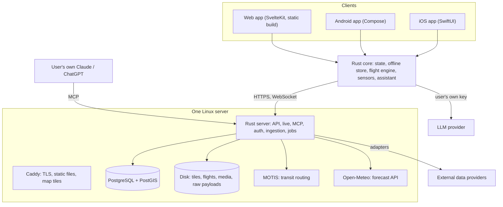

# Architecture

Last revised: 2026-11-18. Facts marked *(to verify)* come from research that could not reach the primary source and must be checked before they are relied on.

## Shape of the system



Three ideas carry the design:

1. **Rust owns everything except pixels and operating-system services.** The same flight engine runs in the phone's recorder, in the browser and on the server.
2. **Nothing outside an adapter knows a provider exists.** External data is normalised into one canonical model before anything else touches it.
3. **One server process, one database, one disk.** Extra services are added only when they are separate upstream projects (transit routing, forecast API).

## Rust workspace

```
crates/
  domain         Canonical types, units, identifiers. No I/O.
  flight         IGC read/write, vario filter, wind estimate, thermal detection,
                 glide and airspace geometry, scoring, task logic. No I/O.
  sensors        Parsers for external instrument protocols. No I/O.
  sources        Adapter traits, manifest types, registry, pipeline.
  sources-*      One crate per provider (sources-dwd, sources-geosphere, ...).
  regions        Loads and validates region packs.
  store          Server persistence (PostgreSQL/PostGIS).
  client-store   Client offline store (SQLite) and sync.
  api-types      Request and response types shared by server and clients.
  tools          Assistant tool definitions: one definition, served in-app and over MCP.
  llm            Provider clients for the in-app assistant.
  core           Client application core: state, events, view models. UniFFI and WASM exports.
  terrain3d      Terrain and flight-replay renderer on wgpu.
  server         The server binary.
apps/
  ios/           SwiftUI shell
  android/       Compose shell
  web/           SvelteKit app
regions/         Region packs (configuration, no code)
deploy/          Compose files, Caddyfile, backup scripts
docs/
```

### Dependency rules

- Dependencies point inward. `domain` depends on nothing in the workspace. `flight`, `sensors` and `sources` depend on `domain`. Everything else may depend on those.
- A `sources-*` crate depends only on `domain` and `sources`. No other crate may name a provider-specific type.
- `flight` and `sensors` do no I/O and read no clock. Time, positions and bytes are passed in, which makes every algorithm replayable from recorded data.
- UI shells contain no business rules. If a shell needs an `if` about flying, the logic belongs in `core`.

CI enforces the first three rules by checking the crate dependency graph.

## Clients

### The bridge

| Target | Mechanism |
|---|---|
| Swift, Kotlin | UniFFI (0.32 at the time of writing) |
| Web | wasm-bindgen |

The core follows the one-way pattern used by Proton Mail, Bitwarden and the Crux framework: the shell sends events in, the core returns a view model, and the shell performs the side effects the core asks for (network, storage, sensors). We adopt the pattern, not the Crux framework, to keep the dependency surface small.

Bridge rules:

- The interface is coarse. A screen gets one view-model struct, not twenty getters.
- Per-frame and audio paths never cross the bridge. The vario tone is synthesised natively from a value the core updates a few times a second. Instruments are drawn natively from a snapshot struct.
- One error type crosses the bridge.

Known friction: Swift 6 strict concurrency still has open UniFFI issues, and there is no first-party generator that covers WASM, so the Swift/Kotlin and web binding surfaces are maintained separately. BoltFFI would unify them but is young. Revisit after the Phase 0 spike.

### iOS (first target)

- SwiftUI, minimum iOS 18.
- Map: MapLibre Native (7.0), wrapping `MLNMapView` directly. The SwiftUI wrapper is pre-1.0 and incomplete.
- Recorder: Core Location with a `CLBackgroundActivitySession` and `CLServiceSession` started in the foreground. Apple's guidance and a 2026 developer-forum thread both point to missing sessions as the cause of suspension about a minute after backgrounding.
- Barometer: `CMAltimeter`. The update rate is undocumented and reported at about 1 Hz, which is too slow for a responsive vario on its own.
- External vario over Core Bluetooth with the `bluetooth-central` background mode and state restoration. This is the primary vario source for the owner's setup.
- Vario audio through the background audio mode. It is real audible content, which is what App Review requires.
- Live Activity for a running flight. The system ends a Live Activity after eight hours, so long flights need a restart strategy.

### Android

- Kotlin and Jetpack Compose, MapLibre Native Android (13.x, Vulkan by default).
- Recorder as a foreground service of type `location`, started while the app is visible. Android 17 adds the same visibility rule for background audio.

### Web

- SvelteKit built to static files and served by Caddy. No Node process on the server.
- MapLibre GL JS 6 for maps. The Rust core runs as WebAssembly for flight analysis and the offline store.
- Pages that must unfurl in chats and be indexed (flights, sites, profiles, events) get their HTML head and a text summary rendered by the Rust server; the web app then takes over. Revisit with a server-rendered SvelteKit build if search indexing proves too thin.

## Maps and terrain

All map data is self-hosted open data, stored as PMTiles files and served as static files with HTTP range requests. The apps download the same files for offline use; MapLibre Native reads them from local storage.

| Layer | Source | Notes |
|---|---|---|
| Elevation | Mapterhorn | Includes Bavarian DGM1 (1 m), Austrian BEV (1 m), swissALTI3D and South Tyrol. Used for hillshade, colour relief, 3D and height-above-ground. |
| Contours | Pre-generated vector tiles from the same elevation data | MapLibre Native has no on-device contour generator, so all platforms use the same pre-built tiles. |
| Vector base map | OpenStreetMap through a custom Planetiler profile | Starts from the OpenMapTiles profile and adds what alpine flying needs: path difficulty (`sac_scale`), material ropeways, power lines, free-flying sites. |
| Style | Our own MapLibre style | One style shared by iOS, Android and web. A high-contrast variant for sunlight in the cockpit. |
| Official maps | basemap.at, Bavarian DTK25 | Switchable raster layers, both CC BY 4.0. |
| Imagery | basemap.at orthophoto, Bavarian DOP20, Sentinel-2 cloudless 2016 elsewhere | For the 3D viewer and an aerial layer. |

### 3D

MapLibre Native has no production 3D terrain. The work exists as a draft pull request with no timeline. MapLibre GL JS on the web does have it.

The 3D viewer is therefore our own renderer: the `terrain3d` crate on wgpu, reading the same elevation and imagery tiles. It draws a quadtree terrain mesh with draped imagery, track ribbons and pilot markers, with a free camera. It embeds in a Metal layer on iOS, a surface view on Android and a canvas on the web (WebGPU, with a WebGL2 fallback because Firefox on Linux and Android still lacks WebGPU by default).

This is the largest single piece of custom engineering in the project. It is confined to replay and route preview; the cockpit and planning maps are 2D with hillshade and contours and do not depend on it. Revisit when MapLibre Native ships terrain pre-releases.

### Live overlays

MapLibre Native slows down with around a thousand symbols that use sort keys and halos. Overlay rules: few symbol layers, no sort keys, feature-state for updates, and a custom layer for objects that move every second (live pilots).

## Server

Everything runs on one Linux server under Docker Compose.

| Process | Role |
|---|---|
| Caddy | TLS, static web app, PMTiles, media files |
| `server` (Rust, Axum) | REST API, live WebSocket, MCP endpoint, authentication, ingestion scheduler, background jobs. One binary; roles can be split later with flags. |
| PostgreSQL + PostGIS | The only database |
| MOTIS | Public-transport routing, self-hosted with open timetable feeds |
| Open-Meteo | Forecast API, self-hosted, syncing open model data |

Deliberate omissions: no Redis (live fan-out is in-process, the job queue is a Postgres table), no object store (blobs live on disk behind a small trait, so an S3-compatible store can replace it), no search engine (Postgres full-text and trigram), no Node runtime, no managed services.

### Storage

- **PostgreSQL:** users, flights, sites, airspace, stations, community data. Observations are partitioned by month.
- **Disk:** IGC files and media under content-hash paths, PMTiles, and a rolling archive of raw provider payloads for replaying adapter bugs.
- **Backups:** nightly encrypted, incremental backups of the database and blobs to storage in a different location. This is the one recurring cost besides the server and it is not optional.

### External dependencies that cannot be self-hosted

| Dependency | Why | Cost |
|---|---|---|
| Apple Push Notification service, Firebase Cloud Messaging | Push notifications | Free |
| An SMTP relay | Sign-in and notification email; self-hosted mail has poor deliverability | Small, or avoided at first with passkeys and Sign in with Apple |
| GitHub Actions | CI, including macOS runners for iOS builds | Free for public repositories |

### API and offline sync

- Static reference data (sites, airspace, obstacles, station metadata) ships as versioned, immutable **region bundles** that clients download and query locally. The map overlays render from the local bundle, so they work without a connection and need no tile server.
- Live data (observations, positions, forecasts) comes from the API with cache validators.
- Flights are recorded locally and uploaded later. Upload is idempotent by content hash.

### Authentication and accounts

Passkeys, email link and Sign in with Apple. The server is also an OAuth 2.1 authorization server, because MCP clients require it (PKCE, client ID metadata documents or dynamic registration).

### Deployment

How deployments reach the server is open until the owner describes it. Options are a pull-based updater on the server or a deploy job with a restricted SSH key. A self-hosted CI runner on a public repository is ruled out because forks could run code on the server.

## Bring your own AI

The project pays for no inference. What the research found:

| Route | Allowed | Who pays | Notes |
|---|---|---|---|
| Sign in with a Claude subscription inside our app | **No** | | Anthropic's terms forbid third parties offering claude.ai login or routing requests through subscription credentials. |
| Our server as an MCP connector in the user's Claude | Yes | The user's Claude plan | Works on every plan including Free (one custom connector). A connector added on the web appears in the mobile apps. Use in voice mode with custom connectors is unproven and must be tested. |
| Our server as a custom MCP server in ChatGPT | Partly | The user's ChatGPT plan | Full custom MCP is documented for Business and Enterprise on the web; consumer plans realistically need a directory listing *(to verify)*. |
| User's own Anthropic API key in our app | Yes | The key owner | Anthropic states developers should use API-key authentication. The key stays in the device keychain and calls go from the device to Anthropic. |
| User's own OpenAI API key in our app | Grey | The key owner | Common practice, no explicit approval found. On-device storage only. |
| OpenRouter account connect (OAuth with PKCE) | Yes | The user's OpenRouter account | Best "connect" experience; needs no app registration. |
| Sign in with ChatGPT for open-source apps | Yes, in preview | The user's ChatGPT plan | Announced autumn 2026. Preview limits include no audio input and a loopback redirect, so the fit for a mobile app is unverified *(to verify)*. |

So the owner's wish is met in two ways:

1. **Connector.** The `tools` crate defines each tool once. The server exposes them over MCP at `/mcp` (Streamable HTTP, OAuth). A pilot adds the connector to their own assistant and asks there. This costs the project nothing and ships as soon as the API exists.
2. **In-app assistant.** The same tools run inside the app against the same API. The tool loop runs on the device in the Rust core, calling the provider directly with the user's credential. The server never sees a key. Providers sit behind one `LlmProvider` trait: Anthropic (Messages API over plain HTTPS, as there is no official Rust SDK), OpenAI, OpenRouter. Speech recognition and speech output use the phone's own engines.

Only the in-app assistant can speak first. An MCP connector can only answer. Proactive in-flight alerts therefore need the in-app route, and anything safety-relevant is deterministic code that works with no assistant at all.

Tool design rules: tools return numbers with their source and timestamp; calculations (glide range, airspace conflicts, itineraries) are done by the flight engine, never by the model; every tool declares whether it is read-only.

## Transit

Google's transit data is good, but its terms rule out the API for this project. The Routes API may not be used with a non-Google map; under the terms that apply to customers billed in the EEA, route steps may not be shown with any map at all; and passing raw results to a language model is not licensed. A plain "open in Google Maps" link is free, needs no key and is allowed.

- **Primary:** self-hosted MOTIS with the open timetable feeds that the community project Transitous uses (Germany-wide DELFI, the Austrian transport associations, Switzerland, South Tyrol and Trentino), plus OpenStreetMap for the walking legs. Results can be drawn on our map and given to the assistant.
- **Bootstrap:** the public Transitous API, which is the same software. It is free for open-source, non-commercial projects, asks for coordination above 720 routing requests a day and for automated use, and requires a link to its sources page.
- **Hand-off:** "open in Google Maps" and "open in Apple Maps" buttons as a cross-check for the pilot.

Realtime coverage is uneven: Germany has it, Tirol and Salzburg do not *(to verify)*. Small alpine bus lines should be tested against known routes before the feature is trusted.

## Quality rules

- **Replay tests.** The flight engine is tested by feeding it recorded flights and sensor logs and comparing against stored results. The cockpit can be run on the ground from a recorded flight.
- **Adapter contract tests.** See [data-sources.md](data-sources.md#testing).
- **CI gates:** formatting, lints, tests, the dependency-graph check, and a licence check on dependencies.
- **Decisions are written down.** A change to anything in the decision log below updates the log in the same commit.

## Decision log

| Date | Decision | Reason | Revisit when |
|---|---|---|---|
| 2026-11-18 | Native UI per platform over a shared Rust core; no cross-platform UI toolkit | Owner decision; performance and feel | Not open |
| 2026-11-18 | UniFFI for Swift/Kotlin, wasm-bindgen for web | Most widely deployed; used by Mozilla, Bitwarden, Element | After the Phase 0 bridge spike, or if BoltFFI matures |
| 2026-11-18 | MapLibre Native and MapLibre GL JS for 2D maps | Open, one style on all platforms, local PMTiles, hillshade and colour relief built in | Not expected |
| 2026-11-18 | Own wgpu renderer for 3D | MapLibre Native has no 3D terrain; no web views allowed | MapLibre Native terrain pre-releases appear |
| 2026-11-18 | Pre-generated contour tiles on all platforms | No native contour generator | A native equivalent appears |
| 2026-11-18 | One server, PostgreSQL + PostGIS, disk storage, Docker Compose | Owner decision; cost | Load that one server cannot carry |
| 2026-11-18 | Static web build, no Node on the server | Fewer processes to run | Search indexing proves too thin |
| 2026-11-18 | Self-hosted MOTIS for transit; Google by link only | Google's terms forbid the API with our map and with an assistant | Not expected |
| 2026-11-18 | Self-hosted Open-Meteo for forecasts first, own model pipeline later | It already handles DWD's new native-grid feed; no usage limits when self-hosted | Soaring fields it lacks (boundary-layer height, model levels) are needed |
| 2026-11-18 | Users bring their own AI; MCP connector plus in-app assistant on user credentials | Owner decision; Claude subscription login in third-party apps is prohibited | Provider policies change |
| Open | Code licence | Recommendation: AGPL-3.0-or-later with an explicit permission for app-store distribution. It keeps forks open and allows reuse of GPL flight software such as XCSoar. A permissive licence would allow closed commercial forks. | Owner decides |
| Open | Deployment path to the server | Depends on the owner's server setup | Owner describes the server |
